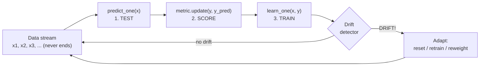
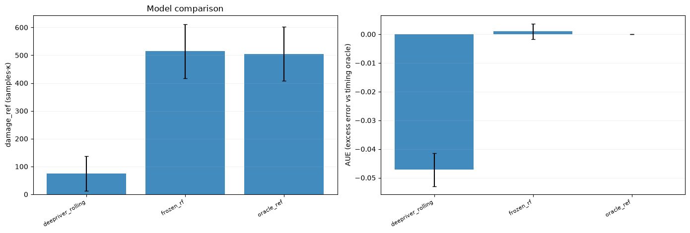
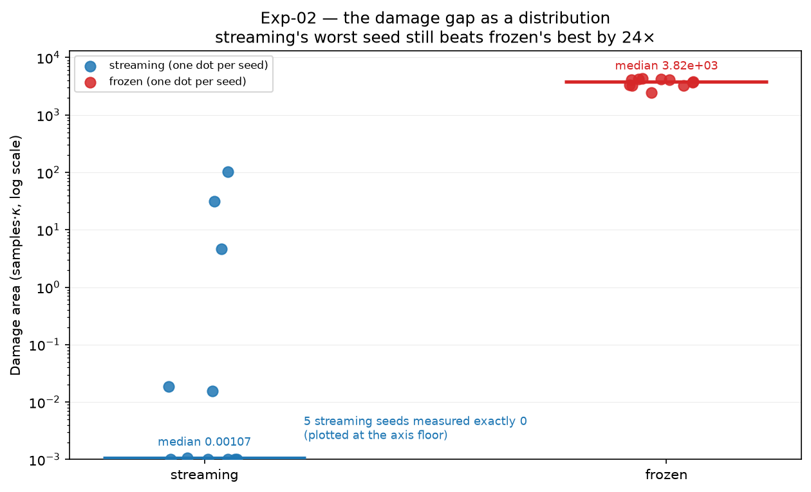
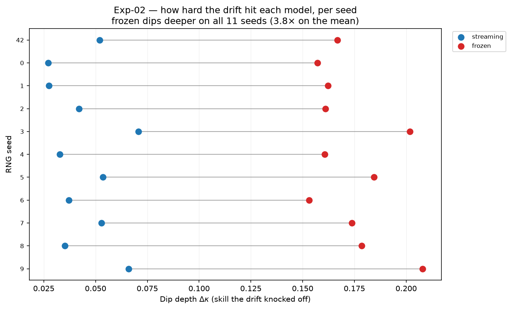
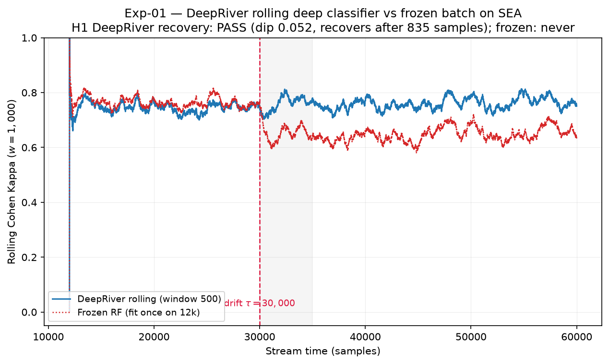
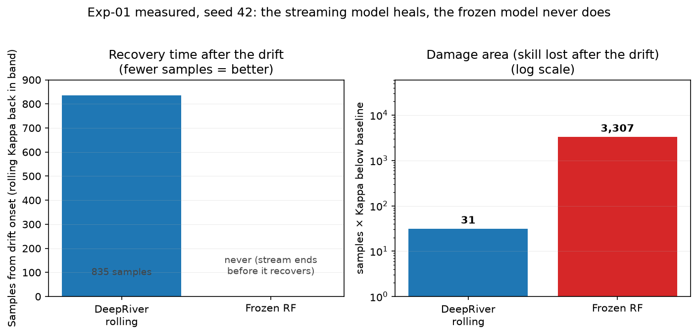

# Streaming Machine Learning — the Delay Tax

**Models that never stop learning, on data that never stops changing — and the
price of learning from yesterday's truth.**

A research project (major-project / final-year scale) on **machine learning from
data streams**: models that learn one sample at a time, forever, in bounded memory,
and that can tell when the world has quietly changed under them — **concept
drift**. Built on the [River](https://riverml.xyz/) framework, with PyTorch deep
learners (DeepRiver) as the experimental subject.

| Status | |
|---|---|
| Phase 0 — research & literature | ✅ complete |
| Phase 1 — experimentation | 🔬 concluded: single-seed pilot, 11-seed sweep, **E01 corrected metric**, **E03 baseline ladder**, **E04 detector map**, **E14 real-stream model check**, **E17 real-stream detector check**, **KDD'26 six-detector reproduction**; **DF-H pilots E18/E19 both failed their gates**; E20 not run; **E21 fixed-delay headline: Stage 1 70–513 vs error-only 2,120–3,269 at L=2k**; **E22: DF-H 3rd, beats ADWIN/HDDM-A/HDDM-W/PageHinkley** |

---

## The vision

Almost all machine learning you were taught treats the dataset as a *finished
object*: it sits on disk, you split it, you fit a model, you are done. Streaming
machine learning drops that assumption. Data arrives one sample at a time,
potentially forever, and is too large — or too fast — to store. The model is never
"finished"; it is permanently mid-training:

Each sample is used **for testing before it is used for training** — that is what
makes the score honest — and the world generating the data keeps changing, so the
model must also *notice when it becomes wrong* and adapt.

The project's own angle is the **Delay Tax**: in production, the label for today's
decision often arrives hours or days late. A model is then being judged — and
updated — on yesterday's truth, and every adaptive trick we know is weakened by
that lag. The full idea is in the
[synopsis](docs/Phase0:Research/idea/synopsis.md); the underlying problem
(types of drift, why detection is hard) in the
[concept-drift note](docs/Phase0:Research/notes/02-concept-drift.md).

---

## The core argument

On a drifting stream, **every model is equally good before the change — the
difference is what happens after**:

- **A frozen batch model** (trained once, deployed, never updated) has no mechanism
  that reacts to data. After a drift it stays wrong until an *external* decision to
  retrain. Its recovery time is undefined.
- **A scheduled-retrain model** watches its clock, not the data. It recovers only at
  the next retrain tick — on average it stays wrong for half a retrain interval too
  long, by pure luck of phase.
- **A streaming model** watches the error stream itself. It detects the change,
  adapts immediately, and its performance returns to baseline within a bounded,
  data-driven number of samples.

The cost of a drift is the *area of skill lost* while a model is wrong — and it is
exactly that damage area, not global accuracy, where streaming wins structurally.
Schematic of the three behaviours (illustrative, pre-registered):

The full mechanism and the metric family are argued in the
[thesis](docs/Phase1:Experimentation/thesis.md), and priced against the
literature in the [metrics dossier](docs/Phase1:Experimentation/streaming-vs-batch-metrics.md)
(including the honest counter-evidence: a *tuned, frequently retrained* batch model
can beat streaming under delayed labels and rare classes — which is exactly why the
Delay Tax is the open problem).

---

## First evidence: the pilot, then the sweep

Exp-01 put the weakest form of the claim on the bench: one synthetic drifting
stream, one abrupt change, a **DeepRiver rolling deep classifier** vs a **frozen
RandomForest**. On seed 42 the streaming model dipped briefly and was back inside
its pre-drift band **835 samples** after the drift, while the frozen model fell from
≈ 0.75 to ≈ 0.59 Kappa — **and never came back**.

Exp-02 then asked the obvious question — was 835 a fluke of that one seed? — by
rerunning the identical experiment on **11 seeds**. The frozen model recovered on
**none of the eleven**. The original damage-area metric reported **294×**, but E01
showed that was an **upper bound**: the integral was truncated on seeds where the
recovery rule collapsed. The corrected metric uses a fixed 5,000-sample window and
a shared reference level: **74.8 ± 61.8** vs **515.0 ± 97.1** samples·κ — a
**≈ 6.9×** gap (**≈ 10.8×** over the rest of the stream). On the clean panel the
worst streaming seed (217.9) is **0.74×** the best frozen seed (295.2), so the old
**24×** worst-case claim is retired too. Recovery is **8/11** seeds with a real
excursion (285–4,279 samples); the old 835 was seed luck. The claim generalised;
the magnitude did not — which is the honest version of the result.

*E01 (11 seeds, corrected metric): `damage_ref` is the primary damage number; AUE
is secondary because the timing oracle knows when the drift happened but not what
the new concept is.*

The baseline ladder (E03, 11 seeds, 220 runs) then priced the honest industrial
alternative: **every streaming adapter paid less damage than frozen and than
every scheduled-retrain interval** — Leveraging Bagging **455.7**, HAT **489.2**,
ARF **575.4** vs the best schedule (1k) **733.5** and frozen **871.7**. The
scheduled models recover by construction at each tick, so `damage_ref` is the
comparison. The phase-noise test is inconclusive: the 12k refit buffer is longer
than the 1k/5k clocks, so only the 20k cell is valid (and has one observation).

The detector map (E04, 5-seed first pass) then asked which early-warning signal
catches which kind of change. Across four synthetic generators, four drift shapes,
two hosts and eight detectors, **HDDM-A on the raw mistake stream is the best
default on the static host**; recurring drift is the hard case (balanced score
0.50) and incremental is the easiest (0.88). The real-stream check (E17, Elec2,
five seeds) repeats that four-shape win on the static host
(0.93/0.96/0.96/0.79), but on the adaptive HAT host **ADWIN wins abrupt (1.00 vs
0.40) and recurring (0.77 vs 0.59)**; the best-host mean is ADWIN 0.935 vs
HDDM-A 0.910. The default is therefore **host-conditional**, not universal.
Smoothing the mistake signal raises false alarms without improving the ranking.
The 7-dataset KDD'26 reproduction is no longer hypothetical: a 50-trial,
six-detector run ranks **SEED/STEPD at 2.12** and **HDDM-A at 3.87**,
reproducing the paper's tables. The ABCD/ABCD(X) arm is cited from the paper
rather than re-run; the full 11-seed matrix and detector tuning are still next.

Honest caveat: the main recovery experiments use one deliberately simple synthetic
stream family; the detector check adds one real dataset (E17) but still has no
scheduled-retrain baseline and no label delay — existence evidence and a first map,
not yet a field-wide claim. Real datasets beyond E17, the full baseline ladder and
the Delay Tax are the next step (below).

---

## Where this is going

**Pilot reality check (2026-11-14).** The signal gate and the DF-H v1 pilot are
done and both are negative: the best deep signal reached AUC **0.616** against
the error-rate **0.598**, and the DF-H fusion ranked **3rd** (7.09) behind STEPD
(5.22) and SEED (5.44), failing the top-2 gate. The feature monitor still detects
feature drift 2–5× earlier at a controlled false-alarm rate, and the ablation
variants own feature cells, but the full E20 matrix is not justified. **E21 now
supplies the surviving result:** at `L = 2,000`, the label-free Stage 1 warns in
**70–513** samples while SEED/STEPD take **2,120–2,710** and ADWIN
**2,472–3,269**. The warning is not floor-bound; the detector is a supporting
warning/confirmation result. **E22** gives the direct capability proof on the
data we have: DF-H is **3rd overall (7.34)**, ahead of HDDM-W (7.47), ADWIN
(9.94), HDDM-A (11.34) and PageHinkley (12.53); only SEED/STEPD are ahead. It
owns feature permutation against that panel, with a 0.04 FAR.

1. **DF-H — the detector hypothesis.** A two-stage detector that combines a
   label-free feature monitor (deep SSL/embedding signals or a classical KS
   control) with supervised confirmation (SEED/STEPD/ADWIN/HDDM-A). The pilot
   did **not** reach top-2; the feature monitor's value is early warning on
   feature drift, not overall rank.
2. **The signal gate.** Done — **negative**. The deep signals did not beat the
   error rate by the pre-registered margin; the classical feature-KS control is
   competitive and is the honest Stage 1 for any v2.
3. **The Delay Tax benchmark.** The fixed-delay Lemma-1 headline is measured
   ([E21](docs/Reports/E21-delay-detector.md)): at `L = 2,000`, Stage 1 warns in
   70–513 samples vs 2,120–3,269 for the error-only panel. Stochastic, partial,
   selective and batch regimes plus Lemmas 2–3 are scaffolded and remain the
   next extension. This is the novel contribution no published benchmark covers.
4. **The final report.** Re-centred on the measurement lab and the delay-tax
   result, with the detector as a supporting negative/ablation study.

The older breadth-first experiments (E05, E08–E13) are deferred; E15 is replaced
by E21. The full plan is [Roadmap v2](docs/Reports/Roadmap-v2.md).

---

## Explore the vault

Everything lives in `docs/`, organised in two phases:

| | What you'll find |
|---|---|
| **Phase 0 — Research** | [Background notes](docs/Phase0:Research/notes/01-streaming-learning.md) (read in order), [literature review](docs/Phase0:Research/literature_review/index.md) with per-paper notes, and the [idea & scope](docs/Phase0:Research/idea/synopsis.md) |
| **Phase 1 — Experimentation** | The [thesis](docs/Phase1:Experimentation/thesis.md) (the argument), [Exp-01 write-up](docs/Phase1:Experimentation/exp01-deepriver-vs-frozen-sea.md) (the pilot), [Exp-02 write-up](docs/Phase1:Experimentation/exp02-seed-sweep-sea.md) (the 11-seed sweep), and the [Ch1 protocol](docs/Phase1:Experimentation/streaming-vs-batch-metrics.md) |
| **Results** | The [global results page](docs/Reports/Results.md) — the consolidated bottom line across every concluded experiment, with the [milestone reports](docs/Reports/Sept9.md) behind it |

Code lives in `experiments/` (one folder per experiment + a `scripts/` and
`figures/` home for runners and chart generators); data artifacts (`results.json`)
and figures are checked into the repo, so every claim in the docs traces to a
number in a file. The documentation site (mkdocs) mirrors this content at
[docs/index.md](docs/index.md).
