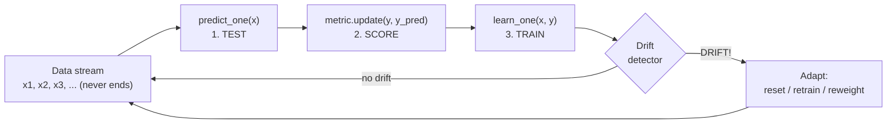
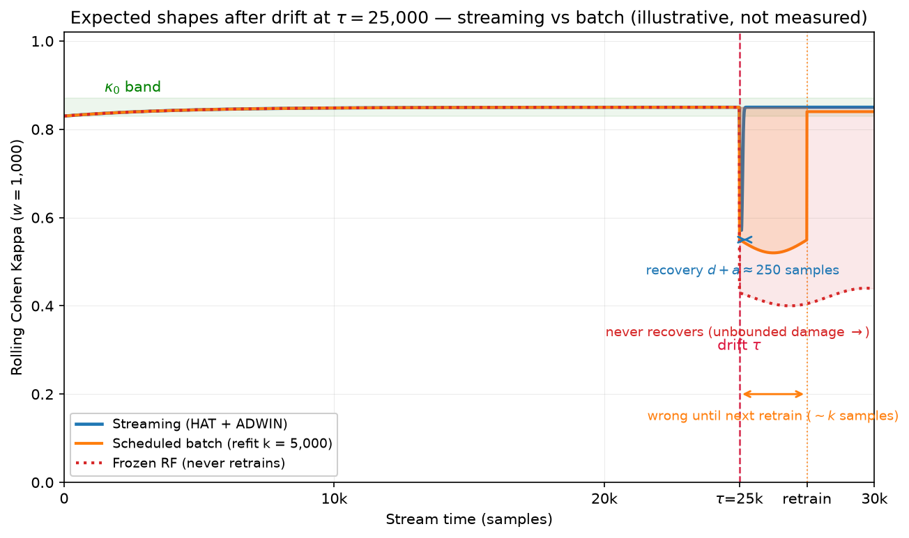
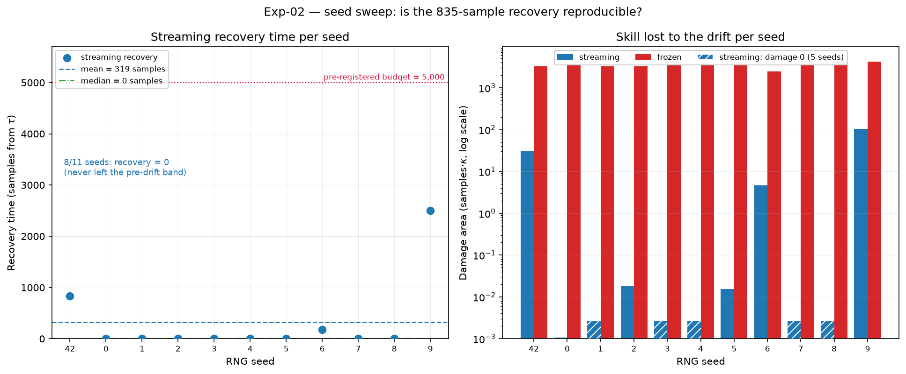

# Streaming Machine Learning — the Delay Tax

**Models that never stop learning, on data that never stops changing — and the
price of learning from yesterday's truth.**

A research project (major-project / final-year scale) on **machine learning from
data streams**: models that learn one sample at a time, forever, in bounded memory,
and that can tell when the world has quietly changed under them — **concept
drift**. Built on the [River](https://riverml.xyz/) framework, with PyTorch deep
learners (DeepRiver) as the experimental subject.

| Status | |
|---|---|
| Phase 0 — research & literature | ✅ complete |
| Phase 1 — experimentation | 🔬 three concluded: single-seed pilot, 11-seed sweep, **E01 corrected metric**; **E04 detector map first pass**; baseline ladder and Delay Tax next |

---

## The vision

Almost all machine learning you were taught treats the dataset as a *finished
object*: it sits on disk, you split it, you fit a model, you are done. Streaming
machine learning drops that assumption. Data arrives one sample at a time,
potentially forever, and is too large — or too fast — to store. The model is never
"finished"; it is permanently mid-training:

Each sample is used **for testing before it is used for training** — that is what
makes the score honest — and the world generating the data keeps changing, so the
model must also *notice when it becomes wrong* and adapt.

The project's own angle is the **Delay Tax**: in production, the label for today's
decision often arrives hours or days late. A model is then being judged — and
updated — on yesterday's truth, and every adaptive trick we know is weakened by
that lag. The full idea is in the
[synopsis](docs/Phase0:Research/idea/synopsis.md); the underlying problem
(types of drift, why detection is hard) in the
[concept-drift note](docs/Phase0:Research/notes/02-concept-drift.md).

---

## The core argument

On a drifting stream, **every model is equally good before the change — the
difference is what happens after**:

- **A frozen batch model** (trained once, deployed, never updated) has no mechanism
  that reacts to data. After a drift it stays wrong until an *external* decision to
  retrain. Its recovery time is undefined.
- **A scheduled-retrain model** watches its clock, not the data. It recovers only at
  the next retrain tick — on average it stays wrong for half a retrain interval too
  long, by pure luck of phase.
- **A streaming model** watches the error stream itself. It detects the change,
  adapts immediately, and its performance returns to baseline within a bounded,
  data-driven number of samples.

The cost of a drift is the *area of skill lost* while a model is wrong — and it is
exactly that damage area, not global accuracy, where streaming wins structurally.
Schematic of the three behaviours (illustrative, pre-registered):

The full mechanism and the metric family are argued in the
[thesis](docs/Phase1:Experimentation/thesis.md), and priced against the
literature in the [metrics dossier](docs/Phase1:Experimentation/streaming-vs-batch-metrics.md)
(including the honest counter-evidence: a *tuned, frequently retrained* batch model
can beat streaming under delayed labels and rare classes — which is exactly why the
Delay Tax is the open problem).

---

## First evidence: the pilot, then the sweep

Exp-01 put the weakest form of the claim on the bench: one synthetic drifting
stream, one abrupt change, a **DeepRiver rolling deep classifier** vs a **frozen
RandomForest**. On seed 42 the streaming model dipped briefly and was back inside
its pre-drift band **835 samples** after the drift, while the frozen model fell from
≈ 0.75 to ≈ 0.59 Kappa — **and never came back**.

Exp-02 then asked the obvious question — was 835 a fluke of that one seed? — by
rerunning the identical experiment on **11 seeds**. The frozen model recovered on
**none of the eleven**. The original damage-area metric reported **294×**, but E01
showed that was an **upper bound**: the integral was truncated on seeds where the
recovery rule collapsed. The corrected metric uses a fixed 5,000-sample window and
a shared reference level: **70.6 ± 66.5** vs **504.4 ± 104.1** samples·κ — a
**≈ 7.1×** gap (**≈ 11.6×** over the rest of the stream). The worst streaming seed
beats the best frozen seed by only **1.27×**, so the old **24×** worst-case claim
is retired too. Recovery is **7/11** seeds with a real excursion (177–4,462
samples); the old 835 was seed luck. The claim generalised; the magnitude did not
— which is the honest version of the result.

*E01 (11 seeds, corrected metric): `damage_ref` is the primary damage number; AUE
is secondary because the timing oracle knows when the drift happened but not what
the new concept is.*

The detector map (E04, 5-seed first pass) then asked which early-warning signal
catches which kind of change. Across four generators, four drift shapes, two hosts
and eight detectors, **HDDM-A on the raw mistake stream is the best default for all
four shapes**; recurring drift is the hard case (balanced score 0.50) and
incremental is the easiest (0.88). Smoothing the mistake signal raises false alarms
without improving the ranking. The full 11-seed matrix and detector tuning are next.

Honest caveat: these experiments use one deliberately simple synthetic stream family,
two-to-eight models, no scheduled-retrain baseline and no label delay — existence
evidence and a first map, not yet a field-wide claim. Real datasets, the full baseline
ladder and the Delay Tax are the next step (below).

---

## Where this is going

1. **Real drifting datasets** — Elec2, Phishing, Forest Covertype, Airlines,
   CreditCard fraud — where drift has no ground-truth timestamp and the win must be
   shown on post-dip behaviour instead.
2. **The full baseline ladder** — frozen, scheduled-retrain, and oracle-tuned batch,
   reported side by side so no one can accuse us of picking an easy opponent.
3. **Real statistics** — ✅ the ≥10-seed requirement is met (Exp-02 ran 11 seeds on
   one stream); what remains is Friedman + Nemenyi *across datasets and learners*,
   with honest effect sizes, to turn the seed sweep into cross-dataset significance.
4. **The Delay Tax itself** — label-delay sweeps (the STUDD-style experiment), where
   batch retraining starves and streaming must keep working on yesterday's labels.

---

## Explore the vault

Everything lives in `docs/`, organised in two phases:

| | What you'll find |
|---|---|
| **Phase 0 — Research** | [Background notes](docs/Phase0:Research/notes/01-streaming-learning.md) (read in order), [literature review](docs/Phase0:Research/literature_review/index.md) with per-paper notes, and the [idea & scope](docs/Phase0:Research/idea/synopsis.md) |
| **Phase 1 — Experimentation** | The [thesis](docs/Phase1:Experimentation/thesis.md) (the argument), [Exp-01 write-up](docs/Phase1:Experimentation/exp01-deepriver-vs-frozen-sea.md) (the pilot), [Exp-02 write-up](docs/Phase1:Experimentation/exp02-seed-sweep-sea.md) (the 11-seed sweep), and the [Ch1 protocol](docs/Phase1:Experimentation/streaming-vs-batch-metrics.md) |
| **Results** | The [global results page](docs/Reports/Results.md) — the consolidated bottom line across every concluded experiment, with the [milestone reports](docs/Reports/Sept9.md) behind it |

Code lives in `experiments/` (one folder per experiment + a `scripts/` and
`figures/` home for runners and chart generators); data artifacts (`results.json`)
and figures are checked into the repo, so every claim in the docs traces to a
number in a file. The documentation site (mkdocs) mirrors this content at
[docs/index.md](docs/index.md).
