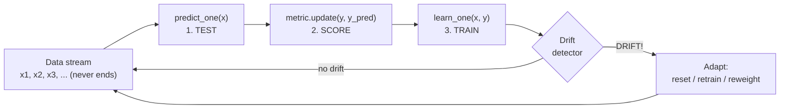

# Streaming Machine Learning — the Delay Tax

**Models that never stop learning, on data that never stops changing — and the
price of learning from yesterday's truth.**

A research project (major-project / final-year scale) on **machine learning from
data streams**: models that learn one sample at a time, forever, in bounded memory,
and that can tell when the world has quietly changed under them — **concept
drift**. Built on the [River](https://riverml.xyz/) framework, with PyTorch deep
learners (DeepRiver) as the experimental subject.

| Status | |
|---|---|
| Phase 0 — research & literature | ✅ complete |
| Phase 1 — experimentation | 🔬 first pilot run, results below |

---

## The vision

Almost all machine learning you were taught treats the dataset as a *finished
object*: it sits on disk, you split it, you fit a model, you are done. Streaming
machine learning drops that assumption. Data arrives one sample at a time,
potentially forever, and is too large — or too fast — to store. The model is never
"finished"; it is permanently mid-training:

Each sample is used **for testing before it is used for training** — that is what
makes the score honest — and the world generating the data keeps changing, so the
model must also *notice when it becomes wrong* and adapt.

The project's own angle is the **Delay Tax**: in production, the label for today's
decision often arrives hours or days late. A model is then being judged — and
updated — on yesterday's truth, and every adaptive trick we know is weakened by
that lag. The full idea is in the
[synopsis](docs/Phase0:Research/idea/synopsis.md); the underlying problem
(types of drift, why detection is hard) in the
[concept-drift note](docs/Phase0:Research/notes/02-concept-drift.md).

---

## The core argument

On a drifting stream, **every model is equally good before the change — the
difference is what happens after**:

- **A frozen batch model** (trained once, deployed, never updated) has no mechanism
  that reacts to data. After a drift it stays wrong until an *external* decision to
  retrain. Its recovery time is undefined.
- **A scheduled-retrain model** watches its clock, not the data. It recovers only at
  the next retrain tick — on average it stays wrong for half a retrain interval too
  long, by pure luck of phase.
- **A streaming model** watches the error stream itself. It detects the change,
  adapts immediately, and its performance returns to baseline within a bounded,
  data-driven number of samples.

The cost of a drift is the *area of skill lost* while a model is wrong — and it is
exactly that damage area, not global accuracy, where streaming wins structurally.
Schematic of the three behaviours (illustrative, pre-registered):

The full mechanism and the metric family are argued in the
[thesis](docs/Phase1:Experimentation/thesis.md), and priced against the
literature in the [metrics dossier](docs/Phase1:Experimentation/streaming-vs-batch-metrics.md)
(including the honest counter-evidence: a *tuned, frequently retrained* batch model
can beat streaming under delayed labels and rare classes — which is exactly why the
Delay Tax is the open problem).

---

## First evidence: the pilot run

Exp-01 (the first atomic experiment) put the weakest form of the claim on the bench:
one synthetic drifting stream, one abrupt change, a **DeepRiver rolling deep
classifier** vs a **frozen RandomForest**. Measured (seed 42, 60,000 samples —
details in the [write-up](docs/Phase1:Experimentation/exp01-deepriver-vs-frozen-sea.md)):

- Both models were equally skilled before the drift (rolling Kappa ≈ 0.75).
- When the stream changed, the frozen model's skill fell to ≈ 0.59 — **and never
  came back** before the stream ended.
- DeepRiver dipped briefly, then **recovered to its pre-drift band 835 samples
  after the drift**.

The money metric — damage area, the skill lost while a model is wrong — differed by
two orders of magnitude:

Honest caveat: this is a single seed and a deliberately simple stream — existence
evidence, not statistics. The multi-seed sweep, real datasets and scheduled-retrain
baselines are the next step (below).

---

## Where this is going

1. **Real drifting datasets** — Elec2, Phishing, Forest Covertype, Airlines,
   CreditCard fraud — where drift has no ground-truth timestamp and the win must be
   shown on post-dip behaviour instead.
2. **The full baseline ladder** — frozen, scheduled-retrain, and oracle-tuned batch,
   reported side by side so no one can accuse us of picking an easy opponent.
3. **Real statistics** — ≥10 seeds, Friedman + Nemenyi across datasets, honest
   effect sizes; the pilot's single-run curves become confidence bands.
4. **The Delay Tax itself** — label-delay sweeps (the STUDD-style experiment), where
   batch retraining starves and streaming must keep working on yesterday's labels.

---

## Explore the vault

Everything lives in `docs/`, organised in two phases:

| | What you'll find |
|---|---|
| **Phase 0 — Research** | [Background notes](docs/Phase0:Research/notes/01-streaming-learning.md) (read in order), [literature review](docs/Phase0:Research/literature_review/index.md) with per-paper notes, and the [idea & scope](docs/Phase0:Research/idea/synopsis.md) |
| **Phase 1 — Experimentation** | The [thesis](docs/Phase1:Experimentation/thesis.md) (the argument), [Exp-01 write-up](docs/Phase1:Experimentation/exp01-deepriver-vs-frozen-sea.md) (the pilot), and the [Ch1 protocol](docs/Phase1:Experimentation/streaming-vs-batch-metrics.md) |

Code lives in `experiments/` (one folder per experiment + a `scripts/` and
`figures/` home for runners and chart generators); data artifacts (`results.json`)
and figures are checked into the repo, so every claim in the docs traces to a
number in a file. The documentation site (mkdocs) mirrors this content at
[docs/index.md](docs/index.md).
