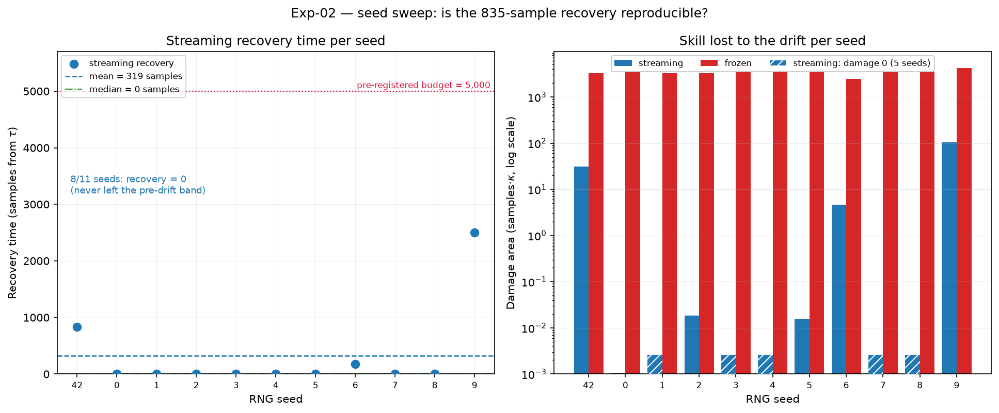
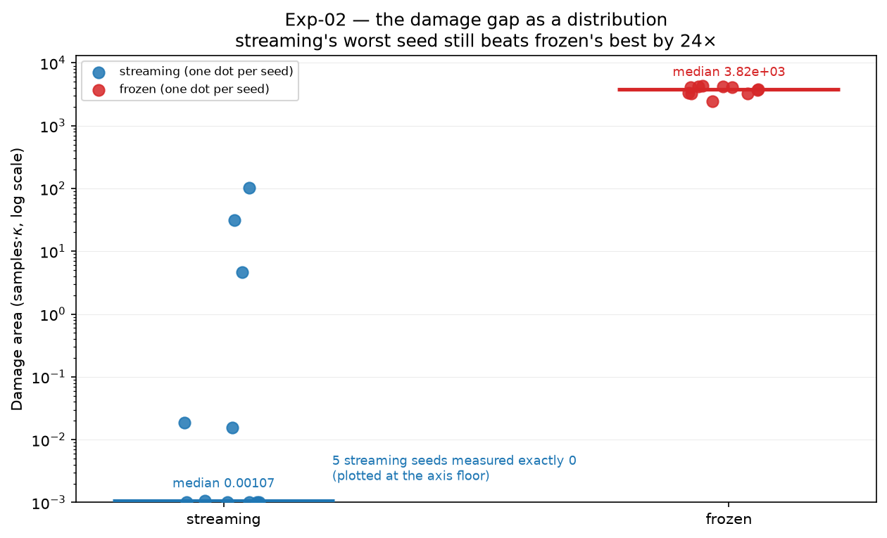
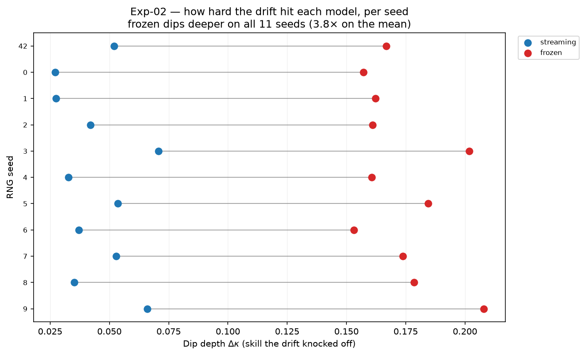
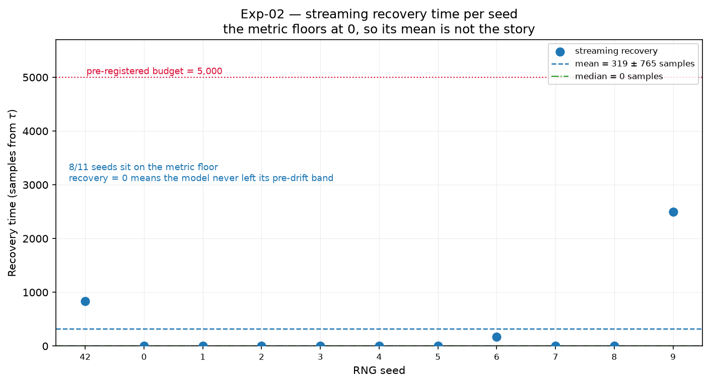
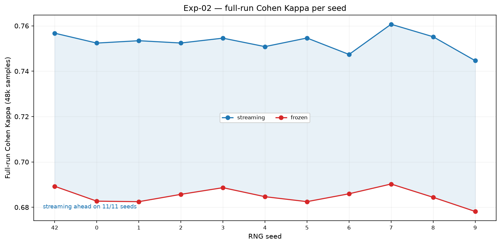
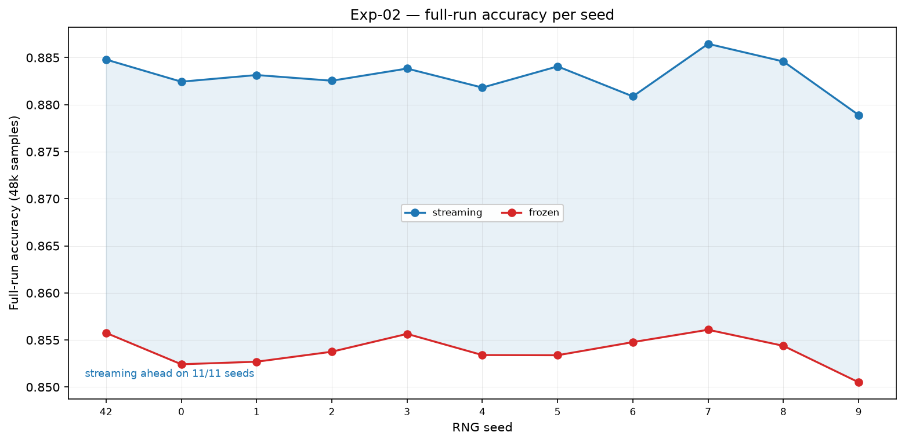
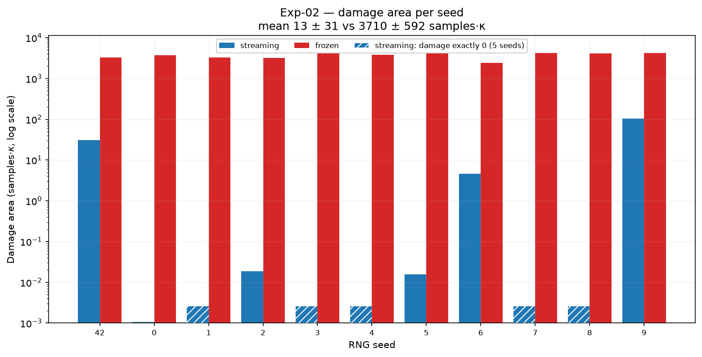
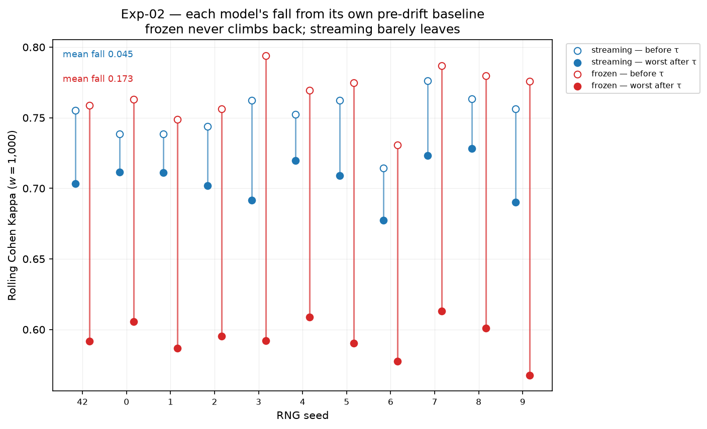
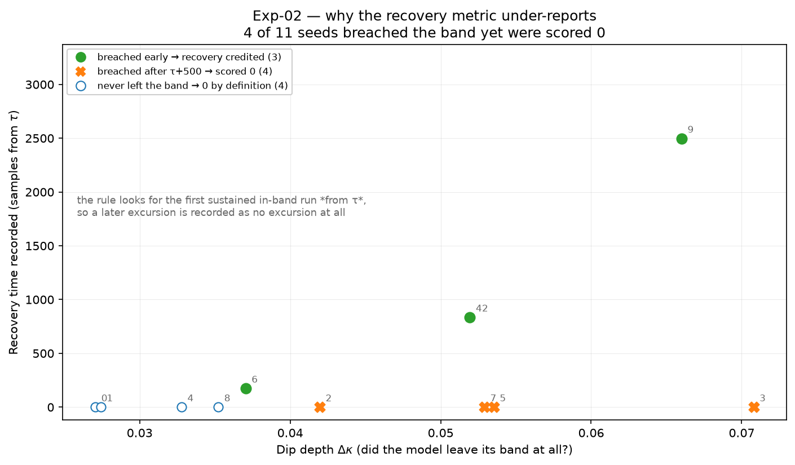

# Exp-02 — seed sweep: is the 835-sample recovery reproducible?

**Series:** Ch1 / thesis pilot ("streaming vs non-streaming on real metrics"), second
atomic experiment — the first *statistical* one.

**Aim → libs → method → calculations → results → conclusions** as in Exp-01. Every
number below is read from `experiments/exp02/results.json`; every figure is re-rendered
from that file.

**Status:** ✅ Run on 2026-09-12 — 11 seeds, RTX 3050 Laptop GPU, 1,127 s total
(≈102 s/seed). Code: `experiments/scripts/exp02_seed_sweep_sea.py`; data artifact:
`experiments/exp02/results.json`; figures: `figures/exp02-*.png` (a nine-figure suite —
one story per figure — embedded through §5–§6).

!!! warning "Metric correction (E01, 2026-11-12)"
    The damage-area numbers on this page use the legacy τ→recovery integral. On
    8/11 seeds recovery collapsed to τ, so the streaming integral was truncated and
    **294×/24× are upper bounds**. The corrected metric gives `damage_ref`
    **74.8 vs 515.0** samples·κ (**≈6.9×**) and `damage_full` **321.4 vs 3,472.9**
    (**≈10.8×**); on the clean panel the worst streaming seed is **0.74×** the best
    frozen seed. The frozen-never-recovers result (0/11) is unchanged. See
    [E01 — Metric v2 correction](../Reports/E01-metric-v2.md).

**Formatting note:** math is written in Unicode (τ, κ₀, Δκ, ≈, ≥) so it renders
identically in Obsidian, GitHub, and the mkdocs site — no LaTeX pipeline required.

---

## 1. Aim

Exp-01 produced one number on one seed: DeepRiver recovered from the drift in
**835 samples**. A synthetic stream is random (feature draws + 10% label noise), so a
single replica cannot distinguish a property of the model from a property of that one
draw — per the project's own rule (thesis F8, Demšar 2006), single runs are noise.

This experiment reruns **exactly the Exp-01 replica** — same stream construction, same
two models, same warm-up, same prequential loop, same metric definitions — and changes
one thing: the RNG seed.

> **Question:** is Exp-01's 835-sample recovery reproducible across seeds, or was it
> an artefact of seed 42?

### Hypotheses (pre-registered)

- **H1 — robustness of recovery:** the streaming model re-enters its pre-drift band
  within the 5,000-sample budget on *every* seed; the frozen model fails to recover on
  *every* seed.
- **H2 — steady state (honest control):** the frozen model's pre-drift baseline is
  at least as good as the streaming model's, i.e. batch wins while the concept is
  stationary (Exp-01's H2, now with `n = 11` to be judged against).
- **Acceptance bar** (fixed in the global results registry before the run): recovery
  time is reported as a **distribution (mean ± SD) over ≥ 10 seeds**, not one number.
- **Falsification:** if streaming recovery is not bounded and inside budget on the
  large majority of seeds, or if the frozen model recovers on any seed, then Exp-01's
  claim is a seed artefact and does not generalise.

---

## 2. Libraries

Identical stack and versions to Exp-01 (deliberately — this is a sweep of one
experiment, not a new one).

| Package | Role | Notes |
|---|---|---|
| `deep-river` 0.3.4 | streaming deep models (`RollingClassifier`) | the subject of the experiment |
| `river` 0.25.0 | metrics (`Accuracy`, `CohenKappa`, `Rolling`), prequential loop | pinned by deep-river (`<0.26`) |
| `torch` 2.5.1 | neural net backend | CUDA build; RTX 3050 (Laptop) |
| `scikit-learn` 1.9.0 | frozen batch baseline (`RandomForestClassifier`) | the opponent |
| `numpy` | stream generation, numerics | |
| `pytest` | not used by us | required at import time by deep-river 0.3.4 (packaging bug) |

Python 3.12, repo-root uv project. Run:
`uv run experiments/scripts/exp02_seed_sweep_sea.py --require-cuda`
(`--figure-only` re-renders the whole suite from the committed artifact without a rerun;
`--figures-dir` overrides where the PNGs land).

---

## 3. Method

### 3a. Stream (SEA, one abrupt drift) — identical to Exp-01, seeded per replica

- One continuous SEA feature draw, x ~ U(0, 10)³, drawn once per seed; only features
  0+1 matter (`x₀ + x₁` vs a threshold); binary labels; `noise = 0.1`; **60,000**
  samples; label rule `x₀ + x₁ > 8` (concept 0) before **τ = 30,000**, then
  `x₀ + x₁ > 9` (concept 1) — an abrupt drift.
- The single-seed memorisation confound fixed in Exp-01 §3a is fixed here too: one
  uninterrupted feature stream, only the label rule switching at τ.
- **Seeds: 42 (Exp-01's, included as a reproducibility cross-check) plus 0–9 — 11
  replicas in total.** Each replica draws its own stream and its own model inits.

### 3b. Models — identical to Exp-01

| Role | Model | Warm-up | Update rule |
|---|---|---|---|
| Streaming | DeepRiver `RollingClassifier` over an **RNN head** (RNN 3 → 16 hidden → Linear → 2; Adam, lr 1e-3, cross-entropy; one optimiser step per sample) | learns from sample 1 | per sample: predict → score → `learn_one` on a **rolling window of 500** |
| Frozen batch | sklearn `RandomForestClassifier(n_estimators=100, random_state=seed)` | fit once on first **12,000 samples (20%)** | **never** updated after warm-up |

Same two documented deep-river 0.3.4 workarounds as Exp-01 (train-mode forced before
`learn_one`; the RNN head rather than a flattened MLP, which `RollingClassifier`'s
feature-incremental handling cannot express).

### 3c. Evaluation protocol

Standard prequential (test-then-train) loop over the post-warm-up region
(t ∈ [12,000, 60,000)) for both models, on identical samples, exactly as Exp-01 §3c
(`predict_one` → `metric.update` → `learn_one`; the frozen model predicts only).
Per-seed metrics recorded as in Exp-01; the rolling-Kappa series is not retained in
this artifact (the experiment's outputs are the drift metrics, and the figure is
re-rendered from them).

**Determinism.** `torch.manual_seed(seed)` and `np.random.seed(seed)` are set per
replica before anything stochastic is built; the frozen RF is seeded with the same
seed. cuDNN RNN backward is not guaranteed bit-deterministic in general, so exact
reproduction is checked, not assumed (§5c).

### 3d. What "recovery = 0" means

Recovery is defined (Exp-01 §4) as the first sample from which rolling Kappa stays
≥ 0.95 · κ₀ for 500 consecutive samples, measured from τ. A seed where the model
**never leaves** its pre-drift band therefore satisfies the rule immediately at τ and
is recorded as **recovery = 0**. This floor is the single most important caveat in the
results below: 0 means *"no excursion to recover from"*, not *"instant recovery"*.

---

## 4. Calculations

Identical definitions to Exp-01 §4 (so the two experiments are comparable
sample-for-sample), plus the distribution statistics this experiment exists to
produce:

- **κ₀** — mean rolling Kappa over the 1,000 samples before τ.
- **Dip depth Δκ** — κ₀ − min rolling Kappa over [τ, τ + 5,000).
- **Recovery time** — smallest r with κ ≥ 0.95 · κ₀ for 500 consecutive samples within
  [τ, τ + 5,000); reported as samples from τ, `null` if the budget expires.
- **Damage area** — Σ max(κ₀ − κ(t), 0) from τ to recovery (to stream end if never),
  in samples·κ.
- **Distribution** — mean, SD, median, min, max over seeds; separate counts of
  `never` (budget expired) and of the metric floor (recovery = 0).

Note on the summary statistic: the recovery distribution is **heavy-tailed and
floored at 0** (8 of 11 seeds fall on the floor), so the mean is not a robust centre —
the median and the counts are reported alongside it. This is flagged rather than
hidden.

---

## 5. Results

Measured 2026-09-12, 11 seeds, full 60k stream. Full per-seed detail:
`experiments/exp02/results.json`.

### 5a. Headline — the distribution Exp-01 could not produce

| Metric (11 seeds) | Streaming (DeepRiver rolling) | Frozen (RF) |
|---|---|---|
| Pre-drift baseline κ₀ | 0.751 ± 0.017 | **0.767 ± 0.018** |
| Minimum rolling Kappa after τ | 0.706 ± 0.015 | 0.594 ± 0.013 |
| Dip depth Δκ | **0.045 ± 0.015** | 0.173 ± 0.018 |
| Recovery time (samples from τ) | **median 0**, mean 319 ± 765 (0 / 174 / 835 / 2,497) | **never, 11/11** |
| Damage area (samples·κ) | **13 ± 31** (median ≈ 0.001, max 103) | 3,710 ± 592 (min 2,439, max 4,368) |
| Full-run accuracy | **0.8830 ± 0.0021** | 0.8539 ± 0.0017 |
| Full-run Cohen Kappa | **0.7530 ± 0.0044** | 0.6850 ± 0.0035 |
| Worst-case / best-case damage | worst streaming 103 | best frozen 2,439 — still **24× larger** |

*Figure 1 — left: recovery time per seed. Eight of eleven seeds sit on the metric floor
(0 = never left the pre-drift band); where an early excursion does occur, recovery is
174 / 835 / 2,497 samples — all inside the pre-registered 5,000 budget. Right: damage
area per seed on a log axis; the 5 seeds with exactly zero measured damage are drawn as
hatched stubs at the axis floor. The damage gap is the stable result; the recovery
number is not.*

*Figure 2 — the same damage numbers as a distribution rather than a per-seed race: one
dot per seed with the median marked. Every frozen seed sits within a factor of two of
every other frozen seed; every streaming seed is two orders of magnitude below them. The
medians (≈ 0.001 vs 3,822 samples·κ) are the honest centre of this comparison.*

*Figure 3 — how hard the drift hit each model, paired by seed. The frozen dip (red) is
deeper than the streaming dip (blue) on **all 11 seeds** — 0.173 against 0.045 on the
mean, ≈ 3.8× — with no seed where the ordering flips.*

### 5b. Per seed

| Seed | Streaming recovery | Streaming Δκ | Streaming damage | Frozen damage |
|---|---|---|---|---|
| 42 (Exp-01) | 835 | 0.052 | 31.2 | 3,307 |
| 0 | 0 | 0.027 | 0.001 | 3,708 |
| 1 | 0 | 0.027 | 0.0 | 3,267 |
| 2 | 0 | 0.042 | 0.019 | 3,224 |
| 3 | 0 | 0.071 | 0.0 | 4,368 |
| 4 | 0 | 0.033 | 0.0 | 3,822 |
| 5 | 0 | 0.054 | 0.016 | 4,151 |
| 6 | 174 | 0.037 | 4.6 | 2,439 |
| 7 | 0 | 0.053 | 0.0 | 4,223 |
| 8 | 0 | 0.035 | 0.0 | 4,121 |
| 9 | 2,497 | 0.066 | 103.1 | 4,180 |

*Figure 4 — the recovery column of the table above, on its own. Eight seeds sit on the
floor; the three that do not (42, 6, 9) recover in 174 / 835 / 2,497 samples. The mean
(319) is dragged up by seed 9 and the SD (765) exceeds it, which is why the median (0)
and this plot are reported alongside the distribution.*

### 5c. Reproducibility cross-check vs Exp-01

Seed 42, re-run through this script, produced **835 samples — exactly Exp-01's
committed value (delta 0)**, with the same κ₀ (0.755), dip depth (0.052) and damage
area (31.2 vs Exp-01's 31.2). The pipeline is therefore reproducible end-to-end on
this machine and configuration: Exp-02 is a genuine sweep of Exp-01, not a different
experiment wearing its name.

### 5d. Acceptance bar

| Pre-registered condition | Required | Measured | Verdict |
|---|---|---|---|
| Seeds | ≥ 10 | 11 | **PASS** |
| Recovery reported as a distribution | mean ± SD | mean 319 ± 765, median 0, range 0–2,497 | **PASS** (with a heavy-tail caveat, §6) |
| Streaming recovers on every seed | every seed | 11/11 (of which 8 never left the band) | **PASS** |
| Frozen never recovers on every seed | every seed | 11/11 | **PASS** |

### 5e. Beyond the drift window — the full run

The streaming model also wins the ordinary, drift-agnostic scoreboard on every seed.
The thesis does not require this (and pre-registered the opposite as an honest control),
so it is reported as a bonus rather than a claim:

*Figure 5 — full-run Cohen Kappa, one point per seed. Streaming is above frozen on all
11 seeds; the shaded band is the gap. 0.7530 ± 0.0044 against 0.6850 ± 0.0035.*

*Figure 6 — the same picture for accuracy: 0.8830 ± 0.0021 against 0.8539 ± 0.0017,
streaming ahead on all 11 seeds.*

---

## 6. Conclusions

### 6a. The claim generalises; the number does not

Exp-01's **835** was a property of seed 42, not of the method. Across 11 seeds the
recovery time is 0 on eight seeds and 174 / 835 / 2,497 on the other three — a
heavy-tailed spread whose mean (319) and SD (765) are not a useful summary on their
own.

What *is* stable, and therefore what Exp-01's claim actually rests on:

- **The frozen model never recovers — 11/11 seeds, no exceptions.** This is the
  thesis's structural prediction and it has no counterexample in the sweep.
- **The damage gap is large and stable.** Streaming pays 13 ± 31 samples·κ against
  3,710 ± 592 — about **294× smaller on the mean**, and even the *worst* streaming
  seed (103) is **24× smaller than the best frozen seed** (2,439). The comparison does
  not depend on picking a favourable seed.
- **The streaming dip is consistently shallow.** Δκ = 0.045 ± 0.015 versus
  0.173 ± 0.018 for the frozen model — the frozen model's dip is ~3.8× deeper on every
  seed, and its rolling Kappa bottoms out near 0.59 while streaming stays near 0.71.
- **The streaming model also wins the full run:** 0.883 accuracy / 0.753 Kappa versus
  0.854 / 0.685 (§5e).

*Figure 7 — the damage column of Figure 1 on its own, so the gap is readable without a
squint: frozen bars sit in a narrow 2,439–4,368 band, streaming bars in 0–103.*

*Figure 8 — each model's own baseline (hollow marker) and its worst rolling Kappa after
τ (filled marker), paired by seed. The frozen model starts slightly higher than
streaming and falls 0.173 on average; the streaming model falls 0.045 and stays close to
its own band, which is why so many of its "recovery times" are 0.*

### 6b. H2 is now (mildly) supported, unlike in Exp-01

Exp-01's single seed showed the two models essentially level before the drift
(κ₀ 0.755 vs 0.759) and recorded H2 — "batch wins steady state" — as refuted. Over 11
seeds the frozen model *does* start ahead: **κ₀ = 0.767 ± 0.018 versus
0.751 ± 0.017**. So the honest control half of the pre-registration holds after all:
a frozen batch model is slightly better while the concept is stationary, and it still
loses the full run because it collapses permanently at τ. The refined statement is
that streaming pays a small steady-state tax and more than earns it back on drift.

### 6c. A real methodological finding: the recovery metric under-reports late dips

Comparing dip depth against recovery time exposes a flaw in the metric as defined:

| | Dip depth | Recovery recorded |
|---|---|---|
| Seeds that breached the band **early** (42, 6, 9) | 0.052 / 0.037 / 0.066 | 835 / 174 / 2,497 |
| Seeds that breached the band **later than τ+500** (2, 3, 5, 7) | 0.042 / 0.071 / 0.054 / 0.053 | **0** — scored as "never left the band" |
| Seeds that never breached (0, 1, 4, 8) | ≤ 0.035 | 0 |

Seven of eleven seeds did leave the pre-drift band at some point after τ, but only
three are credited with a recovery time, because the rule looks for the first
sustained in-band run *starting at τ*: a model that stays in band for the first 500
samples and dips afterwards is scored 0. Recovery time is therefore **not monotone in
dip depth** (seed 3 has a deeper dip than seed 9 yet scores 0), and it silently
conflates "never dipped" with "dipped late and healed".

The practical consequence for the project: **damage area and dip depth are the
trustworthy drift-window metrics; recovery time is only meaningful conditional on an
early excursion.** A future revision should measure recovery from the first
band-exit rather than from τ. This is recorded rather than patched, because changing
the definition now would break comparability with Exp-01's committed numbers.

*Figure 9 — the flaw in one picture. Each seed is placed by how deep its dip was and what
recovery time was recorded. Green = an early excursion whose recovery is credited;
orange X = a seed that **did** leave its band but was scored 0 because the excursion
began after τ + 500; hollow blue = genuinely never left the band. Four of the eleven
seeds are orange, which is why the mean recovery time is not a property of the model.*

### 6d. Caveats, recorded honestly

- One stream family (SEA), one drift type (abrupt), one drift position (τ at 50%),
  two models — no scheduled-retrain baseline, no drift detector, no label delay. Each
  of those is a separate experiment (§7).
- Cost is real and unchanged from Exp-01: ~102 s per seed, 454–490 samples/s on the
  RTX 3050, peak process RSS 1,108 MB. The sweep is GPU-bound in practice; the
  per-sample windowed refit is the slow path.
- cuDNN RNN backward is not bit-deterministic in general; the seed-42 cross-check
  matched exactly here (§5c), but that is an observed result, not a guarantee.
- Script fix along the way: the `--limit` dev slice originally pinned τ to the end of
  the slice, leaving no post-drift region (every metric `n/a`). It now scales the full
  run's geometry (τ at 50%, warm-up at 20%) so a smoke test actually measures a drift.

---

## 7. Cross-references

- Thesis + expected-result sketches: [`thesis.md`](thesis.md) (§6b, §6f falsifiers, F8 statistics).
- Exp-01 (the single-seed pilot this experiment sweeps): [`exp01-deepriver-vs-frozen-sea.md`](exp01-deepriver-vs-frozen-sea.md).
- Ch1 protocol (models/datasets/statistics): [`streaming-vs-batch-metrics.md`](streaming-vs-batch-metrics.md) §5.
- Global verdict registry: [`../Reports/Results.md`](../Reports/Results.md).
- Data artifact: `experiments/exp02/results.json` · code: `experiments/scripts/exp02_seed_sweep_sea.py`.

**Next, in order:** Exp-03 baseline ladder (scheduled-retrain + oracle-tuned batch) ·
Exp-04 real streams (Elec2, Phishing, Covertype, Airlines, CreditCard) · Exp-05 the
Delay Tax (label-delay sweep) · and the recovery-metric revision in §6c.
