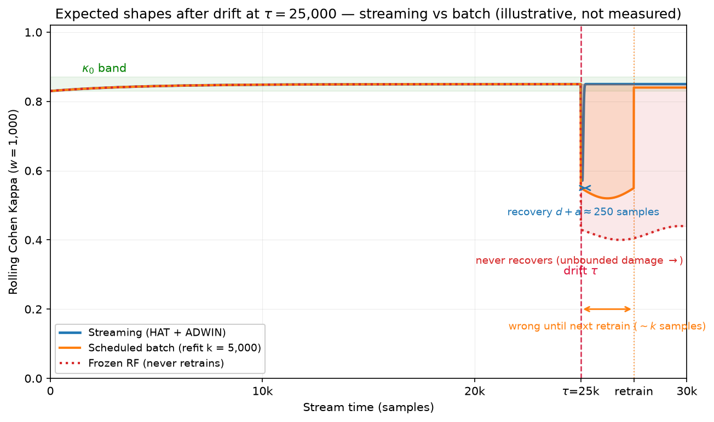

# Thesis — How streaming models beat batch models, and on what

**Purpose:** The argument behind the teacher's plan — *"take some models that are not
streaming and beat them on real metrics."* This page states the idea, the established
facts it rests on (with sources), the expected course of an experiment, and the
results we expect to see. Everything marked **illustrative** is a pre-registered
expectation, to be replaced by measured numbers from the Ch1 run.

**Status:** Thesis expanded (idea → facts → expected events → expected results).
Derivations and estimator definitions to follow in `calculation.md`.

**Formatting note:** math is written in Unicode (τ, κ₀, Δκ, ≈, ≥) so it renders
identically in Obsidian, GitHub, and the mkdocs site — no LaTeX pipeline required.

---

## 1. The idea

> On a drifting, unbounded, label-scarce stream, a streaming model with a drift
> detector returns to pre-drift performance within a bounded number of samples of a
> concept change, and a batch model does not — because batch models update on a
> **clock**, while streaming models update on **evidence**.

Three scope clauses make the claim precise rather than grandiose:

1. **"Beat" is per-metric, never global.** The claim is about the *temporal
   reactivity* family — recovery time, detection delay, performance between
   retrains, memory, label efficiency. It is explicitly **not** about raw mean
   accuracy over the whole stream, where a properly tuned, frequently retrained
   batch model can win (Fact 7 below).
2. **The comparison is fair.** Batch baselines get a warm-up window, get retrained,
   and see the same data in the same order, evaluated under the same prequential
   protocol. The asymmetry is *structural*: a batch model's update schedule does not
   depend on what the data is doing.
3. **The claim is falsifiable.** Section 6 lists the observable outcomes that would
   sink it. If streaming's recovery time is not bounded and smaller than a sane
   retrain interval, the thesis is wrong.

---

## 2. Setting and definitions

Let a stream arrive one sample at a time, and let a concept drift occur at time τ,
after which the error rate of every model trained on the old concept rises by Δe.
Define:

- **d — detection delay:** samples from τ until the drift detector alarms.
- **a — adaptation time:** samples from the alarm until the model's rolling
  performance returns to its pre-drift level.
- **r_next — the next scheduled retrain** of a clock-driven batch model (possibly ∞,
  for a model trained once and never updated).
- **k — the retrain interval** of a scheduled batch model.
- **w — the window** of the rolling metric (e.g. w = 1000 samples).
- **W — the tolerance window:** an alarm within W samples of a true drift counts as a
  detection with delay; an alarm outside any window counts as a false positive. W is
  chosen explicitly and justified, per `notes/04-evaluation.md`.

The **recovery time** of a model is the number of samples from τ until its rolling
performance is back to its pre-drift level.

---

## 3. The mechanism

All models are equally good before τ; the difference is what happens after.

- **Frozen batch** (train once, deploy, never update): error rises at τ and stays
  elevated until an *external* decision to retrain. Recovery time is undefined — the
  model has no mechanism that reacts to data.
- **Scheduled batch** (refit every k samples, no detector): error rises at τ, but the
  model only watches its clock. If the last retrain was at τ − 1, it stays wrong for
  almost k more samples; on average it is wrong k/2 samples too long. Recovery time
  is r_next − τ — luck of phase.
- **Streaming + drift detector**: the detector watches the error stream, alarms at
  τ + d, adaptation starts immediately, and rolling performance is back to baseline
  at τ + d + a. Recovery time is d + a — bounded and data-driven.

The damage a drift causes is the area under the excess-error curve:

```
Streaming damage       ≈ (d + a) × Δe
Scheduled-batch damage ≈ (r_next − τ) × Δe
Frozen-batch damage    = unbounded (never recovers on its own)
```

Streaming wins whenever d + a < r_next − τ — the generic case, since d + a is
typically tens to low hundreds of samples while r_next − τ spans the whole retrain
interval. **That factor, (r_next − τ) / (d + a), is the quantitative content of the
project.**

---

## 4. Facts it is based on (with sources)

| # | Fact | Evidence | Source (verified in the vault) |
|---|---|---|---|
| F1 | Test-then-train prequential evaluation is the accepted streaming protocol; every sample scores *before* it trains. | Batch train/test splits leak future information on temporal data; each sample is used for testing, then training. | Gama, Sebastião & Rodrigues (2013), *Machine Learning* 90:317–346 — `notes/04-evaluation.md` |
| F2 | Drift is detectable online with bounded delay. | ADWIN adaptively sizes a window and alarms on significant mean change; DDM tracks error-rate bounds (p ± s: warn at p + 2s, alarm at p + 3s). | Bifet & Gavaldà (2009), IDA; Gama et al. (2004), DDM — `notes/02-concept-drift.md` |
| F3 | Adaptive streaming learners *recover* after drift. | ARF: adaptive operators + resampling for abrupt, gradual, recurring drift; HAT: ADWIN per tree node. | Gomes et al. (2017), *Machine Learning* 106:1469–1495; Bifet & Gavaldà (2009) — `papers/` |
| F4 | Adaptive streaming beats static baselines on real drifting, imbalanced data — with numbers. | ROSE: **Kappa 63.65 vs next-best 57.85**, 24 real imbalanced datasets, 30 ensembles compared. | Cano & Krawczyk (2022), *Machine Learning* 111:2561–2599 — `papers/cano-krawczyk-2022-rose.md` |
| F5 | Detector quality is a three-way trade-off (delay / false alarms / misses); no detector wins all three. | KDD '26 framework: 14 detectors × 7 real datasets; defines F1-detection score and normalized detection time. | Cerqueira et al. (2026), KDD '26, DOI 10.1145/3770855.3819070 — `papers/kdd2026-drift-benchmark.md` |
| F6 | Label delay/scarcity starves batch retraining; streaming keeps working. | STUDD: best label efficiency among non-baseline methods on 19 streams, MDR ≈ 19%. A 10,000-sample label delay shifts detections by ~10,000 samples and pins prequential accuracy below 50%. Delayed labels raise user exposure ~50%, cut detection up to 75%. | Cerqueira et al. (2023), *Machine Learning* 112:4351–4378; Gomes et al. (2022), ACM Comput. Surveys 55(4):75; Botacin & Gomes (2024), *Computers & Security* 147 — `papers/`, `research/02-delayed-labels.md` |
| F7 | **Counter-evidence:** oracle-tuned, frequently retrained batch can beat streaming under delay + rare classes. | No-delay benchmark: retrained XGBoost AUC-ROC **92.81** vs ARF **91.02**. Delayed-label fraud data: XGBoost AUCPR **23.41** vs ARF **14.23**. ARF ~**2.2×** slower. | Amekoe et al. (2024), arXiv:2409.10111 — `streaming-vs-batch-metrics.md` §3 |
| F8 | Comparing many learners across many streams needs Friedman + Nemenyi; single runs are noise. | ≥10 seeds, mean ± SD, critical-difference diagrams; Wilcoxon signed-rank for pairs. | Demšar (2006), *JMLR* 7:1–30 — `notes/04-evaluation.md` |

**What follows from these facts.** F2 + F3 give streaming a *bounded* reaction time
d + a. F4 is literature precedent that adaptive models beat non-adaptive ones on
exactly the kind of real data we plan to use. F6 gives the label-scarcity win. F7 is
the fence: it defines where we must *not* claim victory, and it is why the Delay Tax
(label delay) is the project's open problem rather than a solved one.

---

## 5. Expected events (experiment timeline)

### 5a. Synthetic streams (ground-truth drift: SEA, Agrawal, Hyperplane, RandomRBF, STAGGER, LED)

A single run (e.g. 100,000 samples, ≥10 seeds) is expected to produce this event
sequence; each stage records specific variables:

| # | Event | What happens | What we record |
|---|---|---|---|
| 1 | Warm-up | First 20–30% of the stream trains all models; no evaluation | (excluded) |
| 2 | Steady state | Rolling Kappa of adaptive models plateaus near its ceiling | baseline level κ₀ (mean over the w samples before drift) |
| 3 | Drift onset at τ | The generating concept changes; all models' rolling Kappa starts to dip | τ is known by construction |
| 4 | Detector alarm | Streaming detector fires at τ + d; batch models are silent | d; whether the alarm falls inside tolerance window W |
| 5 | Adaptation | Streaming model resets/adapts; rolling Kappa bottoms out, then climbs | dip depth; recovery slope |
| 6 | Recovery | Rolling Kappa re-enters the κ₀ band and stays | recovery time d + a |
| 7 | (batch) next retrain | Scheduled batch refits at r_next, recovering only then; frozen never does | r_next − τ |
| 8 | Repeat | Next drift at the next pre-set position | per-drift rows in the summary table |

Expected detector behaviour on *abrupt* synthetic drift (literature-anchored, to be
measured): ADWIN alarms within tens of samples, DDM within low hundreds. On
*gradual* drift both slow down — and that slowdown is itself a result (F5's
trade-off), not a bug.

### 5b. Real streams (Elec2, Phishing, Covertype, Airlines, CreditCard)

No ground-truth drift points exist, so the event model changes:

- Drift is *inferred* from rolling-metric dips and detector alarms; there is no known
  τ to measure delay against.
- Comparison targets **post-dip behaviour**: dip depth, recovery slope, and the
  fraction of the post-drift window each model spends below its own baseline.
- Because Elec2's Kappa+ is known to collapse (protocol caveat), the headline on
  real data is rolling Cohen Kappa + AUC-PR, with Elec2 secondary.

---

## 6. Expected results

> Everything below is **illustrative and pre-registered** — plausible values in the
> ranges the literature (F1–F7) supports, to be confirmed or refuted by the Ch1 run.
> No number here is a measured result.

### 6a. The picture we expect: rolling Kappa over time

Schematic (illustrative, not to scale) of one synthetic stream with one drift at
τ = 25,000, rolling window w = 1,000:



*Figure 1 — the three curves are the whole thesis in one picture: a shallow, short
dip that self-heals (streaming, blue); a dip that heals only on the next retrain
tick (scheduled batch, orange); a permanent step down (frozen, red). Shaded regions
are the damage areas each model pays after the drift.*

### 6b. Illustrative recovery-time numbers (one drift, synthetic stream)

Baseline rolling Kappa κ₀ ≈ 0.85; dip to ≈ 0.5; means over ≥10 seeds
(**illustrative, not measured**):

| Model | d (delay) | Recovery time | Rolling Kappa at τ + 1000 | Damage area (samples × Δκ) |
|---|---|---|---|---|
| HAT + ADWIN | ~40 | ~250 | ~0.83 | ~50 |
| Leveraging Bagging + DDM | ~100 | ~350 | ~0.80 | ~90 |
| Scheduled XGBoost (k = 5000) | — | ~2,400 (phase-dependent) | ~0.62 | ~900 |
| Frozen RF (warm-up 20%) | — | never | ~0.45 | unbounded |

The decisive column is **damage area**: streaming pays ~50–100, scheduled batch pays
~an order of magnitude more, frozen pays forever. Note the scheduled model's
recovery time is *not* a property of the model — rerun with different seed phases
and it scatters uniformly over [0, k] (pure phase noise, which the ≥10-seed protocol
exposes).

### 6c. Detector metrics (synthetic, ground-truth)

| Detector | Expected delay on abrupt drift | Expected on gradual drift | Trade-off to watch |
|---|---|---|---|
| ADWIN | tens of samples | hundreds–thousands | fewer false alarms, slower on gradual |
| DDM | low hundreds | weak (assumes improving error) | fast on abrupt, false alarms on noise |
| Page-Hinkley | tens–hundreds | moderate | threshold-sensitive |

Expectation, not a bug: **no detector wins delay, false alarms and misses
simultaneously** (F5). The Ch1 contribution is reporting the trade-off with real
numbers and pricing it in *damage area* — not claiming a magic detector.

### 6d. Resource metrics (measured; structural expectations)

| Metric | Streaming (expectation) | Batch (expectation) |
|---|---|---|
| Memory | fixed by model size; flat vs stream length | frozen: fixed; scheduled: grows with stored window |
| Passes over data | 1 | ≥1 per refit (scheduled ≈ stream/k passes) |
| Throughput | bounded per-sample cost (ARF the expensive one) | refit bursts, idle between |

Honest losses we expect to report: streaming per-sample cost can exceed batch
amortised cost on stationary stretches (ARF ~2.2× per F7); scheduled batch may match
streaming rolling accuracy *when no drift occurs*. The advantage is conditional on
change — and we will say so.

### 6e. The real-data win card (expected direction per claim)

| Dataset | Claim we expect to defend | Primary metric |
|---|---|---|
| Phishing, Airlines | streaming rolling Kappa ≥ frozen RF/XGBoost on post-drift windows | rolling Kappa |
| Covertype | streaming ≥ frozen; scheduled phase noise visible | rolling Kappa, damage area |
| CreditCard fraud | streaming AUC-PR ≥ frozen; tuned batch reported as upper bound | AUC-PR (imbalanced; accuracy meaningless) |
| Elec2 | secondary; rolling Kappa + AUC-PR only (Kappa+ collapse caveat) | rolling Kappa |
| All datasets | Friedman + Nemenyi across datasets; Wilcoxon pairwise; effect sizes | critical-difference diagram |

### 6f. What would falsify the thesis

1. Streaming recovery time comparable to or worse than a sane retrain interval
   (d + a ≥ r_next − τ on average) on synthetic drifts.
2. Frozen batch's rolling Kappa *not* dropping at drift — i.e. no real drift, a
   dataset problem rather than a model win.
3. No significant difference after Friedman/Nemenyi/Wilcoxon (α = 0.05, ≥10 seeds).
4. Streaming's resource cost so high that the reactivity win is not worth it
   (measured and reported, not hidden).
5. On the no-drift control stream, streaming *loses* to scheduled batch on rolling
   accuracy — expected, but it must be shown and explained, not swept under the rug.

---

## 7. Protocol and statistics

Full experimental protocol (models, datasets, seeds, baselines): see
[`streaming-vs-batch-metrics.md`](streaming-vs-batch-metrics.md). Statistical design
per F8: ≥10 seeds on synthetic; bootstrap windows on real ordered streams; Friedman
+ Nemenyi across datasets; Wilcoxon signed-rank pairwise; effect sizes. One claim
per metric, each with the dataset and number behind it — the win card (§6e) is the
deliverable that gets written into Ch1.

---

## 8. Sources

- Gama, J., Sebastião, R., & Rodrigues, P. P. (2013). On evaluating stream learning
  algorithms. *Machine Learning* 90:317–346.
- Gama, J., Medas, P., Castillo, G., & Rodrigues, P. (2004). Learning with drift
  detection (DDM). SBIA '04.
- Bifet, A., & Gavaldà, R. (2009). Learning from time-changing data with adaptive
  windowing (HAT/ADWIN). IDA.
- Gomes, H. M., et al. (2017). Adaptive random forests for evolving data stream
  classification (ARF). *Machine Learning* 106:1469–1495.
- Cano, A., & Krawczyk, B. (2022). ROSE: robust online self-adjusting ensembles.
  *Machine Learning* 111:2561–2599.
- Cerqueira, V., et al. (2026). A framework for evaluating and benchmarking concept
  drift detection methods. KDD '26. DOI 10.1145/3770855.3819070.
- Cerqueira, V., Gomes, H. M., Bifet, A., & Torgo, L. (2023). STUDD. *Machine
  Learning* 112:4351–4378.
- Gomes, H. M., et al. (2022). A survey on semi-supervised learning for delayed
  partially labelled data streams. *ACM Computing Surveys* 55(4):75.
- Botacin, M., & Gomes, H. (2024). Towards more realistic evaluations: label delays
  in malware detection pipelines. *Computers & Security* 147.
- Amekoe, K. M., et al. (2024). Evaluating the efficacy of instance incremental vs.
  batch learning in delayed label environments. arXiv:2409.10111.
- Demšar, J. (2006). Statistical comparisons of classifiers over multiple data
  sets. *JMLR* 7:1–30.

Per-paper notes live in
[`Phase0:Research/literature_review/index.md`](../Phase0:Research/literature_review/index.md).
