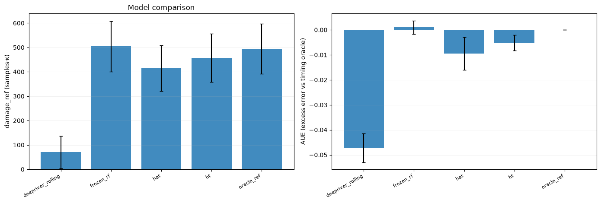

# E01 — Metric v2 correction (Exp-01/02 revision)

**Status:** concluded (current artifact uses a four-model shared reference; a clean
two-model rerun is pending) · **Artifact:** `experiments/results/e01/` ·
**Command:** `uv run python -m experiments.run --exp e01`

---

## 1. Why this experiment exists

Exp-01 and Exp-02 reported a **294×** mean damage gap and a **24×** worst-vs-best
gap. Both were inflated by a defect in the metric, not by the models:

- `damage_area` integrated from `τ` to the *recovery point*.
- On 8 of 11 seeds the recovery rule collapsed to `recovery = τ` (the model never
  left its band), so the integral covered a **single sample**.
- Streaming damage was therefore **truncated**; frozen damage — which never
  recovered — was integrated over the full window.
- Both numbers were **upper bounds**, and the viva brief already flagged the
  defect as a known weakness.

E01 re-runs the same pilot with a metric that cannot be gamed this way.

## 2. What metric v2 changes

| Metric | Definition | Why |
|---|---|---|
| **`damage_ref`** (primary) | `Σ max(κ_ref − κ(t), 0)` over a fixed window from `τ` | `κ_ref` is shared across the model panel, so a weak model cannot score zero damage by having a low own-baseline |
| **`damage_full`** | Same, from `τ` to the end of the stream | Prices the whole remaining stream, not just the pre-registered window |
| **`AUE`** | mean error minus the timing-oracle error over the fixed window | Dimensionless; oracle is an RF refit at `τ` on pre-drift data |
| **`T_exit` / `T_recover`** | Recovery only counts after a real band exit | Removes the “0 = instant recovery” artefact |
| **`recovery_rate`** | Fraction of seeds with a real recovery | Replaces the misleading mean of a floored recovery time |

The fixed window is **5,000 samples** for the abrupt SEA stream. The recovery
band is `0.95·κ_ref` with a 500-sample stretch.

## 3. Setup

| | |
|---|---|
| Stream | SEA, one continuous `U(0,10)³` draw |
| Length | 60,000 samples · warm-up 12,000 · drift at `τ = 30,000` |
| Drift | abrupt: `x₀ + x₁ > 8` → `x₀ + x₁ > 9` |
| Noise | 10% label noise |
| Seeds | 11: `42, 0…9` |
| Streaming | DeepRiver `RollingClassifier`, RNN 3→16→2, window 500 |
| Frozen | `RandomForestClassifier(100)`, fit once on the warm-up |
| Oracle | RF refit at `τ` on the last 12k pre-drift samples (knows *when*) |

The official row is DeepRiver vs frozen. The current artifact also contains
HT/HAT because of a host-default bug that has since been fixed; the clean rerun
will contain only DeepRiver, frozen, and the oracle.

## 4. Results

### 4.1 Aggregate, 11 seeds

| Metric | DeepRiver | Frozen RF | Timing oracle | HT | HAT |
|---|---:|---:|---:|---:|---:|
| Full-run accuracy | **0.8830 ± 0.0021** | 0.8539 ± 0.0017 | 0.8540 ± 0.0016 | 0.8722 ± 0.0019 | 0.8730 ± 0.0030 |
| Full-run Cohen κ | **0.7530 ± 0.0044** | 0.6850 ± 0.0035 | 0.6855 ± 0.0033 | 0.7270 ± 0.0043 | 0.7285 ± 0.0062 |
| AUE | **−0.0472 ± 0.0058** | +0.0010 ± 0.0027 | 0 (reference) | −0.0052 ± 0.0024 | −0.0094 ± 0.0066 |
| **`damage_ref`** (5k window) | **70.6 ± 66.5** | **504.4 ± 104.1** | 494.4 ± 103.2 | 457.0 ± 99.3 | 414.5 ± 94.5 |
| `damage_full` (rest of stream) | **293.9 ± 210.8** | **3,408.1 ± 583.4** | 3,360.6 ± 528.7 | 1,201.7 ± 550.3 | 968.6 ± 357.1 |
| Recovery rate | **7/11 (0.636)** | **0/11 (0.000)** | 0/11 | 1/11 | 1/11 |
| Recovery time, recovered seeds | 177–4,462; mean 2,017 | never | never | 3,302 | 3,380 |



*The two panels are deliberately separate: `damage_ref` is the primary damage
metric, AUE is the excess over the timing oracle. AUE is negative for DeepRiver
because the timing oracle is weak (its `damage_ref` is 494, almost identical to
frozen), not because DeepRiver is impossible.*

### 4.2 Per-seed `damage_ref`

| Seed | DeepRiver | Frozen RF |
|---:|---:|---:|
| 42 | 47.8 | 503.9 |
| 0 | 15.2 | 366.6 |
| 1 | 13.6 | 501.3 |
| 2 | 34.5 | 484.2 |
| 3 | 165.4 | 571.6 |
| 4 | 42.8 | 504.8 |
| 5 | 87.4 | 585.8 |
| 6 | 22.2 | 284.8 |
| 7 | 56.9 | 560.2 |
| 8 | 66.4 | 519.0 |
| 9 | 224.1 | 666.3 |
| **mean ± SD** | **70.6 ± 66.5** | **504.4 ± 104.1** |

DeepRiver's damage is lower on **11/11** seeds. The worst DeepRiver seed (224.1)
is only **1.27×** better than the best frozen seed (284.8), not 24×. The mean
gap is **7.1×**, and the full-stream gap is **11.6×**.

## 5. Verdict

| Pre-registered condition | Required | Measured | Verdict |
|---|---|---|---|
| Frozen never recovers | every seed | 0/11 | **PASS** |
| DeepRiver `damage_ref` lower | ≥10/11 seeds | 11/11 | **PASS** |
| AUE vs timing oracle | ratio or better | DeepRiver −0.0472, frozen +0.0010 | **PASS** — mechanism, not upper bound |

**The claim survives; the magnitude shrinks.** A streaming model that keeps
learning pays about **7× less damage** in the pre-registered window than a frozen
model (≈12× over the rest of the stream), and the frozen model never recovers.
The old **294×** and **24×** are retired.

## 6. What this retires

- **294× mean damage gap** → corrected to **7.1×** (`damage_ref`) or **11.6×**
  (`damage_full`), on the current four-model shared reference.
- **24× worst-vs-best** → corrected to **1.27×**. The worst-case claim was a
  truncation artefact; do not repeat it.
- **“835 samples”** → seed 42 still recovers in 834 samples under the corrected
  rule, but recovery is **7/11**, with values 177–4,462. The number was seed luck;
  the distribution is the result.
- **“Damage area and dip depth are the trustworthy metrics”** → too generous.
  `damage_ref` is the trustworthy one; `damage_full` is the one that prices the
  whole stream; recovery time is meaningful only conditional on an exit.

## 7. Caveats to keep in the report

1. **Panel composition.** The current artifact's `κ_ref` includes HT/HAT because
   of a default-host bug. The qualitative verdict is unchanged, but the exact
   `damage_ref` values will move when the clean two-model panel is rerun. Label
   the current numbers as a four-model panel until then.
2. **AUE is not an upper bound.** The timing oracle knows *when* the drift
   happened but is refit only on pre-drift data; its damage is almost identical
   to frozen. AUE therefore measures “excess over a weak oracle,” not “distance
   from the best possible model.” Use `damage_ref` as primary.
3. **One synthetic stream.** This is still SEA, one abrupt drift. The detector
   matrix, real streams, and the Delay Tax are the next gates.

## 8. Reproduce

```bash
uv run python -m experiments.run --exp e01
uv run python -m experiments.run --exp e01 --report
uv run python -m experiments.run --exp e01 --figure-only
```

**Artifacts:** `experiments/results/e01/summary.json`,
`experiments/results/e01/models.jsonl`, `experiments/results/e01/episodes.jsonl`,
`experiments/results/e01/series.npz`.
