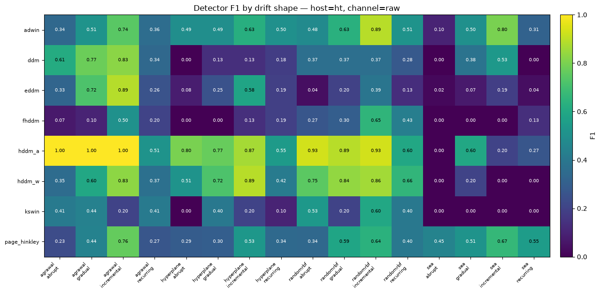
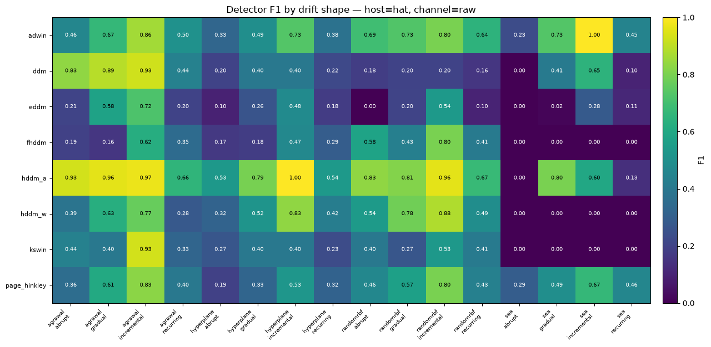

# E04 — Which drift detector works for which drift shape?

**Status:** first pass, 5 seeds · **Artifact:** `experiments/results/e04/` ·
**Command:** `uv run python -m experiments.run --exp e04 --seeds 0-4`

---

## 1. Question

The project has eight early-warning signals and four kinds of change. Before
building a detector into the learning system, we need the map:

1. Which signal catches which kind of change?
2. How quickly does it ring?
3. How often does it cry wolf when nothing changed?
4. Does the answer depend on the learner whose mistakes are being watched?

This is the detector half of the project. E01 measured recovery; E04 measures
whether the system can *notice* that recovery is needed.

## 2. Design

| | |
|---|---|
| Generators | SEA, Hyperplane, RandomRBF, Agrawal |
| Shapes | abrupt, gradual, incremental, recurring |
| Length | 60,000 samples · warm-up 12,000 · change at `τ = 30,000` |
| Seeds | 5: `0–4` (first pass; the full matrix uses 11) |
| Hosts | static Hoeffding Tree (`ht`) and adaptive HAT (`hat`) |
| Detectors | ADWIN, KSWIN, PageHinkley, DDM, EDDM, FHDDM, HDDM-A, HDDM-W |
| Channels | raw mistake signal, and EWMA-smoothed mistake signal |
| `δ_max` | abrupt 1,000 · gradual 2,000 · incremental 4,000 · recurring 2,000 |

Each detector watches the host's mistake stream. A detection inside the
acceptable window counts as a true positive; an alarm outside any window counts
as a false positive. Detection delay is normalized by the per-shape `δ_max`.

## 3. The scoring bug we found

The first report selected **KSWIN** for incremental with **F1 = 1.0 but episode
recall = 0.25**. That is impossible.

The cause: when a detector made **zero alarms**, precision was `None`, so its
run was excluded from the F1 average, while its zero recall still counted. A
detector that almost never rang therefore looked perfect.

The fix: recompute precision, recall and F1 from the raw `TP / FP / detected /
n_episodes` counts, and treat zero alarms as **F1 = 0**. The fix is in
`metrics.evaluate_detections`; `experiments/detector_report.py` recomputes the
E04 report from `detections.jsonl` without rerunning the models.

**The KSWIN “perfect” result was an artefact. It is not a result.**

## 4. Corrected result

**HDDM-A on the raw mistake signal is the best cell for every shape.** Its best
host differs: static HT for abrupt, adaptive HAT for gradual/incremental/
recurring.

| Drift shape | Best default | Balanced score | Changes caught | Alarm precision | False alarms /1k | Detection delay |
|---|---|---:|---:|---:|---:|---:|
| Abrupt | **HDDM-A, raw** | **0.683** | 75% | 0.650 | 0.0075 | 0.185 |
| Gradual | **HDDM-A, raw** | **0.842** | 95% | 0.796 | 0.0083 | 0.155 |
| Incremental | **HDDM-A, raw** | **0.883** | 90% | 0.871 | 0.0033 | 0.012 |
| Recurring | **HDDM-A, raw** | **0.500** | 73% | 0.404 | 0.0308 | 0.144 |

*Balanced score = harmonic mean of alarm precision and episode recall. It is a
stricter, false-alarm-aware score than plain recall; it is not the KDD paper's
exact F1 (which counts multiple alarms per episode), so compare it within this
table, not against KDD tables.*





## 5. Findings

1. **HDDM-A raw is a sensible default on the static host and these synthetic
   generators.** It wins all four shapes, keeps false alarms below 0.031 per
   1,000 examples, and catches 73–95% of changes. The real-stream follow-up
   (E17) shows this does not transfer to the adaptive host — see §8.
2. **Recurring change is the hard case.** Its best balanced score is 0.50 with
   40% alarm precision: it rings often enough to catch changes, but also rings
   when the stream has only switched back to a concept it has seen before.
3. **Incremental change is the easiest.** HDDM-A reaches 0.883 with 0.003 false
   alarms per 1,000 and a detection delay of 0.012 of the allowed window.
4. **Gradual was not harder than abrupt in this slice.** HDDM-A scores 0.842 on
   gradual vs 0.683 on abrupt, and most detectors have a lower normalized delay
   on gradual. This contradicts the usual “gradual is harder” expectation. Treat
   it as a first-pass finding, not a law: per-shape `δ_max`, the longer transition
   window, and the balanced score all affect the comparison.
5. **Smoothing is not free.** On the smoothed channel, KSWIN produces 5.4–7.5
   false alarms per 1,000 examples and ADWIN 0.4–0.6; their balanced scores
   collapse. The raw signal is the default; the smoothed signal is a diagnostic.
   This matches the no-drift control (E02).
6. **Detector rankings are mostly host-stable.** For raw channels, the
   HT-vs-HAT rank correlation is 0.8–1.0 for most detectors; KSWIN is the
   exception at 0.4. The *delay* changes with host, but the ordering usually does
   not. We do not claim a uniform “adaptive learners hide drift” effect from this
   slice.

## 6. What this does not say

- It is a **5-seed first pass**, not the pre-registered 11-seed matrix.
- It uses **default detector settings**; no tuning. E05/S06 are for that.
- It is **synthetic only**; no real streams, no label delay. A first real-stream
  check is E17 (one dataset, one injected mechanism), not a full external-validity
  test.
- The balanced score uses **episode recall**, not the KDD benchmark's
  multi-alarm recall. Raw counts are in `detections.jsonl` if a different
  definition is needed.
- The E04 config has no acceptance rule, so the committed artifact's
  `"pass": true` is vacuous. Do not quote it as a pass. The harness now reports
  `pass: null` with an explicit "nothing was asserted" note for empty
  `acceptance` blocks; the committed E04 artifact predates that fix.

## 7. Reproduce

```bash
uv run python -m experiments.run --exp e04 --seeds 0-4
uv run python -m experiments.detector_report
uv run python -m experiments.run --exp e04 --figure-only
```

**Artifacts:** `experiments/results/e04/summary.json`,
`experiments/results/e04/detections.jsonl` (raw counts),
`experiments/results/e04/detector_report.json` (**corrected report**),
`experiments/results/e04/figures/`.

## 8. Follow-up — E17 on real Elec2 (2026-11-13)

The synthetic default is **host-conditional** on real data. Eight detectors were
replayed on 45,312 real Elec2 records, shuffled per seed, with a known label-swap
drift injected at `τ = 22,656`; five seeds, the same two hosts.

| Drift shape | HDDM-A, static HT | ADWIN, static HT | HDDM-A, adaptive HAT | ADWIN, adaptive HAT |
|---|---:|---:|---:|---:|
| Abrupt | **0.933** | 0.452 | 0.400 | **1.000** |
| Gradual | **0.960** | 0.495 | 1.000 | 1.000 |
| Incremental | **0.960** | 0.842 | **1.000** | 0.971 |
| Recurring | **0.787** | 0.508 | 0.593 | **0.770** |

On the static Hoeffding Tree, HDDM-A repeats the four-shape win. On the adaptive
HAT it does not: ADWIN wins abrupt and recurring, ties gradual, and loses only
incremental. The best-host mean F1 is ADWIN **0.935** vs HDDM-A **0.910**. The
one-sided Hoeffding test can miss an abrupt change that the adaptive learner
repairs quickly; ADWIN's two-sided window comparison still sees it. Recurring
remains the hard case.

Five seeds, one dataset and one injected mechanism: this is a warning about the
scope of the E04 claim, not a final ranking. Full write-up:
[`E17-real-detector-map.md`](E17-real-detector-map.md).
