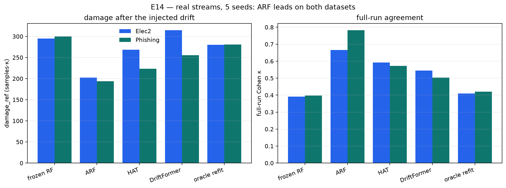

# E14 — real-stream model comparison (5-seed slice)

**Status:** provisional conclusion, 2026-11-14.
**Artifact:** `experiments/results/e14/`.
**Role after Roadmap v2:** host validation only — DriftFormer is a signal
extractor for DF-H, not the benchmark classifier.

> **Scope guard.** Two real datasets, five seeds, one injected mechanism per
> stream. The acceptance rules below were written after the first slice; they set
> the bar for the expansion and are evaluated provisionally here. This page does
> **not** license a field-wide ranking.

---

## 1. The question

Exp-01/02, E01, E04 and E17 are synthetic or single-dataset checks. E14 asks the
external-validity question: **does the streaming advantage survive real features
and real labels**, and is the deep model a viable host on real streams?

The answer matters twice for DF-H:

- if streaming adaptation survives real data, the delay-tax benchmark has a
  credible host;
- if the deep model does not beat ARF as a classifier, it should be used only as
  a **label-free signal extractor** — which is the design choice in Roadmap v2.

---

## 2. Design

| | |
|---|---|
| Datasets | Elec2 (45,312 rows) and Phishing (1,250 rows), shuffled per seed |
| Drift | injected at a known position: `label_swap` and `feature_permutation`, abrupt |
| Models | frozen RF, ARF, HAT, DriftFormer, oracle refit |
| Seeds | 0–4 |
| Runs | 100 model runs, 100 episodes |
| Protocol | prequential test-then-train, shared warm-up, metric v2 (`damage_ref`, `damage_full`, Cohen κ, recovery) |

The oracle refit is a **timing oracle only**: it knows when the drift happened but
not what the new concept is, so it is a weak upper bound.

---

## 3. Measured result

### Pooled over 20 dataset × mechanism × seed cells

| Model | Accuracy | Cohen κ | `damage_ref` | `damage_full` | Recovery rate |
|---|---:|---:|---:|---:|---:|
| Frozen RF | 0.685 | 0.395 | 297.4 | 4,703.0 | 0.00 |
| **ARF** | **0.875** | **0.724** | **198.0** | **2,684.8** | **0.20** |
| HAT | 0.803 | 0.583 | 245.7 | 3,019.6 | 0.15 |
| DriftFormer | 0.770 | 0.524 | 284.9 | 3,497.5 | 0.00 |
| Oracle refit | 0.698 | 0.415 | 280.3 | 4,518.3 | 0.00 |



*E14 pooled over Elec2 + Phishing, five seeds. ARF pays the least damage; the
oracle's damage is almost identical to frozen, which is why AUE is a secondary
metric.*

### By dataset

| Dataset | Model | `damage_ref` | Cohen κ | Recovery rate |
|---|---|---:|---:|---:|
| Elec2 | ARF | **202.4** | **0.666** | 0.00 |
| Elec2 | HAT | 268.3 | 0.593 | 0.00 |
| Elec2 | Frozen RF | 295.0 | 0.392 | 0.00 |
| Elec2 | DriftFormer | 314.7 | 0.545 | 0.00 |
| Phishing | ARF | **193.5** | **0.782** | 0.40 |
| Phishing | HAT | 223.0 | 0.573 | 0.30 |
| Phishing | DriftFormer | 255.2 | 0.503 | 0.00 |
| Phishing | Frozen RF | 299.8 | 0.397 | 0.00 |

**Reading.** ARF leads on both real datasets: lowest `damage_ref`, highest κ,
and the only meaningful recovery. HAT is second. DriftFormer beats frozen on κ but
not on damage — on Elec2 it pays slightly *more* than frozen (314.7 vs 295.0).
Real-stream drift is harder than SEA: recovery rates are low everywhere.

---

## 4. Acceptance rules and provisional verdict

These rules are recorded here, not in `e14_real_streams.yaml`: changing the
registry's acceptance block changes the config hash and would invalidate the
committed cache. They will move into the registry when E14 is expanded and rerun.

| Rule | Bar | Measured (20 cells) | Verdict |
|---|---|---:|---|
| A1 — pooled damage | ARF `damage_ref` ≤ **0.75×** frozen | **0.666×** (198.0 / 297.4) | **PASS** |
| A2 — per-cell robustness | ARF lower `damage_ref` in ≥ **16/20** stream × seed cells | **18/20** | **PASS** |
| A3 — frozen never recovers | frozen recovery rate = 0 on every cell | **0/20** | **PASS** |
| A4 — full-run skill | ARF κ ≥ frozen κ + **0.10** | **+0.329** (0.724 vs 0.395) | **PASS** |

**Provisional verdict: PASS on all four rules.** The streaming advantage survives
the first real-stream check. The magnitude is not transferable to a field-wide
claim: the slice has two datasets, five seeds, one injected mechanism per stream,
and Phishing has only 1,250 rows.

**Acceptance is about ARF, not DriftFormer.** The question is whether streaming
adaptation survives real data, so the pre-registered comparison is ARF vs frozen.
DriftFormer's weaker classifier result is a separate, expected negative: it is the
evidence for using the deep model as a *signal extractor* in DF-H, not as the KDD
host.

---

## 5. What this changes

- **E14 is concluded as a provisional slice**, not as a field-wide result.
- **DriftFormer is not the benchmark host.** Roadmap v2 already uses its encoder
  only; E14 is the measured justification.
- **No statistical ranking across datasets.** With two datasets and five seeds,
  a Friedman/Nemenyi claim is not available. Expansion to ≥5 datasets and ≥10
  seeds is deferred under Roadmap v2; E14 remains host validation.
- The numbers here supersede the provisional table in
  [Nov 14 §4.6](Nov14.md) only in status, not in values.

---

## 6. Reproduction

```bash
uv run python -m experiments.run --exp e14
```

Artifacts: `summary.json` (pooled), `episodes.jsonl` (per-cell), `models.jsonl`,
`series.npz`, `figures/`. The five-seed slice is committed; a full rerun is a
heavy command and is handed to the user per the project rule.
