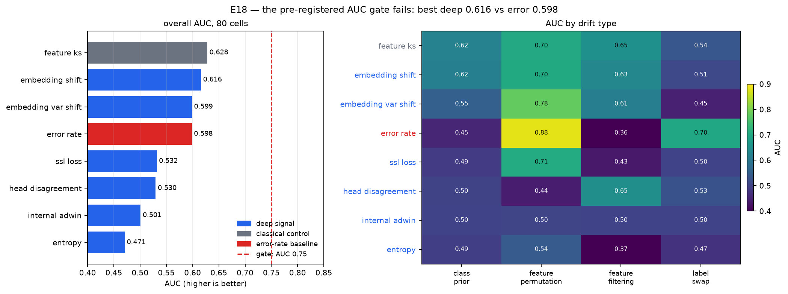
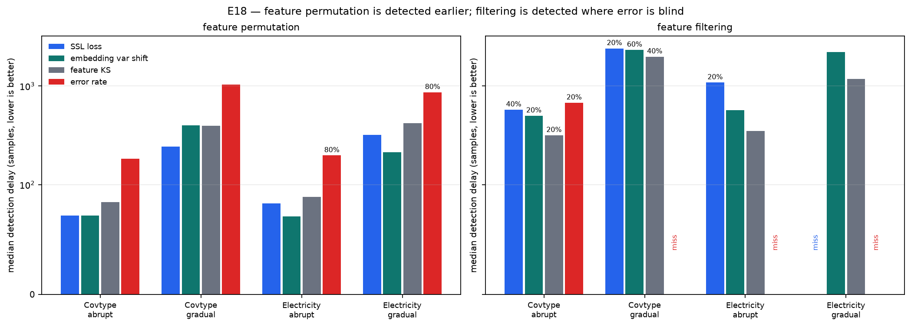

# E18 — the deep signal gate

**Status:** concluded, 2026-11-14.
**Artifacts:** `experiments/results/e18/` (`summary.json`, `detection.json`,
`detection.csv`) · `experiments/data/deep_signals/pilot/` (80 trial files).
**Role:** Stage-1 signal validation for DF-H. Gate result is **negative**.

> **The one-line verdict:** the deep signals have real timing value on feature
> drift, but they do **not** clear the pre-registered AUC gate, and a simple
> `feature_ks` control is often just as good. The deep encoder's marginal value
> is unproven.

---

## 1. What was tested

E18 asks whether a frozen, label-free DriftFormer encoder produces signals that
predict drift better than the raw error rate. The pilot is 2 datasets × 4 drift
types × 2 transitions × 5 trials = **80 cells**:

| | |
|---|---|
| Datasets | Covtype (54 features), Electricity (8 features) |
| Drift | `class_prior`, `label_swap`, `feature_permutation`, `feature_filtering` |
| Transitions | abrupt, gradual |
| Trials | 5 per cell; KDD protocol, 100k-row cap, seed 12 |
| Encoder | DriftFormer, SSL-only pretraining on 20k fixed unlabeled rows per dataset |
| Windows | 500 samples, stride 100, reference = first 20% of windows |
| Signals | `ssl_loss`, `embedding_shift`, `embedding_var_shift`, `head_disagreement`, `entropy`, `internal_adwin`, `feature_ks` |
| Baseline | River Hoeffding Tree prequential error rate on the same trial |

The report label is a **causal detection window**: a window is positive if it
overlaps the drift or ends within one window of its end. The plan's “drift in
the next W” wording would ask the monitor to predict a future change; a causal
monitor cannot do that, so the report uses the detection label. This correction
is documented in `experiments/deep_kdd.py`.

---

## 2. Primary gate — FAIL

The pre-registered gate was: at least one deep signal with **AUC ≥ 0.75** and
**≥ 0.10 above** the error-rate baseline. Measured over all 80 cells:

| Signal | AUC | vs error |
|---|---:|---:|
| `feature_ks` (classical control) | **0.628** | +0.029 |
| `embedding_shift` | **0.616** | +0.017 |
| `embedding_var_shift` | 0.599 | +0.000 |
| `error_rate` | 0.598 | — |
| `ssl_loss` | 0.532 | −0.067 |
| `head_disagreement` | 0.530 | −0.069 |
| `internal_adwin` | 0.501 | −0.098 |
| `entropy` | 0.471 | −0.128 |

**Gate result: FAIL.** Best deep signal **0.616**, short of 0.75 and only
+0.017 over the error rate. Even the classical `feature_ks` control misses the
bar.



*E18 — the deep signals cluster around the error-rate baseline overall. The
right panel shows where the signal actually lives: feature permutation, where
`embedding_var_shift` reaches 0.781, but the error rate is stronger still
(0.879). Label-only drift is correctly left to Stage 2.*

### Where the signal lives

| Drift type | Best signal | AUC | Error-rate AUC |
|---|---|---:|---:|
| `feature_permutation` | `embedding_var_shift` | **0.781** | **0.879** |
| `feature_filtering` | `feature_ks` | 0.651 | ~0.50 |
| `class_prior` | `feature_ks` | 0.622 | ~0.50 |
| `label_swap` | `error_rate` | **0.698** | — |

The deep signal **does** have power on feature permutation (0.781), but the
error rate is stronger there (0.879). On label-only drift (`label_swap`), the
deep signal is correctly near chance (0.51) while the error rate catches it
(0.698) — Stage 2's job.

---

## 3. Secondary diagnostic — timing at a controlled FAR

AUC is not how a detector operates. The `deep_kdd detect` command calibrates
each signal on pre-drift windows to **0.1 false alarms/1k**, then measures the
first alarm after onset. Key feature-drift cells:

| Cell | Signal | Hit rate | Median delay | FAR/1k |
|---|---|---:|---:|---:|
| Covtype feature-permutation, abrupt | `ssl_loss` | 100% | **72** | 0.09 |
| Covtype feature-permutation, abrupt | `error_rate` | 100% | 184 | 0.04 |
| Covtype feature-permutation, gradual | `ssl_loss` | 100% | **244** | 0.05 |
| Covtype feature-permutation, gradual | `error_rate` | 100% | 1,033 | 0.13 |
| Electricity feature-permutation, abrupt | `ssl_loss` | 100% | **83** | 0.06 |
| Electricity feature-permutation, abrupt | `error_rate` | 80% | 198 | 0.07 |
| Electricity feature-permutation, gradual | `embedding_var_shift` | 100% | **214** | 0.15 |
| Electricity feature-permutation, gradual | `error_rate` | 80% | 864 | 0.13 |
| Electricity feature-filtering, abrupt | `embedding_shift` | 100% | **350** | 0.16 |
| Electricity feature-filtering, abrupt | `error_rate` | 0% | — | 0.09 |
| Electricity feature-filtering, gradual | `feature_ks` | 100% | 1,176 | 0.04 |
| Electricity feature-filtering, gradual | `error_rate` | 0% | — | 0.14 |



*E18 timing — lower is better. `SSL loss` and `embedding var shift` alarm well
before the error rate on feature permutation. On feature filtering the error
rate misses entirely while the feature signals still fire. “miss” means no
alarm inside the 2,500-sample budget; percentages mark hit rates below 100%.*

**Reading.** Stage 1 detects feature permutation **2–5× earlier** than the
error rate, and detects feature filtering when the error rate is blind. On
label-only drift it stays quiet at this FAR, which is what Stage 2 is for.

**The catch.** `feature_ks` is often as fast as the deep signals (84 vs 72 on
Covtype abrupt permutation; 350 vs 350 on Electricity abrupt filtering), and
sometimes faster. The deep encoder is not clearly adding information beyond a
simple per-feature KS monitor. That is the risk the E19 ablation was built to
test.

---

## 4. What this changes

- The **AUC gate is a negative result** and stays recorded as such.
- The deep signals are **not a standalone detector**; they are a warning
  channel with real timing value on feature drift.
- The classical `feature_ks` control must travel with the deep signals into
  E19. If the deep view does not beat it there, the classical monitor is the
  honest Stage 1.
- No full 50-trial E20 run is justified by this gate alone. E19 pilots the
  fusion; the result decides whether E20 is worth the compute.

---

## 5. Reproduce

```bash
uv run python -m experiments.deep_kdd report \
    --signals experiments/data/deep_signals/pilot \
    --out experiments/results/e18

uv run python -m experiments.deep_kdd detect \
    --signals experiments/data/deep_signals/pilot \
    --out experiments/results/e18 --far 0.1 --budget 2500

# figures in this page
uv run python experiments/scripts/make_e18_e19_figures.py
```

The signal extraction itself is:

```bash
uv run python -m experiments.deep_kdd prepare-signals \
    --datasets Covtype,Electricity --trials 5 \
    --out experiments/data/deep_signals/pilot --device cuda
```

See [E19 — DF-H v1 pilot](E19-hybrid-detector.md) for the fusion result.
