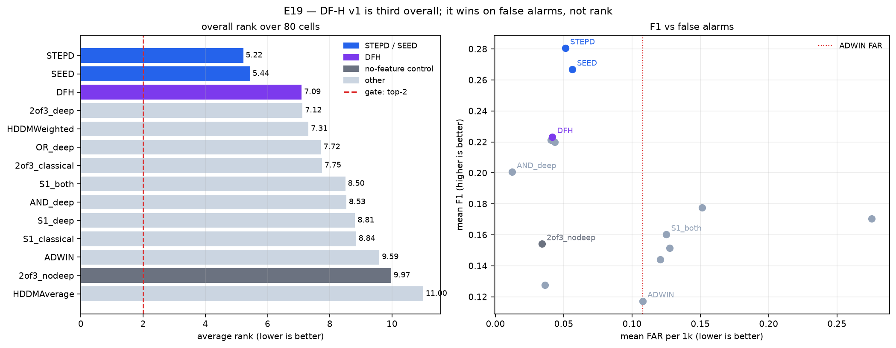
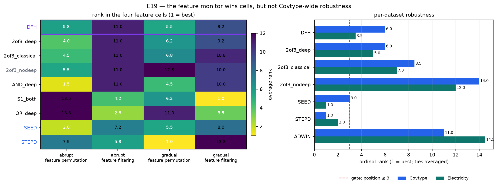

# E19 — DF-H v1 pilot (rule-based fusion)

**Status:** pilot concluded, 2026-11-14. **Gate: FAIL.**
**Artifact:** `experiments/results/e19_kdd_pilot/`.
**Pre-registration:** `experiments/registry/e19_hybrid_detector.yaml`.

> **The one-line verdict:** DF-H v1 ranks **third overall** on the 80-cell KDD
> pilot, behind STEPD and SEED. It owns feature cells in ablation variants, but
> the primary `2of3_both` does not win one, and it is **tied fifth on Covtype**.
> The pre-registered top-2 gate fails, so the full E20 run is not justified.

---

## 1. Design

The pilot is the plan's 2 datasets × 4 drift types × 2 transitions × 5 trials =
**80 cells**, using the KDD'26 protocol and the public-code convention
(`--signal correct --gradual-anchor code`).

| | |
|---|---|
| Stage 1 — deep | `max(ssl_loss_z, embedding_shift_z)` |
| Stage 1 — classical | `feature_ks_z` (the E18 control) |
| Stage 1 — both | `max(deep, classical)` |
| Stage 2 | SEED, STEPD, ADWIN, HDDM-A, HDDM-W |
| Thresholds | calibrated on pre-drift windows to **0.1 FAR/1k**, per dataset |
| Fusion window | 2,000 samples; refractory 2,000 |
| Variants | `S1_deep`, `S1_classical`, `S1_both`, `OR_deep`, `AND_deep`, `2of3_deep`, `2of3_classical`, `2of3_both` (**DFH**), `2of3_nodeep` (control) |

The fusion reports the **confirmation time** for AND/2-of-3 rules and the
earliest alarm for OR. The control `2of3_nodeep` uses SEED + ADWIN + HDDM-A, so
it isolates the feature-monitor contribution.

---

## 2. Overall result

| Detector | Mean F1 | FAR/1k | Overall rank |
|---|---:|---:|---:|
| **STEPD** | **0.281** | 0.05 | **5.22** |
| **SEED** | 0.267 | 0.06 | **5.44** |
| **DFH = 2of3_both** | 0.223 | **0.04** | **7.09** |
| `2of3_deep` | 0.221 | 0.04 | 7.12 |
| `2of3_classical` | 0.220 | 0.04 | 7.75 |
| HDDM-W | 0.170 | 0.28 | 7.31 |
| `OR_deep` | 0.178 | 0.15 | 7.72 |
| `S1_both` | 0.160 | 0.13 | 8.50 |
| `AND_deep` | 0.201 | **0.01** | 8.53 |
| `S1_deep` | 0.144 | 0.12 | 8.81 |
| `S1_classical` | 0.151 | 0.13 | 8.84 |
| ADWIN | 0.117 | 0.11 | 9.59 |
| `2of3_nodeep` (control) | 0.154 | 0.03 | 9.97 |
| HDDM-A | 0.128 | 0.04 | 11.00 |

DF-H beats the no-feature control by **2.9 ranks** (7.09 vs 9.97) and has the
lowest FAR among the competitive rows. It does not beat the top scalar
detectors.



*E19 — left: average rank over the 80 cells; DFH is third, behind STEPD and
SEED. Right: mean F1 against mean false alarms. DFH sits below the top two in
F1 but has the lowest FAR of the competitive rows; `AND_deep` is the low-FAR
outlier, but its overall rank is 8.53.*

---

## 3. Gate check

| Criterion | Bar | Measured | Verdict |
|---|---|---|---|
| Overall rank | top-2 | DFH **3rd** (7.09; STEPD 5.22, SEED 5.44) | **FAIL** |
| Weak feature cells | best on ≥1 of feature permutation/filtering | DFH wins **none**; `AND_deep` wins abrupt permutation (1.50), `S1_both` wins gradual filtering (1.00) | **FAIL for primary**; ablations pass |
| False alarms | FAR ≤ ADWIN | **0.04 vs 0.11** | **PASS** |
| Per-dataset robustness | no rank worse than 3 | Covtype **tied 5th–7th** (avg pos 6.0; rank 7.44), Electricity **tied 3rd–4th** (avg pos 3.5; 6.75) | **FAIL** (strict bar) |

**Overall: FAIL.** The primary candidate is not top-2, does not win a feature
cell, and is not robust across datasets. The FAR and control checks pass.

### Feature-cell detail

| Cell | Best detector | Rank | DFH rank |
|---|---|---:|---:|
| Abrupt feature permutation | `AND_deep` | **1.50** | 5.75 |
| Gradual feature permutation | STEPD | 1.00 | 5.50 |
| Abrupt feature filtering | `OR_deep` | **2.75** | 11.00 |
| Gradual feature filtering | `S1_both` | **1.00** | 9.25 |



*E19 — left: average rank in the four feature cells (1 = best); the purple box
is DFH. `AND_deep` wins abrupt feature permutation, `S1_both` wins gradual
feature filtering, and DFH wins neither. Right: per-dataset ordinal ranks with
ties averaged; DFH is tied 5th–7th on Covtype (6.0) and tied 3rd–4th on
Electricity (3.5), so the strict “no rank worse than 3” bar is not met.*

The feature monitor **does** own feature cells in ablation form. The problem is
the primary 2-of-3 rule: it asks for Stage-2 confirmation on cells where Stage 1
is already right and Stage 2 is slow or blind (feature filtering), and it leaks
Stage-1 false alarms on label-only cells where Stage 1 has no power.

---

## 4. What this changes

- **Do not run the full 7 × 4 × 2 × 50 E20 matrix.** The pilot-first rule says
  the gate must pass first; it did not.
- **The deep view does not earn a clear place over the classical control.**
  `2of3_both` (7.09), `2of3_deep` (7.12) and `2of3_classical` (7.75) are close;
  `feature_ks` was often just as fast in E18. The honest Stage 1 for a v2 is the
  **classical feature monitor**, with the deep view as an ablation.
- **The warning/confirmation idea still works where it should.** `AND_deep` is
  the best detector on abrupt feature permutation (rank 1.50, FAR 0.01), and
  Stage 1 is correctly blind to label-only drift. The failure is the fixed
  2-of-3 rule, not the information.
- **Covtype robustness is the weak point.** DFH is tied 5th–7th there, driven by
  label-only cells where the feature monitor has no power and the 2-of-3 rule
  still waits for it.
- **A v2 is only worth it with a gating hypothesis:** activate Stage 1 only when
  a feature-drift confidence is high, and defer to Stage 2 on label-only cells.
  That needs more than two datasets for leave-one-dataset-out; the current pilot
  cannot validate a learned gate.
- **Pivot to E21.** The Delay Tax benchmark is the novel contribution and does
  not require DF-H to win the KDD rank. The lemmas and the delay measurement
  stand on their own.

---

## 5. Reproduce

```bash
./experiments/kdd.sh run --datasets Covtype,Electricity --trials 5 \
    --signal correct --gradual-anchor code \
    --detectors SEED,STEPD,ADWIN,HDDMAverage,HDDMWeighted \
    --deep-signals experiments/data/deep_signals/pilot \
    --out experiments/results/e19_kdd_pilot --workers 8
```

The E18 signal artifacts behind Stage 1 are in
[`E18-deep-signals.md`](E18-deep-signals.md).

Figures in this page regenerate from the artifact with:

```bash
uv run python experiments/scripts/make_e18_e19_figures.py
```
