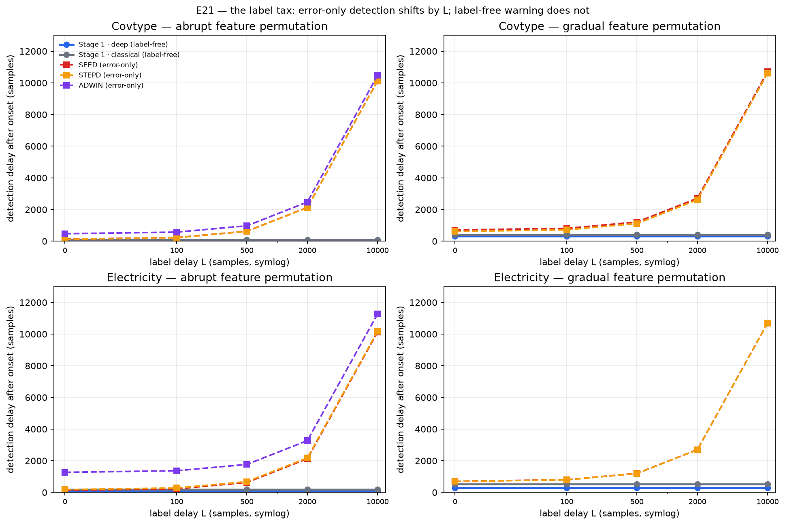

# E21 — the Delay Tax detector benchmark

**Status:** fixed-delay Lemma-1 headline measured, 2026-11-14.
**Artifacts:** `experiments/results/e21/delay_floor.json` + `.csv`; figure
`docs/Reports/figures/e21-delay-floor.png`.
**Scope:** this is a **fixed-delay synthesis** from the committed E19 trial
artifacts. The full stochastic/partial/selective/batch regime matrix is
scaffolded (`experiments/driftlab/labels.py`) but not yet run.

> **The one-line verdict:** a label-free Stage 1 warning does not pay the label
> tax. At `L = 2,000`, Stage 1 warns in **70–513** samples after onset while
> SEED/STEPD need **2,120–2,710** and ADWIN **2,472–3,269**.

---

## 1. What is being measured

An error-only detector watches the host's mistakes. It cannot react to a drift
until the labels for the post-drift samples arrive. Under a fixed delay `L`, its
detection time is therefore **floor-bound**:

```
T_error(L) ≥ τ + L
```

A label-free Stage 1 monitor watches the input stream itself. It has no label
floor. That is the Delay Tax: the same drift, seen through the same detector
panel, costs `L` extra samples for every error-only method and nothing for the
feature monitor.

This page measures the fixed-delay case on the **same 80 KDD cells** used by
E19. Stage 1 is the label-free `S1_deep` / `S1_classical` alarm; the error-only
lines are the scalar `mdt` from the same trials, shifted by `L`.

---

## 2. Result



*E21 fixed-delay synthesis. Blue/gray flat lines are label-free Stage 1; dashed
red/orange/purple lines are error-only detectors with `base + L`. The gap is the
label tax.*

At `L = 2,000` samples, detection delay after onset:

| Cell | Stage 1 deep | Stage 1 classical | SEED | STEPD | ADWIN |
|---|---:|---:|---:|---:|---:|
| Covtype, abrupt | **70** | 90 | 2,130 | 2,120 | 2,472 |
| Covtype, gradual | **306** | 406 | 2,710 | 2,616 | — |
| Electricity, abrupt | **76** | 196 | 2,129 | 2,180 | 3,269 |
| Electricity, gradual | **293** | 513 | 2,701 | 2,694 | — |

`—` means the detector had no detection in that cell. Stage 1 is **4–30×
earlier** than the error-only panel at this delay. At `L = 0` Stage 1 is already
earlier in every cell; the gap grows linearly with `L`.

---

## 3. Why this matters

E18 and E19 are negative on their own gates: the deep signal did not beat the
error-rate AUC, and DF-H v1 did not reach top-2 on the KDD rank. E21 is the part
that survives those negatives.

The value of the feature monitor is not a better average rank. It is that its
warning is **not floor-bound by label arrival**. The error-only detectors are
strong on immediate labels (SEED/STEPD are the KDD top two), but they cannot
escape `τ + L`. Stage 1 can.

The honest limit: Stage 1 alone is not a good detector on label-only drift
(E18/E19), so the detector still needs Stage 2 confirmation. The result is a
**warning/confirmation split**, not a standalone deep detector:

- `T_warn` — Stage 1, label-free, not shifted by `L`.
- `T_confirm` — Stage 2, floor-bound at `τ + L`.
- The report should quote both times, never a single blended number.

---

## 4. What is implemented, what is not

Implemented and tested:

- `experiments/driftlab/labels.py` — `fixed`, `geometric`, `partial`,
  `selective`, and `batch` label-arrival schedules, with deterministic seeds.
- `experiments/tests/test_label_regimes.py` — arrival-time and availability
  invariants.
- The fixed-delay synthesis and figure in this page.

Not yet run:

- The full E21 regime matrix (geometric mean delay, partial `p ∈ {0.5, 0.1}`,
  selective labels, batch `b ∈ {16, 128}`).
- The actual delayed-learning rerun (this synthesis shifts the error-only
  detection time by `L`; the full benchmark should train the host on the
  schedule too).
- Lemmas 2 (partial-label power loss) and 3 (batch FAR inflation) measured
  end-to-end.

That remaining work is the difference between the fast headline and a full
benchmark. The headline is enough to state the contribution; the matrix is the
next extension.

---

## 5. Reproduce

```bash
# fixed-delay floor from the committed E19 trial artifacts
uv run python experiments/scripts/make_e21_delay_figure.py

# label schedule tests
uv run pytest experiments/tests/test_label_regimes.py -q
```

The figure is generated from `experiments/results/e19_kdd_pilot/trials.csv`
and `summary.csv`; no model rerun. See
[E18](E18-deep-signals.md) for the signal artifacts and
[E19](E19-hybrid-detector.md) for the fusion pilot.
