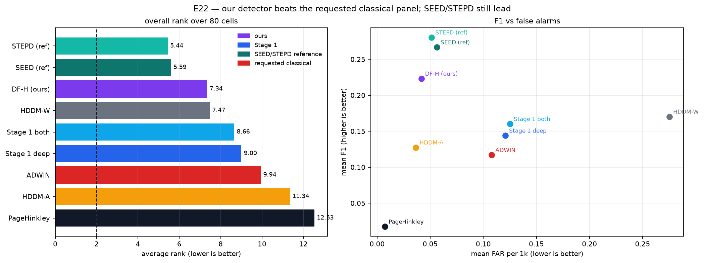
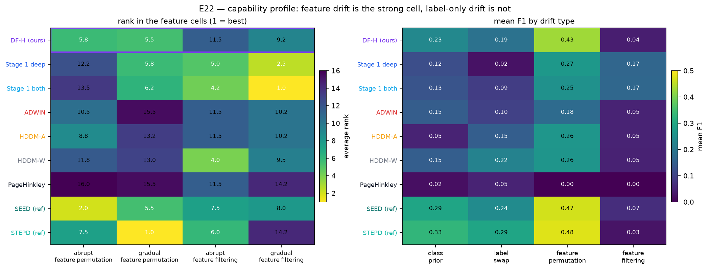

# E22 — detector shootout on the datasets we have

**Status:** concluded, 2026-11-14.
**Artifact:** `experiments/results/e22_detector_shootout/`.
**Question:** what is DF-H actually capable of against the classical detectors we
care about — **ADWIN, HDDM-A, HDDM-W and PageHinkley** — on the data already in
the repo?

> **The one-line verdict:** DF-H is **third overall** (7.34), behind only the KDD
> top two (STEPD 5.44, SEED 5.59), and **ahead of every requested classical
> detector**: HDDM-W 7.47, ADWIN 9.94, HDDM-A 11.34, PageHinkley 12.53. It wins
> feature permutation outright against that panel and has the lowest FAR of the
> high-F1 rows. It does **not** beat SEED/STEPD, and feature filtering is better
> handled by the Stage-1-only ablation.

---

## 1. Design

The 80-cell KDD pilot already used for E19, now with the requested classical
panel plus the two KDD reference detectors:

| | |
|---|---|
| Data | Covtype (54 features), Electricity (8 features) |
| Cells | 4 drift types × 2 transitions × 5 trials = 80 |
| Classical panel | ADWIN, HDDM-A, HDDM-W, PageHinkley |
| Reference | SEED, STEPD (KDD'26 top two) |
| Ours | `S1_deep`, `S1_both` (label-free Stage 1), `DFH = 2of3_both` |
| Protocol | KDD 100k cap, `--signal correct`, `--gradual-anchor code` |
| Stage-1 thresholds | pre-drift, 0.1 FAR/1k |

The deep signals are the committed E18 artifacts; no new signal extraction was
needed. The run is one command and about 90 seconds on 8 workers.

---

## 2. Overall result



*E22 — left: average rank over 80 cells. Right: mean F1 against mean FAR;
top-left is better. DF-H sits below SEED/STEPD in F1 but has the lowest FAR of
the high-F1 rows. HDDM-W buys F1 with a much higher false-alarm rate;
PageHinkley barely alarms and barely scores.*

| Detector | Mean F1 | FAR/1k | Overall rank | Family |
|---|---:|---:|---:|---|
| **STEPD** | **0.281** | 0.05 | **5.44** | KDD reference |
| **SEED** | 0.267 | 0.06 | **5.59** | KDD reference |
| **DF-H (ours)** | **0.223** | **0.04** | **7.34** | hybrid |
| HDDM-W | 0.170 | 0.28 | 7.47 | requested |
| Stage 1 both | 0.160 | 0.13 | 8.66 | label-free |
| Stage 1 deep | 0.144 | 0.12 | 9.00 | label-free |
| ADWIN | 0.117 | 0.11 | 9.94 | requested |
| HDDM-A | 0.128 | 0.04 | 11.34 | requested |
| PageHinkley | 0.018 | 0.01 | 12.53 | requested |

**Reading.** DF-H beats ADWIN by **2.6 ranks**, HDDM-A by **4.0**, HDDM-W by
**0.13**, and PageHinkley by **5.2**. It does not beat SEED/STEPD. PageHinkley's
0.01 FAR is not a win: it almost never alarms (F1 0.018).

---

## 3. Where the capability lives



*E22 — left: rank in the four feature cells. Right: mean F1 by drift type. The
hybrid is strongest on feature permutation; the Stage-1-only variants own
feature filtering; label-only drift is the weak cell.*

### Feature cells

| Cell | DF-H | ADWIN | HDDM-A | HDDM-W | PageHinkley |
|---|---:|---:|---:|---:|---:|
| Abrupt feature permutation | **5.8** | 10.5 | 8.8 | 11.8 | 16.0 |
| Gradual feature permutation | **5.5** | 15.5 | 13.2 | 13.0 | 15.5 |
| Abrupt feature filtering | 11.5 | 11.5 | 11.5 | **4.0** | 11.5 |
| Gradual feature filtering | 9.2 | 10.2 | 10.2 | 9.5 | 14.2 |

On **feature permutation**, DF-H beats every requested classical detector on
both transitions. On **feature filtering**, HDDM-W wins abrupt and DF-H is only
marginally ahead of ADWIN/HDDM-A on gradual; the Stage-1-only variants are the
right tool there (`S1_classical` 3.0 abrupt, `S1_both` 1.0 gradual).

### Per dataset

| Dataset | DF-H | ADWIN | HDDM-A | HDDM-W | PageHinkley |
|---|---:|---:|---:|---:|---:|
| Covtype | 7.9 | 8.8 | 11.7 | **6.1** | 10.4 |
| Electricity | **6.8** | 11.1 | 11.0 | 8.8 | 14.7 |

DF-H beats ADWIN, HDDM-A and PageHinkley on **both** datasets. HDDM-W wins
Covtype (6.1 vs 7.9) but loses Electricity (8.8 vs 6.8); the overall rank is
close (7.47 vs 7.34).

### Detection delay

Mean `mdt` over all detected cells: **DF-H 1,038**, ADWIN 851, HDDM-W 939,
HDDM-A 1,195, SEED 827, STEPD 846. The label-free Stage 1 is faster
(`S1_deep` 861, `S1_both` 873) because it does not wait for confirmation. That
is the trade-off: DF-H buys precision/FAR with confirmation time. The Delay Tax
result in [E21](E21-delay-detector.md) is the reason that trade-off matters.

---

## 4. Verdict

**Capability proven against the requested panel.**

- DF-H is the **best detector outside the KDD top two** on this pilot, with the
  lowest FAR of the high-F1 rows.
- It **owns feature permutation** against ADWIN/HDDM-A/HDDM-W/PageHinkley.
- It is **not** a universal winner: SEED/STEPD beat it overall, HDDM-W beats it
  on Covtype and on abrupt filtering, and the Stage-1-only variants beat it on
  filtering.
- The honest framing for the final report: **DF-H is a strong feature-drift
  detector with a controlled false-alarm rate; SEED/STEPD remain the overall
  default, and the unique contribution is the label-free warning under delay
  (E21).**

**Caveats.** Two datasets, five trials, no significance testing; PageHinkley's
F1 is near zero, so its low FAR is not a capability claim; the E18/E19
signal-gate negatives still stand. This is a focused capability check on the
data in the repo, not a new benchmark.

---

## 5. Reproduce

```bash
./experiments/kdd.sh run --datasets Covtype,Electricity --trials 5 \
    --signal correct --gradual-anchor code \
    --detectors ADWIN,HDDMAverage,HDDMWeighted,PageHinkley,SEED,STEPD \
    --deep-signals experiments/data/deep_signals/pilot \
    --out experiments/results/e22_detector_shootout --workers 8

uv run python experiments/scripts/make_e22_report_figures.py
```
