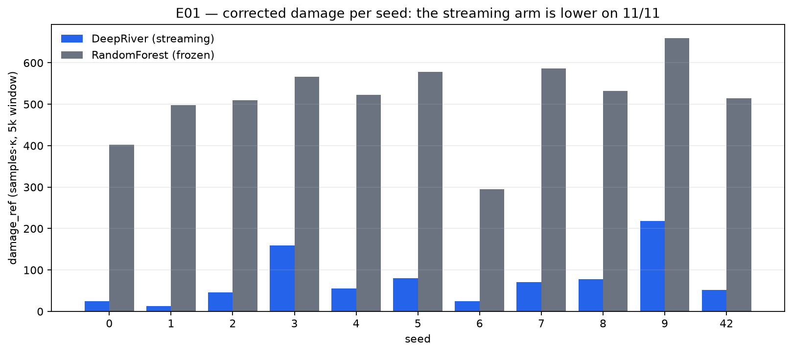
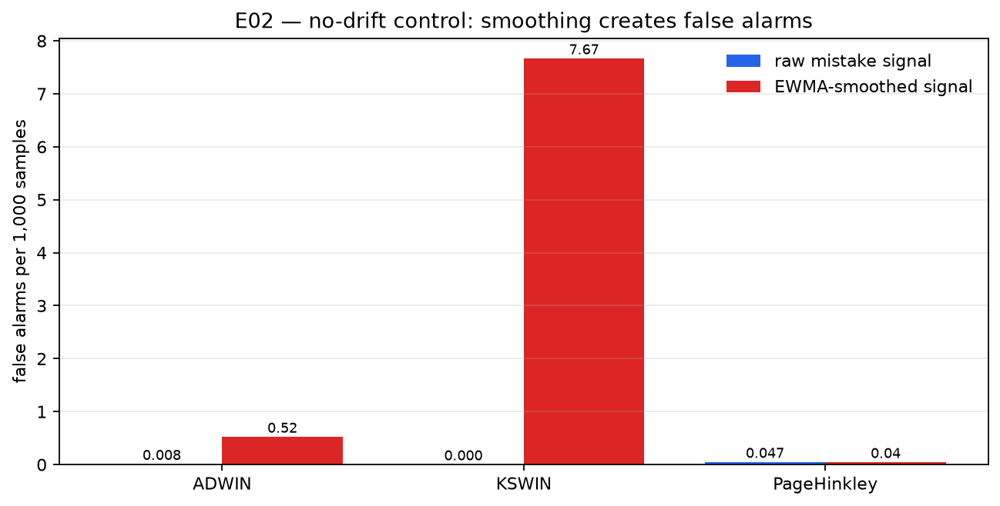
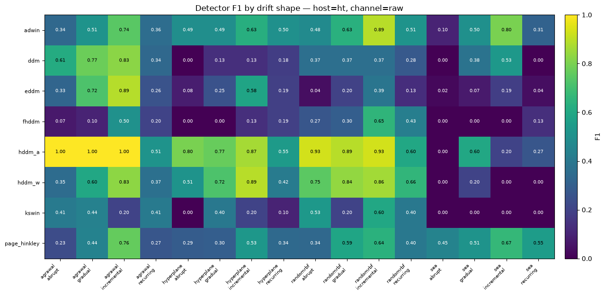
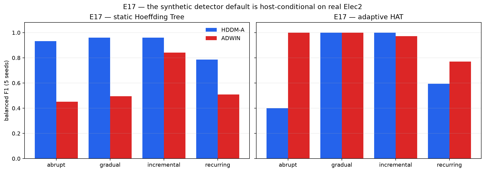
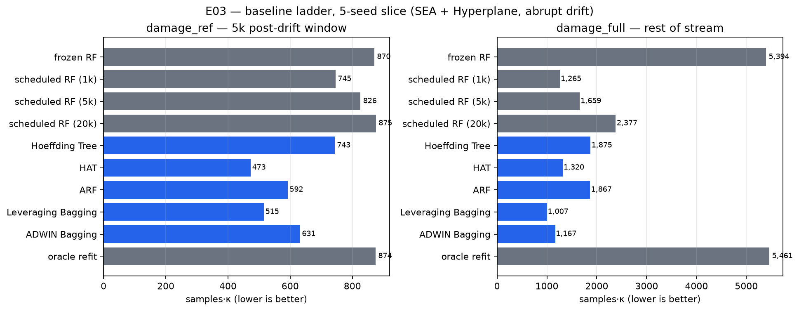
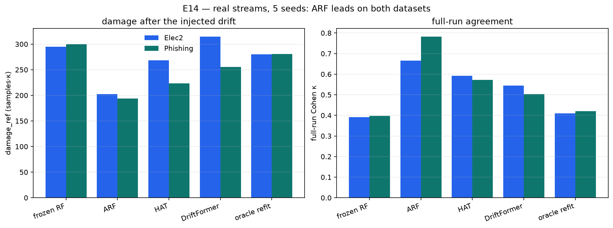
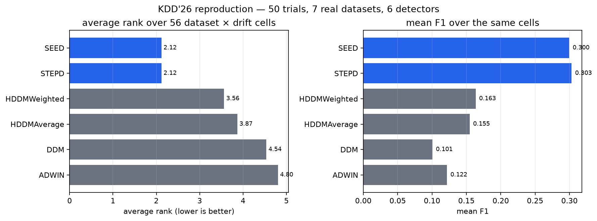

# Post-mid-term report — Nov 14, 2026

**What this page is:** the progress report for everything built *after* the
mid-term baseline. It is grounded in the git history and in the saved artifacts
under `experiments/results/`, not in memory or in the commit messages.

| | |
|---|---|
| **Report date** | 2026-11-14 |
| **Period covered** | 2026-09-23 → 2026-11-14 (implementation landed 2026-11-12/13) |
| **Git base** | `c5e0070` (2026-09-12) — the last measured commit described by the mid-term report |
| **HEAD** | `ed2c144` (2026-11-12) |
| **Working tree** | 39 tracked files modified, 82 untracked files (including this page, the dataset page and their figures) — not yet committed |
| **Mid-term document** | [`mid_term.md`](mid_term.md) — frozen; not edited by this report |
| **Evidence root** | `experiments/results/<exp_id>/` |

> **One-line summary.** After the mid-term we replaced the ad-hoc pilot scripts
> with a config-driven experiment lab, found and fixed a defect in the damage
> metric that had inflated the headline **294×** down to a defensible **≈6.9×**,
> added a no-drift control and two detector maps, reproduced the KDD'26
> detector benchmark, and started the baseline ladder on real streams. The core
> claim survived; the number shrank; the Delay Tax is still ahead.

---

## 1. What changed, in one screen

| Workstream | What landed | Status | Evidence |
|---|---|---|---|
| **DriftLab harness** | Config-driven streams, detectors, learners, metric v2, artifact schema, figures, reports, 53 tests, CI | Built; committed + uncommitted hardening | `experiments/driftlab/`, `experiments/registry/`, `experiments/run.py` |
| **E01 — metric correction** | Fixed-window `damage_ref`, panel-shared reference, exit-conditional recovery | Concluded (clean panel in working tree) | `experiments/results/e01/`, [E01 report](E01-metric-v2.md) |
| **E02 — no-drift control** | 2 stationary streams × 5 seeds × all models + 8 detectors | Concluded; FAR gate fails for ADWIN/KSWIN on EWMA | `experiments/results/e02/` |
| **E04 — detector map** | 4 generators × 4 shapes × 8 detectors × 2 hosts × raw/EWMA, 5 seeds | Concluded first pass | `experiments/results/e04/`, [E04 report](E04-detector-map.md) |
| **E17 — real-stream map** | Elec2, injected label swap, 4 shapes × 8 detectors × 2 hosts, 5 seeds | Concluded first pass; uncommitted | `experiments/results/e17/`, [E17 report](E17-real-detector-map.md) |
| **E03 — baseline ladder** | Frozen, scheduled (1k/5k/20k), oracle, HT/HAT/ARF/LB/ADWIN-bagging on SEA + Hyperplane | 5-seed slice complete; 11-seed run in progress | `experiments/results/e03/` |
| **E14 — real streams** | Elec2 + Phishing, label swap + feature permutation, 5 seeds, 4 models + oracle | 5-seed slice complete; undocumented | `experiments/results/e14/` |
| **KDD'26 reproduction** | 7 datasets × 4 drift types × 2 transitions × 50 trials × 6 detectors | 2,800 tasks, 0 failures, 50-trial ranking complete | `experiments/results/kdd_bench_full/`, `experiments/kdd_bench.py` |
| **Docs & site** | Mid-term report, progress log, Results registry, E01/E04/E17 write-ups, product notes, nav entries | Live | `docs/Reports/`, `mkdocs.yml` |

### Bottom line

- The corrected comparison is **74.8 ± 61.8 vs 515.0 ± 97.1 samples·κ** on the
  5,000-sample window (**≈6.9×**, not 294×), and **321.4 vs 3,472.9** over the
  rest of the stream (**≈10.8×**). The frozen model recovered on **0/11** seeds;
  the streaming model had a real recovery on **8/11**.
- The legacy **294×** and **24×** figures are retired. The worst streaming seed
  is **0.74×** the best frozen seed on the clean panel.
- On synthetic data, **HDDM-A on the raw mistake signal** remains the best
  default for all four drift shapes. On real Elec2 it is **host-conditional**:
  it wins all four shapes on the static Hoeffding Tree, but **ADWIN wins abrupt
  (1.000 vs 0.400) and recurring (0.770 vs 0.593)** on the adaptive HAT.
- The KDD'26 reproduction ranks **SEED and STEPD first (2.12)**, **HDDM-W third
  (3.56)**, **HDDM-A fourth (3.87)**; the F1 values match the paper's tables.
- The baseline ladder's 5-seed slice shows scheduled retraining cuts
  full-stream damage sharply but only **marginally** improves fixed-window
  damage, because its 12k refit buffer delays recovery. Adaptive streaming
  learners have lower damage and the only non-zero recovery rates.
- The Delay Tax, the ABCD/ABCD(X) reproduction, the system chapter and the final
  report are **not started or not finished**. They are the plan in §8.

---

## 2. Git-grounded scope: owned commits vs unrelated files

There are **no merge commits and no merge-conflict resolutions** in this window.
Every commit is authored by the project owner (`Priyansh6747` / `Priyansh Singh
Tanwar`), so there is no "brought in from elsewhere" code to separate. The
distinction that matters is **committed vs uncommitted** and **project vs
downloaded/tooling**.

### 2.1 Commits after the mid-term baseline

| Commit | Date | Size | What it is |
|---|---|---:|---|
| `11c75ff` | 2026-09-22 | +1,755 | Docs-only: DriftDeck product note, ML reference, viva brief, repo structure |
| `0731310` | 2026-09-22 | +546 | Docs-only: EverLearn and EverRank product notes |
| `dc974c0` | 2026-10-01 | −300 | Cleanup: removed the old Perplexity prompt page |
| `ed2c144` | 2026-11-12 | 102 files, +52,418 / −137 | **The implementation commit:** DriftLab harness, E01/E02/E04 artifacts, E01/E04 write-ups, progress log, updated Results/README/viva brief, CI, mid-term report |
| *working tree* | 2026-11-13 | 39 tracked files, +1,268 / −1,810; 82 untracked (including this page, the dataset page, their figures and scripts) | Clean-panel E01 rerun, harness hardening, E03/E14/E17/KDD artifacts, E17 report, tests, nav, dataset reference |

The mid-term report itself is part of `ed2c144`, but its content describes
`c5e0070` (Exp-01/02). That is why `c5e0070` is the comparison base: it is the
last measured commit the mid-term document reports.

### 2.2 What is *not* project work

| Path | Why it is excluded |
|---|---|
| `hs_err_pid55546.log` | JVM crash dump from a CapyMOA/MOA run — diagnostic output, not a deliverable |
| `data/covtypeNorm.arff` (99 MB) | Downloaded KDD'26 benchmark input; the runner can re-download it, and it should not be committed |
| `.commandcode/taste/` | Agent tooling/preferences, not project content |

No other untracked file is unrelated. The E03/E14/E17/KDD artifacts, the new
tests, the KDD runner and the E17 report are all owned work.

---

## 3. What was built: the DriftLab harness

Before the mid-term, Exp-01 and Exp-02 were bespoke scripts with duplicated
metric code. After it, one config-driven runner expresses every experiment.

| Module | Responsibility |
|---|---|
| `driftlab/config.py` | Typed experiment config, YAML loading, stable `config_hash` |
| `driftlab/streams.py` | SEA, Hyperplane, RandomRBF, Agrawal; Elec2 and Phishing; label-swap, feature-permutation, gradual/incremental/recurring episodes; per-seed shuffling |
| `driftlab/detectors.py` | ADWIN, KSWIN, Page-Hinkley, DDM, EDDM, FHDDM, HDDM-A, HDDM-W; raw and EWMA channels |
| `driftlab/learners.py` | Frozen RF, scheduled RF, oracle refit, River HT/HAT/ARF/Leveraging Bagging/ADWIN Bagging |
| `driftlab/metrics.py` | Accuracy, Cohen κ, rolling windows, `damage_ref`, `damage_full`, AUE, recovery, dip, calibration |
| `driftlab/deep/` | DriftFormer (feature-token transformer, memory heads, replay, self-supervised loss, drift-triggered head reset), DeepRiver rolling, pretraining and training |
| `driftlab/harness.py` | Prequential loop, per-seed units, resume, artifact writing, acceptance verdicts |
| `driftlab/artifacts.py` | `meta.json`, `summary.json`, `results.json`, `episodes.jsonl`, `detections.jsonl`, `series.npz`, figures, cache |
| `driftlab/figures.py`, `stats.py`, `calibration.py` | Re-render figures from artifacts; Friedman/Nemenyi helpers; ECE/Brier |
| `experiments/run.py` | CLI: `--exp`, `--seeds`, `--limit`, `--out`, `--resume`, `--device`, `--figure-only`, `--report` |
| `experiments/registry/` | 16 experiment configs (`e01`–`e15`, `e17`) |
| `experiments/{detector,schedule,delay,cost}_report.py` | Derived analyses with no new model runs |

**Artifact contract.** A run is reproducible from `meta.json` (config, config
hash, git SHA, versions, command) plus the committed artifact files. Figures are
re-rendered from the artifact with `--figure-only`; they are never hand-drawn.

**Engineering hardening added after the mid-term (working tree).**

- `--resume` with a **config-hash guard**: a changed config refuses to resume
  into an old artifact.
- Per-seed cache units (`s<stream>_seed<seed>`), so an interrupted sweep
  restarts at the next unit instead of the beginning.
- `--device auto|cpu|cuda` override for deep models, leaving River models alone.
- Acceptance semantics fixed: an experiment with no acceptance rules reports
  `pass = null` ("nothing was asserted"), not a false pass.
- `series.npz` export for downstream figures.
- `schedule_report.py` rewritten to run the KS phase-noise test and to state
  when the refit buffer makes the uniformity test invalid.

**Tests and CI.** 53 test functions across 9 files (metrics, streams,
detectors, artifacts, delay, acceptance, resume, device, KDD runner). The CI
workflow added in `ed2c144` runs `uv sync`, `pytest experiments/tests -q`, and a
1,500-sample smoke run of E02.

---

## 4. Results since the mid-term

### 4.1 E01 — the damage metric was wrong; the claim survived

**The defect.** The legacy `damage_area` integrated from τ to the *recovery
point*. On 8/11 seeds the recovery rule collapsed to τ (the model never left its
band), so the streaming integral covered one sample while the frozen integral —
which never recovered — covered the whole window. Both **294×** and **24×** were
upper bounds of a truncated integral.

**The fix.** `damage_ref` integrates `max(κ_ref − κ(t), 0)` over a **fixed
5,000-sample window** with a **panel-shared** `κ_ref`; `damage_full` does the
same over the rest of the stream; recovery only counts after a real band exit.

| Metric (11 seeds) | DeepRiver | Frozen RF | Timing oracle |
|---|---:|---:|---:|
| Full-run accuracy | **0.8830 ± 0.0021** | 0.8539 ± 0.0017 | 0.8543 ± 0.0016 |
| Full-run Cohen κ | **0.7530 ± 0.0044** | 0.6850 ± 0.0035 | 0.6860 ± 0.0033 |
| `damage_ref` (primary) | **74.8 ± 61.8** | 515.0 ± 97.1 | 505.0 ± 97.6 |
| `damage_full` | **321.4 ± 203.8** | 3,472.9 ± 559.7 | 3,425.4 ± 506.8 |
| `AUE` vs oracle | **−0.0472 ± 0.0058** | +0.0010 ± 0.0027 | 0 |
| `recovery_rate` | **8/11** | **0/11** | 0/11 |
| Recovery samples (recovered) | 285–4,279 (mean 1,502) | never | never |



**Verdict.** DeepRiver's `damage_ref` is lower on **11/11** seeds. Frozen
recovered on **0/11**. The corrected mean gap is **≈6.9×**; the full-stream gap
is **≈10.8×**; the worst DeepRiver seed (217.9) is **0.74×** the best frozen seed
(295.2). The acceptance block passes: frozen never recovers, and the treatment
wins the damage comparison on all 11 seeds.

**Panel-composition note.** The committed artifact at `HEAD` contains a
five-model panel (DeepRiver, frozen, HT, HAT, oracle) from a host-default bug and
reports 70.6 vs 504.4 (≈7.1×). The clean three-model rerun in the working tree
archived that panel at `experiments/results/_archive/e01_5model/` and reports
74.8 vs 515.0. Because `damage_ref` uses a panel-shared reference, removing the
two misconfigured hosts moved every number; the clean panel is the authority.

### 4.2 E02 — the no-drift control: smoothing is not free

E02 ran **two stationary streams × 5 seeds × every model and all eight
detectors** on raw and EWMA channels (220 detections). Nothing should ring.

| Detector (static HT) | Raw FAR /1k | EWMA FAR /1k | Worst-cell FAR | Gate (≤0.1) |
|---|---:|---:|---:|---|
| ADWIN | 0.008 | 0.522 | 0.548 | **FAIL** |
| KSWIN | 0.000 | 7.667 | 7.667 | **FAIL** |
| PageHinkley | 0.047 | 0.043 | 0.055 | **PASS** |



**Verdict.** The models stay stable on both stationary streams, so the control
does its sanity job. But the overall FAR gate **fails**: smoothing the mistake
signal makes ADWIN and KSWIN fire on a world that has not changed. The raw
channel is the default; EWMA is a diagnostic. This is why the detector maps use
raw as the headline channel.

### 4.3 E04 — the synthetic detector map

**Design.** Four generators (SEA, Hyperplane, RandomRBF, Agrawal) × four drift
shapes × eight detectors × two hosts × raw/EWMA, five seeds. 240 model runs,
300 episodes, 1,760 detector runs, 4,867 s.

| Drift shape | Best default | F1 | Episode recall | FAR /1k | NDT |
|---|---|---:|---:|---:|---:|
| Abrupt | **HDDM-A, raw** | **0.683** | 0.75 | 0.0075 | 0.185 |
| Gradual | **HDDM-A, raw** | **0.842** | 0.95 | 0.0083 | 0.155 |
| Incremental | **HDDM-A, raw** | **0.883** | 0.90 | 0.0033 | 0.012 |
| Recurring | **HDDM-A, raw** | **0.500** | 0.725 | 0.0308 | 0.144 |



**Verdict.** HDDM-A on the raw signal is the best cell for all four synthetic
shapes; recurring drift is the hard case. E04's acceptance block records
`pass = true`; this remains a 5-seed first pass with default detector settings,
not the full tuned matrix.

**Bug found and fixed.** The first report selected KSWIN for incremental with
F1 = 1.0 and episode recall = 0.25 — impossible. Zero-alarm runs had
`precision = None` and were dropped from the F1 mean, so a detector that never
rang looked perfect. The corrected report recomputes F1 from raw TP/FP/episode
counts and scores zero alarms as F1 = 0. The KSWIN "perfect" cell is retired.

### 4.4 E17 — the detector map on real Elec2

**Design.** 45,312 real electricity-market records, shuffled per seed, with a
known label swap `0 → 1` injected at τ = 22,656. Four shapes, eight detectors,
two hosts, raw/EWMA, five seeds. 60 model runs, 75 episodes, 440 detections,
832 s.

| Drift shape | HDDM-A, static HT | ADWIN, static HT | HDDM-A, adaptive HAT | ADWIN, adaptive HAT |
|---|---:|---:|---:|---:|
| Abrupt | **0.933** | 0.452 | 0.400 | **1.000** |
| Gradual | **0.960** | 0.495 | 1.000 | 1.000 |
| Incremental | **0.960** | 0.842 | **1.000** | 0.971 |
| Recurring | **0.787** | 0.508 | 0.593 | **0.770** |



**Best host/channel per detector (mean F1 over four shapes):** ADWIN **0.935**,
HDDM-A **0.910**, PageHinkley 0.788, FHDDM 0.715, HDDM-W 0.580, DDM 0.573,
KSWIN 0.506, EDDM 0.413.

**Verdict.** The E04 default is **host-conditional** on real data. HDDM-A's
one-sided test only alarms when the error rate rises significantly above its
frozen low-error reference; HAT adapts and can repair an abrupt label swap
before the test separates. ADWIN compares two windows two-sidedly and still sees
the change. Recurring change remains the hard case. Caveats: one dataset, one
injected mechanism, five seeds, shuffled rows remove natural temporal drift.
E17 has **no acceptance rules**, so the artifact reports `pass = null` ("nothing
was asserted"). Its report page also references figures while
`experiments/results/e17/figures/` is empty — this must be rendered before the
site build is treated as final.

### 4.5 E03 — the baseline ladder and the phase-noise test

**Design.** SEA + Hyperplane, abrupt drift with the onset jittered by ±7,000
samples so each seed hits a different retrain phase. Ten models: frozen RF,
scheduled RF every 1k/5k/20k (12k refit window), HT, HAT, ARF, Leveraging
Bagging, ADWIN Bagging, oracle refit. The completed slice is 5 seeds × 2 streams
× 10 models = **100 runs**, 2,904 s. The full 11-seed run is **20/22 seed-stream
units, 200/220 model runs** and has not been summarized.

| Model | Accuracy | Cohen κ | `damage_ref` | `damage_full` | Recovery rate | Dip |
|---|---:|---:|---:|---:|---:|---:|
| Frozen RF | 0.809 | 0.608 | 870.3 | 5,393.9 | 0.00 | 0.237 |
| Scheduled RF (1k) | 0.855 | 0.702 | 745.5 | **1,264.7** | 0.00 | 0.219 |
| Scheduled RF (5k) | 0.850 | 0.694 | 826.1 | 1,658.7 | 0.00 | 0.232 |
| Scheduled RF (20k) | 0.841 | 0.674 | 875.4 | 2,376.5 | 0.00 | 0.237 |
| Hoeffding Tree | 0.844 | 0.679 | 742.8 | 1,875.2 | 0.00 | 0.211 |
| **HAT** | 0.848 | 0.689 | **473.0** | 1,320.0 | **0.50** | 0.183 |
| ARF | 0.839 | 0.671 | 592.0 | 1,866.7 | 0.40 | 0.211 |
| **Leveraging Bagging** | **0.857** | **0.707** | 515.1 | **1,006.6** | 0.30 | 0.180 |
| ADWIN Bagging | 0.853 | 0.699 | 631.4 | 1,167.0 | 0.20 | 0.193 |
| Oracle refit | 0.809 | 0.606 | 874.3 | 5,461.1 | 0.00 | 0.241 |



**What the slice says.**

- Frozen RF is the highest of the deployable baselines (`damage_ref` 870.3);
  the pre-drift oracle is marginally higher at 874.3, which is the weak-oracle
  problem below. HAT (473.0) and Leveraging Bagging (515.1) pay roughly half,
  and only the adaptive learners have non-zero recovery rates.
- Frequent scheduled retraining cuts **full-stream** damage sharply
  (5,393.9 → 1,264.7, ≈4.3×) but barely moves the **fixed-window** damage
  (870.3 → 745.5, ≈1.17×). The 12k refit buffer is longer than the 1k interval,
  so the refit itself delays the recovery it is supposed to provide.
- The **oracle refit is not an upper bound**: it is refit on pre-drift data, so
  its `damage_ref` (874.3) is essentially frozen. The same weakness appeared in
  E01's timing oracle. A real upper bound needs post-drift data or a stronger
  definition.

**Phase-noise test.** The pre-registered expectation was that scheduled recovery
scatters uniformly over the retrain interval.

| Scheduled model | Mean recovery | Uniform mean | KS p | Uniform not rejected? | Valid test? |
|---|---:|---:|---:|---|---|
| 1k | 6,575 | 500 | 0.000 | no | **no** — buffer 12k > interval 1k |
| 5k | 8,926 | 2,500 | 2.6e-28 | no | **no** — buffer 12k > interval 5k |
| 20k | 9,683 | 10,000 | 0.081 | **yes** | yes — interval 20k > buffer 12k |

The 1k and 5k cells cannot test phase noise: the recovery lag is
buffer-dominated, not phase-dominated. The only valid cell (20k) is consistent
with uniform phase. The honest conclusion is **not** "phase noise is uniform";
it is "the test needs a refit buffer shorter than the retrain interval, and only
the 20k cell currently satisfies that". E03 needs a design fix before the
phase-noise claim is usable.

E03's acceptance block passes for the slice (ARF's AUE is better than scheduled
5k), but this is a 5-seed slice, not the full pre-registered matrix.

### 4.6 E14 — the first real-stream model comparison

**Design.** Elec2 (45,312 rows) and Phishing (1,250 rows), each with label-swap
and feature-permutation drift injected at a known position; five seeds; frozen
RF, ARF, HAT, DriftFormer, oracle. 100 runs, 738 s, CUDA.

| Model (20 cells) | Accuracy | Cohen κ | `damage_ref` | `damage_full` | Recovery rate |
|---|---:|---:|---:|---:|---:|
| Frozen RF | 0.685 | 0.395 | 297.4 | 4,703.0 | 0.00 |
| **ARF** | **0.875** | **0.724** | **198.0** | **2,684.8** | **0.20** |
| HAT | 0.803 | 0.583 | 245.7 | 3,019.6 | 0.15 |
| DriftFormer | 0.770 | 0.524 | 284.9 | 3,497.5 | 0.00 |
| Oracle refit | 0.698 | 0.415 | 280.3 | 4,518.3 | 0.00 |



**By dataset.**

| Dataset | Model | `damage_ref` | Cohen κ | Recovery rate |
|---|---|---:|---:|---:|
| Elec2 | ARF | **202.4** | **0.666** | 0.00 |
| Elec2 | HAT | 268.3 | 0.593 | 0.00 |
| Elec2 | Frozen RF | 295.0 | 0.392 | 0.00 |
| Elec2 | DriftFormer | 314.7 | 0.545 | 0.00 |
| Phishing | ARF | **193.5** | **0.782** | 0.40 |
| Phishing | HAT | 223.0 | 0.573 | 0.30 |
| Phishing | DriftFormer | 255.2 | 0.503 | 0.00 |
| Phishing | Frozen RF | 299.8 | 0.397 | 0.00 |

**Verdict (provisional).** ARF leads on both real datasets, with lower
`damage_ref` and higher full-run κ than frozen. HAT is second. DriftFormer, the
new deep model, does **not** beat ARF and on Elec2 pays slightly more damage
than frozen (314.7 vs 295.0), although it beats frozen on κ (0.545 vs 0.392).
Recovery rates are low everywhere; real-stream drift is harder than SEA. E14 has
**no acceptance rules** (`pass = null`), only five seeds and two datasets, and
Phishing has just 1,250 rows. Do not quote this as a field-wide result.

### 4.7 KDD'26 — the external detector benchmark reproduction

**Design.** Seven real datasets, four injected drift types, abrupt and gradual
transitions, 50 Monte Carlo trials per cell, six detectors. 2,800 tasks, 0
failures, 16,800 result rows, 13m33s wall time on 14 workers.

| Detector | 10-trial rank | 50-trial rank | Mean F1 (56 cells) |
|---|---:|---:|---:|
| **SEED** | 2.23 | **2.12** | **0.300** |
| **STEPD** | 2.30 | **2.12** | **0.303** |
| HDDM-W | 3.56 | 3.56 | 0.163 |
| HDDM-A | 3.94 | 3.87 | 0.155 |
| DDM | 4.52 | 4.54 | 0.101 |
| ADWIN | 4.45 | 4.80 | 0.122 |



**Verdict.** The 50-trial run confirms the 10-trial pilot: **SEED and STEPD tie
for first**, and **HDDM-A is fourth**, behind HDDM-W. This directly contradicts
the synthetic-only "HDDM-A is the default" reading and supports E17's
host-conditional conclusion. The absolute F1 values reproduce the paper's tables
for the shared detectors — abrupt feature permutation
0.572/0.526/0.313/0.237 here vs 0.61/0.53/0.36/0.25 published; gradual
0.424/0.442/0.089/0.122 vs 0.46/0.45/0.10/0.14; DDM's abrupt
feature-permutation F1 0.021 vs 0.02.

**Protocol discrepancy, resolved by measurement.** The public benchmark code
feeds *correctness* (`int(true == pred)`) into MOA detectors that document
`1 = error`, and its gradual window is `(onset, onset)` rather than the paper's
end-anchored window. `kdd_bench.py` implements both conventions. The headline
uses `--signal correct --gradual-anchor code` because that reproduces the
published F1 tables; the paper-protocol defaults give the same top two and the
same mid-tier HDDM-A rank (3.91). The ranking is robust to the convention.

**Not reproduced.** The ABCD/ABCD(X) arm is the expensive part of the matrix,
overheats the 16-thread laptop CPU, and is not needed for the HDDM-A conclusion.
It is **cited, not reproduced**: the paper's ABCD(X) average rank is 1.0 abrupt
and 3.3 gradual. This should be stated as a limitation, not hidden.

---

## 5. Issues faced and fixes

| # | Issue | Evidence | Fix / status |
|---|---|---|---|
| 1 | Legacy `damage_area` truncated the streaming integral when recovery collapsed to τ | 294× and 24× were upper bounds; 8/11 seeds had recovery = τ | Fixed in E01: fixed window, panel-shared `κ_ref`, `damage_full`; **resolved**, numbers retired |
| 2 | Recovery time counted "never left the band" as a recovery | Old 11/11 became 8/11 real recoveries | Exit-conditional `recovery_rate`; **resolved** |
| 3 | E01 committed artifact contained HT/HAT from a host-default bug | Five-model panel at `HEAD`; 70.6 vs 504.4 | Clean three-model rerun; old panel archived; **resolved in working tree**, still uncommitted |
| 4 | Numbers moved again when the panel was cleaned (70.6/504.4 → 74.8/515.0) | `damage_ref` uses a panel-shared reference | Documented as panel-composition effect; **resolved**, but the commit message still quotes the old pair |
| 5 | E04 zero-alarm runs were dropped from the F1 mean, making a never-ringing detector look perfect | KSWIN F1 = 1.0 with recall 0.25 | Recompute F1 from TP/FP/episodes; zero alarms = 0; **resolved** |
| 6 | EWMA smoothing fires on stationary streams | E02 acceptance: ADWIN 0.548/1k, KSWIN 7.667/1k vs threshold 0.1 | Raw channel is default; EWMA is diagnostic; **gate still fails by design**, documented |
| 7 | Scheduled phase-noise test is invalid when the refit buffer exceeds the interval | 1k/5k KS p ≈ 0; mean recovery 6.6k/8.9k vs expected 0.5k/2.5k | Only the 20k cell is valid (p = 0.081); E03 needs a shorter buffer or larger intervals; **open design fix** |
| 8 | The "oracle refit" is not an upper bound | E03 oracle `damage_ref` 874.3 vs frozen 870.3; E01 oracle 505.0 vs frozen 515.0 | State it as a weak timing oracle; a real upper bound needs post-drift data; **open definition issue** |
| 9 | KDD public code contradicts the paper on signal polarity and gradual anchoring | Correctness vs error; `(onset, onset)` vs end-anchored | Implemented both; headline uses the config that reproduces published F1; **resolved** |
| 10 | ABCD/ABCD(X) is too expensive and overheats the laptop | 16-thread CPU thermal ceiling | Cited from the paper, not re-run; **accepted limitation** |
| 11 | E14 has no acceptance rules and only five seeds / two datasets | `pass = null`, "nothing was asserted"; Phishing 1,250 rows | Add acceptance rules and expand before quoting; **open** |
| 12 | E17 report references figures, but its `figures/` directory is empty | `experiments/results/e17/figures/` has no files | Run `--figure-only` and link them; **open** |
| 13 | E03's full 11-seed run is incomplete | `partial.json`: 20/22 units, 200/220 models; `summary.json` is the 5-seed slice | Finish the two remaining units and regenerate; **in progress** |
| 14 | Version skew across the commit message, progress page and artifacts | Commit message says 70.6/504.4; artifact says 74.8/515.0; progress page's PageHinkley FAR differs from the E02 acceptance block | Quote artifacts only in the final report; reconcile the docs; **open cleanup** |
| 15 | Working tree is large and partly untracked | 39 tracked files, 82 untracked, 99 MB Covtype ARFF | Commit in logical units; keep the ARFF out of git; delete the JVM crash log; **open** |

---

## 6. Current status, backed by evidence

### 6.1 Experiment status

| Experiment | Status | Artifact | Committed? | What it supports |
|---|---|---|---|---|
| Exp-01 | Legacy pilot; superseded by E01 | `experiments/exp01/` | Yes | First evidence; 835-sample seed-42 recovery only |
| Exp-02 | Legacy 11-seed sweep; damage magnitudes superseded | `experiments/exp02/` | Yes | Frozen 0/11; distribution over seeds |
| **E01** | Concluded; clean panel in working tree | `experiments/results/e01/` | Artifact partly modified | Corrected ≈6.9× / ≈10.8× gap; 8/11 recovery |
| **E02** | Concluded; FAR gate fails | `experiments/results/e02/` | Yes | No-drift sanity; smoothing creates false alarms |
| **E04** | Concluded first pass | `experiments/results/e04/` | Yes | HDDM-A raw default on synthetic static host |
| **E17** | Concluded first pass | `experiments/results/e17/` | No | Default is host-conditional on real Elec2 |
| **E03** | 5-seed slice complete; 11-seed in progress | `experiments/results/e03/` | No | Scheduled vs streaming ladder; phase test needs redesign |
| **E14** | 5-seed slice complete; undocumented | `experiments/results/e14/` | No | ARF leads on two real streams; provisional |
| **KDD'26** | 50-trial reproduction complete | `experiments/results/kdd_bench_full/` | No | SEED/STEPD first; HDDM-A fourth |
| E05–E13, E15 | Not started | — | — | Severity, delay, block gate, headline, transfer, ablation, mechanisms, architecture, calibration, Delay Tax |
| Ch2 system | Not started | — | — | Docker/Redis/Prometheus/Grafana service |

### 6.2 What the evidence supports

- A frozen model **never recovered** after the SEA drift (**0/11** seeds).
- A streaming model's corrected damage is **≈6.9× lower** in the fixed window
  and **≈10.8× lower** over the rest of the stream; it wins on **11/11** seeds.
- **HDDM-A raw is the best default on the synthetic static host**, but **not
  universally**: on real Elec2's adaptive HAT, ADWIN wins abrupt and recurring.
- The **KDD'26 ranking reproduces**: SEED/STEPD first, HDDM-A mid-tier.
- **Scheduled retraining** helps the full stream (≈4.3× at 1k) but only
  marginally helps the fixed drift window (≈1.17×), because its refit buffer
  delays recovery.
- On the two real streams tested, **ARF beats frozen** on damage and κ.

### 6.3 What the evidence does **not** support

- **294×** or **24×** as the size of the effect. They are retired upper bounds.
- "HDDM-A is the best detector" without a host qualifier.
- "Streaming always wins on real data": DriftFormer loses to frozen on Elec2
  damage and never recovers; only ARF/HAT show the advantage.
- "Recovery time is a single number": it is 285–4,279 on recovered seeds and
  undefined on the rest.
- Any **Delay Tax** claim: zero experiments have run.
- Any **ABCD/ABCD(X)** claim from this repo: that row is cited, not reproduced.
- Any **statistical significance** across datasets: E14 has two datasets and
  five seeds; Friedman/Nemenyi has not been run.

---

## 7. The mid-term promises, checked

The mid-term report's §6.4 future scope listed six items. Here is the honest
scorecard.

| Mid-term promise | Post-mid-term result | Status |
|---|---|---|
| Real drifting datasets (Elec2, Phishing, Covertype, Airlines, CreditCard) | E17 on Elec2 (detectors); E14 on Elec2 + Phishing (models) | **Partial** — 2 of 5, 5 seeds, injected drift |
| Full baseline ladder (frozen, scheduled, oracle-tuned) | E03 5-seed slice: frozen + 1k/5k/20k scheduled + oracle + 5 streaming learners | **Partial** — slice complete, 11-seed in progress, oracle definition weak |
| Cross-dataset Friedman/Nemenyi statistics | Not run | **Not started** |
| Delay Tax label-delay sweeps and hybrid detector | Not run | **Not started** |
| Continual-learning service (docker-compose, event stream, Prometheus/Grafana) | Not started | **Not started** |
| One KDD'26 detector comparison as the immediate-label control | Full six-detector, 50-trial reproduction on 7 datasets, plus E04/E17 maps | **Exceeded** — ABCD/ABCD(X) is cited, not reproduced |

The detector work *was* on the mid-term list as a control; it was pulled forward
and expanded because the "no detector in a detector project" objection was the
most credible attack. That bet paid off: E04/E17 plus the KDD reproduction now
give a defensible, host-conditional detector statement, and they exposed that the
synthetic default does not transfer unchanged to real adaptive hosts.

---

## 8. Plan ahead

> **Superseded for the detector track (2026-11-14).** The P0 housekeeping items
> below still apply, but the P1 order is replaced by [Roadmap v2](Roadmap-v2.md):
> **E18 signal gate → E19 DF-H v1 → E20 full KDD → E21 Delay Tax detector
> benchmark**. E05 and E08–E13 are deferred; E15 is replaced by E21.

### P0 — close the in-flight work (do this before any new science)

1. **Commit the working tree in logical units.** Suggested: (a) harness
   hardening + tests, (b) E01 clean-panel rerun + doc update, (c) E03 slice,
   (d) E14 slice, (e) E17 report + artifacts, (f) KDD runner + artifacts,
   (g) docs/nav. Do not commit `data/covtypeNorm.arff` or
   `hs_err_pid55546.log`.
2. **Finish E03's 11-seed run.** Two seed-stream units remain (200/220 model
   runs done). Regenerate `summary.json` and `schedule_report.py`.
3. **Fix the E03 phase test.** Either shorten the refit buffer below the
   smallest interval or test only intervals larger than the buffer. State the
   buffer caveat in the E03 write-up; do not claim uniform phase from 1k/5k.
4. **Document E14 with acceptance rules.** Pre-register the comparison
   (ARF vs frozen on `damage_ref` and κ), then expand to the five real datasets
   and at least 10 seeds before quoting it.
5. **Render E17 figures** and link them; finish the drafted E17 row in Results
   and add E14 only when its status is honest.
6. **Reconcile version skew.** Make `E01-metric-v2.md` and `Results.md` agree
   on 74.8/515.0, and make the E02 progress table agree with the E02 acceptance
   block. Leave the `ed2c144` commit message as history, but add a one-line note
   that it quotes the earlier five-model panel.

### P1 — the core science still owed

| Order | Experiment | Question | Acceptance bar |
|---:|---|---|---|
| 1 | **E03** (finish) | Does streaming beat a scheduled-retrain model? | streaming recovery ≪ `r_next − τ`; phase test valid |
| 2 | **E05** | How does severity × width change recovery? | monotone damage curve; no threshold cliff unexplained |
| 3 | **E06** | Does label delay shift detection by L? (Lemma 1) | detected onset ≈ true onset + L |
| 4 | **E07** | Does block-prequential evaluation reproduce the delay tax? | B = 32/128 degrade vs B = 1 |
| 5 | **E08** | Headline DriftFormer vs ARF/HAT/frozen/oracle | pre-registered win/loss table |
| 6 | **E09–E13** | Pretrain transfer, ablations, mechanisms, architecture, calibration | each pre-registered; one artifact per cell |
| 7 | **E14 + stats** | Do the real-stream wins hold across five datasets and ≥10 seeds? | Friedman + Nemenyi critical-difference diagram, effect sizes |
| 8 | **E15** | The Delay Tax: fixed, stochastic, partial, selective labels | streaming degrades slower than scheduled/frozen |

This is the registry order. E15 is the headline contribution and is **not**
skipped; it is sequenced after the mechanism experiments and the real-stream
statistics that make its result interpretable.

**ABCD decision.** Either run a deliberately reduced grid (fewer trials, a
`taskset` core subset, lower workers) and label it reduced, or keep the paper's
values explicitly as "cited, not reproduced". Do not silently omit the row.

### P2 — the development half

1. **Ch2 system:** docker-compose with Redis Streams/Kafka, a service that both
   predicts and learns, a live drift monitor, Prometheus metrics, Grafana
   dashboards, and a load generator. Measure p50/p99 latency during adaptation,
   throughput, memory growth, checkpoint/restart cost.
2. **Final report:** write only from saved artifacts. The mid-term report stays
   frozen; corrected/new numbers belong in the final report and the live docs.

---

## 9. Reproduce

```bash
# unit tests + smoke
uv run pytest experiments/tests -q
uv run python -m experiments.run --exp e02 --seeds 42 --limit 1500 --no-proba \
    --out experiments/results/_smoke/e02

# concluded experiments
uv run python -m experiments.run --exp e01
uv run python -m experiments.run --exp e02
uv run python -m experiments.run --exp e04
uv run python -m experiments.run --exp e17 --seeds 0-4
uv run python -m experiments.detector_report --exp e17

# in-flight / provisional
uv run python -m experiments.run --exp e03 --resume
uv run python -m experiments.run --exp e14 --seeds 0-4 --device cuda
uv run python -m experiments.schedule_report

# KDD'26 reproduction
uv sync --project experiments/kdd_env
./experiments/kdd.sh prepare --download-usp
./experiments/kdd.sh check
./experiments/kdd.sh run --datasets all --trials 50 --workers 14 \
    --signal correct --gradual-anchor code \
    --detectors ADWIN,DDM,HDDMAverage,HDDMWeighted,SEED,STEPD \
    --out experiments/results/kdd_bench_full

# figures in this report
uv run python experiments/scripts/make_post_midterm_figures.py

# site
uv run mkdocs serve
```

---

## 10. Appendix — inventory

### 10.1 Committed in `ed2c144`

- **Harness:** `experiments/driftlab/` (config, streams, detectors, learners,
  metrics, calibration, stats, figures, artifacts, harness, deep models),
  `experiments/run.py`, four report scripts.
- **Configs:** 15 registry YAMLs (`e01`–`e15`); `e17` is untracked.
- **Artifacts:** E01, E02 (including 220 detections), E04 (1,760 detections),
  `runs.index.jsonl`.
- **Docs:** `mid_term.md`, `progress.md`, `Results.md`, `E01-metric-v2.md`,
  `E04-detector-map.md`, `viva-brief.md`, README/index, product notes.
- **Tests/CI:** 34 test functions committed; `.github/workflows/test.yml`.

### 10.2 In the working tree (uncommitted)

- **Tracked modifications:** 39 files, +1,268 / −1,810. Includes the clean E01
  panel, harness resume/device/acceptance changes, E03 config, E17 report,
  README/Results/progress updates, mkdocs nav (E17 + two paper notes), and the
  figure regeneration.
- **Untracked:** E03, E14, E17 and KDD artifacts; E17 smoke artifact; the
  `_archive/e01_5model/` superseded panel; `kdd_bench.py`, `kdd.sh`,
  `kdd_env/`; four new test files; the 99 MB Covtype ARFF; the JVM crash log.
- **Counts:** 82 untracked files in total — 69 before this report, plus this
  page, six figures and the figure script, the dataset page, three dataset
  figures and its script. The count includes the ARFF and the JVM crash log.

### 10.3 Evidence map

| Claim | Artifact |
|---|---|
| E01 corrected 74.8 vs 515.0; 8/11 recovery | `experiments/results/e01/summary.json`, `episodes.jsonl` |
| E02 no-drift FAR gate | `experiments/results/e02/detections.jsonl`, `summary.json` |
| E04 HDDM-A four-shape win | `experiments/results/e04/detector_report.json`, `detections.jsonl` |
| E17 host-conditional default | `experiments/results/e17/detector_report.json`, `summary.json` |
| E03 ladder + phase test | `experiments/results/e03/summary.json`, `schedule_test.json`, `partial.json` |
| E14 ARF on real streams | `experiments/results/e14/summary.json`, `episodes.jsonl` |
| KDD'26 ranking | `experiments/results/kdd_bench_full/ranking.json`, `summary.csv`, `meta.json` |

*This page is a post-mid-term record, not a replacement for the final report.
The mid-term report is frozen at [`mid_term.md`](mid_term.md); every number
above comes from a saved artifact and can be regenerated.*
