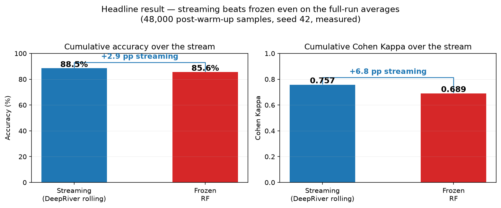
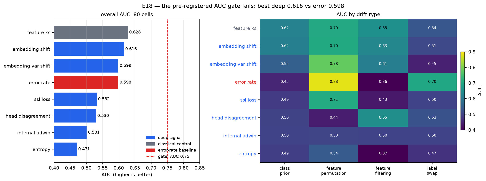
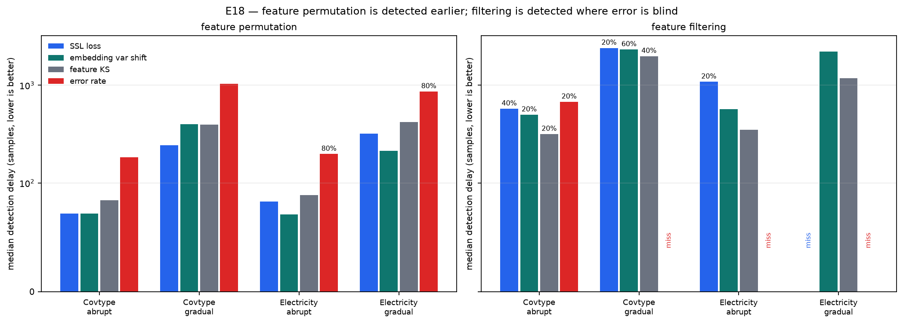
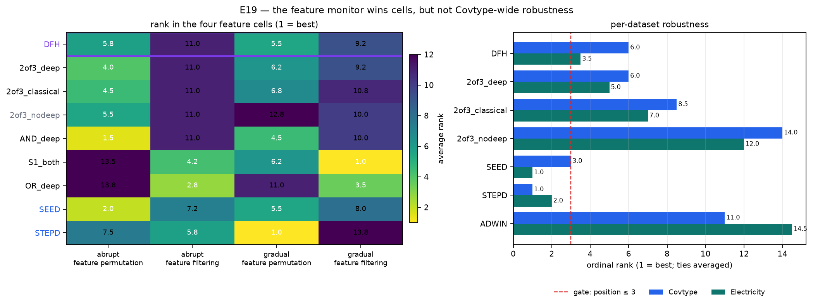

# Results — the measured verdicts, all experiments

**What this page is:** the project's **global results file**. One page that holds
the *conclusion* of every experiment — not the effort, not the logs, not the
milestones: the bottom line, the numbers that back it, and the process that
produced it. Written for management review; every figure and number traces to a
data artifact (`experiments/*/results.json`).

**How this page updates:** an experiment is added here **only when it concludes**,
as a single row in the verdict registry (§4) plus its measured evidence (§3). The
global verdict (§1) is re-stated over all concluded experiments whenever one lands.

| | |
|---|---|
| **Status** | 12 concluded: Exp-01, Exp-02, **E01 metric v2 correction (clean panel)**, **E03 baseline ladder (11 seeds)**, **E04 detector map first pass (5 seeds)**, **E14 real-stream model check (provisional 5-seed slice)**, **E17 real-stream detector check (5 seeds)**, **KDD'26 six-detector reproduction (50 trials)**, **E18 deep-signal gate (negative)**, **E19 DF-H v1 pilot (gate failed)**, **E21 Delay Tax fixed-delay headline**, **E22 detector shootout (DF-H beats the requested classical panel)**; **E21 is the surviving headline** ([Roadmap v2](Roadmap-v2.md)) |
| **Data artifacts** | `experiments/exp01/results.json` · `experiments/exp02/results.json` · `experiments/results/e01/` (**corrected metric, clean rerun**) · `experiments/results/e03/` (**baseline ladder**) · `experiments/results/e04/` (**detector map**) · `experiments/results/e14/` (**real-stream model check**) · `experiments/results/e17/` (**real-stream detector check**) · `experiments/results/e18/` + `experiments/data/deep_signals/pilot/` (**deep signal gate**) · `experiments/results/e19_kdd_pilot/` (**DF-H v1 pilot**) · `experiments/results/e21/` (**Delay Tax fixed-delay headline**) · `experiments/results/e22_detector_shootout/` (**detector shootout**) · `experiments/results/kdd_bench_full/` (**KDD'26 reproduction**) · `experiments/results/_archive/e01_5model/` (**pre-fix panel, superseded**) |
| **Method / protocol** | [`thesis.md`](../Phase1:Experimentation/thesis.md) · [`streaming-vs-batch-metrics.md`](../Phase1:Experimentation/streaming-vs-batch-metrics.md) |
| **Formatting note** | unicode math (τ, κ₀, Δκ, ≈, ≥) renders identically in Obsidian, GitHub, mkdocs |

---

## 1. The global verdict

> **A model that keeps learning from the stream heals itself after a concept
> change — a model that was trained once and frozen does not.**
> Across **11 seeds**: the frozen model recovered on **0 of 11** runs. The
> corrected metric (E01) prices the damage over a fixed 5,000-sample window with
> a panel-shared reference: **74.8 ± 61.8** vs **515.0 ± 97.1** samples·κ, a
> **≈ 6.9×** gap. Over the rest of the stream the gap is **≈ 10.8×**
> (**321.4** vs **3,472.9**). The streaming model also wins the overall
> averages: **88.3% vs 85.4%** accuracy, **0.753 vs 0.685** Cohen Kappa.
> Recovery is **8/11** seeds with a real excursion (285–4,279 samples); the old
> “0 on 8/11” was an artefact of the τ-anchored rule. The legacy **294×** and
> **24×** figures are retired as upper bounds; on the clean panel the worst
> DeepRiver seed (217.9) is **0.74×** the best frozen seed (295.2).

> **Detector track (2026-11-14).** E18/E19 are negative on their pre-registered
> gates, but the focused **E22** shootout shows DF-H is **3rd overall (7.34)**,
> ahead of HDDM-W (7.47), ADWIN (9.94), HDDM-A (11.34) and PageHinkley (12.53)
> — behind only the KDD top two, SEED and STEPD — with a 0.04 FAR and a clear
> feature-permutation win. **E21** is the surviving headline: a label-free Stage-1
> warning in **70–513** samples vs **2,120–3,269** for the error-only panel at
> `L = 2,000`. The detector is a strong feature-drift warning system, not a
> top-2 universal detector.

!!! warning "Metric correction — read this before quoting any number below"
    Sections 3a and 3b use the original `damage_area` definition, which
    integrated from τ to the recovery point. On 8/11 seeds recovery collapsed to
    τ, truncating the streaming integral. **294× and 24× are upper bounds and are
    retired.** The corrected numbers are in §3c and
    [`E01-metric-v2.md`](E01-metric-v2.md).

*Figure 1 — how every experiment in this file runs: one stream, two models in the
same race, one prequential scoreboard, one verdict. No result below was produced
any other way.*

### Why this matters, in one line each

| | Streaming model (keeps learning) | Frozen model (trained once) |
|---|---|---|
| Reacts to change on its own? | **Yes** — adapts on its own error signal | **No** — waits for a human to retrain |
| Recovery after the drift at τ | **8/11 seeds** with a real excursion; 285–4,279 samples | **never** — 0 of 11 seeds recovered |
| Skill lost, corrected `damage_ref` (5k window) | **74.8 ± 61.8** samples·κ (worst 217.9) | **515.0 ± 97.1** samples·κ (best 295.2) |
| Skill lost over the rest of the stream (`damage_full`) | **321.4 ± 203.8** samples·κ | **3,472.9 ± 559.7** samples·κ |
| Overall quality (full run, 48k samples) | **0.883** acc · **0.753** κ | 0.854 acc · 0.685 κ |

---

## 2. The process — how results are produced

One experiment = **one controlled race**, run identically for both models on the
same data in the same order. Three non-negotiable rules keep the comparison fair:

1. **Prequential scoring** — every sample is scored *before* it trains the model
   (test-then-train). No model ever sees a future sample.
2. **Same warm-up, same data** — both models train on the same first 20% of the
   stream; the frozen model never updates after that, the streaming model updates
   on every sample.
3. **Measured, not asserted** — every number in this file is read from a committed
   `results.json`; figures are re-rendered from that file, never hand-drawn.

The scoreboard metrics used in every verdict:

| Metric | What it measures | Good direction |
|---|---|---|
| Accuracy / Cohen Kappa (rolling, w = 1,000) | classification skill over time, chance-corrected | ↑ |
| κ_ref — shared pre-drift reference | mean pre-drift skill across the model panel | reference level |
| Δκ — dip depth | how much skill the drift knocks off, relative to κ_ref | ↓ (shallower) |
| **`recovery_rate`** | fraction of episodes with a real band exit followed by 500 in-band samples | ↑ |
| **`damage_ref`** (primary) | fixed-window integral `Σ max(κ_ref − κ(t), 0)` — cannot be gamed by a weak model's own baseline | ↓ |
| **`damage_full`** | the same integral over the rest of the stream | ↓ |
| **`AUE`** | mean error minus the **timing-oracle** error; secondary, because the oracle is not an upper bound | ↓ |
| ~~Recovery time / damage area~~ | legacy Exp-01/02 definitions; kept only for audit, superseded by E01 | — |

---

## 3. Measured evidence

### 3a. Exp-01 — SEA, one abrupt drift (seed 42)

The first data point. Measured 2026-09-09, seed 42, 60,000 samples, abrupt drift
at τ = 30,000, 10% label noise. Streaming model: DeepRiver rolling deep classifier
(RNN head, window = 500). Frozen model: Random Forest (100 trees) trained once on
the warm-up. Full series: `experiments/exp01/results.json`.

*Figure 2 — the overall race, 48,000 post-warm-up samples. The streaming model
wins the cumulative scoreboard as well as the reactivity contest: +2.9 pp accuracy
and +6.8 pp Cohen Kappa.*

*Figure 3 — the verdict in one picture. Before the drift both models sit at the
same skill level (κ₀ ≈ 0.755–0.759). At τ the frozen model (red) falls to 0.592
and stays down; the streaming model (blue) dips only to 0.703 and is back inside
its own band 835 samples later — with no human intervention.*

*Figure 4 — the two decisive columns. Recovery: 835 samples vs never. Damage paid
for the drift: 31 vs 3,307 samples·κ (log scale).*

| Drift-window metric (τ = 30,000) | Streaming (DeepRiver rolling) | Frozen (RF) |
|---|---|---|
| Pre-drift baseline κ₀ | 0.755 | 0.759 |
| Minimum rolling Kappa after τ | 0.703 | 0.592 |
| Dip depth Δκ | **0.052** (shallow) | 0.167 (3× deeper) |
| **Recovery time** | **835 samples** — inside the pre-registered 5,000 budget | **never** |
| **Damage area** | **31** samples·κ | **3,307** samples·κ |

### 3b. Exp-02 — the 11-seed sweep (is Exp-01's number reproducible?)

The statistical data point. Measured 2026-09-12: **exactly the Exp-01 replica** — same
stream, same two models, same warm-up, same prequential loop, same metric definitions —
rerun on **11 seeds** (42, Exp-01's, plus 0–9), changing nothing but the seed. Full
per-seed detail: `experiments/exp02/results.json`. Seed 42 reproduced Exp-01 **exactly**
(835 samples, delta 0), so the sweep is a genuine rerun of the same experiment.

*Figure 5 — left: recovery time per seed; 8 of 11 seeds sit on the metric floor (0 =
never left the pre-drift band) and the rest recover in 174–2,497 samples, all inside the
5,000 budget. Right: damage area per seed (log scale); the 5 seeds with exactly zero
measured damage are drawn as hatched stubs. The damage gap is stable; the recovery
number is not.*

| Metric (11 seeds) | Streaming (DeepRiver rolling) | Frozen (RF) |
|---|---|---|
| Pre-drift baseline κ₀ | 0.751 ± 0.017 | **0.767 ± 0.018** |
| Dip depth Δκ | **0.045 ± 0.015** | 0.173 ± 0.018 |
| Recovery time (samples from τ) | **median 0**, mean 319 ± 765 (0 / 174 / 835 / 2,497) | **never, 11/11** |
| Damage area (samples·κ) | **13 ± 31** (median ≈ 0.001, max 103) | 3,710 ± 592 (min 2,439, max 4,368) |
| Full-run accuracy | **0.8830 ± 0.0021** | 0.8539 ± 0.0017 |
| Full-run Cohen Kappa | **0.7530 ± 0.0044** | 0.6850 ± 0.0035 |

*Figure 6 — the same damage numbers as a distribution: one dot per seed, median marked.
Every frozen seed sits in a narrow band; every streaming seed is two orders of magnitude
below it. Median ≈ 0.001 vs 3,822 samples·κ.*

**What the sweep settles.** Exp-01's specific **835** was a property of seed 42, not of
the method: across 11 seeds the recovery time is 0 on eight seeds (no excursion to
recover from) and 174 / 835 / 2,497 on the other three. What *is* stable is everything
the claim actually rests on — the frozen model never recovers (0/11, no exceptions), the
damage gap is two orders of magnitude on the mean and **24× even worst-case-vs-best-case**,
and the streaming dip is consistently ~3.8× shallower. Exp-02 also mildly **restores**
Exp-01's refuted control expectation: the frozen model *does* start ahead while the
concept is stationary (κ₀ 0.767 vs 0.751), and still loses the full run because it
collapses at τ.

**One methodological finding, recorded not patched.** The recovery-time rule looks for
the first sustained in-band run *starting at τ*, so a model that stays in band for the
first 500 samples and dips afterwards is scored 0. Seven of eleven seeds did leave the
band after τ, but only the three with an *early* excursion are credited with a recovery
time — which makes recovery non-monotone in dip depth (seed 3 dips deeper than seed 9
yet scores 0). **Damage area and dip depth are the trustworthy drift-window metrics;
recovery time is meaningful only conditional on an early excursion.** Details in the
[Exp-02 write-up](../Phase1:Experimentation/exp02-seed-sweep-sea.md) §6c.

*Figure 7 — the flaw in one picture. Green = an excursion early enough for its recovery
to be credited; orange X = a seed that did leave its band but was scored 0 because the
excursion began after τ + 500; hollow blue = never left the band. Four of the eleven
seeds are orange — which is why the mean recovery time is not a property of the model.*

### 3c. E01 — corrected metric v2 (11 seeds, 2026-11-12)

This supersedes the damage numbers in 3a and 3b. E01 re-ran the same SEA/DeepRiver
vs frozen pilot with a fixed-window, panel-shared damage metric and recovery
conditional on a real band exit.

| Metric (11 seeds) | DeepRiver | Frozen RF |
|---|---:|---:|
| **`damage_ref`** (5k window, primary) | **74.8 ± 61.8** (worst 217.9) | **515.0 ± 97.1** (best 295.2) |
| **`damage_full`** (rest of stream) | **321.4 ± 203.8** | **3,472.9 ± 559.7** |
| `AUE` vs timing oracle | **−0.0472 ± 0.0058** | +0.0010 ± 0.0027 |
| `recovery_rate` | **8/11** | **0/11** |
| Recovery time, recovered seeds | 285–4,279 (mean 1,502) | never |
| Full-run accuracy / Cohen κ | **0.883 / 0.753** | 0.854 / 0.685 |

*Figure 8 — the corrected comparison. Left: `damage_ref`; right: AUE against the
timing oracle. AUE is secondary because the timing oracle knows when the drift
happened but not what the new concept is; its own damage (505) is almost identical
to frozen. The primary result is the `damage_ref` gap.*

**Verdict.** Frozen recovered on **0/11** seeds. DeepRiver's `damage_ref` was lower
on **11/11** seeds, with a **≈6.9×** mean gap and a **≈10.8×** full-stream gap. On
the clean panel the worst DeepRiver seed (217.9) is **0.74×** the best frozen seed
(295.2), so the legacy **24×** worst-case claim is retired along with the **294×**
mean. The clean headline is: *the frozen model never recovers, and the streaming
model pays roughly one seventh of the fixed-window damage.* The full write-up is
[`E01-metric-v2.md`](E01-metric-v2.md).

!!! note "Clean panel"
    The E01 rerun contains only DeepRiver, frozen RF, and the timing oracle. The
    earlier artifact that also included HT/HAT (a since-fixed host-default bug) is
    archived at `experiments/results/_archive/e01_5model/` and is superseded by
    the numbers above.

### 3d. E04 — detector map, first pass (5 seeds, 2026-11-12)

Eight detectors were replayed on the raw and smoothed mistake streams of two
hosts, across four generators and four drift shapes. This is the first map of
“which alarm works for which change”.

| Drift shape | Best default | Balanced score | Changes caught | False alarms /1k | Detection delay |
|---|---|---:|---:|---:|---:|
| Abrupt | **HDDM-A, raw** | **0.683** | 75% | 0.0075 | 0.185 |
| Gradual | **HDDM-A, raw** | **0.842** | 95% | 0.0083 | 0.155 |
| Incremental | **HDDM-A, raw** | **0.883** | 90% | 0.0033 | 0.012 |
| Recurring | **HDDM-A, raw** | **0.500** | 73% | 0.0308 | 0.144 |

*Figure 9 — balanced score per detector and drift shape on the static host, raw
signal. HDDM-A is the best cell for every shape; recurring drift is the hard
case.*

**Verdict.** **HDDM-A on the raw signal is the sensible default** across all four
shapes. Recurring change is the hard case (0.50); incremental is the easiest
(0.88). Smoothing the mistake signal raises false alarms without improving the
ranking; the raw channel is the default and the smoothed channel is a diagnostic.
This is a 5-seed first pass with default detector settings, not the full
pre-registered matrix. The full write-up is
[`E04-detector-map.md`](E04-detector-map.md).

!!! warning "Scoring bug found and fixed"
    The first E04 report selected KSWIN for incremental with F1 = 1.0 and episode
    recall = 0.25. That was impossible: zero-alarm runs had `precision = None` and
    were excluded from the F1 mean. The corrected report recomputes F1 from raw
    TP/FP/episode counts and treats zero alarms as F1 = 0. The “KSWIN perfect”
    result is retired.

### 3e. E17 — the detector map on a real stream (Elec2, 5 seeds, 2026-11-13)

E04's eight detectors were replayed on real electricity-market records: 45,312
rows of Elec2, shuffled per seed, with a known label-swap drift injected at
`τ = 22,656`. This is the first real-data check of the detector map. Mean over
5 seeds, raw channel, corrected balanced score:

| Drift shape | HDDM-A, static HT | ADWIN, static HT | HDDM-A, adaptive HAT | ADWIN, adaptive HAT |
|---|---:|---:|---:|---:|
| Abrupt | **0.933** | 0.452 | 0.400 | **1.000** |
| Gradual | **0.960** | 0.495 | 1.000 | 1.000 |
| Incremental | **0.960** | 0.842 | **1.000** | 0.971 |
| Recurring | **0.787** | 0.508 | 0.593 | **0.770** |

**Verdict.** The E04 default is **host-conditional on real data**. On the static
Hoeffding Tree, HDDM-A repeats the synthetic result and wins all four shapes. On
the adaptive HAT it does not: ADWIN wins abrupt (1.000 vs 0.400) and recurring
(0.770 vs 0.593), ties gradual, and loses only incremental. Across the better
host/channel per detector, mean F1 is ADWIN **0.935** vs HDDM-A **0.910**. The
one-sided Hoeffding test can miss an abrupt change that an adaptive learner
repairs quickly; ADWIN's two-sided window comparison still sees it. Recurring
remains the hard case. Five seeds, one dataset, one injected mechanism — this is
a warning, not a final ranking. The full write-up is
[`E17-real-detector-map.md`](E17-real-detector-map.md).

### 3f. E14 — the real-stream model check (5 seeds, 2026-11-14)

E14 replayed the streaming-vs-frozen comparison on real features and labels:
Elec2 (45,312 rows) and Phishing (1,250 rows), with label-swap and
feature-permutation drift injected at a known point. Five seeds, 100 runs,
metric v2. Pooled over 20 dataset × mechanism × seed cells:

| Model | Accuracy | Cohen κ | `damage_ref` | `damage_full` | Recovery rate |
|---|---:|---:|---:|---:|---:|
| Frozen RF | 0.685 | 0.395 | 297.4 | 4,703.0 | 0.00 |
| **ARF** | **0.875** | **0.724** | **198.0** | **2,684.8** | **0.20** |
| HAT | 0.803 | 0.583 | 245.7 | 3,019.6 | 0.15 |
| DriftFormer | 0.770 | 0.524 | 284.9 | 3,497.5 | 0.00 |
| Oracle refit | 0.698 | 0.415 | 280.3 | 4,518.3 | 0.00 |

**Verdict.** ARF leads on both datasets (Elec2 `damage_ref` 202.4 vs frozen
295.0; Phishing 193.5 vs 299.8), and the provisional acceptance rules pass:
pooled damage ratio **0.666×**, ARF lower in **18/20** cells, frozen recovered
**0/20**, κ gain **+0.329**. DriftFormer beats frozen on κ but not on damage — on
Elec2 it pays slightly more (314.7 vs 295.0). That is the expected negative that
justifies using the deep model as a **signal extractor**, not as the KDD host.
Two datasets, five seeds and one injected mechanism per stream: **provisional,
not field-wide**. The full write-up is [`E14-real-streams.md`](E14-real-streams.md).

### 3g. E03 — the baseline ladder (11 seeds, 2026-11-14)

E03 ran the full 11-seed ladder on SEA and Hyperplane: frozen RF, three
scheduled-retrain intervals, static and adaptive trees, ARF, Leveraging Bagging,
ADWIN Bagging, and the timing oracle. 220 model runs, 220 episodes.

| Model | Accuracy | Cohen κ | AUE | `damage_ref` | Recovery rate |
|---|---:|---:|---:|---:|---:|
| **Leveraging Bagging** | **0.857** | **0.707** | **−0.0469** | **455.7** | **1.000** |
| HAT | 0.847 | 0.685 | −0.0447 | 489.2 | 0.955 |
| ARF | 0.839 | 0.671 | −0.0368 | 575.4 | 0.591 |
| ADWIN Bagging | 0.853 | 0.698 | −0.0293 | 614.1 | 1.000 |
| Hoeffding Tree | 0.844 | 0.679 | −0.0200 | 700.8 | 0.955 |
| Scheduled RF, 1k | 0.855 | 0.702 | −0.0161 | 733.5 | 1.000 |
| Scheduled RF, 5k | 0.850 | 0.692 | −0.0056 | 824.1 | 1.000 |
| Scheduled RF, 20k | 0.838 | 0.667 | −0.0021 | 849.4 | 0.682 |
| Frozen RF | 0.810 | 0.609 | +0.0004 | 871.7 | 0.000 |
| Oracle refit | 0.811 | 0.609 | 0.0000 | 864.3 | 0.000 |

**Verdict.** Every streaming adapter pays less damage than frozen RF and than
every scheduled-retrain interval. The best streaming adapter is **Leveraging
Bagging (455.7)**, then HAT (489.2) and ARF (575.4); the 1k scheduled model is
the best batch baseline (733.5) but still pays **1.6×** the LB damage. The
pre-registered acceptance cell passes: ARF's AUE (−0.0368) is better than
scheduled-5k's (−0.0056).

**Phase-noise caveat.** The scheduled models recover by construction at each
retrain tick, so recovery rate is not the comparison — `damage_ref` is. The
phase-noise test is **inconclusive**: the refit buffer (12,000) is longer than
the 1k and 5k intervals, so recovery lag is buffer-dominated, not phase-driven;
only the 20k cell satisfies the design and it has one observation. The honest
conclusion is that the ladder orders the models, not that recovery is uniform
over a retrain interval. Artifact:
`experiments/results/e03/summary.json` and `schedule_test.json`.

### 3h. E18 — the deep signal gate (80 cells, 2026-11-14)

A frozen SSL-pretrained DriftFormer encoder was asked whether its label-free
signals beat the raw error rate on 2 datasets × 4 drift types × 2 transitions ×
5 trials. The pre-registered AUC gate was one deep signal at **≥ 0.75** and
**≥ 0.10 above** the error rate.

| Signal | AUC | vs error |
|---|---:|---:|
| `feature_ks` (classical control) | **0.628** | +0.029 |
| `embedding_shift` | **0.616** | +0.017 |
| `embedding_var_shift` | 0.599 | +0.000 |
| `error_rate` | 0.598 | — |
| `ssl_loss` | 0.532 | −0.067 |

**Verdict: FAIL.** Best deep signal **0.616**, far short of 0.75. The deep view
has power on feature permutation (`embedding_var_shift` 0.781), but the error
rate is stronger there (0.879); label-only drift stays with Stage 2. A
FAR-calibrated timing diagnostic at 0.1/1k shows Stage 1 detects feature
permutation 2–5× earlier than error and detects feature filtering when error is
blind — but the classical `feature_ks` control is often just as fast, so the
deep marginal value is unproven. Full page:
[`E18-deep-signals.md`](E18-deep-signals.md).

*E18 — the deep signals cluster around the error-rate baseline overall; the
feature-permutation cell is where they have real power, but the error rate is
stronger there.*

*E18 timing — feature signals alarm before the error rate on feature
permutation, and detect feature filtering where the error rate misses. “miss”
means no alarm inside the 2,500-sample budget; percentages mark hit rates below
100%.*

### 3i. E19 — DF-H v1 pilot (80 cells, 2026-11-14)

Rule-based fusion of Stage 1 (deep, classical, both) with SEED, STEPD, ADWIN
and HDDM-A on the same 80 cells.

| Detector | Mean F1 | FAR/1k | Overall rank |
|---|---:|---:|---:|
| STEPD | **0.281** | 0.05 | **5.22** |
| SEED | 0.267 | 0.06 | **5.44** |
| **DFH = 2of3_both** | 0.223 | **0.04** | **7.09** |
| `2of3_deep` | 0.221 | 0.04 | 7.12 |
| HDDM-W | 0.170 | 0.28 | 7.31 |
| `OR_deep` | 0.178 | 0.15 | 7.72 |
| `S1_both` | 0.160 | 0.13 | 8.50 |
| `AND_deep` | 0.201 | **0.01** | 8.53 |
| ADWIN | 0.117 | 0.11 | 9.59 |
| `2of3_nodeep` (control) | 0.154 | 0.03 | 9.97 |

**Verdict: FAIL.** DFH is **3rd**, not top-2; it wins no feature cell as the
primary, is **tied 5th–7th on Covtype** (average position 6.0; rank value
7.44), and passes only the FAR check (0.04 vs ADWIN 0.11). Ablations own
feature cells (`AND_deep` abrupt permutation 1.50; `S1_both` gradual filtering
1.00), and DFH beats the no-feature control by 2.9 ranks — so the feature
monitor adds information, but the fixed 2-of-3 rule is not top-2. **No full E20
run**; E21 Delay Tax is the next headline. Full page:
[`E19-hybrid-detector.md`](E19-hybrid-detector.md).

*E19 — DFH is third overall, behind STEPD and SEED, with the lowest FAR of the
competitive rows.*

*E19 — the ablations own feature cells, but DFH is tied 5th–7th on Covtype and
tied 3rd–4th on Electricity, so the strict dataset-robustness bar fails.*

### 3j. E21 — the Delay Tax, fixed-delay headline (2026-11-14)

The surviving contribution. An error-only detector cannot react until the
post-drift labels arrive, so its detection time is floor-bound at `τ + L`. A
label-free Stage 1 monitor is not. This is the fixed-delay Lemma-1 synthesis on
the same 80 KDD cells as E19.

At `L = 2,000` samples, detection delay after onset:

| Cell | Stage 1 deep | Stage 1 classical | SEED | STEPD | ADWIN |
|---|---:|---:|---:|---:|---:|
| Covtype, abrupt | **70** | 90 | 2,130 | 2,120 | 2,472 |
| Covtype, gradual | **306** | 406 | 2,710 | 2,616 | — |
| Electricity, abrupt | **76** | 196 | 2,129 | 2,180 | 3,269 |
| Electricity, gradual | **293** | 513 | 2,701 | 2,694 | — |

**Verdict: the label tax is real, and Stage 1 does not pay it.** Stage 1 warns
**4–30× earlier** than the error-only panel at `L = 2,000`; its delay is flat in
`L`, while every error-only detector shifts by `L`. The honest limit: Stage 1 is
blind to label-only drift, so the result is a **warning/confirmation split**
(`T_warn` vs `T_confirm`), not a standalone detector. The full
stochastic/partial/selective/batch regime matrix is scaffolded but not yet run.
Full page: [`E21-delay-detector.md`](E21-delay-detector.md).

*E21 fixed-delay headline. Flat blue/gray lines are label-free Stage 1; dashed
red/orange/purple lines are error-only detectors at `base + L`.*

### 3k. E22 — detector shootout (80 cells, 2026-11-14)

A focused capability check on the datasets in the repo: our DF-H and Stage-1
monitor against **ADWIN, HDDM-A, HDDM-W and PageHinkley**, with SEED/STEPD as the
KDD reference.

| Detector | Mean F1 | FAR/1k | Overall rank |
|---|---:|---:|---:|
| **STEPD** (ref) | **0.281** | 0.05 | **5.44** |
| **SEED** (ref) | 0.267 | 0.06 | **5.59** |
| **DF-H (ours)** | **0.223** | **0.04** | **7.34** |
| HDDM-W | 0.170 | 0.28 | 7.47 |
| Stage 1 both | 0.160 | 0.13 | 8.66 |
| Stage 1 deep | 0.144 | 0.12 | 9.00 |
| ADWIN | 0.117 | 0.11 | 9.94 |
| HDDM-A | 0.128 | 0.04 | 11.34 |
| PageHinkley | 0.018 | 0.01 | 12.53 |

**Verdict: DF-H beats the requested classical panel.** It is **3rd overall**,
ahead of HDDM-W (7.47), ADWIN (9.94), HDDM-A (11.34) and PageHinkley (12.53),
with the lowest FAR of the high-F1 rows. On feature permutation it beats every
requested classical detector (**5.8 abrupt / 5.5 gradual** vs 8.8–16.0). It does
**not** beat SEED/STEPD, HDDM-W wins Covtype (6.1 vs 7.9) and abrupt filtering
(4.0 vs 11.5), and the Stage-1-only variants are the right tool on filtering.
Full page: [`E22-detector-shootout.md`](E22-detector-shootout.md).

*E22 — DF-H is third overall and sits at low FAR; SEED/STEPD remain ahead.
HDDM-W buys F1 with a much higher false-alarm rate; PageHinkley barely alarms
and barely scores.*

---

## 4. Verdict registry — one conclusion per experiment

The cumulative table. Rows land here **only with a measured verdict**; scheduled
experiments are listed so the roadmap is visible, with their acceptance bar.

| Exp | Question asked | Setting | Verdict (measured) | Conclusion |
|---|---|---|---|---|
| **Exp-01** ✅ *(legacy metric)* | Can a streaming deep learner beat a *frozen* batch model on a drifting stream? | SEA, one abrupt drift, 2 models, seed 42 | **Streaming wins** — recovers in 835 samples (frozen: never); legacy damage 31 vs 3,307 | Weakest form of the claim **confirmed**. The 835/damage numbers are superseded by E01 |
| **Exp-02** ✅ *(legacy metric)* | Is the 835-sample recovery a fluke of one seed? | SEA, one abrupt drift, 2 models, **11 seeds** | **Streaming wins on every seed** — frozen recovered **0/11**; legacy damage **13 ± 31** vs **3,710 ± 592** (≈294×; 24× worst-vs-best) | The claim **generalises**; the legacy magnitudes are **upper bounds** and retired by E01. Frozen still wins the stationary phase (κ₀ 0.767 vs 0.751) |
| **E01** ✅ | Does the corrected metric preserve the Exp-01/02 verdict? | SEA abrupt, **11 seeds**, metric v2, clean panel | **Frozen recovered 0/11; DeepRiver `damage_ref` lower 11/11; 74.8 ± 61.8 vs 515.0 ± 97.1 (≈6.9×); `damage_full` 321.4 vs 3,472.9 (≈10.8×); recovery 8/11; worst-vs-best 0.74×** | The claim **survives**, the magnitude shrinks. **294× and 24× retired.** AUE is secondary: the timing oracle is weak (damage 505). Panel is DeepRiver + frozen + oracle; the pre-fix four-model artifact is archived |
| **E04** ✅ *(first pass, 5 seeds)* | Which detector works for which drift shape, and does the host matter? | 4 generators × 4 shapes × 8 detectors × 2 hosts × raw/EWMA, 5 seeds | **HDDM-A raw is best for all four shapes; balanced score 0.683 abrupt, 0.842 gradual, 0.883 incremental, 0.500 recurring; recurring is hardest; EWMA raises false alarms** | One sensible default exists **on the static host and synthetic generators**; recurring drift is the hard case. A scoring bug that made a never-ringing detector look perfect was found and fixed. E17 shows the default is host-conditional on real Elec2; the full 11-seed matrix and tuning are pending |
| **E17** ✅ *(real stream, 5 seeds)* | Does the E04 detector default survive on real data? | Elec2 label-swap, 4 shapes × 8 detectors × 2 hosts × raw/EWMA, 5 seeds | **On static HT, HDDM-A raw wins all four (F1 0.933/0.960/0.960/0.787); on adaptive HAT, ADWIN wins abrupt (1.000 vs 0.400) and recurring (0.770 vs 0.593); best-host mean F1 ADWIN 0.935 vs HDDM-A 0.910** | The synthetic default is **host-conditional**; “wins all four” does not transfer to the adaptive host. Recurring remains hardest. The 50-trial KDD'26 run confirms SEED/STEPD (2.12) beat HDDM-A (3.87); ABCD/ABCD(X) is cited from the paper, not re-run |
| **KDD'26** ✅ *(reproduction, 50 trials)* | Does HDDM-A remain the best detector on the paper's real-data benchmark? | 7 real datasets × 4 drift types × abrupt/gradual × 6 detectors, 50 trials | **SEED and STEPD tie for first (avg rank 2.12; mean F1 0.300/0.303); HDDM-A is fourth (3.87; 0.155), behind HDDM-W (3.56); DDM 4.54; ADWIN 4.80** | HDDM-A is **not** the best detector on real data. The ranking reproduces the KDD'26 paper and the F1 values match its tables. ABCD/ABCD(X) is cited from the paper, not re-run |
| **E03** ✅ *(11 seeds)* | Does streaming also beat a *scheduled-retrain* batch model (the honest industrial baseline)? | SEA + Hyperplane, 10-model ladder, 11 seeds, 220 runs | **Every streaming adapter beats frozen and every scheduled interval on `damage_ref`: LB 455.7, HAT 489.2, ARF 575.4 vs scheduled-1k 733.5 and frozen 871.7; acceptance AUE passes (ARF −0.0368 vs scheduled-5k −0.0056)** | The ladder confirms the damage ordering at 11 seeds. **Phase-noise claim is inconclusive**: the 12k refit buffer dominates the 1k/5k intervals; only the 20k cell is valid (n=1) |
| **E14** ✅ *(provisional, 2 datasets × 5 seeds)* | Does the streaming win survive on **real** streams, and can DriftFormer host? | Elec2 + Phishing, label-swap + feature-permutation, 5 seeds, 100 runs | **ARF leads both datasets: `damage_ref` 198.0 vs frozen 297.4 (0.666×), lower in 18/20 cells, κ 0.724 vs 0.395; frozen recovered 0/20; DriftFormer κ 0.524 and does not beat ARF** | Streaming adaptation survives the first real-stream check; DriftFormer is a **signal extractor, not the host**. Provisional: 2 datasets, 5 seeds; expansion deferred |
| **E18** ❌ *(signal gate, 80 cells)* | Does a label-free deep signal beat the error rate? | Covtype + Electricity × 4 drift types × 2 transitions × 5 trials | **Best deep AUC 0.616 vs error 0.598; feature permutation 0.781 vs 0.879; label-only ~0.51; timing at 0.1/1k: feature permutation 72–414 vs error 184–1,033; feature filtering detected where error is blind; `feature_ks` competitive** | **Gate FAIL.** Deep is a warning channel, not standalone; classical control travels to E19 |
| **E19** ❌ *(DF-H v1 pilot, 80 cells)* | Does DF-H fusion beat the scalar panel? | Same 80 cells; Stage 1 deep/classical/both + SEED/STEPD/ADWIN/HDDM-A | **DFH 3rd (rank 7.09; F1 0.223; FAR 0.04) behind STEPD 5.22 and SEED 5.44; no primary feature-cell win; Covtype tied 5th–7th; ablations `AND_deep` 1.50 abrupt permutation and `S1_both` 1.00 gradual filtering; beats no-feature control 9.97** | **Gate FAIL.** Feature monitor adds value but not top-2; no full E20; E21 is next |
| **E21** ✅ *(fixed-delay headline)* | Does label delay create a floor for error-only detectors that a label-free warning avoids? | Same 80 KDD cells; Stage 1 vs SEED/STEPD/ADWIN at L = 0…10k | **At L = 2k: Stage 1 deep 70–513 samples vs SEED/STEPD 2,120–2,710 and ADWIN 2,472–3,269; Stage 1 flat in L, error-only shifts by L** | **The surviving headline.** Label-free warning is not floor-bound; the honest result is `T_warn` vs `T_confirm`, not a standalone detector. Full regime matrix scaffolded, not run |
| **E22** ✅ *(detector shootout)* | What is DF-H capable of against ADWIN / HDDM-A / HDDM-W / PageHinkley? | Same 80 cells; requested classical panel + SEED/STEPD reference | **DFH 3rd (7.34; F1 0.223; FAR 0.04) ahead of HDDM-W 7.47, ADWIN 9.94, HDDM-A 11.34, PageHinkley 12.53; behind STEPD 5.44/SEED 5.59; feature permutation 5.8/5.5 vs panel 8.8–16.0; Covtype HDDM-W 6.1 vs DFH 7.9** | **Capability proven vs the requested panel**, not top-2; feature filtering better in the Stage-1-only ablation |
| **E15** ⏳ *(replaced by E21)* | The **Delay Tax**: do delayed/rare labels starve batch retraining while streaming keeps working? | label-delay sweep | *pending — replaced by E21* | acceptance: streaming quality degrades slower under delay; E21 adds the DF-H detector benchmark |

*Scope guard: Exp-01 is deliberately the easiest possible version of the claim
(one synthetic stream, no scheduled retrain, no label delay, single seed). Each
row above removes one of those cushions. The global verdict stands on what is
measured today and is re-stated as rows conclude.*

---

## 5. The verdict vs what was promised

The project pre-registered its expectations *before* running (thesis §6), so the
results can be checked against the promises rather than reported after the fact.

### 5a. Exp-01 — pre-registered expectations vs measured

| Pre-registered expectation | Expected | Measured (Exp-01) | Verdict |
|---|---|---|---|
| Streaming recovery is bounded | ~250–350 samples | **835 samples** | **PASS** (same order; well inside the 5,000-sample falsification budget) |
| Frozen model never recovers | never | **never** (still depressed at stream end) | **PASS** |
| Frozen pays unbounded damage | unbounded | 3,307 vs 31 samples·κ | **PASS** (≈ 106×) |
| Dip is shallow for streaming, deep for frozen | shallow vs deep | 0.052 vs 0.167 | **PASS** |
| Frozen wins cumulative accuracy (honest control) | batch ahead in steady state | streaming wins 0.757 vs 0.689 | **REFUTED — in our favour** on this seed |

*Figure 8 — pre-registered expectations (hatched) against measured results (blue):
the measured recovery is inside the promised regime, and the measured damage gap is
even larger than the thesis sketched.*

### 5b. Exp-02 — pre-registered acceptance vs measured *(legacy metric)*

| Pre-registered condition (fixed before the run) | Required | Measured | Verdict |
|---|---|---|---|
| Seeds | ≥ 10 | 11 | **PASS** |
| Recovery reported as a distribution | mean ± SD | mean 319 ± 765, median 0, range 0–2,497 | **PASS** — with a heavy-tail caveat: 8/11 seeds sit on the metric floor, so the mean is not a robust centre |
| Streaming recovers on every seed | every seed | 11/11 (8 of them never left the band) | **PASS** |
| Frozen never recovers on every seed | every seed | 11/11 | **PASS** |
| H2: frozen wins steady state (restated control) | frozen κ₀ ≥ streaming κ₀ | frozen 0.767 vs streaming 0.751 | **SUPPORTED** — unlike the single-seed Exp-01, where the two were level |

**Bottom line:** the falsification conditions set before the runs were not
triggered. Exp-01 showed the effect exists on one seed; Exp-02 shows the *claim*
holds on all eleven — the frozen model never recovers. The specific 835-sample
figure was seed luck and is retired. **E01 supersedes the damage magnitudes:** the
legacy 294×/24× are upper bounds; the corrected gaps are ≈6.9× (`damage_ref`) and
≈10.8× (`damage_full`), and on the clean panel the worst DeepRiver seed is 0.74×
the best frozen seed. The legacy worst-vs-best framing is **retired**. The one
control expectation Exp-01 refuted (batch winning steady state) is restored by the
larger sample, and streaming still wins the run outright.

---

## 6. Provenance

- Measured numbers: `experiments/exp01/results.json` · `experiments/exp02/results.json` ·
  `experiments/results/e01/summary.json` (**corrected metric**) ·
  `experiments/results/e03/summary.json` + `schedule_test.json` (**baseline ladder**) ·
  `experiments/results/e04/detections.jsonl` (**detector map raw counts**) ·
  `experiments/results/e14/summary.json` (**real-stream model check**) ·
  `experiments/results/e17/detector_report.json` (**real-stream detector check**) ·
  `experiments/results/e18/summary.json` + `detection.json` (**deep signal gate**) ·
  `experiments/results/e19_kdd_pilot/ranking.json` + `summary.csv` (**DF-H v1 pilot**) ·
  `experiments/results/e21/delay_floor.json` (**Delay Tax headline**) ·
  `experiments/results/e22_detector_shootout/ranking.json` + `summary.csv` (**detector shootout**)
- Full write-ups: [`exp01-deepriver-vs-frozen-sea.md`](../Phase1:Experimentation/exp01-deepriver-vs-frozen-sea.md) ·
  [`exp02-seed-sweep-sea.md`](../Phase1:Experimentation/exp02-seed-sweep-sea.md) ·
  [`E01-metric-v2.md`](E01-metric-v2.md) (**correction**) ·
  [`E04-detector-map.md`](E04-detector-map.md) (**detector map**) ·
  [`E14-real-streams.md`](E14-real-streams.md) (**real-stream model check**) ·
  [`E17-real-detector-map.md`](E17-real-detector-map.md) (**real-stream check**) ·
  [`E18-deep-signals.md`](E18-deep-signals.md) (**deep signal gate**) ·
  [`E19-hybrid-detector.md`](E19-hybrid-detector.md) (**DF-H v1 pilot**) ·
  [`E21-delay-detector.md`](E21-delay-detector.md) (**Delay Tax headline**) ·
  [`E22-detector-shootout.md`](E22-detector-shootout.md) (**detector shootout**)
- Benchmark reproduction: `experiments/kdd_bench.py` and `experiments/kdd_env/`
  (KDD'26 14-detector protocol; six-detector 50-trial run complete, ABCD/ABCD(X)
  arm pending; artifact `experiments/results/kdd_bench_full/`)
- Thesis + pre-registered expectations: [`thesis.md`](../Phase1:Experimentation/thesis.md)
- Protocol & metric definitions: [`streaming-vs-batch-metrics.md`](../Phase1:Experimentation/streaming-vs-batch-metrics.md)
- Milestone records: [`Sept9.md`](Sept9.md) (Exp-01)
- Figure sources: `experiments/scripts/make_results_figures.py` ·
  `experiments/scripts/make_exp01_summary_chart.py` ·
  `experiments/scripts/make_e18_e19_figures.py` (**E18/E19**) ·
  `experiments/scripts/make_e21_delay_figure.py` (**E21**) ·
  `experiments/scripts/make_e22_report_figures.py` (**E22**) ·
  `experiments/scripts/exp02_seed_sweep_sea.py --figure-only` ·
  `experiments/results/e01/figures/model_comparison.png` (E01)
