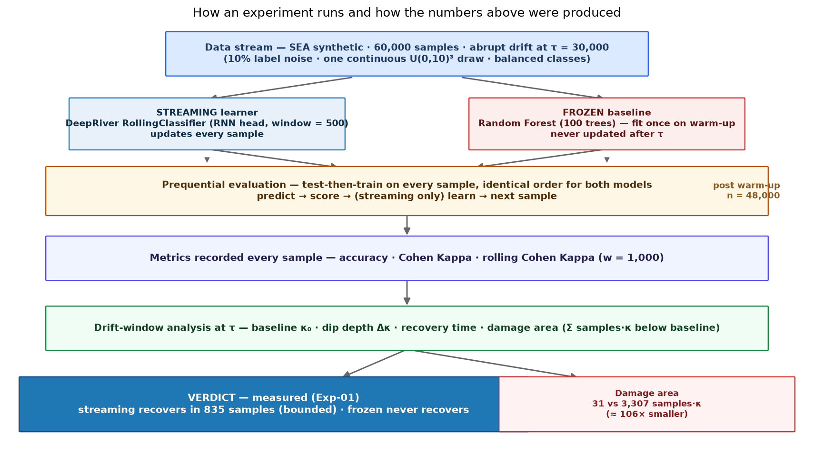
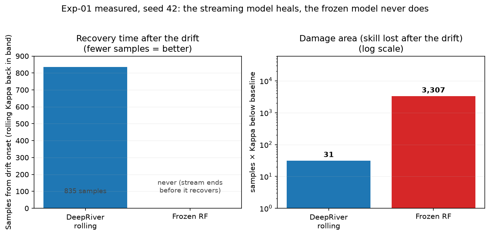
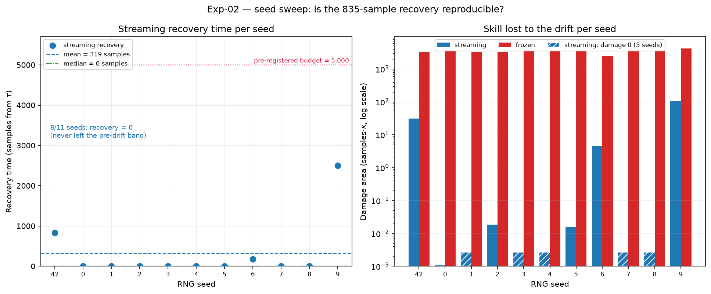
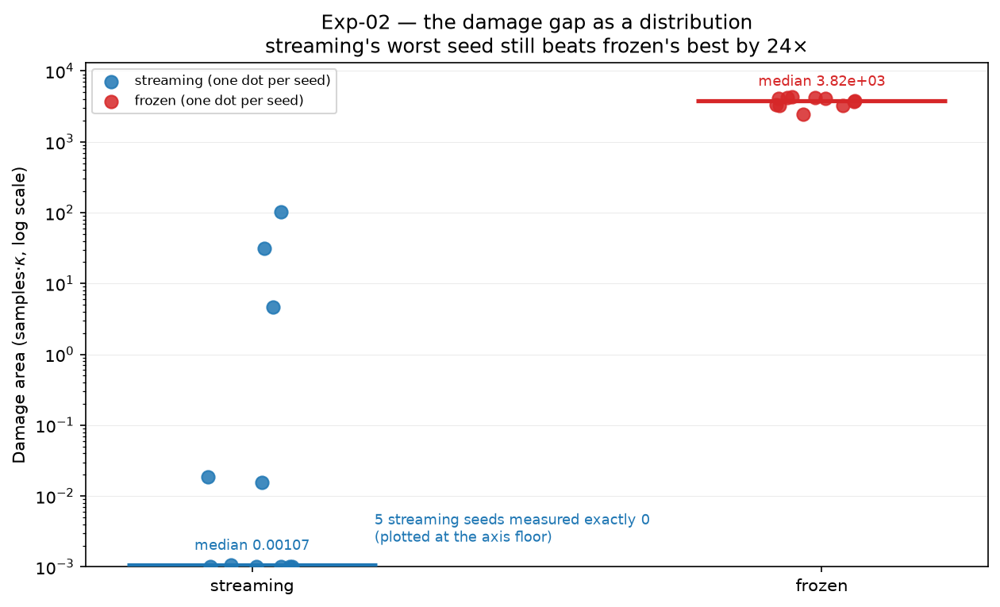
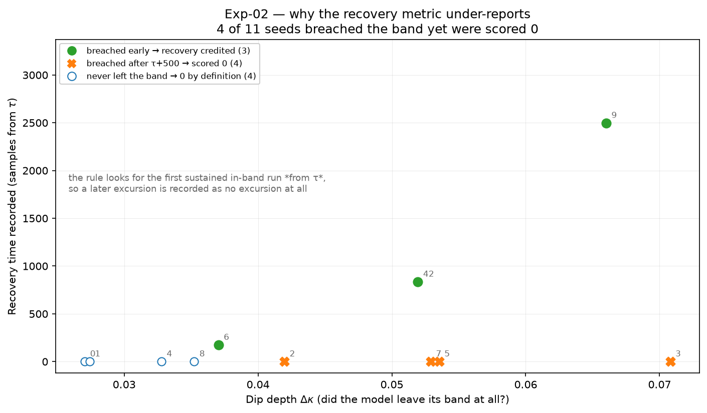
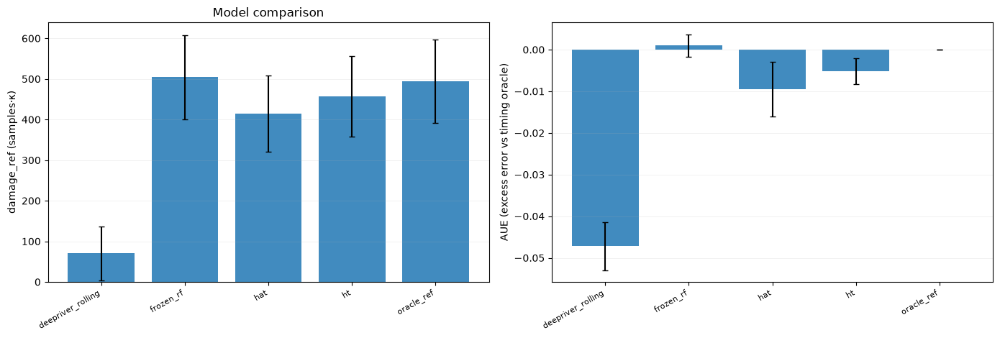
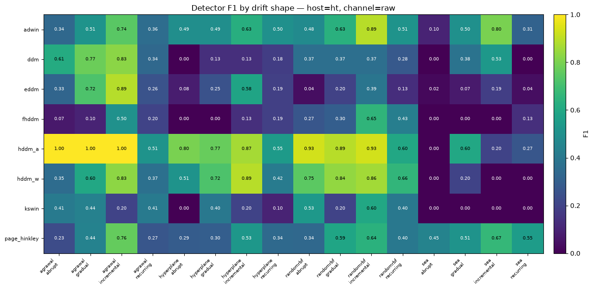
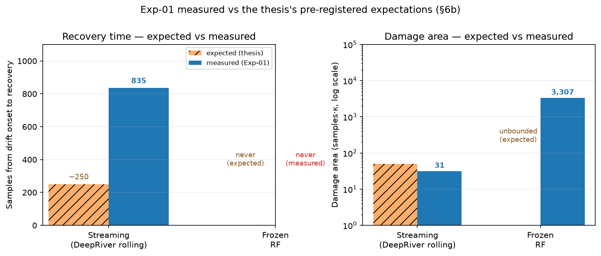

# Results — the measured verdicts, all experiments

**What this page is:** the project's **global results file**. One page that holds
the *conclusion* of every experiment — not the effort, not the logs, not the
milestones: the bottom line, the numbers that back it, and the process that
produced it. Written for management review; every figure and number traces to a
data artifact (`experiments/*/results.json`).

**How this page updates:** an experiment is added here **only when it concludes**,
as a single row in the verdict registry (§4) plus its measured evidence (§3). The
global verdict (§1) is re-stated over all concluded experiments whenever one lands.

| | |
|---|---|
| **Status** | 3 concluded: Exp-01, Exp-02, **E01 metric v2 correction**; **E04 detector map first pass (5 seeds)**; 3 scheduled |
| **Data artifacts** | `experiments/exp01/results.json` · `experiments/exp02/results.json` · `experiments/results/e01/` (**corrected metric**) · `experiments/results/e04/` (**detector map**) |
| **Method / protocol** | [`thesis.md`](../Phase1:Experimentation/thesis.md) · [`streaming-vs-batch-metrics.md`](../Phase1:Experimentation/streaming-vs-batch-metrics.md) |
| **Formatting note** | unicode math (τ, κ₀, Δκ, ≈, ≥) renders identically in Obsidian, GitHub, mkdocs |

---

## 1. The global verdict

> **A model that keeps learning from the stream heals itself after a concept
> change — a model that was trained once and frozen does not.**
> Across **11 seeds**: the frozen model recovered on **0 of 11** runs. The
> corrected metric (E01) prices the damage over a fixed 5,000-sample window with
> a panel-shared reference: **70.6 ± 66.5** vs **504.4 ± 104.1** samples·κ, a
> **≈ 7.1×** gap. Over the rest of the stream the gap is **≈ 11.6×**
> (**293.9** vs **3,408.1**). The streaming model also wins the overall
> averages: **88.3% vs 85.4%** accuracy, **0.753 vs 0.685** Cohen Kappa.
> Recovery is **7/11** seeds with a real excursion (177–4,462 samples); the old
> “0 on 8/11” was an artefact of the τ-anchored rule. The legacy **294×** and
> **24×** figures are retired as upper bounds; the corrected worst-vs-best ratio
> is **1.27×** (224.1 vs 284.8).

!!! warning "Metric correction — read this before quoting any number below"
    Sections 3a and 3b use the original `damage_area` definition, which
    integrated from τ to the recovery point. On 8/11 seeds recovery collapsed to
    τ, truncating the streaming integral. **294× and 24× are upper bounds and are
    retired.** The corrected numbers are in §3c and
    [`E01-metric-v2.md`](E01-metric-v2.md).

*Figure 1 — how every experiment in this file runs: one stream, two models in the
same race, one prequential scoreboard, one verdict. No result below was produced
any other way.*

### Why this matters, in one line each

| | Streaming model (keeps learning) | Frozen model (trained once) |
|---|---|---|
| Reacts to change on its own? | **Yes** — adapts on its own error signal | **No** — waits for a human to retrain |
| Recovery after the drift at τ | **7/11 seeds** with a real excursion; 177–4,462 samples | **never** — 0 of 11 seeds recovered |
| Skill lost, corrected `damage_ref` (5k window) | **70.6 ± 66.5** samples·κ (worst 224.1) | **504.4 ± 104.1** samples·κ (best 284.8) |
| Skill lost over the rest of the stream (`damage_full`) | **293.9 ± 210.8** samples·κ | **3,408.1 ± 583.4** samples·κ |
| Overall quality (full run, 48k samples) | **0.883** acc · **0.753** κ | 0.854 acc · 0.685 κ |

---

## 2. The process — how results are produced

One experiment = **one controlled race**, run identically for both models on the
same data in the same order. Three non-negotiable rules keep the comparison fair:

1. **Prequential scoring** — every sample is scored *before* it trains the model
   (test-then-train). No model ever sees a future sample.
2. **Same warm-up, same data** — both models train on the same first 20% of the
   stream; the frozen model never updates after that, the streaming model updates
   on every sample.
3. **Measured, not asserted** — every number in this file is read from a committed
   `results.json`; figures are re-rendered from that file, never hand-drawn.

The scoreboard metrics used in every verdict:

| Metric | What it measures | Good direction |
|---|---|---|
| Accuracy / Cohen Kappa (rolling, w = 1,000) | classification skill over time, chance-corrected | ↑ |
| κ_ref — shared pre-drift reference | mean pre-drift skill across the model panel | reference level |
| Δκ — dip depth | how much skill the drift knocks off, relative to κ_ref | ↓ (shallower) |
| **`recovery_rate`** | fraction of episodes with a real band exit followed by 500 in-band samples | ↑ |
| **`damage_ref`** (primary) | fixed-window integral `Σ max(κ_ref − κ(t), 0)` — cannot be gamed by a weak model's own baseline | ↓ |
| **`damage_full`** | the same integral over the rest of the stream | ↓ |
| **`AUE`** | mean error minus the **timing-oracle** error; secondary, because the oracle is not an upper bound | ↓ |
| ~~Recovery time / damage area~~ | legacy Exp-01/02 definitions; kept only for audit, superseded by E01 | — |

---

## 3. Measured evidence

### 3a. Exp-01 — SEA, one abrupt drift (seed 42)

The first data point. Measured 2026-09-09, seed 42, 60,000 samples, abrupt drift
at τ = 30,000, 10% label noise. Streaming model: DeepRiver rolling deep classifier
(RNN head, window = 500). Frozen model: Random Forest (100 trees) trained once on
the warm-up. Full series: `experiments/exp01/results.json`.

*Figure 2 — the overall race, 48,000 post-warm-up samples. The streaming model
wins the cumulative scoreboard as well as the reactivity contest: +2.9 pp accuracy
and +6.8 pp Cohen Kappa.*

*Figure 3 — the verdict in one picture. Before the drift both models sit at the
same skill level (κ₀ ≈ 0.755–0.759). At τ the frozen model (red) falls to 0.592
and stays down; the streaming model (blue) dips only to 0.703 and is back inside
its own band 835 samples later — with no human intervention.*

*Figure 4 — the two decisive columns. Recovery: 835 samples vs never. Damage paid
for the drift: 31 vs 3,307 samples·κ (log scale).*

| Drift-window metric (τ = 30,000) | Streaming (DeepRiver rolling) | Frozen (RF) |
|---|---|---|
| Pre-drift baseline κ₀ | 0.755 | 0.759 |
| Minimum rolling Kappa after τ | 0.703 | 0.592 |
| Dip depth Δκ | **0.052** (shallow) | 0.167 (3× deeper) |
| **Recovery time** | **835 samples** — inside the pre-registered 5,000 budget | **never** |
| **Damage area** | **31** samples·κ | **3,307** samples·κ |

### 3b. Exp-02 — the 11-seed sweep (is Exp-01's number reproducible?)

The statistical data point. Measured 2026-09-12: **exactly the Exp-01 replica** — same
stream, same two models, same warm-up, same prequential loop, same metric definitions —
rerun on **11 seeds** (42, Exp-01's, plus 0–9), changing nothing but the seed. Full
per-seed detail: `experiments/exp02/results.json`. Seed 42 reproduced Exp-01 **exactly**
(835 samples, delta 0), so the sweep is a genuine rerun of the same experiment.

*Figure 5 — left: recovery time per seed; 8 of 11 seeds sit on the metric floor (0 =
never left the pre-drift band) and the rest recover in 174–2,497 samples, all inside the
5,000 budget. Right: damage area per seed (log scale); the 5 seeds with exactly zero
measured damage are drawn as hatched stubs. The damage gap is stable; the recovery
number is not.*

| Metric (11 seeds) | Streaming (DeepRiver rolling) | Frozen (RF) |
|---|---|---|
| Pre-drift baseline κ₀ | 0.751 ± 0.017 | **0.767 ± 0.018** |
| Dip depth Δκ | **0.045 ± 0.015** | 0.173 ± 0.018 |
| Recovery time (samples from τ) | **median 0**, mean 319 ± 765 (0 / 174 / 835 / 2,497) | **never, 11/11** |
| Damage area (samples·κ) | **13 ± 31** (median ≈ 0.001, max 103) | 3,710 ± 592 (min 2,439, max 4,368) |
| Full-run accuracy | **0.8830 ± 0.0021** | 0.8539 ± 0.0017 |
| Full-run Cohen Kappa | **0.7530 ± 0.0044** | 0.6850 ± 0.0035 |

*Figure 6 — the same damage numbers as a distribution: one dot per seed, median marked.
Every frozen seed sits in a narrow band; every streaming seed is two orders of magnitude
below it. Median ≈ 0.001 vs 3,822 samples·κ.*

**What the sweep settles.** Exp-01's specific **835** was a property of seed 42, not of
the method: across 11 seeds the recovery time is 0 on eight seeds (no excursion to
recover from) and 174 / 835 / 2,497 on the other three. What *is* stable is everything
the claim actually rests on — the frozen model never recovers (0/11, no exceptions), the
damage gap is two orders of magnitude on the mean and **24× even worst-case-vs-best-case**,
and the streaming dip is consistently ~3.8× shallower. Exp-02 also mildly **restores**
Exp-01's refuted control expectation: the frozen model *does* start ahead while the
concept is stationary (κ₀ 0.767 vs 0.751), and still loses the full run because it
collapses at τ.

**One methodological finding, recorded not patched.** The recovery-time rule looks for
the first sustained in-band run *starting at τ*, so a model that stays in band for the
first 500 samples and dips afterwards is scored 0. Seven of eleven seeds did leave the
band after τ, but only the three with an *early* excursion are credited with a recovery
time — which makes recovery non-monotone in dip depth (seed 3 dips deeper than seed 9
yet scores 0). **Damage area and dip depth are the trustworthy drift-window metrics;
recovery time is meaningful only conditional on an early excursion.** Details in the
[Exp-02 write-up](../Phase1:Experimentation/exp02-seed-sweep-sea.md) §6c.

*Figure 7 — the flaw in one picture. Green = an excursion early enough for its recovery
to be credited; orange X = a seed that did leave its band but was scored 0 because the
excursion began after τ + 500; hollow blue = never left the band. Four of the eleven
seeds are orange — which is why the mean recovery time is not a property of the model.*

### 3c. E01 — corrected metric v2 (11 seeds, 2026-11-12)

This supersedes the damage numbers in 3a and 3b. E01 re-ran the same SEA/DeepRiver
vs frozen pilot with a fixed-window, panel-shared damage metric and recovery
conditional on a real band exit.

| Metric (11 seeds) | DeepRiver | Frozen RF |
|---|---:|---:|
| **`damage_ref`** (5k window, primary) | **70.6 ± 66.5** (worst 224.1) | **504.4 ± 104.1** (best 284.8) |
| **`damage_full`** (rest of stream) | **293.9 ± 210.8** | **3,408.1 ± 583.4** |
| `AUE` vs timing oracle | **−0.0472 ± 0.0058** | +0.0010 ± 0.0027 |
| `recovery_rate` | **7/11** | **0/11** |
| Recovery time, recovered seeds | 177–4,462 (mean 2,017) | never |
| Full-run accuracy / Cohen κ | **0.883 / 0.753** | 0.854 / 0.685 |

*Figure 8 — the corrected comparison. Left: `damage_ref`; right: AUE against the
timing oracle. AUE is secondary because the timing oracle knows when the drift
happened but not what the new concept is; its own damage (494) is almost identical
to frozen. The primary result is the `damage_ref` gap.*

**Verdict.** Frozen recovered on **0/11** seeds. DeepRiver's `damage_ref` was lower
on **11/11** seeds, with a **≈7.1×** mean gap and a **≈11.6×** full-stream gap. The
worst DeepRiver seed beat the best frozen seed by only **1.27×**, so the legacy
**24×** worst-case claim is retired along with the **294×** mean. The clean headline
is: *the frozen model never recovers, and the streaming model pays roughly one
seventh of the fixed-window damage.* The full write-up is
[`E01-metric-v2.md`](E01-metric-v2.md).

!!! note "Panel caveat"
    The current E01 artifact's shared reference includes HT/HAT because of a
    default-host bug that has since been fixed. The qualitative verdict is
    unchanged; the exact `damage_ref` values will move when the clean two-model
    panel is rerun.

### 3d. E04 — detector map, first pass (5 seeds, 2026-11-12)

Eight detectors were replayed on the raw and smoothed mistake streams of two
hosts, across four generators and four drift shapes. This is the first map of
“which alarm works for which change”.

| Drift shape | Best default | Balanced score | Changes caught | False alarms /1k | Detection delay |
|---|---|---:|---:|---:|---:|
| Abrupt | **HDDM-A, raw** | **0.683** | 75% | 0.0075 | 0.185 |
| Gradual | **HDDM-A, raw** | **0.842** | 95% | 0.0083 | 0.155 |
| Incremental | **HDDM-A, raw** | **0.883** | 90% | 0.0033 | 0.012 |
| Recurring | **HDDM-A, raw** | **0.500** | 73% | 0.0308 | 0.144 |

*Figure 9 — balanced score per detector and drift shape on the static host, raw
signal. HDDM-A is the best cell for every shape; recurring drift is the hard
case.*

**Verdict.** **HDDM-A on the raw signal is the sensible default** across all four
shapes. Recurring change is the hard case (0.50); incremental is the easiest
(0.88). Smoothing the mistake signal raises false alarms without improving the
ranking; the raw channel is the default and the smoothed channel is a diagnostic.
This is a 5-seed first pass with default detector settings, not the full
pre-registered matrix. The full write-up is
[`E04-detector-map.md`](E04-detector-map.md).

!!! warning "Scoring bug found and fixed"
    The first E04 report selected KSWIN for incremental with F1 = 1.0 and episode
    recall = 0.25. That was impossible: zero-alarm runs had `precision = None` and
    were excluded from the F1 mean. The corrected report recomputes F1 from raw
    TP/FP/episode counts and treats zero alarms as F1 = 0. The “KSWIN perfect”
    result is retired.

---

## 4. Verdict registry — one conclusion per experiment

The cumulative table. Rows land here **only with a measured verdict**; scheduled
experiments are listed so the roadmap is visible, with their acceptance bar.

| Exp | Question asked | Setting | Verdict (measured) | Conclusion |
|---|---|---|---|---|
| **Exp-01** ✅ *(legacy metric)* | Can a streaming deep learner beat a *frozen* batch model on a drifting stream? | SEA, one abrupt drift, 2 models, seed 42 | **Streaming wins** — recovers in 835 samples (frozen: never); legacy damage 31 vs 3,307 | Weakest form of the claim **confirmed**. The 835/damage numbers are superseded by E01 |
| **Exp-02** ✅ *(legacy metric)* | Is the 835-sample recovery a fluke of one seed? | SEA, one abrupt drift, 2 models, **11 seeds** | **Streaming wins on every seed** — frozen recovered **0/11**; legacy damage **13 ± 31** vs **3,710 ± 592** (≈294×; 24× worst-vs-best) | The claim **generalises**; the legacy magnitudes are **upper bounds** and retired by E01. Frozen still wins the stationary phase (κ₀ 0.767 vs 0.751) |
| **E01** ✅ | Does the corrected metric preserve the Exp-01/02 verdict? | SEA abrupt, **11 seeds**, metric v2 | **Frozen recovered 0/11; DeepRiver `damage_ref` lower 11/11; 70.6 ± 66.5 vs 504.4 ± 104.1 (≈7.1×); `damage_full` 293.9 vs 3,408.1 (≈11.6×); recovery 7/11; worst-vs-best 1.27×** | The claim **survives**, the magnitude shrinks. **294× and 24× retired.** AUE is secondary: the timing oracle is weak (damage 494). Current panel includes HT/HAT; clean two-model rerun pending |
| **E04** ✅ *(first pass, 5 seeds)* | Which detector works for which drift shape, and does the host matter? | 4 generators × 4 shapes × 8 detectors × 2 hosts × raw/EWMA, 5 seeds | **HDDM-A raw is best for all four shapes; balanced score 0.683 abrupt, 0.842 gradual, 0.883 incremental, 0.500 recurring; recurring is hardest; EWMA raises false alarms** | One sensible default exists; recurring drift is the hard case. A scoring bug that made a never-ringing detector look perfect was found and fixed. Full 11-seed matrix and tuning pending |
| **E03** ⏳ | Does streaming also beat a *scheduled-retrain* batch model (the honest industrial baseline)? | SEA + baseline ladder | *pending* | acceptance: streaming recovery ≪ retrain interval r_next − τ |
| **E14** ⏳ | Does the win survive on **real** streams (Phishing, Covertype, Airlines, CreditCard, Elec2)? | 5 real streams, post-dip protocol | *pending* | acceptance: streaming ≥ frozen on post-drift windows |
| **E15** ⏳ | The **Delay Tax**: do delayed/rare labels starve batch retraining while streaming keeps working? | label-delay sweep | *pending* | acceptance: streaming quality degrades slower under delay |

*Scope guard: Exp-01 is deliberately the easiest possible version of the claim
(one synthetic stream, no scheduled retrain, no label delay, single seed). Each
row above removes one of those cushions. The global verdict stands on what is
measured today and is re-stated as rows conclude.*

---

## 5. The verdict vs what was promised

The project pre-registered its expectations *before* running (thesis §6), so the
results can be checked against the promises rather than reported after the fact.

### 5a. Exp-01 — pre-registered expectations vs measured

| Pre-registered expectation | Expected | Measured (Exp-01) | Verdict |
|---|---|---|---|
| Streaming recovery is bounded | ~250–350 samples | **835 samples** | **PASS** (same order; well inside the 5,000-sample falsification budget) |
| Frozen model never recovers | never | **never** (still depressed at stream end) | **PASS** |
| Frozen pays unbounded damage | unbounded | 3,307 vs 31 samples·κ | **PASS** (≈ 106×) |
| Dip is shallow for streaming, deep for frozen | shallow vs deep | 0.052 vs 0.167 | **PASS** |
| Frozen wins cumulative accuracy (honest control) | batch ahead in steady state | streaming wins 0.757 vs 0.689 | **REFUTED — in our favour** on this seed |

*Figure 8 — pre-registered expectations (hatched) against measured results (blue):
the measured recovery is inside the promised regime, and the measured damage gap is
even larger than the thesis sketched.*

### 5b. Exp-02 — pre-registered acceptance vs measured *(legacy metric)*

| Pre-registered condition (fixed before the run) | Required | Measured | Verdict |
|---|---|---|---|
| Seeds | ≥ 10 | 11 | **PASS** |
| Recovery reported as a distribution | mean ± SD | mean 319 ± 765, median 0, range 0–2,497 | **PASS** — with a heavy-tail caveat: 8/11 seeds sit on the metric floor, so the mean is not a robust centre |
| Streaming recovers on every seed | every seed | 11/11 (8 of them never left the band) | **PASS** |
| Frozen never recovers on every seed | every seed | 11/11 | **PASS** |
| H2: frozen wins steady state (restated control) | frozen κ₀ ≥ streaming κ₀ | frozen 0.767 vs streaming 0.751 | **SUPPORTED** — unlike the single-seed Exp-01, where the two were level |

**Bottom line:** the falsification conditions set before the runs were not
triggered. Exp-01 showed the effect exists on one seed; Exp-02 shows the *claim*
holds on all eleven — the frozen model never recovers. The specific 835-sample
figure was seed luck and is retired. **E01 supersedes the damage magnitudes:** the
legacy 294×/24× are upper bounds; the corrected gaps are ≈7.1× (`damage_ref`) and
≈11.6× (`damage_full`), and the worst-vs-best ratio is only 1.27×. The claim that
the gap survives a worst-case-vs-best-case comparison is **retired**. The one
control expectation Exp-01 refuted (batch winning steady state) is restored by the
larger sample, and streaming still wins the run outright.

---

## 6. Provenance

- Measured numbers: `experiments/exp01/results.json` · `experiments/exp02/results.json` ·
  `experiments/results/e01/summary.json` (**corrected metric**) ·
  `experiments/results/e04/detections.jsonl` (**detector map raw counts**)
- Full write-ups: [`exp01-deepriver-vs-frozen-sea.md`](../Phase1:Experimentation/exp01-deepriver-vs-frozen-sea.md) ·
  [`exp02-seed-sweep-sea.md`](../Phase1:Experimentation/exp02-seed-sweep-sea.md) ·
  [`E01-metric-v2.md`](E01-metric-v2.md) (**correction**) ·
  [`E04-detector-map.md`](E04-detector-map.md) (**detector map**)
- Thesis + pre-registered expectations: [`thesis.md`](../Phase1:Experimentation/thesis.md)
- Protocol & metric definitions: [`streaming-vs-batch-metrics.md`](../Phase1:Experimentation/streaming-vs-batch-metrics.md)
- Milestone records: [`Sept9.md`](Sept9.md) (Exp-01)
- Figure sources: `experiments/scripts/make_results_figures.py` ·
  `experiments/scripts/make_exp01_summary_chart.py` ·
  `experiments/scripts/exp02_seed_sweep_sea.py --figure-only` ·
  `experiments/results/e01/figures/model_comparison.png` (E01)
