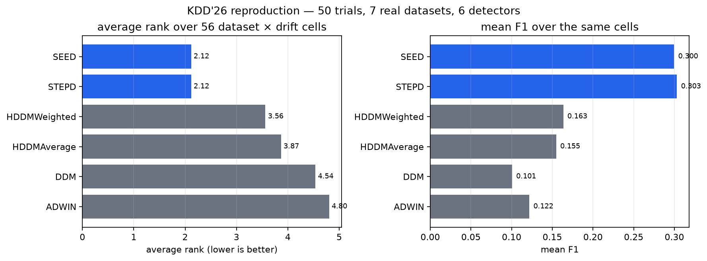
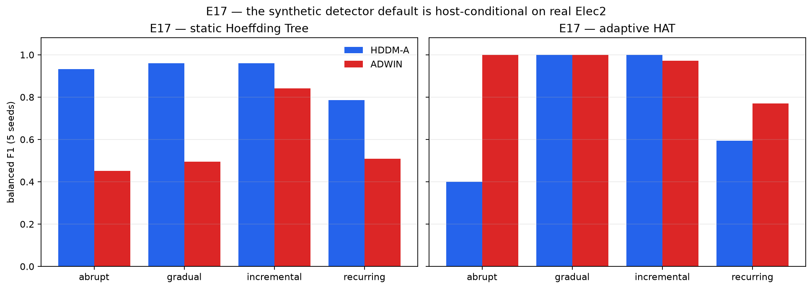
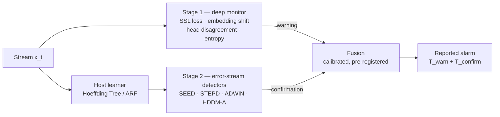

# Roadmap v2 — DF-H, the deep hybrid detector

**Approved:** 2026-11-14 · **Supersedes:** the breadth-first E05–E15 detector
plan. Existing results (E01–E17, KDD'26) stay; the detector track is now
centred on one artefact.

> **The goal in one sentence:** build **DF-H**, a detector that combines a
> **label-free deep monitor** with **supervised confirmation**, and make it
> beat the KDD'26 detector benchmark on its own protocol *and* win the
> delayed-label setting where error-only detectors are provably floor-bound.

> **Status update (2026-11-14):** the E18 signal gate and the E19 v1 pilot both
> ran and **failed their pre-registered gates**. E18's best deep AUC was 0.616
> vs the error rate's 0.598; E19's DF-H ranked **3rd** (7.09) behind STEPD and
> SEED, with FAR below ADWIN but no primary feature-cell win. The full E20
> matrix is not justified by the pilot-first rule. The feature monitor retains a
> real early-warning advantage on feature drift, and the Delay Tax benchmark
> (E21) is now the headline: the fixed-delay Lemma-1 synthesis shows Stage 1
> warning at **70–513** samples vs **2,120–3,269** for the error-only panel at
> `L = 2,000`. The full regime matrix and Lemmas 2–3 are scaffolded but not run.
> **E22** adds the focused capability check on the data in the repo: DF-H is
> **3rd overall (7.34)**, ahead of HDDM-W, ADWIN, HDDM-A and PageHinkley, and
> behind only SEED/STEPD; it owns feature permutation with a 0.04 FAR. See
> [E18](E18-deep-signals.md), [E19](E19-hybrid-detector.md),
> [E21](E21-delay-detector.md) and [E22](E22-detector-shootout.md).

---

## 1. Why the goal changed

The last two months of evidence point to the same conclusion: **no scalar
detector wins everywhere**, and the missing information is in the features, not
in another error-stream vote.

| Evidence | What it says |
|---|---|
| **E04** — synthetic detector map | HDDM-A is the best default on the static host for all four shapes, but recurring drift is only **F1 0.500**. |
| **E17** — real Elec2 | The default is **host-conditional**: HDDM-A wins all four on the static HT, but ADWIN wins abrupt **1.000 vs 0.400** and recurring **0.770 vs 0.593** on the adaptive HAT. Best-host mean: ADWIN **0.935** vs HDDM-A **0.910**. |
| **KDD'26 reproduction** | SEED/STEPD rank **2.12** (mean F1 **0.300/0.303**); HDDM-W **3.56**; HDDM-A **3.87**. The absolute ceiling is low — better signals matter. |
| **E02** — no-drift control | Naive combinations are dangerous: EWMA makes ADWIN **0.548/1k** and KSWIN **7.667/1k** against a **0.1** target. |
| **ABCD(X)** (cited) | Feature-space detection is the strongest arm on feature permutation: rank **1.0 abrupt / 3.3 gradual**. |
| **DriftFormer** | Already computes a masked-feature SSL loss and runs an internal ADWIN; `forward()` returns four head logits and the `cls_out` embedding. The detector is instrumentation + fusion, not a new model. |

*The target: SEED/STEPD at 2.12. DF-H does not need to win every cell; it needs
to be top-2 overall and own the cells where feature information matters.*

*No scalar detector is universal. A feature monitor adds a different view, not
another vote on the same error stream.*

---

## 2. What DF-H is

*Stage 1 watches the input stream without labels; Stage 2 confirms with the
host's mistakes. The reported result has two times: warning and confirmation.*

| Stage | Input | Signals / detectors | Labels needed? |
|---|---|---|---|
| **Stage 1 — deep monitor** | Raw features, frozen DriftFormer encoder | SSL loss, embedding shift, head disagreement, entropy, internal ADWIN, feature-KS control | No |
| **Stage 2 — confirmation** | Host mistake stream | SEED, STEPD, ADWIN, HDDM-A on the raw channel | Yes |
| **Fusion** | Both stages | `S1`, `S2`, `OR`, `AND`, `2of3`, `2of3_nodeep` | — |

**Stage 1 is the new information.** It sees `P(X)` change directly, which is why
it should win feature permutation/filtering and recurring change. **Stage 2 keeps
the cells where SEED/STEPD are strong**, especially label swap and class-prior
drift, where `P(X)` is unchanged and a label-free monitor has no power (Lemma 4).

### Fusion rules

| Variant | Rule | Purpose |
|---|---|---|
| `S1` | Stage 1 only | Label-free ceiling; delay benchmark |
| `S2` | Best fixed scalar detector | The strong baseline |
| `OR` | Stage 1 or Stage 2 | Earliest alarm; highest FAR risk |
| `AND` | Stage 1 and Stage 2 within `W_confirm` | Precision-first |
| `2of3` | Stage 1 + SEED + ADWIN | The candidate |
| `2of3_nodeep` | SEED + ADWIN + HDDM-A | Control: does deep add anything? |

The final rule is pre-registered and calibrated to **FAR ≤ 0.1/1k** on E02 and
the pre-drift 20% of each stream. No EWMA. No test-trial tuning.

---

## 3. Success criteria

### 3.1 Immediate-label benchmark (KDD'26)

| Criterion | Bar |
|---|---|
| Overall average rank | **top-2** (SEED/STEPD are at 2.12) |
| Weak cells | **best on at least two** of `feature_permutation`, `feature_filtering`, `recurring` |
| False alarms | **FAR no worse than ADWIN** |
| Per-dataset robustness | **no dataset rank worse than 4** |
| Stretch | **#1 overall** |

### 3.2 Delayed-label benchmark (the novel contribution)

| Criterion | Bar |
|---|---|
| Fixed delay `L` | warning time grows by **≤ L + c**; confirmation is floor-bound |
| Partial labels | higher recall than the best error-only detector at `p = 0.5` and `0.1` |
| Selective labels | warn earlier on unlabelled drift; confirm when labels arrive |
| Lemmas | Lemma 1 (floor), Lemma 2 (`1/√p`), Lemma 3 (batch FAR) measured |

**Negative result is acceptable.** If DF-H does not beat the baselines, the
delay-tax measurement and the lemmas still stand. This is the scope's existing
fallback, not a new risk.

---

## 4. The roadmap

| Phase | Experiment | What it does | Gate |
|---|---|---|---|
| **0** | Housekeeping | Finish E03 (20/22 units), document E14, render E17 figures, commit in logical units | clean tree to start |
| **1** | E18 scaffold | `signal_snapshot()` on DriftFormer; `DeepSignalMonitor`; `signals.npz`; pure-NumPy KDD trial builder | smoke runs finite/deterministic |
| **2** | **E18 — signal gate** | Extract signals on SEA, Hyperplane, Elec2, and an 80-trial KDD pilot (2 datasets × 4 types × 2 transitions × 5 trials) | at least one deep signal **AUC ≥ 0.75** on held-out data and **≥ 0.10 above** the error-rate baseline |
| **3** | **E19 — DF-H v1** | Rule-based fusion on synthetic + E17 + the KDD pilot | top-2 on the pilot; best on ≥1 feature cell; FAR ≤ ADWIN |
| **4** | **E20 — DF-H v2** | Learned fusion, leave-one-dataset-out; full 7 × 4 × 2 × 50 KDD | top-2 overall; best on ≥2 weak cells; FAR ≤ ADWIN; no dataset rank > 4 |
| **5** | **E21 — Delay Tax detector benchmark** | Fixed/stochastic/partial/selective/batch regimes; DF-H vs scalar detectors; lemmas 1–3 | warning ≤ L + c; confirmation matches the best error-only + L; recall gain under partial/selective |
| **6** | Write-up | Final report around the detector; minimal system/demo | one-command reproduction |

**Pilot-first compute.** No full 50-trial deep signal run until the 80-trial
pilot passes. The encoder is frozen per dataset; signals are precomputed in the
main environment and loaded by the KDD runner, so `kdd_env` never needs torch.

---

## 5. What is cut or deferred

| Item | Decision |
|---|---|
| **E03** | Finish, no expansion |
| **E05 severity** | Defer |
| **E06 delay shift** | Keep — Lemma-1 pilot |
| **E07 block gate** | Keep — DriftFormer prerequisite |
| **E08 DriftFormer vs panel** | Cut to one host-quality check |
| **E09 pretrain transfer** | Defer |
| **E10–E12** | Defer; keep only signal and encoder-size ablations |
| **E13 calibration** | Keep only if v2 uses probabilities |
| **E14 real streams** | Keep as host validation; no 5-dataset expansion now |
| **E15 Delay Tax** | Replaced by **E21** |
| **ABCD/ABCD(X)** | Cited only; not re-run |
| **Chapter 2 service** | Defer until after E20/E21 |
| **Product docs** | Defer |

---

## 6. Risks and fallbacks

| Risk | Fallback |
|---|---|
| Deep signal has no power | Phase-2 gate stops early; use a classical PCA/KS/linear-MMD feature monitor with the same fusion |
| KDD host mismatch | Keep the Hoeffding Tree host; deep model is only a signal channel |
| Leakage in the learned fusion | Leave-one-dataset-out; pre-registered rule; no test tuning |
| Deep compute cost | Frozen per-dataset encoder; batched GPU inference; cached signals; pilot-first |
| DriftFormer is a weak classifier | Never use it as the host; use its encoder only; compare an autoencoder/DeepRiver representation |
| False alarms | Raw channel only; E02 calibration; confirmation window; FAR target |
| Scope says deep is out | Dated scope amendment: deep is a **label-free signal extractor**, not the benchmark classifier; classical fallback ready |
| Delay floor cannot be beaten | Report warning vs confirmed separately; Lemma 1 is a theorem, not a failure |

---

## 7. What this changes in the project story

The final report is re-centred:

1. **Measurement lab + baseline detector map** — E01/E02/E04/E17/KDD.
2. **DF-H architecture + immediate-label benchmark** — E18–E20.
3. **Delay Tax benchmark + lemmas** — E06/E21.
4. **Minimal system/demo or a clearly scoped Chapter 2.**

The mid-term report stays frozen. The post-mid-term report
([Nov 14](Nov14.md)) remains the snapshot of what was built before this
roadmap; new results land in the E18–E21 pages and the final report.

---

## 8. Definition of done

- DF-H implemented as a reusable detector adapter with tests.
- E18 signal report with a clear go/no-go verdict.
- E19 pilot and E20 full KDD result with a DF-H row beside SEED/STEPD.
- E21 delay benchmark with Lemmas 1–3 measured (or a documented negative result).
- New pages wired into the nav; Results/progress/scope updated.
- Every result regenerable from a saved artifact.

*Full implementation detail: [the approved DF-H plan](../Plans/df-h-ultimate-goal.md).
This page is the repo-facing summary.*
