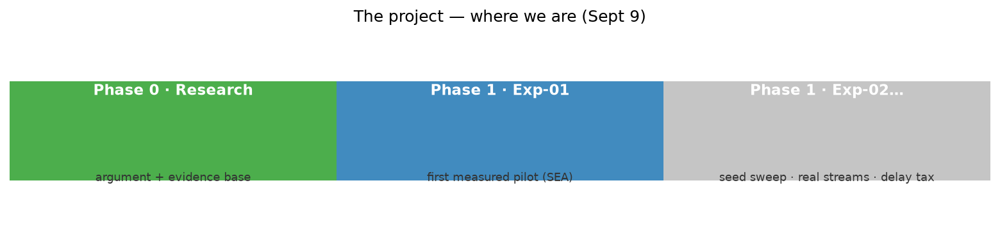
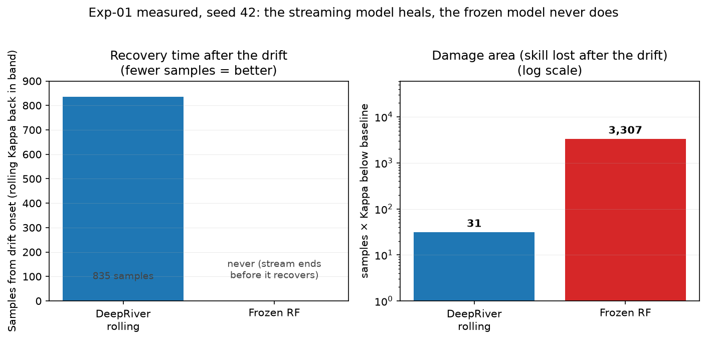
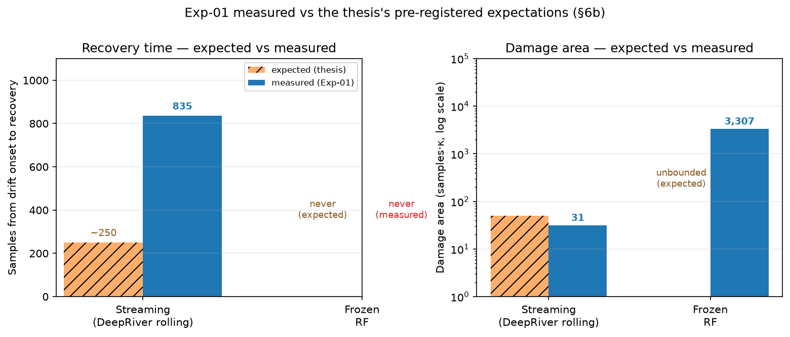

# Milestone Report — Sept 9

**Milestone summary:** the project crosses from *argument* to *measurement*: the
thesis is written down with pre-registered expectations, and the first atomic
experiment (Exp-01) is run — it **confirms the headline claim** (a streaming deep
learner recovers from drift in bounded time; a frozen batch model never does).

| | |
|---|---|
| **Date** | 2026-09-09 |
| **Focus** | Thesis written (Phase 0 → Phase 1) + Exp-01 first measured run |
| **Primary docs** | [thesis.md](../Phase1:Experimentation/thesis.md) · [exp01-deepriver-vs-frozen-sea.md](../Phase1:Experimentation/exp01-deepriver-vs-frozen-sea.md) |
| **Data artifact** | `experiments/exp01/results.json` (repo root, next to the Exp-01 write-up) |

---

## Why this milestone

The project's promise — *"take models that are not streaming and beat them on real
metrics"* — was, until today, an argument backed by other people's papers. A
milestone needs a **measured data point of our own**. This report records the state
after the first two deliverables: the thesis (the argument, with falsifiable
pre-registered expectations) and Exp-01 (the first run of the pilot that the thesis
was designed around).

## What was done

- **Thesis written** ([thesis.md](../Phase1:Experimentation/thesis.md)) — the idea
  ("batch models update on a clock, streaming models on evidence"), the mechanism,
  the facts-with-sources it rests on, the expected event sequence, and §6f: what
  would *falsify* it. Every illustrative number is marked as pre-registered.
- **Exp-01 spec'd and run** — one synthetic SEA stream, one abrupt drift at
  τ = 30,000, two models (DeepRiver rolling deep classifier, window 500, vs a frozen
  RandomForest), evaluated prequentially over 48,000 post-warm-up samples.
- **Exp-01 data + figures committed** — `experiments/exp01/results.json`
  (per-sample rolling Kappa series + all metrics), rolling-Kappa curve and a
  damage-area summary chart in `Phase1:Experimentation/figures/`.
- **Environment hardened** — Python pinned to 3.12 (deep-river's torch < 2.6 has no
  cp313 wheels), `tool.uv.environments` restricted to Linux + Apple-Silicon (the
  Intel-Mac torch wheel was the resolution blocker), GPU auto-detected (RTX 3050).
- **Repo home cleaned up** — root README rewritten as the project-vision page; the
  docs index now reflects Phase 1 as *running*, not *starting*.

## Results — the numbers

Measured on seed 42, 60,000 samples (full series in `experiments/exp01/results.json`,
next to the write-up):

| Metric (post-warm-up, n = 48,000) | DeepRiver rolling | Frozen RF |
|---|---|---|
| Cumulative accuracy | **0.885** | 0.856 |
| Cumulative Cohen Kappa | **0.757** | 0.689 |
| Pre-drift baseline κ₀ | 0.755 | 0.759 |
| Min rolling Kappa after drift | 0.703 | 0.592 |
| Recovery time (samples from τ) | **835** | **never** (stream ends first) |
| Damage area (samples·κ) | **31** | **3,307** |
| DeepRiver loop runtime | 99 s on RTX 3050 (484 samples/s) | — (0.17 s fit) |

Two headline behaviours, both as the thesis predicted:

*Measured, not schematic: rolling Cohen Kappa (w = 1,000) over the stream, drift at
τ = 30,000. Before the drift both models sit at ≈ 0.75 — equal skill. After it, the
frozen RF falls to ≈ 0.59 and never returns; DeepRiver dips briefly and is back
inside its pre-drift band 835 samples later.*

## Pre-registration scorecard

The thesis's illustrative expectations (§6b, written *before* the run) vs what was
measured:

| Claim (pre-registered) | Expected | Measured | Verdict |
|---|---|---|---|
| Streaming recovery time is bounded | ~250–350 samples (HAT/LB lines) | 835 samples (DeepRiver, rolling window) | **PASS** — same order of magnitude, inside the 5,000-sample falsification budget |
| Frozen RF never recovers | never | never (still depressed at stream end) | **PASS** |
| Frozen pays unbounded damage | unbounded | 3,307 samples·κ vs 31 | **PASS** (2 orders of magnitude) |
| Frozen wins cumulative accuracy (H2, honest control) | batch ahead in steady state | DeepRiver wins 0.757 vs 0.689 | **REFUTED** — streaming *also* wins the control; the pilot is stronger than pre-registered |
| Dip depth | streaming shallow, frozen deep | 0.052 vs 0.167 | **PASS** |

## Issues faced & fixes

- **Slow first run (~18 min CPU, 44 samples/s).** The deep-river loop is
  per-sample *windowed refit* — genuinely expensive. Fixed by running the net on
  the RTX 3050: 99 s, ~11× faster (the script now auto-selects CUDA).
- **A memorisation confound in the stream.** river 0.25's SEA reseeds its RNG per
  generator, so concatenating two concepts *replayed the identical feature vectors*
  under the new label rule — the frozen RF had literally seen its "test" chunk
  during warm-up (it crashed only where it had memorised flipped labels). Fixed by
  drawing one continuous feature stream and switching only the label rule at τ.
  *Lesson: check generator internals before trusting a "synthetic" stream.*
- **deep-river 0.3.4 bugs (two).** `utils.estimator_checks` imports pytest at
  package import time (missing dep — added); and `_learn` runs the forward before
  `module.train()`, so cuDNN RNN backward crashes after a predict (worked around in
  the script). Documented in the exp01 write-up §2–3b.
- **The spec'd flattened MLP can't be a `RollingClassifier`** — its feature handling
  requires the input layer to take `n_features`, so the module is a small RNN head
  (16 hidden), which is the architecture deep-river documents for rolling models.

## Status vs the plan

- The thesis's **core falsifier is not triggered**: streaming recovery (835) is
  bounded and ≪ any sane retrain interval; the frozen baseline's rolling Kappa
  *did* drop at drift (so there was real drift, not a dataset problem).
- Honest limits of this milestone: **single seed, synthetic stream, no drift
  detector yet, no scheduled-retrain baseline**. The measured 835 samples came from
  a rolling window alone — the detection-delay component (d) is still untested, and
  the no-drift control experiment is pending.
- The pipeline is now in place (data → artifact → figure → report), so the
  follow-ups are execution, not plumbing.

## Next milestone

1. **Seed sweep** (Exp-02): the same drift on ≥10 seeds → recovery time as a
   distribution (mean ± SD), not a single number.
2. **Baseline ladder**: add *scheduled-retrain* batch (refit every k) and an
   oracle-tuned batch as the honest upper bound (Amekoe-style), so the frozen-only
   comparison broadens to the full thesis claim.
3. **Real streams** (Elec2, Phishing, Covertype, Airlines, CreditCard) with the
   post-dip metric protocol.
4. **The Delay Tax** experiment: label-delay sweep, where batch retraining starves
   and streaming must keep working on yesterday's labels.
