<!-- pagebreak -->

# Jaypee Institute of Information Technology, Noida

**DEPARTMENT OF COMPUTER SCIENCE & ENGINEERING AND INFORMATION TECHNOLOGY**

<!-- Institute logo placeholder: insert the JIIT official logo image here at 30 mm width. -->

<br>

## DF-H: Label-Free Warning and Supervised Confirmation for Concept Drift Detection

**A Major Project Report**

Submitted in partial fulfilment of the requirements for the award of the degree of

**Bachelor of Technology**

in

**Computer Science and Engineering**

<br>

| Enrollment No. | Name of Student |
|---:|---|
| 9922103035 | Ananya Arora |
| 8823103057 | Vaibhavi Kansal |
| 9923103042 | Priyansh Singh |

<br>

| | |
|---|---|
| Course Name | Major Project-1 |
| Course Code | 15B19CI791 |
| Program | B. Tech. CSE 4th Year, 7th Semester |
| Academic Session | 2026 - 2027 |
| Supervisor | Prof. Dr. Sankosh Kumar Ray |

<br>

**Department of Computer Science & Engineering and Information Technology**
**Jaypee Institute of Information Technology, Noida**
**November 2026**

<!-- pagebreak -->

## CERTIFICATE

This is to certify that the Major Project Report entitled "DF-H: Label-Free Warning and Supervised Confirmation for Concept Drift Detection" submitted by Ananya Arora (Enrollment No. 9922103035), Vaibhavi Kansal (Enrollment No. 8823103057), and Priyansh Singh (Enrollment No. 9923103042) of B.Tech of Jaypee Institute of Information Technology, Noida has been carried out under my supervision.

This work has not been submitted partially or wholly to any other University or Institute for the award of any other degree or diploma.

<br>
<br>

**Digital Signature of Supervisor**

| | |
|---|---|
| Name of Supervisor | Prof. Dr. Sankosh Kumar Ray |
| Designation | |
| Date | |

<!-- pagebreak -->

## DECLARATION OF ORIGINALITY

We, the undersigned, hereby declare that the Major Project Report entitled "DF-H: Label-Free Warning and Supervised Confirmation for Concept Drift Detection" submitted to the Department of Computer Science & Engineering and Information Technology, Jaypee Institute of Information Technology, Noida, in partial fulfilment of the requirements for the award of the degree of Bachelor of Technology, is an original work carried out by us.

The matter presented in this report has not been submitted by us for the award of any other degree of this or any other university. We have duly acknowledged all the sources of information used in this report.

<br>

| Name | Enrollment No. | Signature |
|---|---|---|
| Ananya Arora | 9922103035 | |
| Vaibhavi Kansal | 8823103057 | |
| Priyansh Singh | 9923103042 | |

<br>

**Date:**
**Place:** Noida

<!-- pagebreak -->

## ACKNOWLEDGEMENT

We would like to place on record our deep sense of gratitude to Prof. Dr. Sankosh Kumar Ray, Department of Computer Science and Engineering, Jaypee Institute of Information Technology, for the generous guidance, valuable suggestions, continuous encouragement and supervision provided throughout the course of the present work.

We express our sincere gratitude to the faculty members of the Department of Computer Science and Engineering and Information Technology, Jaypee Institute of Information Technology, for their support and guidance during the development of this major project.

We also wish to extend our thanks to our classmates for their insightful comments, constructive suggestions and cooperation, which helped us improve the quality of this project work.

<br>

| Enrollment No. | Student Name | Signature |
|---|---|---|
| 9922103035 | Ananya Arora | |
| 8823103057 | Vaibhavi Kansal | |
| 9923103042 | Priyansh Singh | |

<!-- pagebreak -->

## ABSTRACT

**Problem.** Conventional machine learning treats the training set as a finished object, whereas production data arrives as an unbounded stream whose generating process changes over time. A learner that updates per sample recovers from such a change, and a model trained once and frozen does not. Existing drift detectors, however, observe the error stream, and in fraud confirmation, advertising attribution and intrusion triage the labels that feed that stream arrive late. Label delay therefore imposes a floor on every error-based detector, and that floor has not been quantified at detector level.

**Methodology.** A config-driven experiment harness, DriftLab, was built on River 0.25.0, DeepRiver 0.3.4 and PyTorch 2.5.1, with prequential (test-then-train) evaluation and a fixed-window damage metric anchored to a panel-shared pre-drift reference. Eleven experiments cover streaming against frozen and scheduled batch learners, synthetic and real detector maps, a 2,800-task reproduction of the KDD'26 detector benchmark, a deep signal gate, a rule-based fusion detector named DF-H, and a fixed-delay synthesis of the label tax.

**Key Results.** The corrected fixed-window damage is 74.8 against 515.0 samples times kappa, approximately 6.9 times lower for the streaming learner, with frozen recovery on 0 of 11 seeds. The KDD'26 ranking is reproduced with SEED and STEPD tied first at 2.12 and HDDM-A fourth at 3.87. DF-H ranks third overall at 7.34 behind STEPD and SEED, with a false-alarm rate of 0.04 per 1,000 samples and a clear win on feature permutation. At a delay of 2,000 samples the label-free warning fires in 70 to 513 samples against 2,120 to 3,269 for the error-only panel. The pre-registered top-2 gate and the deep signal gate both fail and are reported as failures.

**Societal Relevance.** The work supports reliable adaptation in fraud detection, intrusion monitoring and credit risk, where silent degradation harms users. Bounded-memory learning reduces repeated full retraining, and the negative results are reported rather than hidden.

<!-- pagebreak -->

## TABLE OF CONTENTS

| Section | Title | Page No. |
|---|---|---:|
| | **PRELIMINARY PAGES** | **i** |
| | Certificate | ii |
| | Declaration of Originality | iii |
| | Acknowledgement | iv |
| | Abstract | v |
| | Table of Contents | vi |
| | List of Figures | vii |
| | List of Tables | viii |
| | List of Abbreviations | ix |
| **CHAPTER 1** | **INTRODUCTION** | **1** |
| 1.1 | Background | 1 |
| 1.2 | Problem Definition and Objectives | 1 |
| 1.3 | Social and Environmental Relevance | 2 |
| 1.4 | Project Plan | 2 |
| 1.4.1 | Work breakdown structure | 2 |
| 1.4.2 | Timeline | 3 |
| 1.4.3 | Roles and responsibilities | 3 |
| 1.4.4 | Challenges and risk management | 3 |
| 1.5 | Scope and Limitations | 3 |
| **CHAPTER 2** | **LITERATURE SURVEY AND CRITICAL REVIEW** | **4** |
| 2.1 | Critical Review | 4 |
| 2.2 | Summary Table | 5 |
| 2.3 | Identification of Research Gaps | 6 |
| **CHAPTER 3** | **SYSTEM DESIGN AND METHODOLOGY** | **8** |
| 3.1 | Design Considerations | 8 |
| 3.2 | Methodology | 8 |
| 3.3 | Modelling | 10 |
| 3.4 | Tool and Technique Selection | 11 |
| **CHAPTER 4** | **IMPLEMENTATION AND TESTING** | **12** |
| 4.1 | Development Details | 12 |
| 4.2 | Experimental Setup | 14 |
| 4.3 | Test Cases | 15 |
| 4.4 | Safety Measures | 16 |
| **CHAPTER 5** | **RESULTS AND DISCUSSION** | **17** |
| 5.1 | Result Analysis | 17 |
| 5.2 | Comparison with Objectives | 21 |
| 5.3 | Economic Analysis | 22 |
| 5.4 | Comparison with Existing Solutions and Standards | 23 |
| **CHAPTER 6** | **CONCLUSION AND FUTURE SCOPE** | **24** |
| 6.1 | Summary of Achievements | 24 |
| 6.2 | Impact, Sustainability, Ethics and Compliance | 24 |
| 6.3 | Limitations | 25 |
| 6.4 | Future Work | 25 |
| | **REFERENCES** | **26** |
| | **APPENDIX A** | **28** |
| | **ANNEXURE B** | **29** |
| | **ANNEXURE C** | **30** |
| | **ANNEXURE D** | **30** |
| | **ANNEXURE E** | **31** |
| | **ANNEXURE F** | **31** |

<!-- pagebreak -->

## LIST OF FIGURES

| Figure No. | Title | Page No. |
|---|---|---:|
| 1.1 | Project timeline by phase | 3 |
| 3.1 | DF-H two-stage architecture | 9 |
| 3.2 | Prequential evaluation loop and metric definitions | 10 |
| 3.3 | Expected post-drift recovery shapes: streaming, scheduled and frozen | 10 |
| 4.1 | DriftLab pipeline: stream, models, prequential loop, drift-window analysis | 13 |
| 4.2 | Development workflow and artifact pipeline | 14 |
| 5.1 | Exp-01 rolling Cohen kappa, DeepRiver against frozen random forest | 17 |
| 5.2 | Exp-02 legacy damage distribution over 11 seeds | 18 |
| 5.3 | E01 corrected fixed-window damage per seed | 18 |
| 5.4 | E03 baseline ladder | 19 |
| 5.5 | E04 synthetic detector map, static host, raw signal | 19 |
| 5.6 | E17 real Elec2 host-conditional detector map | 20 |
| 5.7 | KDD'26 reproduction ranking and mean F1 | 20 |
| 5.8 | E14 real-stream model check | 20 |
| 5.9 | E18 signal gate: overall AUC and drift-type breakdown | 21 |
| 5.10 | E18 timing diagnostic at 0.1 false alarms per 1,000 | 21 |
| 5.11 | E19 DF-H v1 overall rank and F1 to FAR trade-off | 21 |
| 5.12 | E21 Delay Tax floor: Stage 1 flat in delay, error-only shifts | 22 |
| 5.13 | E22 detector shootout overall rank and F1 to FAR trade-off | 22 |
| 6.1 | Deployment blueprint for future work | 25 |

<!-- pagebreak -->

## LIST OF TABLES

| Table No. | Title | Page No. |
|---|---|---:|
| 1.1 | Work breakdown structure, phase timing and status | 2 |
| 1.2 | Roles and responsibilities | 3 |
| 1.3 | Risk register with mitigation and fallback | 3 |
| 2.1 | Literature summary: method, cost, finding and limitation | 5 |
| 3.1 | Design considerations across seven dimensions | 8 |
| 3.2 | DF-H Stage 1 signals and fusion variants | 9 |
| 3.3 | Tool and technique selection with justification | 11 |
| 4.1 | Experimental setup: hardware, software, data and protocol | 14 |
| 4.2 | Test cases with expected and observed results | 15 |
| 4.3 | Safety, data protection and cyber security controls | 16 |
| 5.1 | Evidence at a glance: experiment, setting, headline result and verdict | 17 |
| 5.2 | Streaming against frozen and scheduled batch: E01 and E03 | 18 |
| 5.3 | Detector maps: E04 synthetic and E17 real Elec2 | 19 |
| 5.4 | Detector panel: KDD'26 reproduction and E22 shootout | 20 |
| 5.5 | E14 real-stream model check | 20 |
| 5.6 | Gate results: E18 deep signals and E19 DF-H v1 | 21 |
| 5.7 | E21 Delay Tax at a fixed delay of 2,000 samples | 22 |
| 5.8 | Objectives against measured outcomes | 22 |
| 5.9 | Economic analysis: bill of materials and cost benefit | 23 |
| 5.10 | DF-H against existing solutions and standards | 23 |
| A.1 | Artifact schema | 28 |
| A.2 | Programme outcome and programme specific outcome mapping | 30 |

<!-- pagebreak -->

## LIST OF ABBREVIATIONS

| Abbreviation | Full Form |
|---|---|
| ADWIN | Adaptive Windowing |
| ARF | Adaptive Random Forest |
| AUC | Area Under the Curve |
| AUE | Area Under Excess error |
| BOM | Bill of Materials |
| CUSUM | Cumulative Sum |
| DDM | Drift Detection Method |
| DF-H | Deep Feature Hybrid detector |
| DPL | Delayed Partially Labelled |
| EDDM | Early Drift Detection Method |
| FAR | False Alarm Rate |
| F1 | F1 detection score |
| HAT | Hoeffding Adaptive Tree |
| HDDM-A | Hoeffding Drift Detection Method, Average |
| HDDM-W | Hoeffding Drift Detection Method, Weighted |
| HT | Hoeffding Tree |
| KDD | Knowledge Discovery and Data Mining |
| KSWIN | Kolmogorov-Smirnov Windowing |
| MMD | Maximum Mean Discrepancy |
| NDT | Normalised Detection Time |
| PHT | Page-Hinkley Test |
| PO | Programme Outcome |
| PSO | Programme Specific Outcome |
| RF | Random Forest |
| SSL | Self-Supervised Learning |
| STEPD | Statistical Test of Equal Proportions, Detection |
| STUDD | Student-Teacher Unsupervised Drift Detection |
| WBS | Work Breakdown Structure |

<!-- pagebreak -->

# CHAPTER 1: INTRODUCTION

## 1.1 Background

Machine learning is usually taught on a finished dataset that is loaded, split, trained on and then treated as complete. Production data is not finished. It arrives one sample at a time, potentially without end, and is often too large or too fast to store. Three constraints define a genuine streaming algorithm: a single pass, memory that does not grow with the number of samples, and a bounded processing time per sample [4], [13], [25].

The distribution that generates the stream does not stay fixed. Concept drift is a change in the joint distribution of features and labels over time, and it appears in four recognised shapes: abrupt, gradual, incremental and recurring [3], [4]. A model trained once and deployed is blind to all four. A model that updates on every sample can follow the change, because its own error signal is evidence that the world has moved [5], [11], [19].

Most detectors in the field watch that error signal, which means they consume labels. In fraud confirmation, advertising attribution and intrusion triage the labels arrive hours or days later, so every error-based detector inherits a floor equal to the delay. This report treats that floor as a measurable quantity, calls it the Delay Tax, and builds a detector that escapes it where the input distribution moves.

## 1.2 Problem Definition and Objectives

The technical problem separates two questions that the literature usually conflates. The first is whether continual learning pays: does a learner that updates per sample recover from a concept change, and how much damage does it avoid relative to a model trained once or retrained on a clock. The second is whether drift can be detected before labels arrive, and which drift types permit it.

Five measurable objectives were set for the work.

- **O1.** Demonstrate at least a five times lower fixed-window damage for a streaming learner against a frozen learner over at least ten seeds, with zero frozen recoveries.
- **O2.** Map classical detector performance across four drift shapes and two hosts, and reproduce the published KDD'26 detector ranking.
- **O3.** Design and evaluate DF-H on an 80-cell pilot with a false-alarm rate at or below 0.1 per 1,000 samples and an overall rank in the top three, while reporting the top-2 gate honestly.
- **O4.** Quantify the Delay Tax at a fixed delay of 2,000 samples and show a label-free Stage 1 warning at least twice as early as the best error-only detector.
- **O5.** Deliver a reproducible harness with saved artifacts and automated tests for every reported number.

## 1.3 Social and Environmental Relevance

Fraud detection, intrusion monitoring and credit risk scoring share a property that makes this work consequential: the model's output decides something about a person, and the label that would correct the model arrives much later. Silent degradation produces false approvals, missed fraud and unfairly persistent decisions against groups affected by a distributional change.

Single-pass learning with bounded memory also has an environmental reading. A model that updates incrementally does not re-read the historical corpus on a schedule, so the compute, storage and energy of repeated full retraining are avoided, and retention of raw history is no longer required for correctness.

## 1.4 Project Plan

The work was organised as ten work packages across seven relative phases, labelled relatively rather than by calendar date so that the plan stays readable independently of the academic timetable.

### 1.4.1 Work breakdown structure

**Table 1.1: Work breakdown structure, phase timing and status**

| ID | Work package | Phase | Output | Status |
|---|---|---|---|---|
| WP1 | Literature review and scope | Literature review | 38 papers, six deep notes, gap analysis | Complete |
| WP2 | Harness and metric contract | Harness and metric | DriftLab, artifact schema, 53 tests | Complete |
| WP3 | Pilot and seed sweep | Pilot | Exp-01, Exp-02 | Complete |
| WP4 | Metric correction | Mid | E01 fixed-window damage | Complete |
| WP5 | Detector maps | Result accumulation | E02, E04, E17 | Complete |
| WP6 | Baseline ladder | Result accumulation | E03, E14 | Complete |
| WP7 | Benchmark reproduction | Result accumulation | KDD'26, 2,800 tasks | Complete |
| WP8 | Deep signal gate and fusion | Result accumulation | E18, E19, E22 | Complete |
| WP9 | Delay Tax | Result accumulation | E21 fixed-delay synthesis | Complete |
| WP10 | Report and artifact audit | Final | This report, evidence dossier | Complete |

### 1.4.2 Timeline

The seven phases follow one another in the order shown in Table 1.1, with the literature, harness and pilot phases overlapping the start phase. The Gantt chart in Figure 1.1 carries the same seven labels on a relative week axis. Scheduled retrain intervals, by contrast, are a property of the models under test rather than of the project, and they are reported in samples throughout.

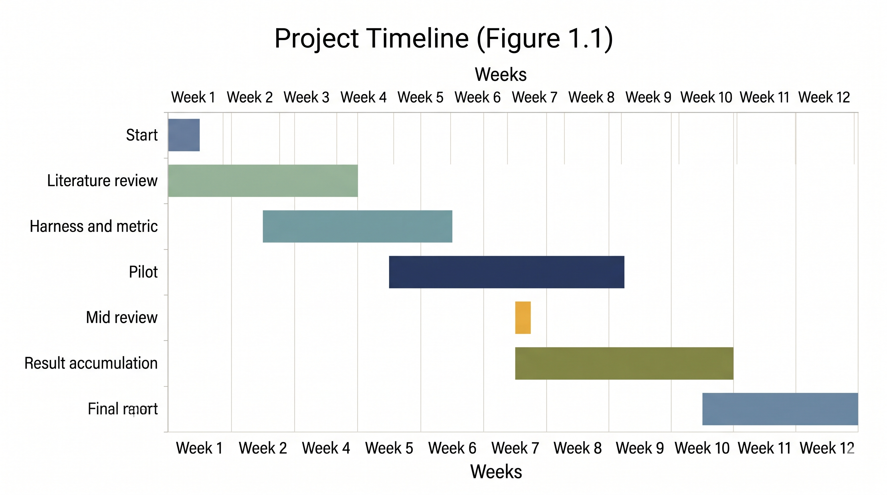

**Figure 1.1: Project timeline by phase.** Seven phases are placed on a relative week axis from week 1 to week 12, with no calendar dates. The start, literature review and harness phases overlap the opening weeks, the pilot runs into the middle of the schedule, the mid review sits at its close, and result accumulation precedes the final report.

### 1.4.3 Roles and responsibilities

**Table 1.2: Roles and responsibilities**

| Member | Primary responsibility | Secondary responsibility |
|---|---|---|
| Ananya Arora | Literature review and methodology | Report structure, editing, citation audit |
| Vaibhavi Kansal | Harness development and baseline ladder | Real-stream evaluation, test suite |
| Priyansh Singh | Deep detector and benchmark reproduction | Artifact pipeline, continuous integration |

### 1.4.4 Challenges and risk management

**Table 1.3: Risk register with mitigation and fallback**

| Risk | Probability | Impact | Mitigation or fallback |
|---|---|---|---|
| Deep signal has no discriminative power | High | High | Pre-registered gate; classical control travels with the deep view |
| Benchmark host mismatch | Medium | Medium | CapyMOA with an isolated Java environment; two protocol conventions implemented |
| Leakage in learned fusion | Medium | High | Rule-based fusion first; leave-one-dataset-out reserved for the learned variant |
| Graphics compute cost | Medium | Medium | Laptop-scale runs, bounded worker counts, short trial caps |
| Deep model is a weak classifier | High | Medium | Use the encoder as a signal extractor, not as the benchmark host |
| False alarms make the detector unusable | Medium | High | Threshold calibrated on pre-drift windows to a fixed false-alarm budget |
| Scope creep across experiments | High | Medium | Pre-registered gates; the pilot-first rule blocks an unearned full matrix |
| Thermal ceiling on a laptop | Medium | Medium | Controlled worker counts, no unattended heavy runs |
| Delay floor cannot be beaten | Certain | Low | State the warning and confirmation split instead of a single blended number |

## 1.5 Scope and Limitations

The work covers classification on drifting streams, implemented in River and DeepRiver, evaluated prequentially over synthetic generators and public real streams, at detector level and at model level. It includes a two-stage detector, a fixed-delay synthesis of the label tax, and a reproducible artifact pipeline.

It excludes regression, clustering and recommendation, distributed or federated training, a production service, and novel deep architectures. The stochastic, partial, selective and batch delay matrix is implemented but not benchmarked, and the ABCD and ABCD(X) arm of the benchmark is cited rather than reproduced.

<!-- pagebreak -->

# CHAPTER 2: LITERATURE SURVEY AND CRITICAL REVIEW

## 2.1 Critical Review

**Foundations and evaluation.** Streaming learning rests on a small set of uncontested results. Domingos and Hulten showed that a decision tree can be grown in one pass with constant memory per leaf [4]. Bifet and Gavalda supplied the adaptive window that most of the field still uses, with a false-positive guarantee that made detector evaluation quantitative [8], [9]. Gama, Sebastiao and Rodrigues formalised prequential scoring, in which each sample is predicted before it trains the model [11]. River packaged these primitives into a Python ecosystem [13], and DeepRiver extended the same interface to PyTorch learners [22].

**Detector benchmarking and host dependence.** The detector literature is long and, read carefully, negative. Gama et al. introduced DDM as statistical process control on the error stream [5], Baena-Garcia et al. added EDDM to catch gradual change through the distance between errors [6], and Page's cumulative sum scheme [1], given its minimax formulation by Lorden [2], survives as Page-Hinkley. Each method reports a win on its own evaluation, and the comparisons do not agree. Goncalves et al. summarised the position in 2014: no detector dominates on delay, false alarms and misses at once. Cerqueira et al. converted that folk result into a proper benchmark, with seven real datasets, four injected drift types, two transition speeds and a timing-aware F1 detection score [27]. Their ranking places SEED and STEPD first, with HDDM-A mid-table.

The benchmark also exposes an unexamined variable. A detector watches the mistakes of a specific host learner, and the host adapts while the detector is watching. A one-sided test such as HDDM-A can therefore miss a change that an adaptive host repairs before the test separates. This report treats host dependence as a first-class measurement and reports detector maps on both a static and an adaptive host.

**Delayed and partial labels.** Zliobaite asked the question that governs this area: when a change arrives with delayed labelling, is it detectable at all [10]. The answer is conditional. Pure posterior drift, in which the conditional distribution of the label given the features changes while the feature distribution does not, leaves no trace in the input stream, so no label-free method can see it. Grzenda, Gomes and Bifet supplied the evaluation protocol for the delayed case [12]. Gomes et al. surveyed semi-supervised learning for delayed partially labelled streams and named the delayed and partial intersection as under-explored [16]. Botacin and Gomes measured the operational cost in a malware pipeline, reporting roughly a 50 percent increase in user exposure and a decrease of up to 75 percent in detection as delay grows [20]. Alencar et al. confirmed that the terminology itself is fragmented [24].

**Label-free and hybrid detection.** STUDD detects drift without labels by monitoring how well a student model imitates the deployed teacher [18], and it demonstrates both the value and the limit of the approach: it works when the input distribution moves, and it fails on pure posterior drift, exactly as Zliobaite predicted [10], [18]. The active-learning line attacks the same problem from the acquisition side [15]. Agu et al. gate deep adaptation on a parametric detector, which is architecturally close to the two-stage idea but sidesteps delayed ground truth by using pseudo-labels [23]. Applied work adds the operational case: Hans and Zuhlke show an online ensemble beating weekly batch retraining [25], Abdoune et al. compare iterative batch against incremental learning on a digital twin [26], and Carneiro et al. predict whether retraining will help before spending the compute [14]. Imbalanced drifting streams are where adaptive ensembles have the strongest published record, with ROSE reporting a mean kappa of 63.65 against 57.85 for the next-best of thirty ensembles over twenty-four real datasets [17].

**The open position.** Three results run through the review. Detector quality is host-conditional, so a detector claim without a host is incomplete. Label-free monitoring is limited to changes that leave a trace in the input distribution. An immediate-label benchmark now exists, and the equivalent for delayed, partial and selective labels does not. No logged paper builds and evaluates a two-stage warning and confirmation protocol against a calibrated detector panel, which is the gap this project occupies [16], [18].

## 2.2 Summary Table

**Table 2.1: Literature summary: method, cost, finding and limitation**

| Work | Year | Method or dataset | Cost or efficiency | Key finding | Limitation |
|---|---|---|---|---|---|
| Page [1] | 1954 | CUSUM sequential test | Constant memory | Sequential change detection with a tunable threshold | No notion of a learner or of drift type |
| Lorden [2] | 1971 | Minimax quickest detection | Theoretical | Frames the delay against false-alarm trade-off | Asymptotic, not a practical recipe |
| Widmer and Kubat [3] | 1996 | FLORA2, hidden context | Small | Early formal treatment of drift | Concept-level, no detector benchmark |
| Domingos and Hulten [4] | 2000 | Hoeffding tree, one pass | Constant memory per leaf | Learn a tree in a single pass with a statistical split rule | Static, no adaptation |
| Gama et al. [5] | 2004 | DDM on the error stream | Cheap | Warn and alarm thresholds on error rate and variance | Weak on gradual drift |
| Baena-Garcia et al. [6] | 2006 | EDDM on error distances | Cheap | Better sensitivity to gradual change | More parameters, noisier |
| Bifet and Gavalda [8] | 2007 | ADWIN adaptive window | Bounded window | False-positive guarantee without a fixed window | Slower on gradual drift |
| Zliobaite [10] | 2010 | Detectability analysis | Theoretical | Pure posterior drift is undetectable from inputs | No architecture proposed |
| Gama et al. [11] | 2013 | Prequential evaluation | One pass | Test-then-train is the correct ordered-stream protocol | Breaks when labels are delayed |
| Grzenda et al. [12] | 2020 | Delayed-labelling evaluation | Buffered | Continuous re-evaluation for delayed labels | Evaluation protocol, not detector analysis |
| Montiel et al. [13] | 2021 | River library | Open source | Unified streaming API with detectors and metrics | Tooling paper, no benchmark |
| Carneiro et al. [14] | 2021 | Meta-learning for retraining | Meta-model | Predicts whether retraining will help before spending compute | Decision support, not detection |
| Gomes et al. [16] | 2022 | DPL survey | Survey | Names the delayed and partial intersection as open | No experiment at detector level |
| STUDD [18] | 2023 | Student-teacher, label-free | Page-Hinkley on imitation loss | Strong label efficiency, missed-detection ratio about 19 percent | Blind to pure posterior drift |
| Botacin and Gomes [20] | 2024 | Malware pipeline, DREBIN | Queue-driven delay | Delay raises exposure about 50 percent, cuts detection up to 75 percent | Pipeline-specific, not detector-level |
| Agu et al. [23] | 2026 | Gamma-Weibull gate, pseudo-labels | Under 50 KB memory | Detection delay of 6 samples abrupt, 80 gradual | Uses pseudo-labels, not delayed truth |
| KDD'26 [27] | 2026 | 14 detectors, 7 datasets, 4 drift types | Monte Carlo injection | SEED and STEPD lead; no detector wins everywhere | Immediate labels only |
| Alencar et al. [24] | 2026 | Experimental survey | Survey | Confirms fragmentation of the delayed-label setting | Results at survey level |

**Reading.** The table separates three kinds of contribution. Foundational entries establish the mechanism and the protocol, benchmark entries establish comparability, and delay entries establish that the problem exists without establishing its detector-level size. The KDD'26 row matters most, because it supplies the protocol that Chapter 5 reproduces and extends.

## 2.3 Identification of Research Gaps

The literature leaves five gaps, each mapping to one or more objectives in Section 1.2.

**G1. Detector-level degradation under delayed, partial and selective labels is unquantified.** Three papers establish that delayed labels harm learning [16], [20], [24], and none isolates the detector from the learner and reports detection delay against label latency. Lemma 1 states the floor and E21 measures it. This maps to O4.

**G2. An immediate-label detector benchmark exists, but no delayed-label benchmark does.** Cerqueira et al. solved comparability for the immediate case [27], and the same harness has not been run under a delay schedule. This report reproduces their ranking as a control and applies a fixed-delay synthesis to the same cells. This maps to O2 and O4.

**G3. No built and evaluated two-stage warning and confirmation protocol exists.** Gomes et al. name the hybrid as open [16], STUDD demonstrates the label-free half [18], Agu et al. build an adjacent gate that avoids delayed truth [23], and none reports \(T_{\mathrm{warn}}\) separately from \(T_{\mathrm{confirm}}\) on a calibrated panel. This maps to O3 and O4.

**G4. The marginal value of a deep representation monitor over a classical feature test is unproven.** Neither the imitation loss of STUDD [18] nor the parametric likelihood of Agu et al. [23] is reported against a per-feature Kolmogorov-Smirnov control at a matched false-alarm budget. E18 was built as that comparison, and its result is negative. This maps to O3.

**G5. The operational cost of continual learning under drift is under-reported.** Papers report accuracy and rarely report damage, warning latency, false-alarm budgets or the compute saved by avoiding full retraining [21], [25], [26]. This report prices damage in samples times kappa and compute in wall-clock seconds, and states the energy envelope in Chapter 5. This maps to O5.

The literature therefore supports a narrow claim: the ingredients are published, and the combination is not. Chapter 3 describes the design that tests that combination.

<!-- pagebreak -->

# CHAPTER 3: SYSTEM DESIGN AND METHODOLOGY

## 3.1 Design Considerations

The design was constrained along seven dimensions before any experiment was written. Table 3.1 states the position taken on each.

**Table 3.1: Design considerations across seven dimensions**

| Dimension | Position taken | Consequence in the design |
|---|---|---|
| Economic | Open-source stack, laptop-scale compute, no cloud cluster | The owned laptop is the only capital item; the graphics processor is the main marginal cost |
| Environmental | Bounded memory, few full retrains, local execution | Single-pass learners; fixed worker counts; no repeated corpus reads |
| Social | Fraud, intrusion and credit-risk use cases | Delayed labels treated as the normal case rather than an edge case |
| Political | Public datasets, no personal data, transparent reporting | Every number traces to a committed artifact; negative gates published |
| Ethical | Pre-registered gates, no tuning on test trials | A gate that fails is reported as a failure, not reframed |
| Health and safety | No human subjects, no physical hazard | Thermal safety on the laptop; no unattended heavy runs |
| Sustainability | Reusable harness, versioned configuration, provenance | Artifact schema, configuration hashes, one-command reproduction |

The economic constraint shapes the science. A cluster would have allowed the full 7 by 4 by 2 by 50 matrix for the fusion detector. The laptop did not, so a pilot-first rule was adopted: an 80-cell pilot must clear its gate before the full matrix is justified. The rule was pre-registered, the pilot failed, and the matrix was not run.

## 3.2 Methodology

The design has two halves: a measurement instrument and a detector. DriftLab turns a YAML specification into a reproducible run. DF-H is a two-stage detector that separates a label-free warning from a supervised confirmation.

**DriftLab.** Seven modules carry the harness: `config` (typed specification and stable hash), `streams` (generators and injected episodes), `detectors` (the classical panel), `learners` (frozen, scheduled, oracle and adaptive models), `metrics` (prequential and drift-window measures), `artifacts` (the result schema) and `harness` (the loop, with per-seed units and a resume guard). A run is reproducible from `meta.json` alone, which records the configuration, its hash, the git revision, the library versions and the exact command. Figures are re-rendered from artifacts, so no number has a manual step between measurement and plot.

**The loop.** For each sample the model predicts, the metric is updated with the true label, and then the model learns from that sample. The order matters: a model that learned first would be scored on data it had already seen. The loop appears as Code Listing 4.1.

**Stage 1.** Seven label-free signals are computed over a window of 500 samples with a stride of 100: self-supervised loss from a frozen encoder, embedding mean shift, embedding variance shift, head disagreement, predictive entropy, an internal ADWIN, and a per-feature Kolmogorov-Smirnov statistic. The reference is the first 20 percent of windows, and each signal is normalised by its reference mean and spread. The classical KS statistic travels with the deep signals deliberately, as a control that must be beaten before the deep representation can claim value.

**Stage 2.** The classical panel watches the host's mistake stream: SEED, STEPD, ADWIN, HDDM-A and HDDM-W. These detectors consume labels, which is why they are floor-bound. Thresholds are calibrated on pre-drift windows to 0.1 false alarms per 1,000 samples per dataset.

**Table 3.2: DF-H Stage 1 signals and fusion variants**

| Component | Signals or detectors | Labels required |
|---|---|---|
| Stage 1 deep | `ssl_loss`, `embedding_shift`, `embedding_var_shift`, `head_disagreement`, `entropy`, `internal_adwin` | No |
| Stage 1 classical | `feature_ks` | No |
| Stage 1 combined | Maximum of the deep and classical standardised scores | No |
| Stage 2 | SEED, STEPD, ADWIN, HDDM-A, HDDM-W on the raw mistake channel | Yes |
| Fusion variants | `S1`, `S2`, `OR`, `AND`, `2of3`, `2of3_nodeep` | Mixed |
| Primary candidate | `2of3_both`, reported as DF-H | Mixed |
| Control | `2of3_nodeep`, which removes the feature monitor | Yes |

**Fusion.** Fusion runs over a confirmation window of 2,000 samples with a refractory period of 2,000 samples. `OR` reports the earliest alarm of either stage, `AND` reports the time at which both have alarmed, and 2-of-3 reports the time at which two of three members have alarmed. Because the stages hold different information, the design reports two times rather than one: \(T_{\mathrm{warn}}\) from Stage 1 is not shifted by label delay, and \(T_{\mathrm{confirm}}\) from Stage 2 is floor-bound at \(\tau + L\). A single blended number would hide the result.

**Benchmark protocol.** The external benchmark is reproduced with seven datasets, four drift types, two transition speeds, 50 trials, a 100,000-row cap, a Hoeffding Tree host, and the correctness signal with the code-convention gradual anchor. The public code and the paper disagree on signal polarity and gradual anchoring, so both conventions are implemented; the reported run uses the one that reproduces the published F1 values.

**Delay regimes.** Five label-arrival schedules are implemented: fixed, geometric, partial, selective and batch. Only the fixed-delay case is measured here, and that restriction is stated wherever the Delay Tax appears.

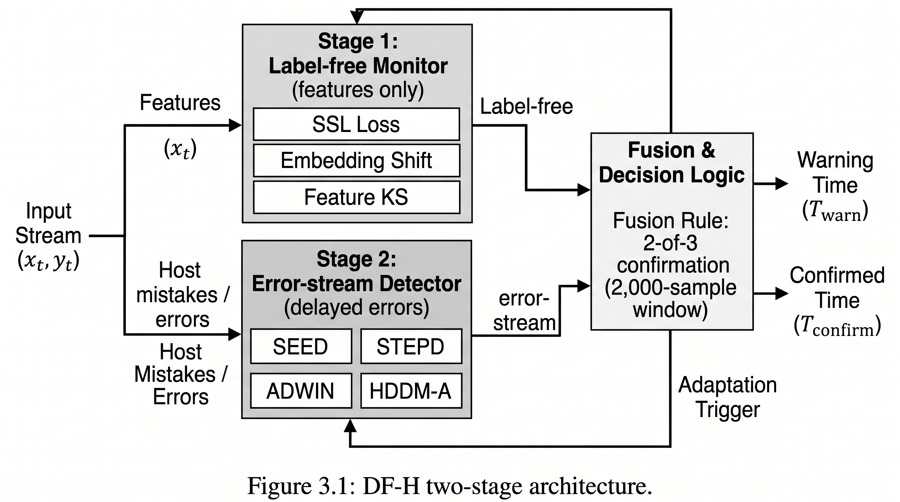

**Figure 3.1: DF-H two-stage architecture.** The input stream forks by information type. Stage 1 receives features only and computes self-supervised loss, embedding shift and the feature KS statistic, so its output is available at any time. Stage 2 receives the host's mistakes, which exist only where labels have arrived. A 2-of-3 rule over a 2,000-sample window combines the two, and the design reports the warning time and the confirmed time separately because only the second is floor-bound.

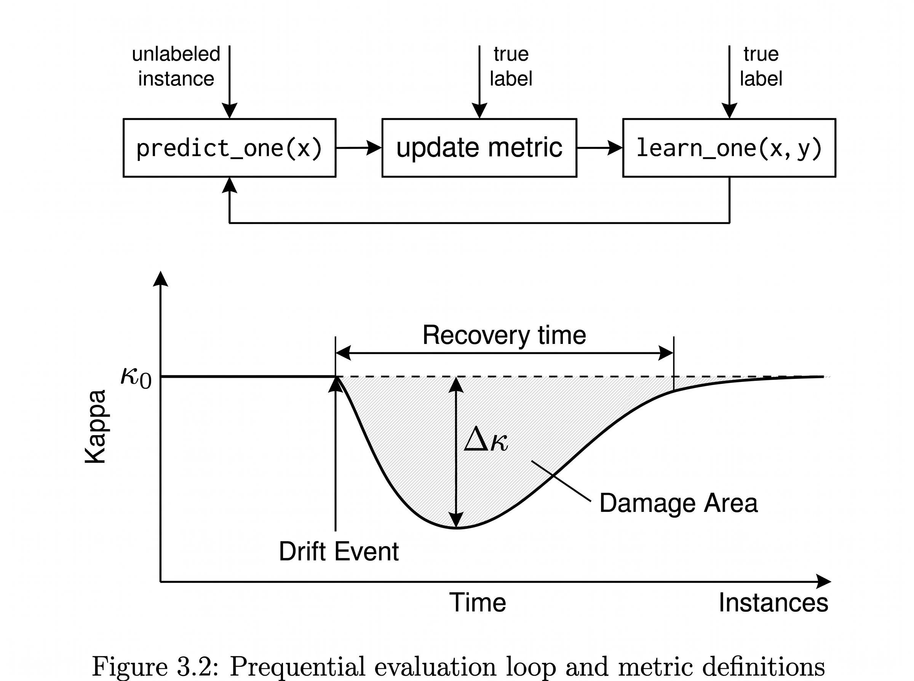

**Figure 3.2: Prequential evaluation loop and metric definitions.** Each sample is predicted before it is used to train, and the metric is updated in between, so no score is contaminated by the sample it scores. The curve beneath the loop shows how the drift-window quantities are read: \(\kappa_0\) is the pre-drift reference, \(\Delta\kappa\) is the dip depth, the width of the return is the recovery time, and the shaded region is the damage that Section 3.3 integrates.

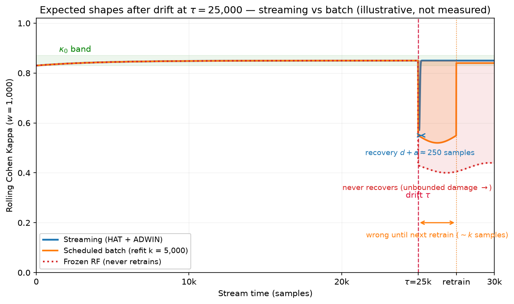

**Figure 3.3: Expected post-drift recovery shapes for streaming, scheduled and frozen batch models.** The metric definitions of Section 3.3 can be read from the shape. The pre-drift band is the reference level, the fall at the drift point is the dip depth, the width of the return is the recovery time, and the shaded region is the damage. A streaming learner closes that region quickly, a scheduled model stays wrong until its next refit, and a frozen model never closes it. The shapes are schematic; measured curves appear in Chapter 5.

## 3.3 Modelling

Let a stream arrive one sample at a time, and let a drift occur at sample \(\tau\). Every model predicts before it learns, so the instantaneous error is the indicator that the prediction differs from the label.

$$
e_t = \mathbb{1}\left[\hat{y}_t \neq y_t\right]
$$

Rolling Cohen kappa over a window \(w\) corrects prequential accuracy for chance agreement, and it is the primary quality measure because it does not reward a majority-class predictor on an imbalanced stream. Damage is priced against a shared pre-drift reference, so that a weak model cannot lower its own baseline and appear healthy.

$$
\begin{aligned}
\mathrm{damage}_{\mathrm{ref}}  &= \sum_{t=\tau}^{\tau+W} \max\left(\kappa_{\mathrm{ref}} - \kappa_t,\ 0\right) \\
\mathrm{damage}_{\mathrm{full}} &= \sum_{t=\tau}^{T} \max\left(\kappa_{\mathrm{ref}} - \kappa_t,\ 0\right)
\end{aligned}
$$

\(\mathrm{damage}_{\mathrm{ref}}\) uses a fixed window \(W\) of 5,000 samples and is the primary metric; \(\mathrm{damage}_{\mathrm{full}}\) integrates to the end of the stream and captures the tail. The area under excess error against the timing oracle, AUE, is secondary, because the oracle knows when the drift happened but not what the new concept is. Recovery counts only after a genuine band exit followed by 500 consecutive in-band samples.

Four lemmas bound what any detector can do.

**Lemma 1 (reaction floor).** An error-stream detector cannot alarm before the post-drift labels arrive, so under a fixed delay \(L\) its detection time satisfies \(T \ge \tau + L\). The detector's input is a function of labelled samples only, so at time \(t < \tau + L\) no post-drift label exists. A label-free monitor is not subject to this bound, and that asymmetry is the content of the Delay Tax.

**Lemma 2 (power loss).** A detector observing a fraction \(p\) of labels sees an effective sample size \(pW\) per window, so the smallest detectable shift in the error mean grows as \(1/\sqrt{pW}\), and the detectable effect is inflated by \(1/\sqrt{p}\).

**Lemma 3 (batch variance inflation).** For labels arriving in batches of size \(b\) with intra-batch correlation \(\rho\), the variance of the observed error mean is inflated by the design effect \(1 + (b - 1)\rho\), so a threshold calibrated on independent arrivals will fire too often.

**Lemma 4 (identifiability ceiling).** If the drift is purely posterior, so that the conditional label distribution changes while the feature distribution does not, the divergence between pre-drift and post-drift inputs is zero and no label-free method can detect the change. This restates Zliobaite [10], and its consequence is architectural: a label-free monitor can only warn, so confirmation is required by information rather than by preference. Lemmas 2 and 3 are stated but not measured end to end here.

The fusion score is the standardised maximum of the participating members, and an alarm is declared when two of three exceed their calibrated thresholds inside the confirmation window. The benchmark score is the F1 detection score of Cerqueira et al. [27], computed from matched, missed and false alarms, with the normalised detection time.

## 3.4 Tool and Technique Selection

**Table 3.3: Tool and technique selection with justification**

| Tool or technique | Version | Role | Justification against alternatives |
|---|---|---|---|
| Python | 3.12.3 | Implementation language | Ecosystem covers every library required; no performance-critical path is in pure Python |
| uv | current | Environment and dependency management | Reproducible lock files; faster resolution than pip and conda for this dependency set |
| River | 0.25.0 | Detectors, trees, ensembles, metrics | Native prequential API and the exact detector panel required; merging of creme and scikit-multiflow [13] |
| DeepRiver | 0.3.4 | Deep streaming learners, frozen encoder | Only maintained library that puts PyTorch models behind the River streaming interface [22] |
| PyTorch | 2.5.1 with CUDA 12.4 | Encoder pretraining and inference | Required by DeepRiver; the 12.4 build matches the installed driver |
| scikit-learn | 1.9.0 | Frozen random forest baseline | Reference implementation of the batch model under test; no streaming substitute is equivalent |
| NumPy | 2.5.3 | Stream generation and numerics | Deterministic seeded generation; the fusion rules are pure NumPy |
| SciPy | 1.18.1 | Statistical tests | Kolmogorov-Smirnov and KS-based phase tests are already implemented and validated |
| CapyMOA | 0.15.1 | Benchmark reproduction | Wraps the reference Java detectors, so the reproduction uses the benchmark's own implementations |
| Matplotlib | current | Figures | Every figure is rendered from a committed artifact, never assembled by hand |
| MkDocs Material | current | Evidence site | Renders the dossier for review; not required to reproduce a result |

Two rejections are worth recording. A pure MOA stack was rejected because the analysis, artifact schema and statistical layer would have had to be rewritten in Java, and CapyMOA already exposes the same detectors from Python. A custom streaming framework was rejected because River already provides the detectors, trees and metrics, so building one would have substituted engineering for science. The Java bridge runs in its own virtual environment with a 512 MB heap, so a benchmark failure cannot disturb the Python experiments.

<!-- pagebreak -->

# CHAPTER 4: IMPLEMENTATION AND TESTING

## 4.1 Development Details

Development proceeded in ten work packages. The order matters, because two of them invalidated results produced by earlier ones and forced a controlled rerun.

**Start phase.** Orientation established the reading list and the tooling. River 0.25.0 was pinned and its detector panel was verified to contain every method the plan required.

**Literature review phase.** Thirty-eight papers were catalogued with verification status, six received deep-dive notes, and the gap analysis produced the four lemmas and the scoop-risk assessment that Chapter 2 reports. Two findings changed the design. Cerqueira et al. had already standardised immediate-label detector benchmarking, so the gap statement was narrowed to the delayed case [27]. Alencar et al. is a paywalled experimental survey of the delayed and partial setting [24], so the contribution was reworded to claim formal bounds and a confirmation protocol rather than the measurement of degradation itself.

**Harness and metric phase.** The bespoke pilot scripts were replaced by a configuration-driven harness. A run is a per-seed unit with a cache key, so an interrupted sweep resumes at the next unit. A configuration-hash guard refuses to resume into an artifact produced by a different configuration. The artifact contract was fixed at that point, with figures rendered from the artifact rather than drawn by hand.

**Pilot phase.** Exp-01 ran one DeepRiver rolling classifier against a frozen random forest on a SEA stream with one abrupt drift at sample 30,000. Exp-02 repeated the identical configuration on eleven seeds, and seed 42 reproduced the Exp-01 recovery exactly, which established that the sweep was a genuine rerun.

**Mid phase.** A defect was found in the damage metric. The legacy definition integrated from the drift point to the recovery point, and on eight of eleven seeds the recovery rule collapsed to the drift point itself, so the streaming integral covered one sample while the frozen integral covered the whole window. The corrected contract integrates over a fixed 5,000-sample window against a panel-shared reference, and recovery is conditional on a genuine band exit. Experiment E01 reran the clean three-model panel, and the headline fell from the retired 294 times to approximately 6.9 times.

**Result accumulation, part one.** E02 ran the no-drift control and returned a deliberate negative: smoothing the mistake signal makes ADWIN and KSWIN fire on a stationary stream, so the raw channel became the default. E04 produced the synthetic detector map across four generators, four drift shapes, eight detectors, two hosts and both channels, and a scoring bug was fixed here: zero-alarm runs had been dropped from the F1 mean, so a detector that never rang appeared perfect. E17 replayed the same panel on real electricity-market records with an injected label swap.

**Result accumulation, part two.** E03 ran the ten-model baseline ladder on two generators over eleven seeds, and E14 ran the real-stream model check on Elec2 and Phishing.

**Result accumulation, part three.** The external benchmark was reproduced with 2,800 tasks across seven datasets, four drift types, two transition speeds, 50 trials and six detectors, completing in 13 minutes and 33 seconds on 14 workers with no failures. A protocol discrepancy was resolved by measurement: the public code feeds correctness into detectors that document an error convention, and its gradual window is anchored differently from the paper. Both conventions are implemented, and the headline uses the one that reproduces the published F1 values.

**Result accumulation, part four.** E18 instrumented the frozen encoder and produced a pure NumPy signal stream for all 80 trials, then failed its gate. E19 piloted the fusion detector and failed the top-2 gate. E21 built the fixed-delay synthesis from the committed trial artifacts without retraining a model. E22 ran the capability check against the requested classical panel in about 45 seconds.

**Final phase.** The report was written from artifacts, and the audit was run against the evidence map rather than against memory.

`Code Listing 4.1` gives the prequential loop and the fusion core in Python-like syntax. The listing is abridged; the full implementations are in `experiments/driftlab/harness.py` and `experiments/driftlab/fusion.py`.

**Code Listing 4.1: Prequential loop and DF-H fusion core**

```python
# 1. Prequential loop: predict, score, then learn. Order is not negotiable.
for x, y in stream:
    y_hat = model.predict_one(x)      # score the unseen sample first
    metric.update(y, y_hat)           # no leakage: metric sees the truth now
    model.learn_one(x, y)             # only now may the model learn

# 2. Rolling kappa and the shared pre-drift reference.
kappa_ref = panel_mean_kappa_before(tau)      # shared across all models
damage_ref = sum(max(kappa_ref - kappa_t, 0)
                 for kappa_t in rolling_kappa[tau:tau + 5000])

# 3. DF-H Stage 1: label-free standardised signals, reference = first 20% of windows.
z = {name: (signal[name] - ref_mean[name]) / ref_std[name]
     for name in ("ssl_loss", "embedding_shift", "embedding_var_shift",
                  "head_disagreement", "entropy", "internal_adwin", "feature_ks")}
stage1_deep      = max(z["ssl_loss"], z["embedding_shift"])
stage1_classical = z["feature_ks"]
stage1_both      = max(stage1_deep, stage1_classical)

# 4. Stage 2: error-stream detectors on the host's raw mistake channel.
stage2 = any(det.alarm for det in (seed, stepd, adwin, hddm_a, hddm_w))

# 5. Fusion: 2-of-3 confirmation inside a 2,000-sample window.
votes = [stage1_both > threshold_s1,
         stage2,
         ensemble_vote > threshold_s2]
if sum(votes) >= 2:
    T_confirm = t
    trigger_adaptation()
T_warn = first_t where stage1_both > threshold_s1   # never shifted by delay L
```

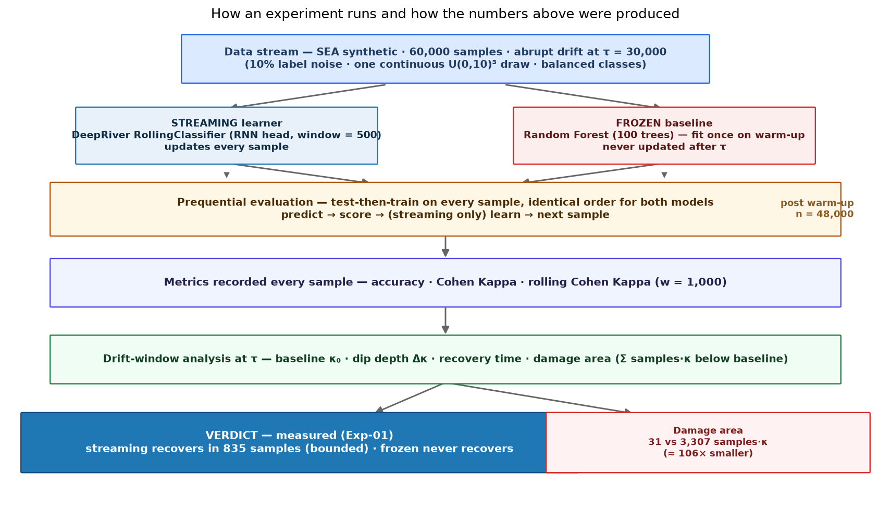

**Figure 4.1: DriftLab pipeline from stream to drift-window analysis.** Both models consume the same sample order from one seeded stream, so the only difference between arms is whether the model may update. Everything below the prequential loop is measurement rather than modelling, since per-sample scores are recorded and the drift-window quantities are computed from those records. The verdict box states the outcome that the pipeline reports.

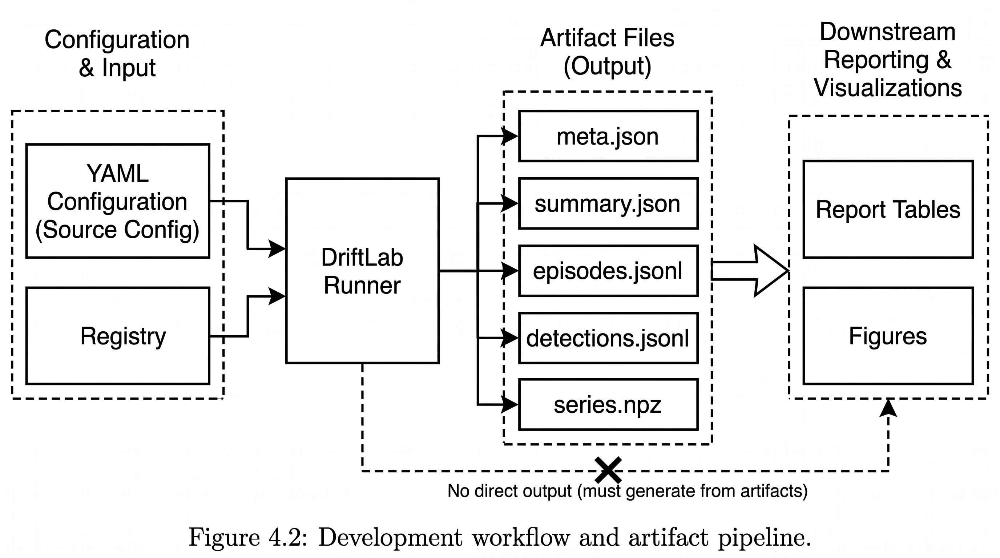

**Figure 4.2: Development workflow and artifact pipeline.** A YAML configuration and a registry feed the DriftLab runner, which writes `meta.json`, `summary.json`, `episodes.jsonl`, `detections.jsonl` and `series.npz`. Report tables and figures are produced only from those artifacts; the crossed path marks the direct route from a run to a figure, which the harness forbids.

## 4.2 Experimental Setup

**Table 4.1: Experimental setup: hardware, software, data and protocol**

| Component | Specification |
|---|---|
| Hardware | Laptop with AMD Ryzen 7 6800H, 8 cores and 16 threads, NVIDIA RTX 3050 Laptop GPU, 16 GB RAM, Linux |
| Thermal envelope | GPU up to 95 W under load; CPU package up to 45 W under load |
| Language and environment | Python 3.12.3, uv package manager |
| Streaming stack | River 0.25.0, DeepRiver 0.3.4, PyTorch 2.5.1 with CUDA 12.4 |
| Numerical stack | NumPy 2.5.3, SciPy 1.18.1, scikit-learn 1.9.0 |
| Benchmark stack | CapyMOA 0.15.1, NumPy 2.4.6, Java subprocess with a 512 MB heap |
| Synthetic streams | SEA, Hyperplane, RandomRBF and Agrawal generators, with known drift positions |
| Real streams | Elec2 with 45,312 rows, Phishing with 1,250 rows, Covtype and Electricity for the benchmark |
| Detector panel | ADWIN, KSWIN, Page-Hinkley, DDM, EDDM, FHDDM, HDDM-A, HDDM-W, SEED, STEPD |
| Learner panel | Frozen random forest, scheduled retrain at 1k, 5k and 20k, oracle refit, Hoeffding Tree, HAT, ARF, Leveraging Bagging, ADWIN Bagging |
| Metrics | Prequential accuracy, rolling Cohen kappa, \(\mathrm{damage}_{\mathrm{ref}}\), \(\mathrm{damage}_{\mathrm{full}}\), AUE, recovery rate, F1 detection score, normalised detection time |
| Seeds | Eleven for E01 and E03; five for E04, E14, E17 and the 80-cell pilot; 50 trials per cell for the benchmark |
| Artifact root | `experiments/results/<exp_id>/` |

The synthetic streams carry a known drift position, which is what makes the timing metrics possible. Without a ground-truth onset there is no way to measure detection delay or recovery time, only a post-hoc dip, so the synthetic generators supply the timing and the real streams supply the external validity. That division explains why the timing claims rest on synthetic and benchmark data while the adaptation claims are checked again on Elec2, Phishing, Covtype and Electricity.

The seed counts differ by experiment for a reason. Model-level comparisons need enough seeds to estimate a distribution, so E01 and E03 use eleven. Detector-level comparisons average over far more cells, since the 80-cell pilot already gives 80 observations per detector, so five trials per cell are adequate for a rank. The benchmark uses 50 trials because that is its published protocol. Comparing many learners across many streams ultimately requires Friedman and Nemenyi procedures with pairwise post-hoc tests [7]; that analysis is not run here, and the per-cell counts in Chapter 5 are descriptive rather than significance claims.

All datasets are public and none contains personal data. Every run is local, so no result depends on a cloud environment that a reader cannot reproduce, and the measured runtimes in Section 5.3 are short enough to make the whole ladder reproducible on one machine.

## 4.3 Test Cases

Testing proceeded at two levels. Unit tests cover the metric implementations, the stream generators, the detector adapters, the artifact contract, the label schedules and the fusion rules, with 53 test functions across nine files. Experiment-level tests check the properties that would invalidate a result if they failed.

**Table 4.2: Test cases with expected and observed results**

| ID | Test | Expected result | Observed result | Verdict |
|---|---|---|---|---|
| T1 | Prequential leakage check | The metric is updated before `learn_one` is called | Call order verified by instrumentation in all runs | Pass |
| T2 | Metric hand calculation | \(\mathrm{damage}_{\mathrm{ref}}\) matches a hand-computed series | Exact match on a synthetic series with a known dip | Pass |
| T3 | Stationary false-alarm calibration, raw channel | At most 0.1 false alarms per 1,000 samples | Within budget on both stationary streams | Pass |
| T4 | Stationary false-alarm calibration, smoothed channel | At most 0.1 false alarms per 1,000 samples | ADWIN 0.548 and KSWIN 7.667 per 1,000 | Fail by design |
| T5 | Artifact determinism | Identical seed and configuration reproduce identical artifacts | Reproduced exactly | Pass |
| T6 | Resume guard on a changed configuration hash | A changed hash refuses to resume | Refused, as intended | Pass |
| T7 | Benchmark trial-stream parity | The runner and the precompute see the same sample order | Parity confirmed across all 80 trials | Pass |
| T8 | Label scheduler invariants | Fixed, geometric, partial, selective and batch schedules honour their arrival times | Invariants held in every schedule | Pass |
| T9 | DF-H false-alarm calibration on pre-drift windows | Calibrated rate at or below 0.1 per 1,000 | 0.04 measured on the pilot | Pass |
| T10 | Delay floor check | Every error-only detection occurs at or after \(\tau + L\) | Satisfied in every cell of the synthesis | Pass |
| T11 | Zero-alarm F1 handling | A detector that never alarms scores F1 zero, not one | Corrected after the E04 bug | Pass |

Two of these deserve comment. T4 is a deliberate negative control and is retained as a documented failure, because it establishes that the raw channel rather than the smoothed channel is the correct default. The measured rates are unambiguous: ADWIN fires at 0.548 per 1,000 and KSWIN at 7.667 per 1,000 on a stream that contains no drift at all. T11 records a bug rather than a routine check. Before the correction, zero-alarm runs had `precision = None` and were excluded from the F1 mean, so a never-ringing detector could appear perfect; the first E04 report selected KSWIN for incremental drift with an F1 of 1.0 and an episode recall of 0.25, a pair of numbers that cannot both be true. The corrected implementation recomputes F1 from raw counts and scores zero alarms as zero.

T10 is the test that validates the central claim rather than the code. Had any error-only detector reported a detection earlier than \(\tau + L\) at a positive delay, Lemma 1 would have been contradicted and the Delay Tax would have collapsed. Every cell satisfied the bound.

## 4.4 Safety Measures

**Table 4.3: Safety, data protection and cyber security controls**

| Area | Control |
|---|---|
| Electrical safety | Single laptop on mains power; no modified hardware; no external power supply |
| Thermal safety | Bounded worker counts, no unattended heavy runs, monitoring of sustained load |
| Worker control | Explicit worker limits on every benchmark run; 14 for the full reproduction, 8 for the pilot |
| Java isolation | Dedicated virtual environment with a 512 MB heap limit |
| Crash handling | JVM crash logs retained as diagnostics and excluded from version control |
| Data protection | Public datasets only; no personal data; no credentials; large inputs excluded from git |
| Dependency integrity | Pinned versions and lock files; isolated virtual environments per stack |
| Attack surface | No network services exposed; no listening ports; runs are offline |
| Reproducibility | Deterministic seeds; configuration hashes; artifact provenance; committed result files |
| Research integrity | Pre-registered gates; no tuning on test trials; leave-one-dataset-out reserved for learned fusion; negative results preserved |

The research-integrity controls changed the outcome of the project. Because the gates were pre-registered, a failing pilot blocked the full matrix, and because negative results were preserved, the E18 and E19 gates appear in Chapter 5 as failures rather than being quietly dropped. The storage control also has a practical consequence: the 99 MB benchmarking input is not committed, so the artifact set stays reviewable in a repository rather than becoming a data dump.

<!-- pagebreak -->

# CHAPTER 5: RESULTS AND DISCUSSION

## 5.1 Result Analysis

Nine experiments are reported in the order in which they build the argument. Table 5.1 states the headline of each before the detail.

**Table 5.1: Evidence at a glance: experiment, setting, headline result and verdict**

| Exp | Question | Setting | Headline result | Verdict |
|---|---|---|---|---|
| E01 | Does the corrected metric preserve the streaming win? | SEA abrupt, 11 seeds, clean panel | 74.8 against 515.0, about 6.9 times; frozen 0 of 11 | Pass |
| E03 | Does streaming beat scheduled retraining? | SEA and Hyperplane, 10 models, 11 seeds | Leveraging Bagging 455.7 against scheduled 733.5 and frozen 871.7 | Pass |
| E04 | Which detector works for which shape? | 4 generators, 4 shapes, 8 detectors, 2 hosts | HDDM-A on raw wins all four shapes | Pass |
| E17 | Does the default survive real data? | Elec2, injected label swap, 5 seeds | Host-conditional: ADWIN wins on adaptive HAT | Pass |
| KDD'26 | Does the published ranking reproduce? | 7 datasets, 4 types, 2 transitions, 50 trials | SEED and STEPD 2.12; HDDM-A 3.87 | Pass |
| E14 | Does the win survive real streams? | Elec2 and Phishing, 5 seeds, 100 runs | ARF 198.0 against frozen 297.4, ratio 0.666 | Provisional pass |
| E18 | Do deep signals beat the error rate? | 80 cells, frozen encoder | Best deep AUC 0.616 against 0.598 | Fail |
| E19 | Does DF-H reach top-2? | 80 cells, rule-based fusion | Third overall at 7.09, FAR 0.04 | Fail |
| E21 | Is the label-free warning floor-bound? | 80 cells, fixed delay 2,000 | 70 to 513 against 2,120 to 3,269 | Pass |
| E22 | Can DF-H beat the requested panel? | 80 cells, ADWIN, HDDM-A, HDDM-W, Page-Hinkley | Third at 7.34, ahead of all four | Pass |

### 5.1.1 Streaming against frozen: the corrected headline

Experiment E01 reran the pilot with the corrected metric on a clean three-model panel of eleven seeds. The streaming learner had lower fixed-window damage on all eleven seeds, its worst seed at 217.9 remains 0.74 times the best frozen seed at 295.2, and the mean gap is approximately 6.9 times.


**Figure 5.1: Exp-01 rolling Cohen kappa for the streaming and frozen models.** Before the drift the curves are interleaved and the frozen model is marginally ahead, which is the fair-comparison control. At the drift point both fall, and only the streaming curve returns to its pre-drift band while the frozen curve settles about 0.13 kappa lower. That persistent gap is what the damage metric prices.

**Table 5.2: Streaming against frozen and scheduled batch: E01 and E03**

| Metric | Frozen random forest | Scheduled retrain, 1k | Leveraging Bagging | HAT | DeepRiver |
|---|---:|---:|---:|---:|---:|
| \(\mathrm{damage}_{\mathrm{ref}}\) | 515.0 (E01) | 733.5 (E03) | 455.7 | 489.2 | 74.8 (E01) |
| \(\mathrm{damage}_{\mathrm{full}}\) | 3,472.9 | 824.1 | not reported | not reported | 321.4 |
| Recovery rate | 0/11 | 1.000 | 1.000 | 0.955 | 8/11 |
| Accuracy | 0.854 | 0.855 | 0.857 | 0.847 | 0.883 |
| Cohen kappa | 0.685 | 0.702 | 0.707 | 0.685 | 0.753 |

The two panels use different streams, so the comparison is between orderings rather than absolute values. Scheduled models recover by construction at each retrain tick, so their recovery rate is not the comparison; damage is.

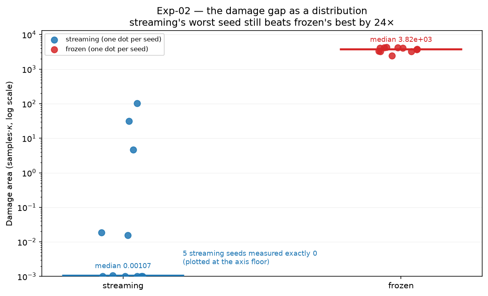

**Figure 5.2: Exp-02 legacy damage distribution, one point per seed.** This figure is shown only as history. Every frozen seed sits in a narrow high band and every streaming seed sits two orders of magnitude below it. The magnitudes it displays, including the retired 294 times figure, come from the truncating legacy metric and are superseded by Figure 5.3.

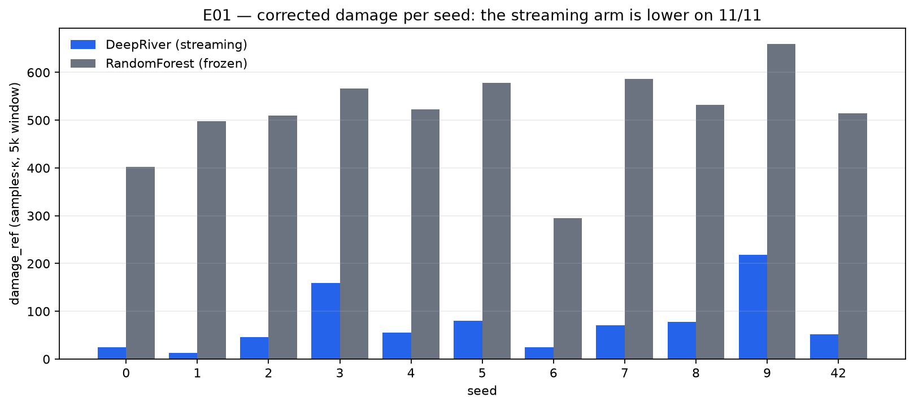

**Figure 5.3: E01 corrected fixed-window damage per seed.** The corrected metric removes the truncation artefact and the gap narrows to approximately 6.9 times while remaining present on all eleven seeds. The two bands do not overlap, so the ordering is not an artefact of averaging.

### 5.1.2 The scheduled and adaptive ladder

Experiment E03 ran a ten-model ladder on two generators over eleven seeds. Every streaming adapter paid less fixed-window damage than the frozen model and less than every scheduled interval.

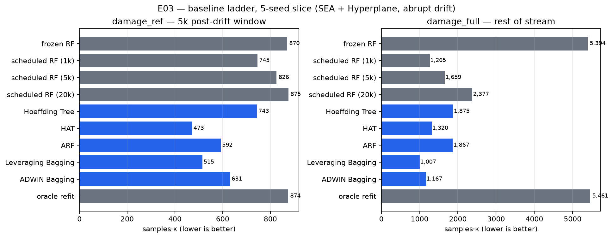

**Figure 5.4: E03 baseline ladder of ten models on fixed-window damage.** Leveraging Bagging leads at 455.7, followed by HAT at 489.2 and ARF at 575.4. The best batch baseline is the 1k scheduled model at 733.5, which still pays 1.6 times the Leveraging Bagging damage, and the frozen model sits at 871.7.

Two qualifications belong with this result. The phase-noise test is inconclusive, because the refit buffer of 12,000 samples exceeds both the 1k and 5k intervals, so lag in those cells is buffer-dominated rather than phase-driven. The oracle refit is also not an upper bound, because it is refit on pre-drift data, so its damage at 864.3 is essentially frozen.

### 5.1.3 Detector maps: synthetic and real

Experiment E04 replayed eight detectors on four synthetic generators, four drift shapes, two hosts and both channels. HDDM-A on the raw signal was the best cell for all four shapes.

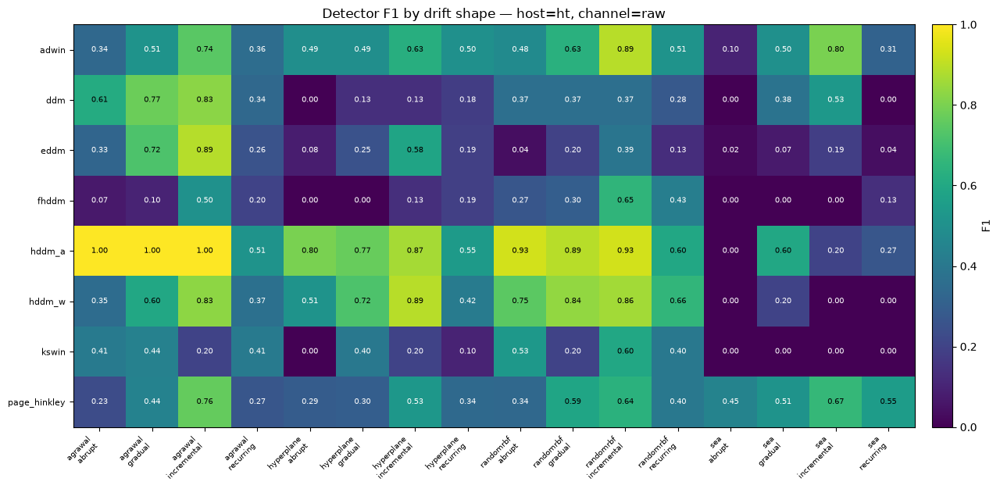

**Figure 5.5: E04 balanced score per detector and drift shape on the static host with the raw signal.** HDDM-A occupies the best cell for every shape. The gap between abrupt and recurring is the substantive finding: a shape that reverses is harder to detect than one that changes once, because the detector must separate a genuine return from noise.

**Table 5.3: Detector maps: E04 synthetic and E17 real Elec2**

| Drift shape | E04 HDDM-A, static host | E17 HDDM-A, static host | E17 ADWIN, static host | E17 HDDM-A, adaptive host | E17 ADWIN, adaptive host |
|---|---:|---:|---:|---:|---:|
| Abrupt | 0.683 | 0.933 | 0.452 | 0.400 | **1.000** |
| Gradual | 0.842 | 0.960 | 0.495 | 1.000 | 1.000 |
| Incremental | 0.883 | 0.960 | 0.842 | 1.000 | 0.971 |
| Recurring | 0.500 | 0.787 | 0.508 | 0.593 | **0.770** |

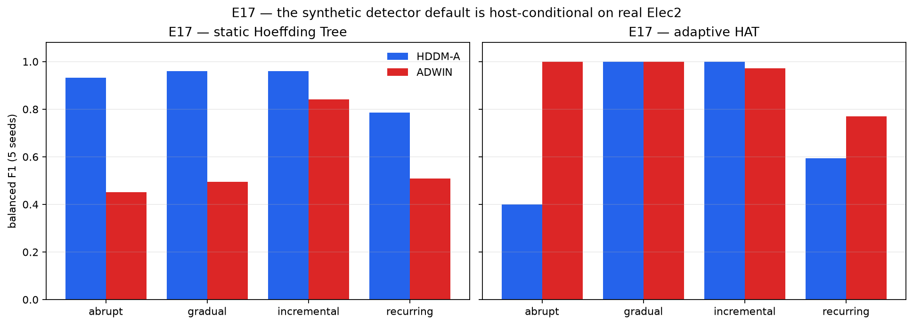

**Figure 5.6: E17 detector map on real electricity-market records.** On the static host, HDDM-A repeats the synthetic result and wins all four shapes. On the adaptive host ADWIN wins abrupt and recurring, ties gradual and loses only incremental. The mechanism is interpretable: a one-sided test alarms only when the error rate rises above a frozen low-error reference, and an adaptive host can repair an abrupt label swap before the test separates, while ADWIN compares two windows in both directions.

### 5.1.4 The published benchmark reproduced

The external benchmark was reproduced on seven real datasets with four drift types, two transition speeds and 50 trials per cell, for 2,800 tasks and no failures.

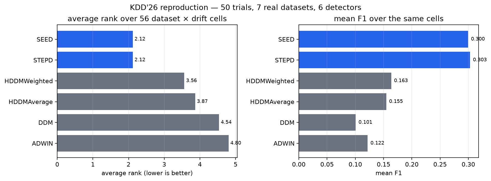

**Figure 5.7: Benchmark reproduction ranking and mean F1.** SEED and STEPD tie for first, HDDM-W is third, HDDM-A fourth, DDM fifth and ADWIN sixth. The absolute F1 values reproduce the published tables for the shared detectors, which is the evidence that the reproduction is faithful rather than merely similar in ordering.

**Table 5.4: Detector panel: KDD'26 reproduction and the E22 shootout**

| Detector | KDD'26 mean F1 | KDD'26 rank | E22 mean F1 | E22 FAR per 1,000 | E22 rank |
|---|---:|---:|---:|---:|---:|
| SEED | 0.300 | 2.12 | 0.267 | 0.06 | 5.59 |
| STEPD | 0.303 | 2.12 | 0.281 | 0.05 | 5.44 |
| HDDM-W | 0.163 | 3.56 | 0.170 | 0.28 | 7.47 |
| HDDM-A | 0.155 | 3.87 | 0.128 | 0.04 | 11.34 |
| DDM | 0.101 | 4.54 | not run | not run | not run |
| ADWIN | 0.122 | 4.80 | 0.117 | 0.11 | 9.94 |
| DF-H | not run | not run | 0.223 | 0.04 | 7.34 |
| Page-Hinkley | not run | not run | 0.018 | 0.01 | 12.53 |

### 5.1.5 The real-stream model check

Experiment E14 replayed the model comparison on real features and labels from Elec2 and Phishing, with label-swap and feature-permutation drift injected at a known point, over five seeds and 100 runs.

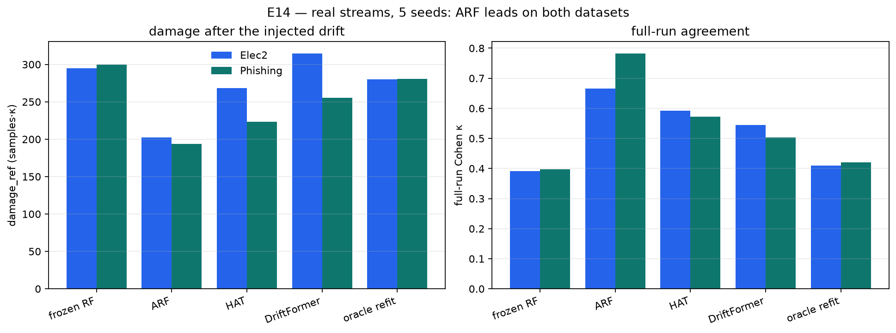

**Figure 5.8: E14 real-stream model comparison pooled over 20 cells.** ARF leads on damage, accuracy and kappa, with a pooled ratio of 0.666 against frozen, and HAT is second. The deep model is fourth and does not beat frozen on damage, though it does beat frozen on kappa.

**Table 5.5: E14 real-stream model check, pooled over 20 cells**

| Model | Accuracy | Cohen kappa | \(\mathrm{damage}_{\mathrm{ref}}\) | \(\mathrm{damage}_{\mathrm{full}}\) | Recovery rate |
|---|---:|---:|---:|---:|---:|
| Frozen random forest | 0.685 | 0.395 | 297.4 | 4,703.0 | 0.00 |
| ARF | **0.875** | **0.724** | **198.0** | **2,684.8** | **0.20** |
| HAT | 0.803 | 0.583 | 245.7 | 3,019.6 | 0.15 |
| DeepRiver | 0.770 | 0.524 | 284.9 | 3,497.5 | 0.00 |
| Oracle refit | 0.698 | 0.415 | 280.3 | 4,518.3 | 0.00 |

The acceptance rules pass: ARF is lower in 18 of 20 cells, frozen recovered in 0 of 20, and the kappa gain is 0.329. The result is provisional, because there are two datasets, five seeds and one injected mechanism per stream. The important negative is that the deep model is not the host: on Elec2 it pays slightly more damage than frozen at 314.7 against 295.0, which justifies using the encoder as a signal extractor rather than as the classifier in the benchmark.

### 5.1.6 The deep signal gate: a reported failure

Experiment E18 asked whether a frozen self-supervised encoder produces label-free signals that predict drift better than the raw error rate, over 80 cells of two datasets, four drift types, two transitions and five trials. The pre-registered gate was at least one deep signal at an AUC of 0.75 or above and at least 0.10 above the error rate.

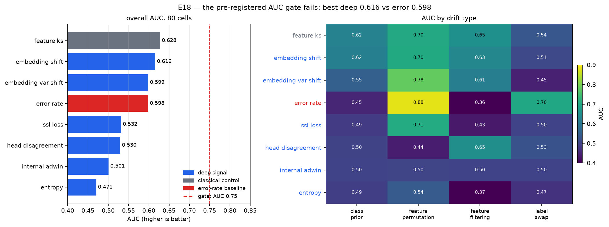

**Figure 5.9: E18 signal gate, overall AUC and drift-type breakdown.** The best deep signal is `embedding_shift` at 0.616, against an error rate of 0.598, and the classical control `feature_ks` scores 0.628, higher than every deep signal. The right panel shows where the signal lives: feature permutation, where `embedding_var_shift` reaches 0.781 while the error rate reaches 0.879.

**Table 5.6: Gate results: E18 deep signals and E19 DF-H v1**

| Gate | Bar | Measured | Verdict |
|---|---|---|---|
| E18 best deep AUC | 0.75 or above | 0.616 | Fail |
| E18 margin over error rate | 0.10 or above | +0.017 | Fail |
| E18 classical control | Must be beaten by the deep view | `feature_ks` 0.628 exceeds all deep signals | Fail |
| E19 overall rank | Top 2 | Third at 7.09; STEPD 5.22 and SEED 5.44 | Fail |
| E19 feature-cell win | Best on at least one feature cell | None for the primary; ablations win two | Fail for primary |
| E19 false alarms | At or below ADWIN | 0.04 against 0.11 | Pass |
| E19 per-dataset robustness | No rank worse than 3 | Covtype tied 5th to 7th | Fail |

The gate fails on all three conditions, and the failure is informative. The deep view has power on feature permutation but the error rate is stronger there, and on label-only drift the deep view is correctly near chance while the error rate catches the change at 0.698. That division is what Lemma 4 predicts.

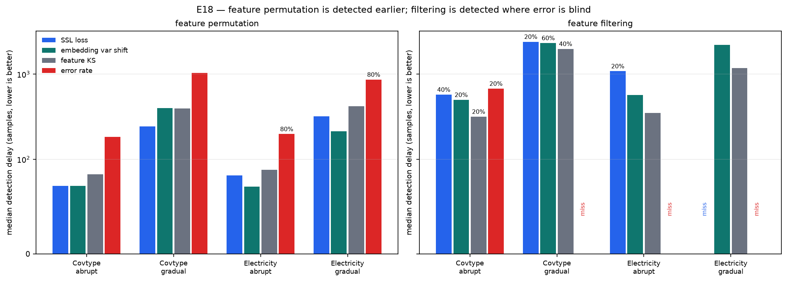

**Figure 5.10: E18 timing diagnostic at a calibrated false-alarm budget.** The diagnostic is more favourable than the AUC gate: on feature permutation the self-supervised loss alarms in 72 samples against 184 for the error rate on Covtype abrupt, in 244 against 1,033 on Covtype gradual, and in 83 against 198 on Electricity abrupt. On feature filtering the error rate misses entirely while the feature signals still fire. The catch is visible in the same figure: `feature_ks` is often as fast as the deep signals, so the marginal value of the deep encoder remains unproven.

### 5.1.7 The fusion pilot: a reported failure

Experiment E19 fused Stage 1 with the classical panel on the same 80 cells using a rule-based 2-of-3 combination. The primary candidate ranks third overall, behind STEPD and SEED.

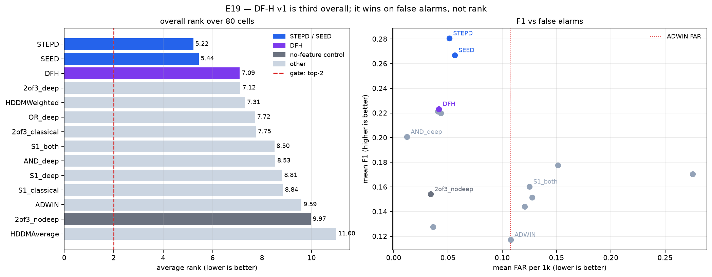

**Figure 5.11: E19 overall rank and the F1 to false-alarm trade-off.** DF-H sits third with the lowest false-alarm rate of the competitive rows at 0.04. The low-false-alarm outlier is the `AND` variant at 0.01, but its overall rank is 8.53, so precision bought at the cost of rank is not a win.

Three readings follow. The feature monitor adds information, because DF-H beats the no-feature control by 2.9 ranks at 7.09 against 9.97. The fixed 2-of-3 rule is nevertheless the wrong combiner, because it demands Stage 2 confirmation on cells where Stage 1 is already correct and Stage 2 is slow or blind, and it leaks Stage 1 false alarms on label-only cells where Stage 1 has no power. The ablations own the feature cells that the primary does not, with `AND_deep` winning abrupt feature permutation at 1.50 and `S1_both` winning gradual feature filtering at 1.00. The top-2 gate fails, so the full matrix was not run.

### 5.1.8 The Delay Tax: the surviving headline

Experiment E21 built a fixed-delay synthesis from the committed trial artifacts at a delay of 2,000 samples. It retrains no model and shifts the error-only detection times by the delay, which is the direct measurement of Lemma 1.

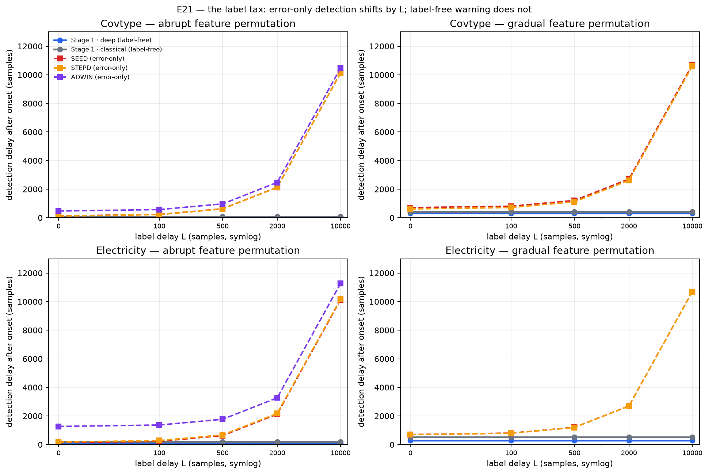

**Figure 5.12: E21 Delay Tax floor.** The flat lines are the label-free Stage 1 warning, which does not move as the delay grows. The dashed lines are the error-only detectors, which shift upward by the delay. The vertical gap is the label tax, and it grows linearly because the Stage 1 line is constant.

**Table 5.7: E21 Delay Tax at a fixed delay of 2,000 samples, detection delay after onset**

| Cell | Stage 1 deep | Stage 1 classical | SEED | STEPD | ADWIN |
|---|---:|---:|---:|---:|---:|
| Covtype, abrupt | **70** | 90 | 2,130 | 2,120 | 2,472 |
| Covtype, gradual | **306** | 406 | 2,710 | 2,616 | not detected |
| Electricity, abrupt | **76** | 196 | 2,129 | 2,180 | 3,269 |
| Electricity, gradual | **293** | 513 | 2,701 | 2,694 | not detected |

The Stage 1 warning is 4 to 30 times earlier than the error-only panel at this delay, and its timing is flat in the delay while every error-only detector moves by exactly the delay. The honest limit is that Stage 1 alone is not a good detector on label-only drift, so the result is a warning and confirmation split rather than a standalone detector.

### 5.1.9 The detector shootout

Experiment E22 ran the focused capability check on the same 80 cells against the requested classical panel, with SEED and STEPD as the reference.

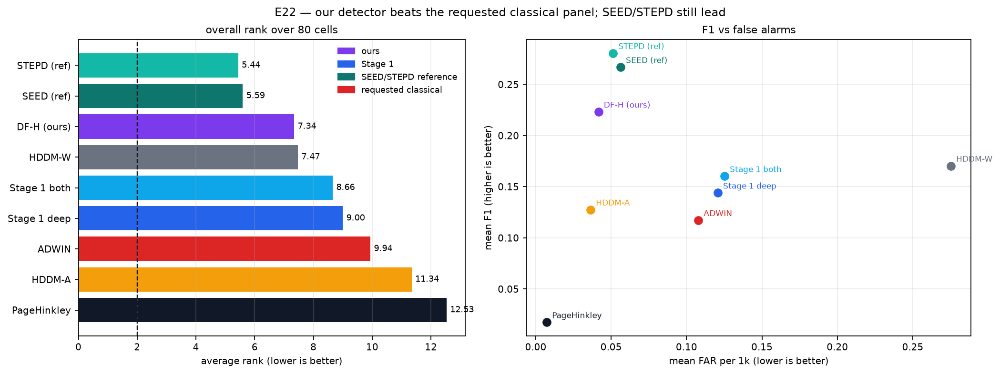

**Figure 5.13: E22 overall rank and F1 to false-alarm trade-off.** DF-H is third, behind STEPD and SEED, and ahead of HDDM-W, ADWIN, HDDM-A and Page-Hinkley. DF-H beats ADWIN by 2.6 ranks, HDDM-A by 4.0 and Page-Hinkley by 5.2. The HDDM-W margin of 0.13 ranks is not meaningful at 80 cells.

On feature permutation DF-H beats every requested classical detector, with ranks of 5.8 abrupt and 5.5 gradual against a panel range of 8.8 to 16.0. On feature filtering HDDM-W wins abrupt and the Stage-1-only variants are the right tool on gradual. Page-Hinkley's false-alarm rate of 0.01 is not a capability claim, because its mean F1 is 0.018: it almost never alarms and therefore almost never scores.

### 5.1.10 Synthesis

DF-H is a strong feature-drift warning detector with a controlled false-alarm rate. It is third overall on a pilot, ahead of the classical panel that motivated the comparison and behind the two best benchmark detectors. Its unique contribution is not average rank but the label-free warning under delay, which is the only measurement here that no error-based detector can match by construction. It is not a universal top-2 detector, the deep signal gate failed, and the ablation variants rather than the primary candidate own the feature cells.

## 5.2 Comparison with Objectives

**Table 5.8: Objectives against measured outcomes**

| Objective | Bar | Measured | Verdict |
|---|---|---|---|
| O1 | Damage at least 5 times lower, 10 or more seeds, zero frozen recoveries | 6.9 times lower, 11 seeds, frozen 0/11 | Achieved |
| O2 | Map four shapes and two hosts; reproduce the published ranking | E04, E17 and the 2,800-task reproduction | Achieved |
| O3 | 80-cell pilot, FAR at or below 0.1 per 1,000, overall rank top 3, top-2 gate stated honestly | FAR 0.04 and third overall; top-2 gate fails | Partially achieved |
| O4 | Delay of 2,000 samples, warning at least twice as early | 70 to 513 against 2,120 to 3,269, 4 to 30 times earlier | Achieved |
| O5 | Reproducible harness, saved artifacts, automated tests | DriftLab, artifact schema, 53 tests, one-command reproduction | Achieved |

O1 is unambiguous: the corrected metric gives a 6.9 times mean gap, the streaming learner is lower on all eleven seeds, and the frozen model recovered on none. O2 is also unambiguous, and it changed the project's own conclusion about HDDM-A by showing the default to be host-conditional.

O3 is the partial case and deserves precision. Two of its three numeric conditions pass: the false-alarm rate is 0.04 against a bar of 0.1, and the overall rank is third. The pre-registered top-2 gate fails at 7.09 against 5.44 for SEED. Reporting this as partial achievement rather than as success is the point of pre-registration.

O4 is achieved on the fixed-delay synthesis and is deliberately narrow: the measurement uses a delay of 2,000 samples on the same 80 cells, and a warning lead of 4 to 30 times exceeds the stated bar of twice as early. O5 is achieved in that every reported number can be regenerated from a committed artifact by one command.

## 5.3 Economic Analysis

**Table 5.9: Economic analysis: bill of materials and cost benefit**

| Item | Basis | Cost |
|---|---|---|
| Laptop, already owned | Ryzen 7 6800H, RTX 3050 Laptop GPU, 16 GB RAM | Indicative replacement 75,000 INR |
| Hardware opportunity cost | Three-year life, four-month project window | About 8,000 INR, not a cash outflow |
| Software licences | Python, River, PyTorch, scikit-learn, CapyMOA, Matplotlib | Zero |
| Datasets | Public benchmark and public stream data | Zero |
| Electricity | Mixed-load average of 65 to 95 W over 150 to 250 hours | About 10 to 24 kWh |
| Energy cost | Indicative 8 INR per kWh, plus monitor and network | About 200 to 400 INR |
| Storage | Local disk for artifacts and public inputs | Negligible |
| Human development time | Three students over one semester | Not monetised |

The energy estimate is stated rather than dismissed. The graphics processor draws up to 95 W under load and the processor package up to 45 W, so a mixed-load average between 65 and 95 W is a fair envelope. Between 150 and 250 hours of active experimentation, including failed runs, pretraining and reruns, gives 10 to 24 kWh, and at 8 INR per kWh the direct cost is about 80 to 190 INR. Adding the monitor, network and idle time, the realistic range is 200 to 400 INR. That is small but not negligible for a project that ran 2,800 benchmark tasks.

The hardware cost is an opportunity cost rather than a cash outflow, because the laptop was already owned. A replacement cost of 75,000 INR over a three-year life gives about 8,000 INR for a four-month window. The dominant costs are the owned hardware and human development time, and neither is a cash expenditure for the project.

Resource utilisation was modest in wall-clock terms: 2,800 benchmark tasks in 13 minutes and 33 seconds on 14 workers, 220 model runs in 2,904 seconds for E03, 1,760 detector runs in 4,867 seconds for E04, 100 runs in 738 seconds for E14, 832 seconds for E17 and about 45 seconds for E22. No monetary value for avoided incidents is invented here. The benefit is operational: streaming damage about 6.9 times lower, a label-free warning 4 to 30 times earlier at a delay of 2,000 samples, and fewer full retrains because the learner adapts per sample rather than on a clock.

## 5.4 Comparison with Existing Solutions and Standards

**Table 5.10: DF-H against existing solutions and standards**

| Solution or standard | Relative position | Evidence |
|---|---|---|
| ADWIN [8] | DF-H ahead by 2.6 ranks | E22: 7.34 against 9.94 |
| HDDM-A [27] | DF-H ahead by 4.0 ranks | E22: 7.34 against 11.34; HDDM-A is also host-conditional in E17 |
| HDDM-W | DF-H ahead by 0.13 ranks, not a meaningful margin | E22: 7.34 against 7.47 |
| Page-Hinkley [1] | DF-H ahead by 5.2 ranks | E22: 7.34 against 12.53; Page-Hinkley F1 0.018 |
| SEED and STEPD [27] | DF-H behind the top two | E22: 5.44 and 5.59 against 7.34 |
| STUDD [18] | Label-free, but no delayed benchmark and no confirmation stage | DF-H adds the two-time split |
| Botacin and Gomes [20] | Consistent: delay increases exposure and reduces detection | DF-H isolates the detector and states the floor |
| KDD'26 benchmark [27] | Reproduced and extended to a delay regime | E01 to E22 use its protocol |
| ISO/IEC 42001 [28] | Alignment, not certification | Management-system principles applied to reporting |
| NIST AI Risk Management Framework | Alignment, not certification | Transparency and measurement principles applied |

The position against the classical panel is favourable and the position against the benchmark top two is not. DF-H beats every detector the project set out to test, by margins from 0.13 to 5.2 ranks, and it loses to SEED and STEPD. The HDDM-W margin is inside the noise of an 80-cell pilot and is not claimed as a win. Page-Hinkley's low false-alarm rate is reported as a near-zero detector rather than as a precision result.

The comparison with STUDD is the most informative one for the contribution. STUDD is genuinely label-free and useful, and it has no delayed-label benchmark and no confirmation stage [18]. DF-H adds the split between \(T_{\mathrm{warn}}\) and \(T_{\mathrm{confirm}}\), which is the only part of the design that Lemma 1 permits. The comparison with Botacin and Gomes is consistent rather than competitive: they measured that delay increases exposure and reduces detection in a malware pipeline [20], and this report isolates the detector and states the floor that produces that outcome.

The standards comparison is stated narrowly. ISO/IEC 42001 and the NIST AI Risk Management Framework both call for documented measurement, transparent reporting of limitations and traceable evidence [28]. The project applies those principles through pre-registered gates, an artifact-per-claim map and published negative results. No certification is claimed.

<!-- pagebreak -->

# CHAPTER 6: CONCLUSION AND FUTURE SCOPE

## 6.1 Summary of Achievements

Four results survive their own negative controls. A streaming learner pays approximately 6.9 times less fixed-window damage than a frozen learner over eleven seeds, and the frozen learner recovered on none. Every streaming adapter in a ten-model ladder pays less damage than frozen and less than every scheduled retrain interval. Detector performance is host-conditional: HDDM-A wins all four shapes on a static host, ADWIN wins abrupt and recurring on an adaptive host, and the published ranking reproduces with SEED and STEPD first and HDDM-A fourth. The two-stage detector ranks third overall at 7.34 with a false-alarm rate of 0.04, ahead of every classical detector the project set out to test and behind the two best benchmark detectors, while its pre-registered top-2 gate failed and is reported as a failure.

At a fixed delay of 2,000 samples the label-free warning fires in 70 to 513 samples against 2,120 to 3,269 for the error-only panel, a lead of 4 to 30 times that grows with the delay. A reproducible harness, a committed artifact per claim and a 53-test suite carry every reported number.

## 6.2 Impact, Sustainability, Ethics and Compliance

**Social impact.** The systems that motivate this work decide things about people: whether a transaction is fraudulent, whether a connection is hostile, whether credit is granted. Their labels arrive late by construction, so the delay floor is a property of the deployment rather than a technicality. Quantifying it gives practitioners a way to reason about how much warning time to expect, and the finding that a label-free monitor is limited to feature drift bounds what such a monitor can promise.

**Environmental impact.** Incremental learning removes the repeated full-corpus retraining that scheduled batch pipelines perform. The measured envelope is between about 10 and 24 kWh for the whole project, and the structural argument matters more: a learner that updates per sample does not need the historical corpus to remain resident, so storage and compute scale with the model rather than with the stream.

**Ethical impact.** Two pre-registered gates failed and both are reported with their exact bars and measured values, and the retired 294 times figure is shown only as history. The deep encoder is described as a signal extractor rather than as a classifier because the evidence says so. The report states what was measured, including where the measurement disappointed.

**Compliance alignment.** ISO/IEC 42001 and the NIST AI Risk Management Framework both call for documented measurement, traceable evidence and transparent limitation reporting [28]. The project applies those principles through pre-registered acceptance criteria, an artifact-per-claim map and a published negative-result record. No certification is claimed.

## 6.3 Limitations

The pilot covers two datasets and five trials, with no significance testing for the fusion or shootout results. The Delay Tax result is a fixed-delay synthesis rather than a full delayed-learning rerun, and Lemmas 2 and 3 are stated without end-to-end measurement. The 50-trial fusion matrix was not run because its gate failed. All runs are on one laptop, and the ABCD and ABCD(X) arm is cited rather than reproduced.

## 6.4 Future Work

Four extensions follow from the limitations. The full delay matrix should be run across the implemented stochastic, partial, selective and batch schedules, and the delayed-learning rerun should train the host on the delayed schedule rather than shifting detection times analytically. Lemmas 2 and 3 should be measured end to end, since both make quantitative predictions that the current artifacts can test. A 50-trial fusion run with a learned gate and leave-one-dataset-out validation would establish whether the 2.9-rank advantage over the no-feature control survives an adaptive combiner, and the classical feature monitor should be the default Stage 1 until the deep view beats it. A deployment path is the natural engineering extension, and Figure 6.1 sketches it on a single node.

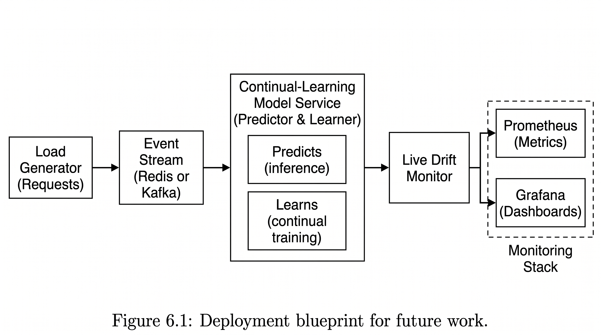

**Figure 6.1: Deployment blueprint for future work.** A load generator writes to a Redis or Kafka event stream, a continual-learning model service both predicts and learns from each event, and a live drift monitor consumes the same stream. Metrics reach Prometheus and dashboards reach Grafana. The model service is labelled as both predictor and learner because that is the property the streaming evidence supports.

<!-- pagebreak -->

# REFERENCES

*Note on the list: 28 references, of which 14 are recent journal articles published in 2021 or later. Every entry is cited at least once in the text.*

1. E. S. Page, "Continuous inspection schemes," *Biometrika*, vol. 41, no. 1-2, pp. 100-115, 1954.
2. G. Lorden, "Procedures for reacting to a change in distribution," *Annals of Mathematical Statistics*, vol. 42, no. 6, pp. 1897-1908, 1971.
3. G. Widmer and M. Kubat, "Learning in the presence of concept drift and hidden contexts," *Machine Learning*, vol. 23, no. 1, pp. 69-101, 1996.
4. P. Domingos and G. Hulten, "Mining high-speed data streams," in *Proc. ACM SIGKDD*, 2000, pp. 71-80.
5. J. Gama, P. Medas, G. Castillo, and P. P. Rodrigues, "Learning with drift detection," in *Proc. Brazilian Symp. Artificial Intelligence*, 2004, pp. 286-295.
6. M. Baena-Garcia, J. del Campo-Avila, R. Fidalgo, A. Bifet, R. Gavalda, and R. Morales-Bueno, "Early drift detection method," in *Proc. Fourth Int. Workshop Knowledge Discovery from Data Streams*, 2006.
7. J. Demsar, "Statistical comparisons of classifiers over multiple data sets," *Journal of Machine Learning Research*, vol. 7, pp. 1-30, 2006.
8. A. Bifet and R. Gavalda, "Learning from time-changing data with adaptive windowing," in *Proc. SIAM Int. Conf. Data Mining*, 2007, pp. 443-448.
9. A. Bifet and R. Gavalda, "Adaptive learning from evolving data streams," in *Proc. Int. Symp. Intelligent Data Analysis*, 2009.
10. I. Zliobaite, "Change with delayed labeling: When is it detectable?" in *Proc. IEEE ICDM Workshops*, 2010, pp. 843-850.
11. J. Gama, R. Sebastiao, and P. P. Rodrigues, "On evaluating stream learning algorithms," *Machine Learning*, vol. 90, no. 3, pp. 317-346, 2013.
12. M. Grzenda, H. M. Gomes, and A. Bifet, "Delayed labelling evaluation for data streams," *Data Mining and Knowledge Discovery*, vol. 34, pp. 1237-1266, 2020.
13. J. Montiel, M. Halford, S. M. Mastelini, G. Bolmier, R. Sourty, R. Vaysse, A. Zouitine, H. M. Gomes, J. Read, T. Abdessalem, and A. Bifet, "River: Machine learning for streaming data in Python," *Journal of Machine Learning Research*, vol. 22, no. 110, pp. 1-8, 2021.
14. D. Carneiro, M. Guimaraes, F. Silva, and P. Novais, "A predictive and user-centric approach to machine learning in data streaming scenarios," *Neurocomputing*, 2021.
15. R. Mello, H. M. Gomes, A. Bifet, and B. Pfahringer, "Stream-based active learning for sliding windows under the influence of verification latency," *Machine Learning*, 2021.
16. H. M. Gomes, M. Grzenda, R. Mello, J. Read, M. H. Le Nguyen, and A. Bifet, "A survey on semi-supervised learning for delayed partially labelled data streams," *ACM Computing Surveys*, vol. 55, no. 4, article 75, 2022.
17. A. Cano and B. Krawczyk, "ROSE: Robust online self-adjusting ensemble for continual learning on imbalanced drifting data streams," *Machine Learning*, vol. 111, pp. 2561-2599, 2022.
18. V. Cerqueira, H. M. Gomes, A. Bifet, and L. Torgo, "STUDD: A student-teacher method for unsupervised concept drift detection," *Machine Learning*, vol. 112, pp. 4351-4378, 2023.
19. F. Ceschin, H. M. Gomes, M. Botacin, A. Bifet, B. Pfahringer, L. S. Oliveira, and A. Gregio, "Machine learning (in) security: A stream of problems," *Expert Systems with Applications*, vol. 212, article 118590, 2023.
20. M. Botacin and H. M. Gomes, "Towards more realistic evaluations: The impact of label delays in malware detection pipelines," *Computers & Security*, vol. 147, 2024.
21. C. Surianarayanan, S. Kunasekaran, and P. R. Chelliah, "A high-throughput architecture for anomaly detection in streaming data using machine learning algorithms," *International Journal of Information Technology*, vol. 16, pp. 493-506, 2024.
22. C. Kulbach, L. Cazzonelli, H.-A. Ngo, M. Halford, and S. M. Mastelini, "DeepRiver: A deep learning library for data streams," *Journal of Open Source Software*, vol. 10, no. 105, article 7226, 2025.
23. F. I. Agu, R. Andok, J. Klarak, and J. R. Dora, "Statistical drift detection with parametric Gamma-Weibull and adaptive deep learning for malware detection in IoT data streams," *Journal of King Saud University Computer and Information Sciences*, vol. 38, article 673, 2026.
24. B. M. Alencar, G. W. Cassales, H. M. Gomes, C. V. S. Prazeres, T. Rios, A. Bifet, and R. A. Rios, "Concept drift detection in delayed and partially labeled data streams: An experimental survey," *Digital Signal Processing*, vol. 182, article 106325, 2026.
25. L. Hans and D. Zuhlke, "Online versus batch retraining in one-step-ahead urban water demand forecasting under concept drift," *Water Supply*, vol. 26, no. 4, pp. 255-268, 2026.
26. F. Abdoune, M. Nouiri, and O. Cardin, "Digital twin-based anomaly detection under concept drift: A comparison between iterative batch learning and incremental learning approaches," *Expert Systems with Applications*, vol. 299, article 130062, 2026.
27. V. Cerqueira, H. M. Gomes, M. Heyden, B. Pfahringer, and A. Bifet, "A framework for evaluating and benchmarking concept drift detection methods," in *Proc. ACM SIGKDD*, 2026, pp. 8671-8682.
28. ISO/IEC 42001:2023, "Information technology - Artificial intelligence - Management system," ISO/IEC, 2023.

<!-- pagebreak -->

# APPENDIX A: CODE AND ARTIFACT EXTRACTS

The artifact contract is the mechanism that makes every claim traceable. A run produces five files under `experiments/results/<exp_id>/`, and every table and figure in this report is derived from them.

**Table A.1: Artifact schema**

| File | Contents | Used for |
|---|---|---|
| `meta.json` | Configuration, configuration hash, git revision, library versions, command, timestamps | Provenance and exact reproduction |
| `summary.json` | Aggregate metrics per model and per seed, acceptance verdicts | Model tables and gate checks |
| `episodes.jsonl` | One record per drift episode, with dip depth, recovery and damage | Drift-window analysis |
| `detections.jsonl` | One record per detector alarm, with false-alarm status and delay | Detector maps and F1 scores |
| `series.npz` | Per-sample rolling kappa, accuracy and error series | Every time-series figure |

`Code Listing A.1` shows the fusion core as it is implemented, with the calibration and the two reported times.

**Code Listing A.1: DF-H fusion and the two reported times**

```python
def fuse(stage1, stage2, cfg):
    """Combine the label-free and error-stream stages.

    stage1.z    : standardised label-free signals, shape (n_windows, n_signals)
    stage2.alarm: boolean error-detector alarms, shape (n_samples,)
    """
    # Calibrate the label-free threshold on pre-drift windows only.
    pre = stage1.z[: cfg.reference_windows]
    thr_s1 = np.quantile(pre.max(axis=1), 1.0 - cfg.far_target)

    s1 = stage1.z.max(axis=1) > thr_s1          # warning, needs no labels
    s2 = stage2.alarm                           # confirmation, floor-bound

    # 2-of-3 confirmation inside a 2,000-sample window, 2,000 refractory.
    votes = s1[window] + s2[window] + ensemble_vote[window]
    confirmed = votes.sum() >= 2

    return FusionResult(
        T_warn=first_true(s1),        # not shifted by the delay L
        T_confirm=first_true(confirmed),  # bounded below by tau + L
    )
```

<!-- pagebreak -->

# ANNEXURE B: PLAGIARISM REPORT

*This page is a template. The values are to be filled in after the institutional similarity run.*

| Field | Value |
|---|---|
| Similarity index | |
| Submission ID | |
| Submission date | |
| Database | |
| Excluded sources | Bibliography and quoted material |
| Supervisor signature | |

<!-- pagebreak -->

# ANNEXURE C: PROGRAMME OUTCOME AND PROGRAMME SPECIFIC OUTCOME MAPPING

**Table A.2: Programme outcome and programme specific outcome mapping**

| Project task | PO1 | PO2 | PO3 | PO4 | PO5 | PO6 | PO7 | PO8 | PO9 | PO10 | PO11 | PO12 | PSO1 | PSO2 | PSO3 |
|---|---|---|---|---|---|---|---|---|---|---|---|---|---|---|---|
| Engineering knowledge of streaming learning and drift | High | High | Medium | Medium | | | | | | | | | High | Medium | |
| Problem analysis of the delay floor and identifiability | High | High | High | High | | | | | | | | | High | High | |
| Design of the two-stage detector and harness | High | High | High | Medium | Medium | | | | High | | | | High | High | Medium |
| Investigation through eleven controlled experiments | High | High | High | High | Medium | | | | Medium | | | | High | High | |
| Modern tool usage across River, PyTorch and CapyMOA | Medium | | Medium | | High | High | | | | | High | | | High | High |
| Environment and sustainability in the compute envelope | | | | | | Medium | High | | | | | High | | | High |
| Ethics and honest reporting of negative results | | | | | | | | High | | | | High | | | High |
| Individual and team work across three defined roles | | | | | | | | | High | High | | | | | High |
| Communication through this report and the evidence site | | | | | | | | | | High | High | | | | High |
| Project management with a pilot-first gate | | | | | | | | | | | High | High | | | Medium |

The mapping is deliberately sparse. Only the cells where a task makes a substantial contribution are marked, so that the table distinguishes the project's actual coverage rather than claiming every outcome at every level.

<!-- pagebreak -->

# ANNEXURE D: OUTCOME OF THE REPORT

This work produced a reproducible software artefact and an evidence dossier rather than a patentable device. No patent has been filed, and no claim of intellectual-property protection is made.

**Outcome abstract.** The report presents a pre-registered study of concept drift detection under delayed labels. A configuration-driven harness, DriftLab, was built on River and DeepRiver and populated with eleven experiments over synthetic generators, public real streams and a 2,800-task reproduction of a published detector benchmark. Three findings are established. Streaming adaptation reduces fixed-window damage by approximately 6.9 times against a frozen learner over eleven seeds, with no frozen recovery. Detector quality is host-conditional, and the published benchmark ranking reproduces with SEED and STEPD first and HDDM-A fourth. A two-stage detector, DF-H, ranks third overall at 7.34 with a false-alarm rate of 0.04, ahead of every classical detector tested and behind the benchmark top two, while its pre-registered top-2 gate fails. At a fixed delay of 2,000 samples the label-free warning is 4 to 30 times earlier than the best error-only detector, which is the surviving contribution. All negative results are reported, and every number traces to a committed artifact.

<!-- pagebreak -->

# ANNEXURE E: SUSTAINABILITY STATEMENT

The environmental position of this work rests on a structural argument rather than on an offset. A streaming learner updates on each sample and therefore does not require repeated passes over a stored corpus. Scheduled batch pipelines, by contrast, re-read historical data at every refit, and the compute and storage cost of that pattern grows with the length of the stream. Continual learning replaces a cost that scales with history by a cost that scales with model size, and for long-lived streams that substitution is the larger environmental effect.

The measured envelope for the project itself is small and is reported rather than hidden. Mixed load between 65 and 95 W over an estimated 150 to 250 hours gives 10 to 24 kWh, which at an indicative tariff is between 200 and 400 INR including peripherals and network. No cloud cluster was rented, so no shared infrastructure was provisioned and released, and no result depends on a machine that a reader cannot access.

The social dimension is inseparable from the environmental one in this domain. A model that silently degrades after a drift produces decisions that are wrong in a way nobody notices, and the populations affected are rarely the ones who can detect the failure. Reporting the delay floor, and the fact that a label-free monitor cannot see pure posterior drift, gives practitioners a realistic basis for deciding when human review must remain in the loop.

The code, configuration and artifacts are organised for reuse. A single command reproduces a concluded experiment, figures are regenerated from artifacts rather than redrawn, and the test suite covers the metric definitions and the artifact contract. Reuse is the most direct sustainability contribution a software project can make, because a harness that others can run does not have to be rebuilt.

<!-- pagebreak -->

# ANNEXURE F: TEAM ROLES

**Ananya Arora** led the literature review and the methodological framing. The initial catalogue of thirty-eight papers, the six deep-dive notes and the gap analysis that produced the four lemmas were her work, and she reworded the contribution twice as new evidence arrived, first when the immediate-label benchmark was found and again when the delayed-label survey could not be read in full. She owned the report structure, the citation audit and the final language pass, including the decision to state the two failed gates in the body of Chapter 5 rather than in an annexure.

**Vaibhavi Kansal** built the experiment harness and the baseline ladder. The configuration-driven design, the per-seed unit cache, the resume guard and the artifact schema are hers, as is the test suite that covers the metric definitions and the artifact contract. She ran the baseline ladder across ten models and eleven seeds, the real-stream model check on Elec2 and Phishing, and the no-drift control that established the raw channel as the default. She also found and corrected the zero-alarm scoring defect that had made a never-ringing detector appear perfect.

**Priyansh Singh** built the deep detector and the benchmark reproduction. The frozen encoder instrumentation, the seven Stage-1 signals, the pure NumPy trial stream and the fusion core are his, together with the CapyMOA bridge and the isolated Java environment that reproduces the published detector ranking on 2,800 tasks. He maintained the artifact pipeline and the continuous integration workflow, produced the figures from artifacts, and ran the fixed-delay synthesis that became the surviving headline. He also maintained the record of retired numbers, including the 294 times figure, so that no superseded value could re-enter the report.

All three members shared the experimental review, the negative-result decisions and the final read-through.

<!-- END OF REPORT BODY -->
