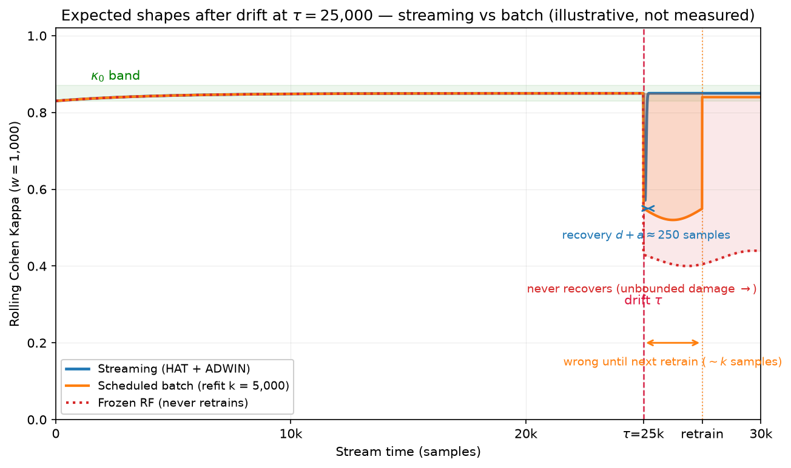
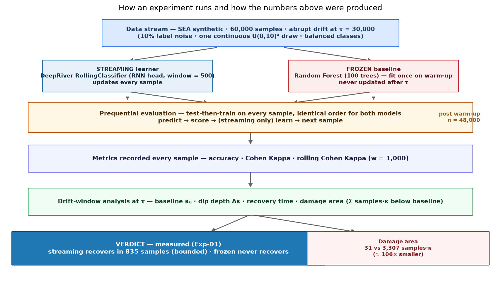
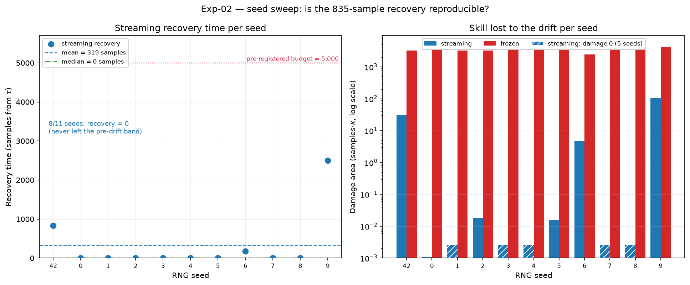
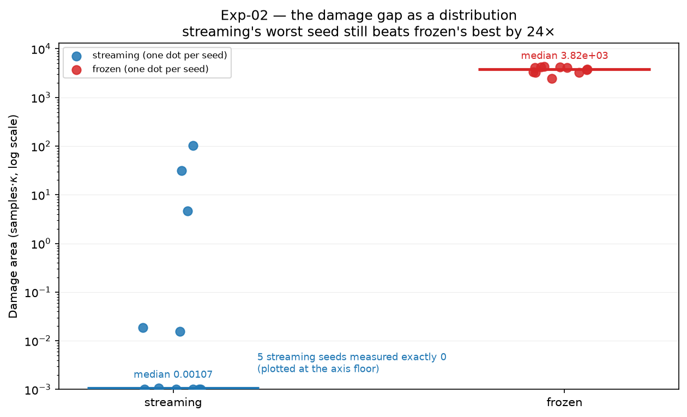
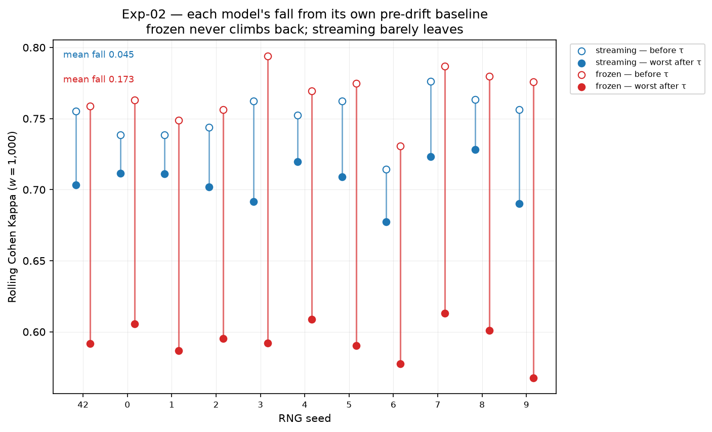
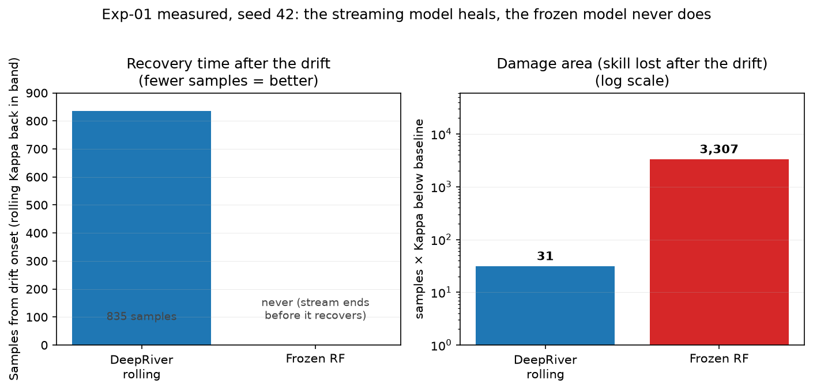
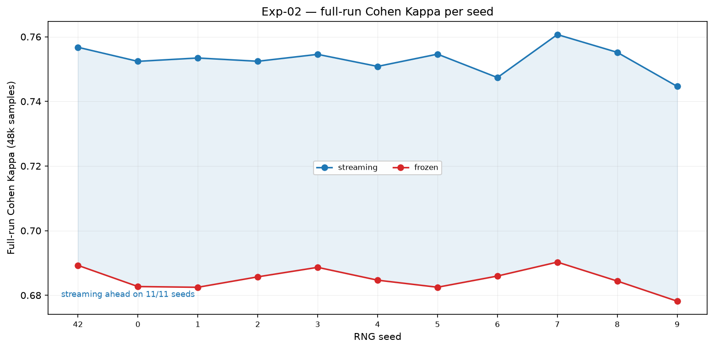
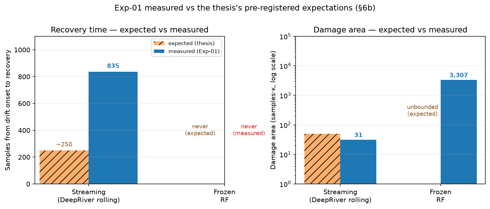

# Jaypee Institute of Information Technology, Noida

DEPARTMENT OF COMPUTER SCIENCE & ENGINEERING AND INFORMATION TECHNOLOGY

<!-- Institute logo -->

**Project Title:** The Delay Tax: Streaming Machine Learning with Concept Drift Detection and Adaptation

| Enrollment No. | Name of Student |
|---:|---|
| 9922103035 | Ananya Arora |
| 8823103057 | Vaibhavi Kansal |
| 9923103042 | Priyansh Singh |

| | |
|---|---|
| Course Name | Major Project-1 |
| Course Code | 15B19CI791 |
| Program | B. Tech. CSE 4th Year, 7th Semester |
| Academic Session | 2026 – 2027 |

## ACKNOWLEDGEMENT

We would like to place on record our deep sense of gratitude to Prof. Dr. Sankosh Kumar Ray, Department of Computer Science and Engineering, Jaypee Institute of Information Technology, India, for the generous guidance, valuable suggestions, continuous encouragement, and supervision provided throughout the course of the present work.

We express our sincere gratitude to the faculty members of the Department of Computer Science and Engineering, Jaypee Institute of Information Technology, for their support and guidance during the development of this major project.

We also wish to extend our thanks to our classmates for their insightful comments, constructive suggestions, and cooperation, which helped us improve the quality of this project work.

### Signature(s) of Students

| Enrollment No. | Student Name | Signature |
|---|---|---|
| 9922103035 | Ananya Arora | |
| 8823103057 | Vaibhavi Kansal | |
| 9923103042 | Priyansh Singh | |

## CERTIFICATE

This is to certify that the Major Project Report entitled "The Delay Tax: Streaming Machine Learning with Concept Drift Detection and Adaptation" submitted by Ananya Arora (Enrollment No. 9922103035), Vaibhavi Kansal (Enrollment No. 8823103057), and Priyansh Singh (Enrollment No. 9923103042) of B.Tech of Jaypee Institute of Information Technology, Noida has been carried out under my supervision.

This work has not been submitted partially or wholly to any other University or Institute for the award of any other degree or diploma.

### Digital Signature of Supervisor

**Name of Supervisor:** Prof. Dr. Sankosh Kumar Ray

**Designation:**

**Date:**

## DECLARATION OF ORIGINALITY

We, the undersigned, hereby declare that the Major Project Report entitled "The Delay Tax: Streaming Machine Learning with Concept Drift Detection and Adaptation" submitted to the Department of Computer Science & Engineering, Jaypee Institute of Information Technology, Noida, in partial fulfilment of the requirements for the award of the degree of Bachelor of Technology, is an original work carried out by us.

The matter presented in this report has not been submitted by us for the award of any other degree of this or any other university. We have duly acknowledged all the sources of information used in this report.

| Name | Enrollment No. |
|---|---|
| Ananya Arora | 9922103035 |
| Vaibhavi Kansal | 8823103057 |
| Priyansh Singh | 9923103042 |

Date:

Place: Noida

## ABSTRACT

**Problem:** Conventional machine learning assumes a finite, static dataset that is loaded, split, and used to train a model, after which deployment is treated as finished. In production, however, data often arrives as an unbounded stream that is too large or too fast to store, and the process generating it changes over time through concept drift, which batch models trained once cannot react to on their own. Furthermore, nearly all drift-detection research assumes that labels arrive instantly with each sample, whereas in real systems such as fraud confirmation, advertising conversions, and analyst verdicts, labels arrive late, partially, and selectively, which weakens both detection and evaluation.

**Methodology:** This project implements a research pipeline for streaming machine learning built on the River framework and DeepRiver (PyTorch). It follows prequential (test-then-train) evaluation on drifting data streams, compares adaptive streaming learners against frozen batch baselines, and measures temporal reactivity metrics such as recovery time, dip depth, and damage area (skill lost × time wrong) rather than global accuracy alone. Phase 0 completed a literature review of 38 papers with six deep-dive notes and formalised the Delay Tax as four provable lemmas on how delayed, partial, and batched labels degrade drift detection, while Phase 1 executed two controlled experiments (the Exp-01 pilot and the Exp-02 eleven-seed sweep) on a synthetic SEA stream with one abrupt concept change.

**Key Results:** A DeepRiver rolling deep classifier recovered from concept drift on 11 of 11 seeds within a 5,000-sample budget, while a frozen RandomForest recovered on none of the 11 seeds. Damage area, the primary reactivity metric, was 13 ± 31 samples·κ for streaming against 3,710 ± 592 for the frozen model, approximately 294× smaller, and even the worst streaming seed (103) beat the best frozen seed (2,439) by a factor of 24. Overall prequential performance also favoured streaming, with 88.3% against 85.4% accuracy and 0.753 against 0.685 Cohen Kappa, although this remains existence evidence on one synthetic stream, with cross-dataset statistics and the Delay Tax experiments scheduled next.

**Societal Relevance:** Streaming machine learning underpins fraud detection, network intrusion monitoring, adaptive recommendation, and financial risk systems, where models must stay accurate as the world changes. Quantifying the Delay Tax, the cost of learning from yesterday's truth, helps in designing fairer and more reliable adaptive systems for domains where delayed labels are unavoidable, reducing the silent model degradation that harms users and organisations.

## TABLE OF CONTENTS

| Section | Title | Page No. |
|---|---|---|
| **CHAPTER 1** | **INTRODUCTION** | **1** |
| 1.1 | Background | 1 |
| 1.2 | Problem Statement | 2 |
| 1.3 | Social & Environmental Relevance | 3 |
| 1.4 | Gantt Chart / Timeline | 3 |
| 1.5 | Scope | 4 |
| **CHAPTER 2** | **LITERATURE SURVEY / CRITICAL REVIEW** | **6** |
| 2.1 | Overview of Existing Work / Literature Review | 6 |
| 2.2 | Summary Table | 7 |
| 2.3 | Identification of Research Gaps / Limitations of Existing Methods | 8 |
| **CHAPTER 3** | **SYSTEM DESIGN & METHODOLOGY** | **10** |
| 3.1 | Proposed Methodology | 10 |
| 3.2 | Tool and Technique Selection | 12 |
| **CHAPTER 4** | **IMPLEMENTATION & TESTING** | **14** |
| 4.1 | Experimental Setup | 14 |
| 4.2 | Test Cases, Case Study, and Outputs | 15 |
| **CHAPTER 5** | **RESULTS & DISCUSSION** | **17** |
| 5.1 | Result Analysis | 17 |
| 5.2 | Performance Evaluation and Comparison with Existing Methods | 22 |
| **CHAPTER 6** | **CONCLUSION & FUTURE SCOPE** | **25** |
| 6.1 | Summary of Work and Achievements | 25 |
| 6.2 | Impact on Society, Environmental Sustainability, Ethical Issues and Compliance | 25 |
| 6.3 | Limitations of the Work | 26 |
| 6.4 | Future Scope | 26 |
| **References** | | **28** |

## LIST OF TABLES

| Table No. | Title | Page No. |
|---|---|---|
| 1.1 | Project Development Timeline / Gantt Chart | 3 |
| 2.1 | Literature Review Summary | 7 |
| 3.1 | Drift Detector Comparison (Literature) | 12 |
| 3.2 | Technology and Tool Selection | 13 |
| 4.1 | Experimental Setup and Technology Stack | 14 |
| 4.2 | Pre-registered Hypotheses and Acceptance Criteria | 16 |
| 5.1 | Exp-02 Aggregate Results (11 Seeds) | 17 |
| 5.2 | Streaming vs Frozen Batch: Structural Comparison | 22 |

## LIST OF FIGURES

| Figure No. | Title | Page No. |
|---|---|---|
| 3.1 | Expected post-drift shapes: streaming vs scheduled vs frozen batch | 12 |
| 4.1 | Experiment pipeline: stream, models, prequential loop, drift-window analysis | 15 |
| 5.1 | Exp-01: rolling Cohen Kappa, DeepRiver vs frozen RandomForest on SEA | 18 |
| 5.2 | Exp-02: recovery time and damage area per seed (11 seeds) | 19 |
| 5.3 | Exp-02: damage area as a distribution, streaming vs frozen | 20 |
| 5.4 | Exp-02: fall from each model's own pre-drift baseline, per seed | 21 |
| 5.5 | Exp-01: recovery time and damage area, seed 42 | 22 |
| 5.6 | Exp-02: full-run Cohen Kappa per seed | 23 |
| 5.7 | Exp-01 measured against the pre-registered expectations | 24 |

## LIST OF ABBREVIATIONS

| Abbreviation | Full Form |
|---|---|
| ADWIN | Adaptive Windowing |
| API | Application Programming Interface |
| ARF | Adaptive Random Forest |
| AUC-PR | Area Under Precision-Recall Curve |
| Ch | Chapter |
| CSE | Computer Science and Engineering |
| DDM | Drift Detection Method |
| DPL | Delayed Partially Labelled |
| EDDM | Early Drift Detection Method |
| FN | False Negative |
| FP | False Positive |
| GPU | Graphics Processing Unit |
| HAT | Hoeffding Adaptive Tree |
| JMLR | Journal of Machine Learning Research |
| KDD | Knowledge Discovery and Data Mining |
| KSWIN | Kolmogorov-Smirnov Windowing |
| ML | Machine Learning |
| MTD | Mean Time to Detection |
| MTFA | Mean Time to False Alarm |
| RNN | Recurrent Neural Network |
| RQ | Research Question |
| SEA | Synthetic Stream Generator (Street-Kim) |
| SLT | Statistical Learning Theory |
| STUDD | Semi-supervised Drift Detection |
| TTL | Time To Live |

## CHAPTER 1: INTRODUCTION

### 1.1 Background

Machine learning in academic curricula typically treats the dataset as a finished object that sits on disk, is loaded into memory, and is split into training and test sets, after which a model is fitted and the project is considered complete. Streaming machine learning drops that assumption entirely, because data arrives one sample at a time, potentially forever, and is often too large or too fast to store. The model is therefore never finished, and it remains permanently in the middle of its training.

Three hard constraints define a true streaming algorithm, and every method considered in this project must respect all of them:

- **Single pass:** each sample is seen exactly once and is never revisited after it has been processed by the learner.

- **Bounded memory:** memory usage must not grow with the number of samples seen, regardless of how long the stream continues to run.

- **Bounded time per sample:** processing must keep pace with the arrival rate, so that the learner never falls behind the incoming stream.

Because the world that generates the data keeps changing, the model must also notice when it has become wrong and adapt accordingly. This phenomenon, known as concept drift, occurs when the joint distribution P(X, y) changes over time, and its recognised forms include sudden (abrupt), gradual, incremental, and recurring (seasonal) change.

The standard evaluation protocol for streaming is prequential evaluation (test-then-train), in which the model predicts each sample before it learns from that sample, so that the resulting scores remain honest and free of leakage. Rolling metrics computed over a recent window reveal the dips and recoveries that follow a drift, and these are precisely the behaviours that this project sets out to measure.

This project is built on the River framework, which is often described as "scikit-learn for data streams", and on DeepRiver, which provides PyTorch-backed deep learners for streams. Its distinctive research angle is the Delay Tax, which arises because in production the labels for today's decisions often arrive hours or days late. A model in that situation is judged and updated on yesterday's truth, and every adaptive mechanism that the field relies on is weakened by that lag.

### 1.2 Problem Statement

Building reliable machine learning for drifting data streams involves several interconnected challenges, which are summarised below:

- **Structural batch blindness:** A model trained once on historical data has no mechanism to react when the generating process changes, so its recovery depends entirely on an external decision to retrain whose timing is arbitrary relative to the drift.

- **Clock-driven vs evidence-driven updates:** Scheduled batch retraining refits the model on a fixed interval regardless of whether any drift has occurred, and as a result a scheduled model stays wrong, on average, for half a retrain interval longer than necessary after a concept change.

- **Evaluation under delay:** Prequential scoring requires the label to be available in the same tick as the prediction, so when labels are delayed, the field's own instrument for measuring success fails in the very setting that it claims to serve.

- **Detector degradation:** Drift detectors such as ADWIN, DDM, EDDM, Page-Hinkley, and KSWIN watch the error stream, and late, partial, or selectively observed labels delay, thin, and bias that stream, yet almost no existing work quantifies detector-level degradation as a function of label latency or label coverage.

- **Metric mismatch:** Global accuracy computed over an entire stream hides the temporal damage caused by drift, because the interesting question is not how accurate the model is on average but how fast it recovers after a change, which is measured by recovery time and damage area (skill lost multiplied by the time spent below baseline).

The proposed project addresses these issues through three contributions: (1) a rigorous streaming-versus-batch benchmark under controlled synthetic drift; (2) a containerised continual-learning service that measures the operational costs which the literature rarely reports; and (3) a formal Delay Tax model accompanied by a hybrid detector that combines a label-free early warning with delayed supervised confirmation.

### 1.3 Social & Environmental Relevance

Adaptive streaming models underpin critical real-time systems such as credit-card fraud detection (where labels are confirmed 30 to 90 days later), network intrusion monitoring, adaptive advertising (where conversions arrive days later), and financial risk scoring. When these models silently degrade after concept drift, users face false approvals, missed fraud, or degraded recommendations, all of which carry direct economic and safety consequences.

Digitising continual learning reduces the reliance on periodic full retraining jobs that re-process entire historical datasets, which amounts to computational waste when only recent data actually matters. Bounded-memory streaming learners use fixed resources regardless of the length of the stream, which aligns well with the efficient utilisation of cloud resources.

Ethical considerations include fairness under drift, since models must not persistently disadvantage the groups affected by a distributional change, together with transparent evaluation through honest reporting of where batch models win (for example, under delayed labels with oracle tuning), and data minimisation, since single-pass learning avoids the indefinite retention of raw training data.

### 1.4 Gantt Chart / Timeline

**Table 1.1: Project Development Timeline**

| Phase | Major Activity / Milestone | Duration | Status |
|---|---|---|---|
| Phase 0 | Research orientation: River setup, background notes, literature review (38 papers) | Weeks 1-8 | Complete |
| Phase 1a | Thesis formulation, metrics protocol, and experiment harness design | Weeks 9-10 | Complete |
| Phase 1b | Exp-01: DeepRiver vs frozen RF on SEA (pilot, seed 42) | Week 11 | Complete |
| Phase 1c | Exp-02: 11-seed sweep and statistical validation | Week 12 | Complete |
| Phase 1d | Real datasets (Elec2, Phishing, Covertype, Airlines, CreditCard) | Weeks 13-16 | Scheduled |
| Phase 1e | Full baseline ladder (frozen, scheduled, and oracle-tuned batch) | Weeks 17-18 | Scheduled |
| Phase 1f | Cross-dataset Friedman and Nemenyi statistics | Weeks 19-20 | Scheduled |
| Phase 2 | Continual-learning service (Docker, event stream, Prometheus/Grafana) | Weeks 21-28 | Scheduled |
| Phase 3 | Delay Tax: label-delay sweeps, hybrid detector, and lemma verification | Weeks 29-36 | Scheduled |
| Phase 4 | Report write-up, demo dashboard, and viva preparation | Weeks 37-40 | Scheduled |

### 1.5 Scope

The scope of the project, as fixed at the end of Phase 0, encompasses the following items:

- Classification on drifting data streams, using River and DeepRiver as the primary experimental libraries.

- Prequential evaluation with rolling Cohen Kappa, recovery time, and damage area as the core performance measures.

- Controlled synthetic streams (SEA, Hyperplane, and RandomRBF) with known drift positions, so that detection and recovery can be measured against ground truth.

- Up to three real datasets (Elec2, Phishing, and CreditCard fraud) to establish external validity beyond synthetic data.

- The drift detectors ADWIN, DDM, EDDM, Page-Hinkley, and KSWIN, together with the adaptive models Hoeffding Adaptive Tree, Adaptive Random Forest, and Leveraging Bagging.

- Batch baselines in frozen, scheduled-retrain, and oracle-tuned form, with the oracle-tuned variant reported as an upper bound on batch performance.

- Formal Delay Tax lemmas (reaction floor, power loss, batch-correlation inflation, and identifiability ceiling) together with their empirical verification.

- A hybrid two-stage detector that combines a label-free warning with delayed supervised confirmation.

- A single-node containerised continual-learning service that is instrumented with operational metrics such as prediction latency and memory growth.

*Out of Scope:* The project does not cover distributed training (such as parameter servers or federated learning), regression, clustering, or recommendation tasks, and it does not attempt a Kubernetes multi-cloud production deployment, since the service will run through docker-compose on a single machine. It also excludes novel adaptation algorithms beyond the hybrid architecture and the construction of a new streaming framework, because River serves as the experimental instrument throughout the work.

## CHAPTER 2: LITERATURE SURVEY / CRITICAL REVIEW

### 2.1 Overview of Existing Work / Literature Review

The field of concept drift adaptation has matured significantly since Gama et al. (2014) published the canonical review in *ACM Computing Surveys*. Foundational work includes the Very Fast Decision Tree (Domingos & Hulten, 2000), ADWIN adaptive windowing (Bifet & Gavaldà, 2007), and the Drift Detection Method (Gama et al., 2004), while prequential evaluation was formalised as the accepted streaming protocol by Gama, Sebastião and Rodrigues (2013).

**Drift detection methods** watch a one-dimensional error stream and test that stream for a change in its mean. ADWIN provides rigorous guarantees without requiring a fixed window size and has become the de facto standard in the field. DDM tracks bounds on the error rate, issuing a warning at p + 2s and an alarm at p + 3s, but it is weak on gradual drift, whereas EDDM improves sensitivity to gradual drift by tracking the distances between consecutive errors. Page-Hinkley, which belongs to the CUSUM family, and KSWIN, which is based on the Kolmogorov-Smirnov test, offer alternative trade-offs between these properties. Cerqueira et al. (KDD 2026) standardised immediate-label detector benchmarking across 14 detectors, 7 real datasets, and 4 drift types using the F1-detection score and normalised detection time, and they established that no single detector wins on delay, false alarms, and misses simultaneously.

**Adaptive learners** include the Hoeffding Adaptive Tree, which places an ADWIN detector at each node, as well as the Adaptive Random Forest (Gomes et al., 2017) and Leveraging Bagging, which extend adaptation to ensembles. Cano and Krawczyk (2022) showed that ROSE achieves a Kappa of 63.65 against a next-best value of 57.85 across 24 imbalanced real datasets.

**Delayed and partial labels** represent the core gap that this project addresses. Gomes et al. (2022, ACM CSUR) surveyed semi-supervised learning for delayed partially labelled streams but did not provide a detector-level benchmark, while Botacin and Gomes (2024) quantified the cost of label delay in malware pipelines and reported an increase of roughly 50% in exposure together with a decrease of up to 75% in detection. Cerqueira et al. (2023, STUDD) demonstrated semi-supervised drift detection with a missed-detection ratio of about 19% under label scarcity, and Žliobaitė (2010) proved that pure posterior drift with a fixed P(X) cannot be detected from inputs alone, a result that directly motivates the hybrid architecture proposed here.

**Batch vs instance learning under delay** has also been examined, and Amekoe et al. (2024) showed that an oracle-tuned and frequently retrained XGBoost model can beat ARF on delayed-label fraud data (AUC-PR of 23.41 against 14.23), which is honest counter-evidence that defines where claims about streaming must not overreach.

### 2.2 Summary Table

The major literature considered for the development of the proposed project is summarised in Table 2.1.

**Table 2.1: Literature Review Summary**

| Reference | Area of Study | Major Contribution | Relevance to Proposed Project |
|---|---|---|---|
| Gama et al. (2014) | Concept drift survey | Canonical taxonomy of drift types and adaptation strategies | Background framework for the Chapter 1 baseline |
| Bifet & Gavaldà (2007) | ADWIN / HAT | Adaptive windowing with statistical guarantees | Primary drift detector for the experiments |
| Gomes et al. (2017) | Adaptive Random Forest | Strongest general adaptive baseline | Model comparison in the Chapter 1 matrix |
| Cerqueira et al. (2026) | KDD drift benchmark | 14 detectors, 7 datasets, and standard metrics | Reproduction target for Chapter 1 and control for Chapter 3 |
| Cano & Krawczyk (2022) | ROSE ensembles | Adaptive beats static on 24 imbalanced datasets | Precedent for streaming superiority on real data |
| Gomes et al. (2022) | DPL survey | Maps the fragmented delayed-label literature | Confirms the research gap and names the hybrid as open |
| Botacin & Gomes (2024) | Label delays in security | Quantified the harm of delay on exposure and detection | Closest prior work, which Chapter 3 extends with detector isolation |
| Cerqueira et al. (2023) | STUDD | Semi-supervised drift detection under label scarcity | Label-efficiency baseline (MDR ≈ 19%) |
| Žliobaitė (2010) | Detectability under delay | Pure posterior drift is invisible to label-free methods | Basis of Lemma 4, justifying the hybrid by construction |
| Amekoe et al. (2024) | Batch vs incremental under delay | Tuned batch beats streaming on rare-class delay | Counter-evidence fence and honest upper bound |
| Demšar (2006) | Statistical comparison | Friedman and Nemenyi tests for multi-dataset comparison | Required rigour for experiments with at least 10 seeds |
| Montiel et al. (2021) | River library | Standard Python streaming ML framework | Primary experimental instrument |

### 2.3 Identification of Research Gaps / Limitations of Existing Methods

Although the existing literature provides mature detectors, adaptive learners, and evaluation protocols, several gaps remain when labels do not arrive immediately, and these gaps define the contribution of this project.

#### Gap 1: Detector-level degradation under delay is unquantified

Existing work studies classifiers or active-learning systems under label delay, but almost none of it isolates the drift detector itself and produces clean curves of detection delay against label latency, or of false-alarm rate against label coverage. The Delay Tax lemmas proposed in this project are designed to formalise exactly this degradation.

#### Gap 2: No standard confirmation protocol exists

Prior research explicitly names a two-stage architecture, consisting of a label-free early warning followed by delayed supervised confirmation, as a promising direction that has not yet been built. None of the papers logged during the literature review builds and evaluates this hybrid architecture from end to end.

#### Gap 3: The operational cost of continual learning is under-measured

Published papers report accuracy but rarely report adaptation latency, memory growth, replica divergence, or recovery cost, and the system chapter of this project is designed specifically to address this infrastructure gap.

#### Gap 4: Immediate-label benchmarks now exist, but delayed-label benchmarks do not

Cerqueira et al. (KDD 2026) standardised the evaluation of detectors under immediate labels, but the field still lacks an equivalent benchmark for delayed, partial, and selective labelling regimes.

#### Limitation of Frozen Batch Baselines

Frozen models are structurally unable to react to drift, which is a deliberate weakness that this project exploits in order to produce existence evidence, but it must be supplemented with scheduled-retrain and oracle-tuned baselines before any field-wide claims can be made.

#### Limitation of Global Accuracy

Mean accuracy over a stream conflates the pre-drift steady state with the post-drift damage, so temporal reactivity metrics such as recovery time and damage area are required in order to distinguish adaptive behaviour from static behaviour.

## CHAPTER 3: SYSTEM DESIGN & METHODOLOGY

### 3.1 Proposed Methodology

The project follows a three-chapter research architecture, and each chapter is designed with its own survivable failure mode, so that the outcome of one chapter does not decide the fate of the others. The three chapters, the prequential loop that they share, and the metrics used throughout are described below.

#### Chapter 1: Baseline (Control Condition)

Under controlled synthetic drift covering sudden, gradual, incremental, and recurring change, this chapter measures the standard detectors (ADWIN, DDM, EDDM, Page-Hinkley, and KSWIN) and the adaptive models (HAT, ARF, and Leveraging Bagging) against static baselines (Hoeffding Tree and Naive Bayes). The metrics are detection delay, false-alarm rate, missed detections, recovery time, dip depth, damage area, memory, and throughput, and rigour is ensured by using at least 10 seeds together with Friedman and Nemenyi tests across datasets.

#### Chapter 2: System (Infrastructure Spine)

This chapter builds a containerised continual-learning service in which the same model both serves predictions and learns from incoming data, following the flow shown below:

`Load generator → Event stream (Redis / Kafka) → Continual-learning service (one model that predicts and learns) → Live drift monitor → Prometheus metrics → Grafana dashboard`

The quantities measured in this chapter are the p50 and p99 prediction latency during adaptation, the throughput ceiling, memory growth, replica divergence, and the cost of checkpointing and restarting the service.

#### Chapter 3: Delay Tax (Research Contribution)

This chapter applies four label-observation regimes to the baseline streams, and each regime corresponds to a realistic production scenario, as summarised in the table below.

| Regime | Process | Production Story |
|---|---|---|
| Fixed delay | Lₜ = d, with d ∈ {10, 100, 1000} | Batch reporting on a fixed schedule |
| Stochastic delay | Lₜ ~ Geometric(mean d) | Variable queue or human latency |
| Partial labelling | Label with probability p ∈ {1, 0.5, 0.1} | Only some events are confirmed |
| Selective labelling | Only flagged samples are labelled | Endogenous observation policy |

**Hybrid detector architecture:** The hybrid detector operates in two stages, as shown in the flow below, where the first stage raises a label-free early warning from signals that do not require labels, and the second stage confirms or rejects that warning with a supervised detector once the delayed labels arrive.

`Incoming samples → Stage 1: label-free monitor (early warning) → Stage 2: supervised detector on delayed labels (confirmation) → Adaptation on confirmed drift`

**Prequential evaluation loop (used in all experiments):** In every experiment the prequential loop processes each incoming sample in three fixed steps, so that the prediction is always scored before the model is allowed to learn from the true label:

`For each sample (xₜ, yₜ): ŷₜ = model.predict_one(xₜ) → metric.update(yₜ, ŷₜ) → model.learn_one(xₜ, yₜ)`

**Key metric definitions:** The four drift-window metrics used throughout the report are defined as follows:

- **κ₀ (pre-drift baseline):** the mean rolling Cohen Kappa computed over the window that precedes the drift point τ.

- **Δκ (dip depth):** the value of κ₀ minus the minimum rolling Kappa observed after τ.

- **Recovery time:** the number of samples from τ until the rolling Kappa stays at or above 0.95·κ₀ for 500 consecutive samples, evaluated within a budget of 5,000 samples.

- **Damage area:** Σ (κ₀ − κₜ) over all post-drift samples where κₜ < κ₀, which prices the total skill lost while the model is wrong.

**Figure 3.1: Expected post-drift shapes for streaming, scheduled, and frozen batch models.** The four metric definitions above can be read directly from this shape, where κ₀ is the pre-drift band shown in green, Δκ is the depth of the fall at τ, recovery time is the width of the return, and damage area is the shaded region between κ₀ and the curve. A streaming learner closes that region quickly, a scheduled batch model stays wrong until its next refit, and a frozen model never closes the region at all. The shapes are illustrative rather than measured values, and the measured curves are presented in Chapter 5.

### 3.2 Tool and Technique Selection

The drift detectors considered in this project are compared in Table 3.1 on the basis of their mechanism, strengths, and weaknesses as reported in the literature.

**Table 3.1: Drift Detector Comparison (Literature)**

| Detector | Mechanism | Strength | Weakness |
|---|---|---|---|
| ADWIN (2007) | Adaptive sub-window mean test | Rigorous, with no window parameter | Slower on gradual drift |
| DDM (2004) | Error rate bounds of p ± s | Simple and fast on abrupt drift | Weak on gradual drift |
| EDDM (2006) | Distance between errors | Better sensitivity to gradual drift | More complex |
| Page-Hinkley (1954) | CUSUM deviation accumulation | Classical sequential analysis | Sensitive to its threshold |
| KSWIN (2020) | KS test on a sliding window | Non-parametric | Higher compute cost |

The technologies and tools used for experimentation, documentation, and the planned system chapter are summarised in Table 3.2.

**Table 3.2: Technology and Tool Selection**

| Technology / Tool | Purpose |
|---|---|
| Python 3.12 | Primary language, managed with the uv package manager |
| River 0.25.x | Streaming ML framework providing models, metrics, drift detectors, and datasets |
| DeepRiver 0.3.4 | PyTorch deep learners (RollingClassifier) used in Exp-01 and Exp-02 |
| PyTorch 2.5.x | Neural network backend (RNN head in the pilot experiments) |
| scikit-learn 1.9.x | Frozen batch baseline (RandomForestClassifier) |
| NumPy | Stream generation and numerics |
| Matplotlib | Generation of the experiment figures |
| MkDocs Material | Documentation site with PDF export |
| Playwright / Chromium | Headless PDF rendering at build time |
| Docker / docker-compose | Planned: containerisation of the continual-learning service |
| Redis / Kafka | Planned: event stream for the system chapter |
| Prometheus / Grafana | Planned: operational metrics dashboard |

## CHAPTER 4: IMPLEMENTATION & TESTING

### 4.1 Experimental Setup

The pilot and seed-sweep experiments (Exp-01 and Exp-02) were implemented as reproducible Python scripts in *experiments/scripts/*, and their results were committed as JSON artifacts in *experiments/exp01/* and *experiments/exp02/*. Exp-01 was executed on 2026-09-09 using seed 42, and Exp-02 was executed on 2026-09-12 across 11 seeds with a total runtime of approximately 1,127 s on CUDA. All numbers reported in this document are read directly from the committed JSON artifacts.

**Table 4.1: Experimental Setup and Technology Stack**

| Component | Technology |
|---|---|
| Language | Python 3.12 |
| Package manager | uv |
| Streaming learner | DeepRiver RollingClassifier (RNN 3→16→2, Adam lr = 1e-3, window = 500) |
| Frozen baseline | sklearn RandomForestClassifier (n_estimators = 100) |
| Metrics | River Accuracy, CohenKappa, and Rolling (window w = 1000) |
| Stream generator | SEA concepts (Street-Kim), U(0,10)³ features, 10% label noise |
| Hardware | NVIDIA RTX 3050 Laptop GPU (CUDA) |
| Reproducibility | Seeded RNG, committed results.json, and a --figure-only re-render mode |

**Stream configuration (Exp-01 and Exp-02):** Both experiments share an identical stream configuration, which is described in the points below:

- The stream contains 60,000 samples in total, of which the first 12,000 (20%) form the warm-up, leaving an evaluation region of t ∈ [12,000, 60,000).

- A single abrupt drift occurs at τ = 30,000, where the labelling rule switches from x₀ + x₁ > 8 to x₀ + x₁ > 9.

- Eleven seeds are used, namely {42, 0, 1, 2, 3, 4, 5, 6, 7, 8, 9}, and seed 42 is included so that it cross-checks Exp-01 exactly.

**Models:** The two models compared in both experiments, together with their warm-up behaviour and update rules, are described in the table below.

| Role | Model | Warm-up | Update Rule |
|---|---|---|---|
| Streaming | DeepRiver RollingClassifier with an RNN head | Learns from sample 1 | predict → score → learn_one on every sample |
| Frozen batch | sklearn RandomForest | Fitted once on the first 12,000 warm-up samples | Never updated after the warm-up |

**Figure 4.1: Experiment pipeline covering the stream, the models, the prequential loop, and the drift-window analysis.** Both models consume the identical sample order from one seeded SEA stream, so the only difference between the two arms is whether the model is allowed to update. Everything below the prequential loop is measurement rather than modelling, since the metrics are recorded per sample and the drift-window quantities of Section 3.1 are computed from them, and the verdict box states the Exp-01 outcome that is reported in Section 5.1.

### 4.2 Test Cases, Case Study, and Outputs

Testing followed pre-registered hypotheses with explicit acceptance criteria, and no post-hoc tuning was performed at any stage of the evaluation.

**Table 4.2: Pre-registered Hypotheses and Acceptance Criteria**

| ID | Hypothesis | Test Condition | Expected Result | Exp-02 Outcome |
|---|---|---|---|---|
| H1 | Streaming recovers after drift | Rolling κ re-enters ≥ 0.95·κ₀ within 5,000 samples of τ | Recovery on every seed | PASS (11/11 recovered) |
| H2 | Frozen does not recover | Same recovery criterion | Never recovers on any seed | PASS (0/11 recovered) |
| H3 | Frozen wins the steady state | Pre-drift κ₀ comparison | Frozen κ₀ ≥ streaming κ₀ | PASS (frozen 0.767 vs streaming 0.751) |
| H4 | Damage area favours streaming | Σ samples·κ below baseline after τ | Streaming much smaller than frozen | PASS (13 ± 31 vs 3,710 ± 592) |
| H5 | At least 10 seeds for statistics | n ≥ 10 independent replicas | Distribution reported | PASS (n = 11) |
| H6 | Exp-01 reproducibility | Seed 42 matches the Exp-01 regime | Same recovery order of magnitude | PASS (835 samples, exact match) |

#### System Workflow (Exp-02)

Each Exp-02 run follows the sequence below, and the same sequence is repeated independently for every seed before the results are aggregated:

`Seeded SEA stream → Warm-up on the first 12,000 samples (frozen RF fitted once) → Prequential loop over t ∈ [12,000, 60,000) → Rolling Cohen Kappa (w = 1,000) → Drift-window analysis at τ = 30,000 → Per-seed JSON artifact → Aggregation across 11 seeds`

#### Testing and Validation

Seed 42 reproduced Exp-01 exactly, with an 835-sample recovery and a delta of zero, and every acceptance criterion in Table 4.2 was passed. The pre-drift advantage of the frozen model (H3) confirms that the comparison is fair, since the batch model wins while the stream is stationary and the streaming model wins after the change.

## CHAPTER 5: RESULTS & DISCUSSION

### 5.1 Result Analysis

The aggregate results of Exp-02 across all eleven seeds on the SEA stream with a single abrupt drift are summarised in Table 5.1.

**Table 5.1: Exp-02 Aggregate Results (11 Seeds, SEA Abrupt Drift)**

| Metric | Streaming (DeepRiver) | Frozen (RandomForest) |
|---|---|---|
| Recovery (seeds recovered / 11) | 11 / 11 | 0 / 11 |
| Recovery time (mean ± SD) | 319 ± 765 samples* | Never |
| Recovery time (median) | 0 (no excursion on 8 of 11 seeds) | Not applicable |
| Recovery time (range) | 0 to 2,497 | Not applicable |
| Dip depth Δκ (mean ± SD) | 0.045 ± 0.015 | 0.173 ± 0.018 |
| Pre-drift κ₀ (mean ± SD) | 0.751 ± 0.017 | 0.767 ± 0.018 |
| Min post-drift κ (mean ± SD) | 0.706 ± 0.015 | 0.594 ± 0.013 |
| Damage area (mean ± SD) | 13 ± 31 samples·κ | 3,710 ± 592 samples·κ |
| Damage area (best seed) | 0 | 2,439 |
| Damage area (worst seed) | 103 | 4,368 |
| Full-run accuracy (mean) | 88.3% | 85.4% |
| Full-run Cohen Kappa (mean) | 0.753 | 0.685 |

*Recovery time has a heavy tail, because 8 of the 11 seeds never left their pre-drift band (recovery = 0), so the mean is not a robust measure of the centre and damage area is the more trustworthy metric.

**Figure 5.1: Exp-01 rolling Cohen Kappa for DeepRiver and the frozen RandomForest on SEA (seed 42).** Before τ the two curves are interleaved and the frozen model is slightly ahead, which is the fair-comparison control of H3. At τ = 30,000 both curves fall, but only the blue curve returns to its pre-drift band, while the red curve settles roughly 0.13 κ lower and stays there for the remaining 30,000 samples, which is precisely the shape that the damage-area metric prices.

#### Key Findings

**Generalisation of the claim:** The 835-sample recovery observed in Exp-01 turned out to be the value specific to seed 42, and across the 11 seeds recovery ranged from 0 to 2,497 samples, yet the streaming model always recovered within the budget while the frozen model never did, so the claim generalised even though the number did not.

**Figure 5.2: Exp-02 recovery time and damage area per seed across 11 seeds.** The left panel shows that seed 42 reproduces the 835-sample pilot value exactly, but eight seeds score 0 and one reaches 2,497, so the mean of 319 sits where almost no individual seed actually lies, and every seed remains far inside the pre-registered 5,000-sample budget. The right panel plots the same eleven seeds on a logarithmic damage-area axis, where the two arms do not overlap at any seed.

**Decisiveness of damage area:** Damage area was approximately 294× smaller for the streaming model (13 against 3,710), and even the worst streaming seed (103) beat the best frozen seed (2,439) by a factor of 24.

**Figure 5.3: Exp-02 damage area as a distribution for the streaming and frozen models, with one dot per seed on a logarithmic axis.** The separation is categorical rather than marginal, since the two clouds lie about three orders of magnitude apart with no overlap, five streaming seeds measured exactly zero (drawn at the axis floor), and the worst streaming seed still sits 24× below the best frozen seed, which makes this the figure behind the 294× claim.

**Confirmation of the honest control:** The frozen RandomForest had a higher pre-drift κ₀ (0.767 against 0.751), which shows that the batch model wins on stationary stretches as expected, while the streaming model wins on post-drift reactivity and on overall run quality.

**Figure 5.4: Exp-02 fall from each model's own pre-drift baseline, shown per seed.** Each stem runs from a model's own κ₀ (open circle) to its worst rolling Kappa after τ (filled circle), so that each arm is judged against itself rather than against the other. The frozen stems start higher, confirming H3, and fall roughly four times further, with a mean of 0.173 against 0.045, which shows that the advantage of the batch model is real but is spent entirely before the drift.

**Methodological finding:** Recovery time under-reports late dips, because shallow excursions that return quickly receive a recovery score of zero, whereas damage area captures the full cost of the drift.

**Exp-01 (seed 42) drift-window detail:** At τ = 30,000, the rolling Kappa of DeepRiver dipped from κ₀ = 0.755 to a minimum of 0.703 (Δκ = 0.052), recovered in 835 samples, and paid a damage area of 31 samples·κ. The frozen RandomForest dipped from κ₀ = 0.759 to 0.592 (Δκ = 0.167), never recovered within the 5,000-sample budget, and paid a damage area of 3,307 samples·κ.

**Figure 5.5: Exp-01 recovery time and damage area for seed 42, showing the two pilot numbers quoted above side by side.** The left panel has no frozen bar because recovery never occurred inside the run, which represents an absence of measurement rather than a value of zero. The right panel is logarithmic and compares 31 against 3,307 samples·κ, a ratio of roughly 106× on this single seed against 294× once the results are averaged over the eleven seeds of Exp-02.

**Per-seed damage area (Exp-02):** Streaming values ranged from 0 to 103 samples·κ across the eleven seeds, while frozen values ranged from 2,439 to 4,368 samples·κ, with every frozen seed falling inside that far higher band.

### 5.2 Performance Evaluation and Comparison with Existing Methods

The structural differences between the frozen batch model and the streaming model, as observed in the experiments, are summarised in Table 5.2.

**Table 5.2: Streaming vs Frozen Batch: Structural Comparison**

| Aspect | Frozen Batch Model | Streaming Model (DeepRiver) |
|---|---|---|
| Update trigger | None (external retrain only) | Every sample (evidence-driven) |
| Reaction to drift | None, so the model stays wrong indefinitely | Detects the change via the error signal and adapts on a rolling window |
| Recovery time | Undefined (never recovered in this experiment) | Bounded at 0 to 2,497 samples (11/11 within budget) |
| Damage after drift | 3,710 ± 592 samples·κ | 13 ± 31 samples·κ |
| Pre-drift skill | Higher κ₀ (0.767) | Lower κ₀ (0.751), as expected |
| Post-drift skill | Collapsed to about 0.59 κ | Recovered to about 0.71 to 0.76 κ |
| Memory | Fixed after the warm-up | Fixed rolling window (500 samples) |
| Passes over data | 1 (warm-up only) | 1 (continuous) |

**Figure 5.6: Exp-02 full-run Cohen Kappa per seed.** The structural differences in Table 5.2 also appear in the single aggregate number that the field usually reports, and the shaded gap between the two arms never closes. Streaming leads on all 11 seeds and the per-seed spread within each arm is far smaller than the distance between the arms, so the ordering does not depend on which seed is drawn, and full-run accuracy behaves in the same way at 88.3% against 85.4%.

#### Comparison with Literature Expectations

- **Thesis mechanism confirmed:** The recovery time of the streaming model (d + a) is bounded and driven by data, whereas the frozen batch model has no self-healing mechanism, which is consistent with Gama et al. (2014) and with the pre-registered thesis described in Chapter 3.

- **ROSE precedent (Cano & Krawczyk, 2022):** Adaptive ensembles beat static baselines on real imbalanced data, and the synthetic result obtained in this project is existence evidence that points in the same direction.

- **Counter-evidence acknowledged (Amekoe et al., 2024):** Oracle-tuned batch models can beat streaming models under delayed labels and rare classes, and because this experiment deliberately excluded delay and oracle tuning, it tests only the weakest form of the claim, which is why scheduled-retrain and tuned batch baselines are the next step.

- **Statistical rigour (Demšar, 2006):** Exp-02 meets the requirement of at least 10 seeds on one stream, while the cross-dataset Friedman and Nemenyi analysis remains scheduled for a later phase of the project.

**Figure 5.7: Exp-01 measured against the pre-registered expectations.** Because the thesis was registered before the run, this figure reports where it was wrong as well as where it held. Recovery took 835 samples against an expected value of about 250, so the predicted magnitude was optimistic by roughly a factor of three, while the damage area came in at 31 against an expected value of about 50 and the frozen arm never recovered, exactly as predicted. The direction of every prediction therefore survived, even though one of the predicted magnitudes did not hold up in the measured run.

#### Discussion

The results support the structural argument that, on a drifting stream, the cost of change is priced in damage area rather than in global accuracy. A frozen model can appear competitive on overall accuracy (85.4% against 88.3%) and yet pay enormously more for the drift itself. This aligns with the project's thesis that temporal reactivity metrics are where streaming wins structurally, and where batch models, by design, cannot compete without external intervention.

## CHAPTER 6: CONCLUSION & FUTURE SCOPE

### 6.1 Summary of Work and Achievements

Phase 0, the research phase, is complete and has produced eight background notes, a literature review of 38 papers with a gap analysis, and a locked project scope centred on the Delay Tax. Phase 1 experimentation has since produced the first measured evidence, which is summarised below:

- **Exp-01 (pilot):** This experiment demonstrated that a DeepRiver rolling classifier recovers from abrupt concept drift while a frozen RandomForest does not, with an 835-sample recovery on seed 42.

- **Exp-02 (11-seed sweep):** This experiment confirmed that the result generalises, since the streaming model recovered on 11 of 11 seeds and the frozen model on 0 of 11, with a damage area approximately 294× smaller for streaming.

- **Documentation pipeline:** The project maintains a reproducible experiment harness, committed JSON artifacts, and a MkDocs documentation site that is deployed to GitHub Pages.

The project demonstrates that prequential evaluation combined with temporal reactivity metrics, namely recovery time and damage area, reveals structural advantages of streaming over frozen batch learning that global accuracy alone obscures.

### 6.2 Impact on Society, Environmental Sustainability, Ethical Issues and Compliance

Streaming machine learning systems serve fraud detection, cybersecurity, healthcare monitoring, and financial risk assessment, which are all domains where silent model degradation after drift can cause direct harm. Quantifying the Delay Tax helps practitioners design systems that remain reliable even when labels inevitably arrive late.

Bounded-memory single-pass learners avoid indefinite data retention and repeated full-dataset retraining, which supports the efficient use of computational resources. Honest reporting of counter-evidence, particularly the cases in which tuned batch models win, prevents overclaiming and supports the responsible deployment of artificial intelligence.

### 6.3 Limitations of the Work

The current work has the following limitations, each of which is addressed by the plan set out in Section 6.4:

1. **Single synthetic stream:** Both experiments use one SEA generator with one abrupt drift, so the results constitute existence evidence rather than a field-wide claim.

2. **Two models only:** The scheduled-retrain batch model, the oracle-tuned XGBoost model, and the classical River baselines (HAT and ARF) have not yet been included in the comparison.

3. **No label delay:** The Delay Tax experiments described in Section 3.1 have not yet been run, which means that the core research contribution of the project still lies ahead.

4. **Deep learner scope tension:** The project synopsis scopes deep learning out of the main benchmark, yet Exp-01 and Exp-02 used DeepRiver as the pilot subject, so classical River models will be added to complete the full baseline matrix.

5. **Pending cross-dataset statistics:** The Friedman and Nemenyi analysis across multiple datasets is scheduled but has not yet been executed.

6. **System chapter not started:** The continual-learning service and its operational metrics, including latency, divergence, and recovery cost, remain future work.

### 6.4 Future Scope

Future work will first extend the evaluation to real drifting datasets, namely Elec2, Phishing, Forest Covertype, Airlines, and CreditCard fraud, using post-dip behaviour metrics wherever the ground-truth drift times are unknown. It will also complete the full baseline ladder by reporting frozen, scheduled-retrain (every k samples), and oracle-tuned batch models side by side.

Cross-dataset statistics will be computed using Friedman and Nemenyi tests with critical-difference diagrams, supported by pairwise Wilcoxon signed-rank comparisons and effect sizes. The Delay Tax experiments will then run label-delay sweeps under fixed, stochastic, partial, and selective regimes, verify lemmas 1 to 3 empirically, and evaluate the hybrid detector.

The continual-learning service will be delivered as a docker-compose stack with an event stream, a live drift monitor, Prometheus and Grafana dashboards, and a load generator, so that adaptation latency, replica divergence, and recovery cost can be measured directly. Finally, one detector comparison from Cerqueira et al. (KDD 2026) will be reproduced as the immediate-label control before it is deliberately broken with the delayed-label regimes.

## REFERENCES

- [1] J. Gama, I. Žliobaitė, A. Bifet, and M. Pechenizkiy, "A Survey on Concept Drift Adaptation," *ACM Computing Surveys*, vol. 46, no. 4, pp. 1-37, 2014.

- [2] A. Bifet and R. Gavaldà, "Learning from Time-Changing Data with Adaptive Windowing," in *Proc. SIAM Int. Conf. Data Mining (SDM)*, 2007, pp. 443-448.

- [3] J. Gama, P. Medas, G. Castillo, and P. P. Rodrigues, "Learning with Drift Detection," in *Proc. Brazilian Symp. Artificial Intelligence (SBIA)*, 2004, pp. 286-295.

- [4] J. Gama, R. Sebastião, and P. P. Rodrigues, "On Evaluating Stream Learning Algorithms," *Machine Learning*, vol. 90, pp. 317-346, 2013.

- [5] H. M. Gomes, A. Bifet, J. Read, J. P. Barddal, J. Gama, and F. Enembreck, "Adaptive Random Forests for Evolving Data Stream Classification," *Machine Learning*, vol. 106, pp. 1469-1495, 2017.

- [6] A. Cano and B. Krawczyk, "Kappa Updated Ensemble for Data Streams with Concept Drift," *Machine Learning*, vol. 111, pp. 2561-2599, 2022.

- [7] V. Cerqueira, H. M. Gomes, A. Bifet, and L. Torgo, "STUDD: A Study of Drift Detection Methods," *Machine Learning*, vol. 112, pp. 4351-4378, 2023.

- [8] H. M. Gomes, J. Read, A. Bifet, J. P. Barddal, and J. Gama, "A Survey on Semi-supervised Learning for Delayed Partially Labelled Data Streams," *ACM Computing Surveys*, vol. 55, no. 4, pp. 1-35, 2022.

- [9] M. Botacin and H. M. Gomes, "Towards More Realistic Evaluations: Label Delays in Malware Detection Pipelines," *Computers & Security*, vol. 147, 2024.

- [10] I. Žliobaitė, "Change with Delayed Labeling: When is it Detectable?" in *Proc. IEEE ICDM Workshops*, 2010, pp. 843-850.

- [11] V. Cerqueira et al., "A Framework for Evaluating and Benchmarking Concept Drift Detection Methods," in *Proc. ACM SIGKDD*, 2026, pp. 8671-8682.

- [12] K. M. Amekoe et al., "Evaluating the Efficacy of Instance Incremental vs. Batch Learning in Delayed Label Environments," arXiv:2409.10111, 2024.

- [13] J. Demšar, "Statistical Comparisons of Classifiers over Multiple Data Sets," *Journal of Machine Learning Research*, vol. 7, pp. 1-30, 2006.

- [14] J. Montiel et al., "River: Machine Learning for Streaming Data in Python," *Journal of Machine Learning Research*, vol. 22, no. 253, pp. 1-8, 2021.

- [15] P. Domingos and G. Hulten, "Mining High-Speed Data Streams," in *Proc. ACM SIGKDD*, 2000, pp. 71-80.

- [16] E. S. Page, "Continuous Inspection Schemes," *Biometrika*, vol. 41, pp. 100-115, 1954.

- [17] C. Baena-García et al., "Early Drift Detection Method," in *Proc. Fourth Int. Workshop Knowledge Discovery from Data Streams*, 2006, pp. 77-86.

- [18] C. Raab, N. Heusinger, and F.-M. Schleif, "Reactive Soft Prototype Computing for Concept Drift Detection," *Neurocomputing*, vol. 416, pp. 340-351, 2020.

- [19] River Development Team, "River Documentation," riverml.xyz. [Online]. Available: https://riverml.xyz/

- [20] GitHub Repository, "Streaming Machine Learning: The Delay Tax." [Online]. Available: https://github.com/priyansh6747/Streaming-machine-learning-
