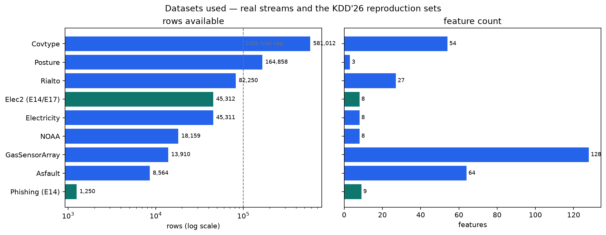
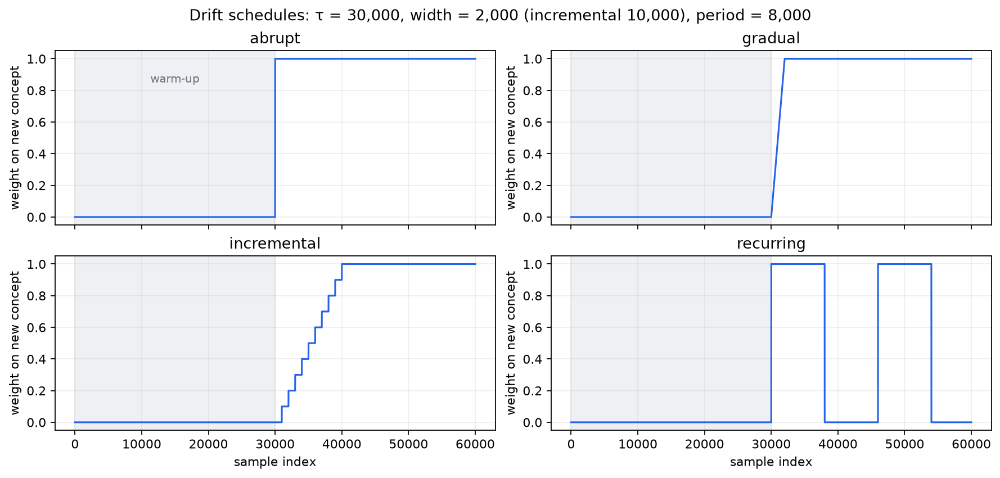
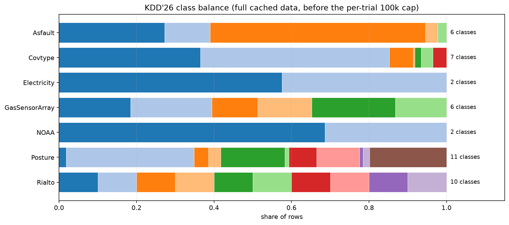

# Datasets — what the project actually runs on

**What this page is:** a reference for every dataset used in the project — the
synthetic generators, the River real streams, and the seven KDD'26 benchmark
sets. Shapes, class balances, feature spaces, drift injection, and the caveats
are all taken from the experiment configs and the cached artifacts under
`experiments/data/kdd/` and `experiments/results/`.

| | |
|---|---|
| **Synthetic configs** | `experiments/registry/e01_metric_v2.yaml`, `e02_no_drift.yaml`, `e03_ladder.yaml`, `e04_detectors.yaml` |
| **Real-stream configs** | `experiments/registry/e14_real_streams.yaml`, `e17_real_detector_map.yaml` |
| **Benchmark runner** | `experiments/kdd_bench.py`, `experiments/kdd_env/` |
| **Cached benchmark data** | `experiments/data/kdd/*.npz`, `*.csv`, `usp_ds.zip` |
| **Standalone Covtype copy** | `data/covtypeNorm.arff` (99 MB, untracked) |

> **Important:** every real-stream experiment here is **semi-synthetic**. The
> real rows are shuffled per seed to remove the original temporal order, and a
> drift is then **injected at a known position**. The project is measuring
> detector/model response to a known change, not natural drift in the wild.

---

## 1. At a glance

### 1.1 Real datasets

| Dataset | Rows | Features | Classes | Used in | Notes |
|---|---:|---:|---:|---|---|
| **Elec2** | 45,312 | 8 | 2 | E17, E14 | River `Elec2`; electricity-market price movement |
| **Phishing** | 1,250 | 9 | 2 | E14 | River `Phishing`; UCI website-phishing features |
| **Asfault** | 8,564 | 64 | 6 | KDD'26 | USP DS Repository; severe class imbalance |
| **Covtype** | 581,012 | 54 | 7 | KDD'26 | CapyMOA `CovtypeNorm`; capped at 100k per trial |
| **Electricity** | 45,311 | 8 | 2 | KDD'26 | CapyMOA `Electricity`; same schema as Elec2 |
| **GasSensorArray** | 13,910 | 128 | 6 | KDD'26 | USP DS Repository; high-dimensional |
| **NOAA** | 18,159 | 8 | 2 | KDD'26 | USP DS Repository; weather records |
| **Posture** | 164,858 | 3 | 11 | KDD'26 | USP DS Repository; capped at 100k per trial |
| **Rialto** | 82,250 | 27 | 10 | KDD'26 | USP DS Repository; balanced 10-class |

### 1.2 Synthetic streams

| Generator | Rows | Features | Classes | Used in | Concept change |
|---|---:|---:|---:|---|---|
| **SEA** | 60,000 | 3 | 2 | Exp-01, Exp-02, E01–E04 | Decision threshold on `x₀ + x₁` |
| **Hyperplane** | 60,000 | 10 | 2 | E02, E03, E04 | Random weight vector rotated |
| **RandomRBF** | 60,000 | 10 | 2 | E04 | Centroid set swapped |
| **Agrawal** | 60,000 | 9 | 2 | E04 | Classification function switched |



*Rows are the available rows before the KDD per-trial 100k cap. Covtype and
Posture are the two datasets that hit the cap.*

---

## 2. The shared synthetic protocol

All controlled streams use the same skeleton unless a config overrides it.

| Parameter | Value |
|---|---|
| Length | **60,000** samples |
| Warm-up | **12,000** samples (20%) |
| Drift position | **τ = 30,000** |
| Label noise | **10%** (including the no-drift control) |
| Evaluation | Prequential: predict → score → learn, every sample |
| Drift shapes | abrupt, gradual, incremental, recurring |
| Gradual width | **2,000** samples |
| Incremental width | **10,000** samples, 10 steps |
| Recurring period | **8,000** samples, 2 episodes |
| Detection windows `δ_max` | abrupt 1,000 · gradual 2,000 · incremental 4,000 · recurring 2,000 |
| Seeds | 5 (`0–4`) for the completed slices; E01 uses 11 (`42, 0–9`); E03's full plan is 11 (`0–10`) |

**How the change is generated.** The feature process is drawn once per stream.
Each sample is labelled by a mixture of concept A and concept B with a weight
`p(t)`:

- **Abrupt:** `p(t) = 0` before τ, `1` after.
- **Gradual:** `p(t)` ramps linearly from 0 to 1 over the width.
- **Incremental:** the same ramp, snapped into 10 discrete steps.
- **Recurring:** alternating blocks of concept A and B after τ.

This mixing design avoids the River generator RNG-replay confound found during
Exp-02: the feature vectors are not replayed under a new label rule, so the
frozen model cannot memorise its test chunk.



### 2.1 SEA

- **Features:** 3 continuous features, `x₀, x₁, x₂ ~ U(0, 10)`.
- **Label rule:** `y = 1[x₀ + x₁ > threshold]`.
- **Concepts:** thresholds `8.0, 9.0, 7.0, 9.5` for concept variants `0–3`.
- **Used by:** Exp-01/02 and E01/E03 with an abrupt change `8.0 → 9.0` at τ;
  E02 is the stationary control; E04 uses all four shapes.
- **Why:** the smallest possible drift testbed — two features actually matter,
  the decision boundary is exact, and the drift is visible in a rolling metric.

### 2.2 Hyperplane

- **Features:** 10 continuous features, `xᵢ ~ U(0, 1)`.
- **Label rule:** two random weight vectors `w_A, w_B`; the active weight vector
  is mixed with `p(t)`, and `y = 1[Σ wᵢxᵢ ≥ 0.5 · Σ wᵢ]`.
- **Used by:** E02 (stationary control), E03 (abrupt, position jittered), E04.
- **Why:** a high-dimensional linear boundary that changes direction rather than
  threshold — a different failure mode from SEA.

### 2.3 RandomRBF

- **Features:** 10 continuous features.
- **Concepts:** two independently drawn RBF worlds, each with 20 centroids and
  2 classes; a sample is a centroid plus a Gaussian offset.
- **Drift:** the active centroid set is switched with `p(t)`.
- **Used by:** E04.
- **Why:** locally clustered classes with overlapping Gaussians — harder for a
  tree to separate than SEA/Hyperplane.

### 2.4 Agrawal

- **Features:** 9 mixed numeric/categorical features (salary, commission, age,
  elevel, car, …) from River's `synth.Agrawal`.
- **Concept:** one of 10 classification functions; the function is switched with
  `p(t)`.
- **Used by:** E04.
- **Why:** a non-linear, rule-based generator with categorical structure.

### 2.5 Experiment-specific differences

| Experiment | Streams | Difference from the skeleton |
|---|---|---|
| Exp-01 / Exp-02 | SEA abrupt only | Seed 42 + 0–9; legacy metric |
| E01 | SEA abrupt only | 11 seeds; clean three-model panel |
| E02 | SEA + Hyperplane, **stationary** | No drift; every alarm is a false alarm |
| E03 | SEA + Hyperplane, abrupt | Drift onset jittered by **±7,000** samples per seed to vary the retrain phase |
| E04 | SEA, Hyperplane, RandomRBF, Agrawal × 4 shapes | 4 generators × 4 shapes × 2 hosts × raw/EWMA, 5 seeds |

---

## 3. The real streams in E14 and E17

Both experiments use River datasets, shuffle the rows per seed, then inject a
known drift. This is the semi-synthetic protocol of the KDD'26 benchmark.

### 3.1 Elec2 — electricity market

| | |
|---|---|
| Source | River `Elec2` (remote dataset) |
| Rows | **45,312** |
| Features | **8**: `date`, `day`, `period`, `nswprice`, `nswdemand`, `vicprice`, `vicdemand`, `transfer` |
| Target | Binary class: electricity price moves up/down |
| Class balance | **26,075 / 19,236** in the KDD export (45,311 rows; one row fewer than River's 45,312) |
| Used by | **E17** (detectors), **E14** (models) |

**E17 configuration.** 45,312 rows; warm-up 9,062; drift at **τ = 22,656**;
label swap `0 → 1`; five seeds `0–4`; four shapes:

| Shape | Width | Notes |
|---|---:|---|
| Abrupt | 0 | One-step label swap |
| Gradual | 2,000 | Swap probability ramps over 2,000 rows |
| Incremental | 10,000 | 10 discrete swap steps |
| Recurring | 8,000 period, 2 episodes | Concept A/B alternate after τ |

**E14 configuration.** 45,312 rows; warm-up 9,062; drift at **τ = 30,000**;
abrupt; five seeds; two mechanisms: `label_swap` (`0 → 1`) and
`feature_permutation` (all feature columns permuted).

**Caveat.** Shuffling removes the original time order, so `date` and `day` stay
in the feature vector as numbers but no longer carry temporal meaning. This is a
known property of the semi-synthetic protocol, not a modelling mistake.

### 3.2 Phishing — website classification

| | |
|---|---|
| Source | River `Phishing` (bundled file; UCI Website Phishing) |
| Rows | **1,250** |
| Features | **9**: `empty_server_form_handler`, `popup_window`, `https`, `request_from_other_domain`, `anchor_from_other_domain`, `is_popular`, `long_url`, `age_of_domain`, `ip_in_url` |
| Target | `is_phishing` (binary) |
| Class balance | **702 non-phishing / 548 phishing** |
| Used by | **E14** only |

**E14 configuration.** 1,250 rows; warm-up 250; drift at **τ = 625**; abrupt;
five seeds; `label_swap` and `feature_permutation`.

**Caveat.** Phishing is very small (1,250 rows) and contributes only one drift
episode per run. It is a second real dataset for external validity, not a
stand-alone benchmark; E14's aggregate is dominated by Elec2's 45k rows.

### 3.3 Injection mechanisms

| Mechanism | What happens after τ |
|---|---|
| `label_swap` | Every label equal to the source class is changed to the target class (with the shape's probability `p(t)`) |
| `feature_permutation` | All feature columns are permuted; labels are untouched |
| `class_prior` | A chosen class is dropped with probability 0.75 (KDD only) |
| `feature_filtering` | Rows above the pre-onset median of a chosen feature are dropped (KDD only) |

The first two are used in E14/E17; all four are used in the KDD'26
reproduction. Because the change is injected, the true drift position and the
end of the transition are known exactly.

---

## 4. The KDD'26 benchmark datasets

The KDD'26 reproduction uses seven real datasets. Five come from the USP DS
Repository archive; Covtype and Electricity are exported from CapyMOA. Every
trial shuffles the rows, caps the stream at **100,000 rows**, draws a drift onset
uniformly from **50–80%** of the stream, and injects one of four drift types.

### 4.1 Shapes and class balances

| Dataset | Rows | Features | Classes | Class counts (label-encoded) | `δ_max` |
|---|---:|---:|---:|---|---:|
| **Asfault** | 8,564 | 64 | 6 | `[2335, 1002, 4761, 273, 1, 192]` | 500 |
| **Covtype** | 581,012 | 54 | 7 | `[211840, 283301, 35754, 2747, 9493, 17367, 20510]` | 2,500 |
| **Electricity** | 45,311 | 8 | 2 | `[26075, 19236]` | 2,500 |
| **GasSensorArray** | 13,910 | 128 | 6 | `[2565, 2926, 1641, 1936, 3009, 1833]` | 1,500 |
| **NOAA** | 18,159 | 8 | 2 | `[12461, 5698]` | 1,500 |
| **Posture** | 164,858 | 3 | 11 | `[2973, 54480, 6168, 5210, 27244, 1706, 11779, 18359, 1381, 2848, 32710]` | 2,500 |
| **Rialto** | 82,250 | 27 | 10 | `[8225, 8225, 8225, 8225, 8225, 8225, 8225, 8225, 8225, 8225]` | 2,500 |



*Shares are computed on the full cached data, before the per-trial 100k cap.
The encoded labels are arbitrary; the colours are only to show balance.*

**Effective rows per trial.** Asfault, Electricity, GasSensorArray, NOAA and
Rialto are used in full. **Covtype** is truncated from 581,012 to **100,000**
and **Posture** from 164,858 to **100,000**. A 50-trial run therefore sees many
different 100k slices of those two datasets, not the full records.

### 4.2 What is in each dataset

| Dataset | Feature composition | Things to know |
|---|---|---|
| **Asfault** | 64 numeric features; original column names are not preserved by the CSV loader (`F1…F64`) | Class 4 has **1 example**; class 2 dominates (4,761 of 8,564). Any per-class metric is unstable. |
| **Covtype** | 54 features: 10 numeric terrain features, 4 binary wilderness-area flags, 40 binary soil-type flags | 7 forest-cover classes; the standard UCI Covertype schema, normalized. |
| **Electricity** | 8 features, same schema as Elec2 (`date, day, period, nswprice, nswdemand, vicprice, vicdemand, transfer`) | Binary; 45,311 rows in the CapyMOA export vs 45,312 in River. |
| **GasSensorArray** | 128 numeric sensor features | 6 gas classes; high-dimensional and correlated; 13,910 rows. |
| **NOAA** | 8 numeric weather features | Binary; 18,159 rows; the smallest feature set after Posture. |
| **Posture** | **3 features** | **11 classes**; 164,858 rows but only 3 features, so the problem is intrinsically hard and the cap to 100k matters. |
| **Rialto** | 27 numeric features | 10 perfectly balanced classes (8,225 each); 82,250 rows. |

The original column names for Asfault, GasSensorArray, NOAA, Posture and Rialto
are replaced with `F1…Fn` by `experiments/kdd_bench.py`; the cached `.npz` files
therefore store positional feature names, not semantic ones. The shape and class
counts above are read directly from those `.npz` files.

### 4.3 The four injected drift types

| Drift type | Mechanism | What changes |
|---|---|---|
| `class_prior` | After onset, each row of the selected class is dropped with probability **0.75** | The class distribution shifts; the stream gets shorter |
| `label_swap` | Every row of the selected class is relabelled to another class | `P(y|X)` changes; `P(X)` is unchanged |
| `feature_permutation` | All feature columns are permuted | The feature→label relationship is destroyed |
| `feature_filtering` | Rows whose chosen feature exceeds its **pre-onset median** are dropped | The conditional feature distribution changes; the stream gets shorter |

**Transitions.** An abrupt drift applies the mechanism at the onset. A gradual
drift applies it with probability `p(t)` that ramps from 0 to 1 over
`width = δ_max`. The onset is drawn uniformly from the middle 50–80% of the
stream, so the drift never falls in the first half or the last fifth.

### 4.4 Protocol summary

| Parameter | Value |
|---|---|
| Datasets | 7 (Asfault, Covtype, Electricity, GasSensorArray, NOAA, Posture, Rialto) |
| Drift types | 4 (`class_prior`, `label_swap`, `feature_permutation`, `feature_filtering`) |
| Transitions | 2 (abrupt, gradual) |
| Trials | **50 per dataset × drift type × transition** |
| Row cap | **100,000** per trial |
| Shuffle | Every trial independently |
| Headline detectors | ADWIN, DDM, HDDM-A, HDDM-W, **SEED**, **STEPD** |
| Configured detectors | 13, including ABCD and ABCD(X) |
| Stop rule | `δ_max` after the drift end |
| Result rows | 16,800 (2,800 tasks × 6 detectors) |

The 50-trial run completed 2,800 tasks with **0 failures** in 13m33s on 14
workers. The ABCD/ABCD(X) arm is **cited from the paper, not reproduced**; it is
the expensive part of the matrix and overheats the laptop CPU. The full ranking
is in [E17 §7](Reports/E17-real-detector-map.md) and the global
[Results](Reports/Results.md) page.

---

## 5. What the data does **not** contain

These are deliberate limitations, not oversights.

| Limitation | Consequence |
|---|---|
| **No natural temporal drift** in E14/E17 | Real rows are shuffled and drift is injected; the results measure detector/model response to a known change, not natural drift in Elec2/Phishing |
| **No natural-drift benchmark yet** | E14 has two real datasets (Elec2, Phishing); Covertype, Airlines and CreditCard are not in the model comparison |
| **No label delay** | Labels arrive immediately in every dataset above; the Delay Tax experiments (E15) have not run |
| **No missing/partial/selective labels** | The Delay Tax regimes are future work |
| **No train/test split** | Evaluation is prequential with a warm-up; there is no held-out test set |
| **No per-class stratification** in E14/E17 | Rows are shuffled per seed, so class balance varies slightly by seed |
| **KDD uses at most 100k rows** | Covtype loses ~83% of its rows per trial; Posture loses ~39% |
| **KDD labels are encoded** | Class indices are arbitrary; do not attach semantic meaning without the source table |
| **Synthetic streams are controlled** | SEA has 3 features and 2 classes; a win there is existence evidence, not a field-wide claim |

---

## 6. Where the data lives and how to rebuild it

### 6.1 Paths

| Path | Contents |
|---|---|
| `experiments/data/kdd/*.npz` | Cached numeric arrays + feature names used by the KDD runner |
| `experiments/data/kdd/*.csv` | Original CSVs for the five USP datasets and Electricity |
| `experiments/data/kdd/usp_ds.zip` | 600 MB USP DS Repository archive (do not commit) |
| `data/covtypeNorm.arff` | 99 MB normalized Covtype ARFF (do not commit) |
| `experiments/results/e17/` | Elec2 detector-map artifact |
| `experiments/results/e14/` | Elec2 + Phishing model-comparison artifact |
| `experiments/results/kdd_bench_full/` | 50-trial benchmark artifact |

The `.npz` caches are the canonical numeric form. The standalone
`data/covtypeNorm.arff` is a reference copy, not the KDD runner's input — the
runner exports Covtype from CapyMOA into `experiments/data/kdd/Covtype.npz`.
Both the `.npz` caches and the ARFF are **untracked** and should stay that way:
the repository should not carry the 600 MB zip or the 99 MB ARFF.

### 6.2 Commands

```bash
# synthetic experiments
uv run python -m experiments.run --exp e01
uv run python -m experiments.run --exp e02
uv run python -m experiments.run --exp e03 --resume
uv run python -m experiments.run --exp e04

# real River streams
uv run python -m experiments.run --exp e14 --seeds 0-4 --device cuda
uv run python -m experiments.run --exp e17 --seeds 0-4

# KDD'26 benchmark
uv sync --project experiments/kdd_env
./experiments/kdd.sh prepare --download-usp
./experiments/kdd.sh check
./experiments/kdd.sh run --datasets all --trials 50 --workers 14 \
    --signal correct --gradual-anchor code \
    --detectors ADWIN,DDM,HDDMAverage,HDDMWeighted,SEED,STEPD \
    --out experiments/results/kdd_bench_full

# figures in this page
uv run python experiments/scripts/make_dataset_figures.py
```

### 6.3 Sources

- **River** — `Elec2` and `Phishing` datasets (`river.datasets`).
- **CapyMOA** — `CovtypeNorm` and `Electricity` exports used by the KDD runner.
- **USP DS Repository** — the Google Drive archive referenced in
  `experiments/kdd_bench.py`; supplies Asfault, GasSensorArray, NOAA, Posture
  and Rialto.
- **UCI / original dataset pages** — the provenance behind River's Phishing and
  the Covertype schema; use the source pages for semantic feature names and
  class meanings.

---

*Shapes, row counts and class balances on this page come from the cached
`experiments/data/kdd/*.npz` arrays and the River dataset metadata; the drift
settings come from `experiments/registry/*.yaml` and `experiments/kdd_bench.py`.
Re-run `make_dataset_figures.py` after refreshing a cache.*
