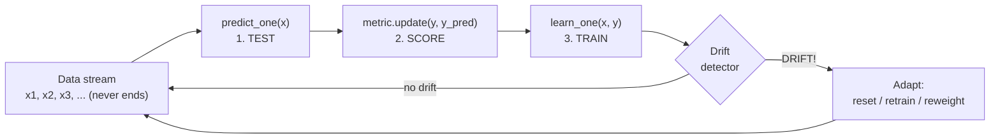

# Major Project — Streaming machine learning : Drift detection and adaptation

Research-based project on **machine learning from data streams**, using
[River](https://riverml.xyz/) as the experimental framework.

Status: **Phase 0 (research) complete, Phase 1 (experimentation) in progress — the
first pilot (Exp-01) has been run.**

---

## The one-paragraph version

Almost all machine learning you've been taught assumes the dataset is a *finished
object*: it sits on disk, you load it, you split it, you fit a model, you're done.
**Streaming machine learning drops that assumption.** Data arrives one sample at a
time, potentially forever, and is too large (or too fast) to store. The model must
learn incrementally, in a single pass, using bounded memory. And because the world
generating the data keeps changing, the model must also *notice when it becomes
wrong* and adapt. That last part — **concept drift**, and specifically the cost of
*delayed labels* (the "Delay Tax") — is the real research problem, and it's what
makes this a project rather than a tutorial.

---

## The picture



Each sample is used **for testing before it is used for training**, then thrown away.
The model is never "finished" — it is permanently mid-training.

---

## How this site is organised

| Phase | What it holds |
|---|---|
| **Phase 0 — Research** | Background notes, literature review, and exploratory bridges. The reading and scoping that defines the project. |
| **Phase 1 — Experimentation** | Evidence dossiers and experimental protocols. Claims backed by numbers. |

### Phase 0 — Research

**Notes** — read in order; each builds on the previous:

| # | Note | What it covers |
|---|------|----------------|
| 01 | [Streaming learning](Phase0:Research/notes/01-streaming-learning.md) | Batch vs online, the constraints, why it exists |
| 02 | [Concept drift](Phase0:Research/notes/02-concept-drift.md) | The core research problem — types, detection, adaptation |
| 03 | [The River library](Phase0:Research/notes/03-river-library.md) | What the tool is, its API, its modules |
| 04 | [Evaluation](Phase0:Research/notes/04-evaluation.md) | Prequential evaluation and how to measure a detector |
| 05 | [Project directions](Phase0:Research/notes/05-project-directions.md) | Candidate research questions, scored |
| 06 | [Literature & landscape](Phase0:Research/notes/06-literature-landscape.md) | Key papers, competing tools |
| 07 | [Open questions](Phase0:Research/notes/07-open-questions.md) | Things to decide before planning |
| 08 | [Scope](Phase0:Research/notes/08-scope.md) | What is in and out of the project |

**Literature review:**

- [Index](Phase0:Research/literature_review/index.md) — every paper read, with verification status
- [Gap analysis](Phase0:Research/literature_review/gap-analysis.md) — where the project's contribution sits
- [Conclusion](Phase0:Research/literature_review/Conclusion.md)
- Paper notes: [ROSE](Phase0:Research/literature_review/papers/cano-krawczyk-2022-rose.md) ·
  [STUDD](Phase0:Research/literature_review/papers/cerqueira-2023-studd.md) ·
  [Label delays (Botacin & Gomes)](Phase0:Research/literature_review/papers/botacin-gomes-2024-label-delays.md) ·
  [DPL survey (Gomes 2022)](Phase0:Research/literature_review/papers/gomes-2022-dpl-survey.md) ·
  [KDD 2026 drift benchmark](Phase0:Research/literature_review/papers/kdd2026-drift-benchmark.md) ·
  [Gamma–Weibull (AGU 2026)](Phase0:Research/literature_review/papers/agu-2026-gamma-weibull.md)

**Research digests:**

- [Landscape](Phase0:Research/research/01-landscape.md)
- [Delayed labels](Phase0:Research/research/02-delayed-labels.md)

**Exploratory bridges** (adjacent areas considered): see
[explore/README](Phase0:Research/explore/README.md).

**Idea:** [Synopsis](Phase0:Research/idea/synopsis.md) · [Scope](Phase0:Research/idea/scope.md)

### Phase 1 — Experimentation

- [Roadmap v2 — DF-H](Reports/Roadmap-v2.md)
  — the new ultimate goal: a label-free deep monitor plus supervised
  confirmation, targeting the KDD'26 detector benchmark and the delayed-label
  setting.
- [E01 — Metric v2 correction](Reports/E01-metric-v2.md)
  — the **current** headline: frozen recovered **0/11**, DeepRiver's corrected
  `damage_ref` is **74.8 vs 515.0** samples·κ (**≈6.9×**), and the legacy **294×**
  is retired as an upper bound.
- [E04 — Detector map](Reports/E04-detector-map.md)
  — the synthetic map: eight detectors across four drift shapes and four
  generators; **HDDM-A on the raw signal is the best default on the static host**,
  recurring drift is the hard case, and smoothing raises false alarms.
- [E17 — Real-stream detector map](Reports/E17-real-detector-map.md)
  — the same eight detectors on real Elec2 records; HDDM-A keeps its four-shape
  win on the static host, but **ADWIN wins abrupt and recurring on the adaptive
  host**, so the default is host-conditional.
- [Exp-01: DeepRiver rolling vs frozen batch on SEA](Phase1:Experimentation/exp01-deepriver-vs-frozen-sea.md)
  — the first atomic experiment (legacy metric; superseded by E01).
- [Exp-02: the 11-seed sweep](Phase1:Experimentation/exp02-seed-sweep-sea.md)
  — the sweep that made the claim statistical (legacy metric; corrected by E01).
- [Thesis: how streaming beats batch, and on what](Phase1:Experimentation/thesis.md)
  — the mechanism and the metric family where the win is structural.
- [Streaming vs Batch: real metrics where online learning wins (and where it doesn't)](Phase1:Experimentation/streaming-vs-batch-metrics.md)
  — evidence dossier + the Ch1 experimental protocol.

---

## Running the docs locally

```bash
uv run mkdocs serve
```

The site is deployed to GitHub Pages on every push to `main` via
`.github/workflows/ci.yml`.
