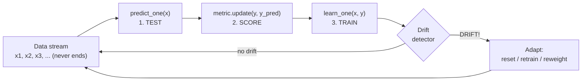

# Major Project — Streaming (Online) Machine Learning

Research-based project on **machine learning from data streams**, using
[River](https://riverml.xyz/) as the experimental framework.

Status: **idea / scoping phase.** Nothing implemented yet.

---

## The one-paragraph version

Almost all machine learning you've been taught assumes the dataset is a *finished
object*: it sits on disk, you load it, you split it, you fit a model, you're done.
**Streaming machine learning drops that assumption.** Data arrives one sample at a
time, potentially forever, and is too large (or too fast) to store. The model must
learn incrementally, in a single pass, using bounded memory. And because the world
generating the data keeps changing, the model must also *notice when it becomes
wrong* and adapt. That last part — **concept drift** — is the real research problem,
and it's what makes this a project rather than a tutorial.

---

## The picture

Each sample is used **for testing before it is used for training**, then thrown away.
The model is never "finished" — it is permanently mid-training.

---

## Notes

Read them in order; each builds on the previous.

| # | File | What it covers |
|---|------|----------------|
| 01 | [Streaming learning](Phase0:Research/notes/01-streaming-learning.md) | Batch vs online, the constraints, why it exists |
| 02 | [Concept drift](Phase0:Research/notes/02-concept-drift.md) | The core research problem — types, detection, adaptation |
| 03 | [The River library](Phase0:Research/notes/03-river-library.md) | What the tool is, its API, its modules |
| 04 | [Evaluation](Phase0:Research/notes/04-evaluation.md) | Prequential evaluation and how to measure a detector |
| 05 | [Project directions](Phase0:Research/notes/05-project-directions.md) | Candidate research questions, scored |
| 06 | [Literature & landscape](Phase0:Research/notes/06-literature-landscape.md) | Key papers, competing tools |
| 07 | [Open questions](Phase0:Research/notes/07-open-questions.md) | Things to decide before planning |

---

## What still needs deciding

See [notes/07-open-questions.md](Phase0:Research/notes/07-open-questions.md). Short version:
which research question, which datasets, and how much scope. Planning and
implementation come **after** that.
